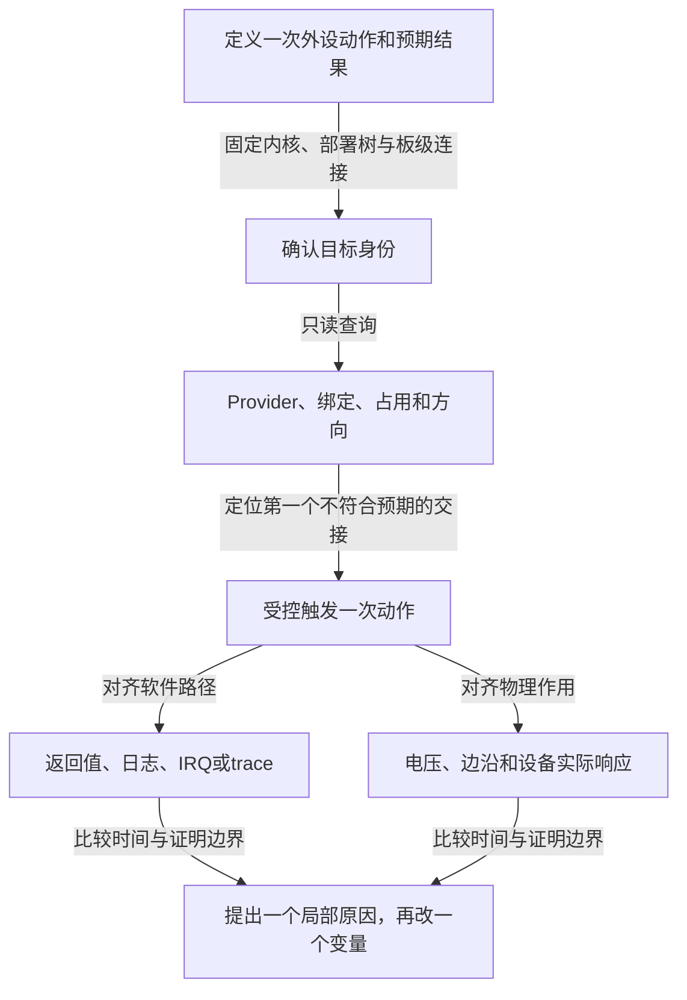

# 第1章\_GPIO\_调试\_迁移与工程模板

“alert没有中断”至少可能表示三件不同的事：焊盘没有变化、变化没有进入Linux处理者，或者处理者运行了但业务没有收到数据。如果一开始就换GPIO API，很容易把现场改掉而仍不知道故障在哪一层。这里把 [GPIO主线](../../../knowledge/driver_model/gpio/大纲.md) 已建立的状态模型变成可执行的排查顺序：先固定目标与预期，再只读取证，最后围绕一次受控动作增加观察。

本文是工程操作页，默认读者已理解线路占用、逻辑值、Provider与IRQ桥接。命令针对目标Linux，不在整理笔记的Windows主机执行。公共实现依据NXP Linux 6.12.20固定提交，工具例子固定libgpiod 2.3.1；其他版本先核对本机帮助与实现。本轮没有目标板运行，以下是取证方法与预期判断，不是已经测得的结果。

## 1.1\_先把不工作改成可以证伪的描述

以my-device的alert为例，先写清：外设在什么动作后拉低哪根线，线接到哪个控制器的哪个局部offset，谁持有它，软件应该在哪个接口报告什么。在这条描述旁记下内核构建、配置、实际部署的DTB/overlay以及驱动版本。uname的release字符串不能唯一代表源码提交；若无法取得构建身份，就保留未知，不用目录名或旧测试记录替它补齐。



Provider注册是软件能力，pad复用是连线选择，线路占用是使用权，IRQ计数是某条处理路径的活动；这些证据没有互相包含关系。排查时寻找第一个失去保证的交接，不把最后的业务失败直接归咎于GIC或GPIO硬件。

| 当前层 | 先问的问题 | 可读证据 | 不能单独证明的结论 |
| --- | --- | --- | --- |
| 部署与连接 | 内核实际使用哪份节点和属性 | 构建记录、启动配置、运行树 | DTS源码已改就代表板上已更新 |
| Provider | 预期控制器是否枚举、绑定并登记 | 总线设备driver链接、gpiodetect、日志 | debugfs文件不存在就代表没有控制器 |
| 所有权 | 哪个设备或请求文件持有线 | gpioinfo、GPIO调试视图、进程fd | consumer字符串是不可伪造的进程身份 |
| 方向与极性 | 当前配置怎样解释逻辑0/1 | line info、驱动调用结果 | 软件配置等于焊盘实测 |
| pinctrl与电气 | GPIO路径是否接到预期pad | pinctrl对象、平台寄存器、原理图与仪器 | 通用GPIO API能够替代板级pinmux |
| 事件 | 来源如何检测并进入哪条IRQ | 设备状态、IRQ身份、计数、trace | 一次计数等于完成设备数据处理 |
| 生命周期 | 失败和退出是否归还占用 | 请求结果、解绑路径、最后file引用 | 归还占用等于恢复旧电平 |

## 1.2\_先保存不会抢占线路的快照

`gpiodetect` 和 `gpioinfo` 查询控制器与线路信息，不需要另行请求线路；`gpioget` 和 `gpiomon` 则会建立请求，可能改变方向或与既有Consumer冲突。第一轮取证使用前两者，不为了“看一下值”先把正在工作的驱动卸掉。

```sh
# 目标Linux：进入可写的诊断目录，以下变量保留在同一shell。
set -eu
capture_dir=$(mktemp -d ./gpio_evidence.XXXXXX)
uname -a > "$capture_dir/uname.txt"
gpiodetect --version > "$capture_dir/libgpiod_version.txt"
gpiodetect > "$capture_dir/chips.txt"
cat "$capture_dir/chips.txt"
printf '证据目录：%s\n' "$capture_dir"
```

如果工具未安装或字符设备不可访问，保存具体错误并检查工具、权限和CONFIG_GPIO_CDEV；不能把工具失败写成“没有GPIO”。从输出和设备绑定关系确定目标gpiochip，N是动态编号，不等于DTS标签或硬件bank编号。随后输入已确认的chip名称，例如现场实际显示的gpiochip3；这里不预填某块板的编号。

```sh
# 同一目标Linux shell，以下-c用法对应libgpiod 2.3.1。
printf '%s\n' '输入刚核对的gpiochip名称：'
read -r gpio_chip
gpioinfo -c "$gpio_chip" > "$capture_dir/lines.before.txt"
cat "$capture_dir/lines.before.txt"
if test -r /sys/kernel/debug/gpio; then
    cat /sys/kernel/debug/gpio > "$capture_dir/gpio_debug.before.txt"
else
    printf '%s\n' 'GPIO debugfs视图不可读；检查挂载、配置或权限。' \
        > "$capture_dir/gpio_debug.unavailable.txt"
fi
cat /proc/interrupts > "$capture_dir/interrupts.before.txt"
```

gpioinfo给出offset、线名、方向、占用标签及部分配置，不提供每次输入变化的完整历史，也不是所有电气状态的硬件回读。线名可缺失或重复，应结合chip身份与offset确认。工具职责和-c语法见 [libgpiod 2.3.1工具说明](https://libgpiod.readthedocs.io/en/v2.3.1/gpio_tools.html)。若使用其他major版本，先调整查询语法，不混用两版命令。

debugfs是否可读取决于挂载、CONFIG_DEBUG_FS和权限等。不要在只读采集块里悄悄挂载或改配置；先判断这项证据是否必要，再按测试环境管理方式启用。即使视图存在，它也只是一时的快照，多文件读取不是原子地冻结整台机器。

## 1.3\_对照真正运行的树而不只对照DTS文件

驱动按运行设备树查连接。磁盘DTB可能尚未部署，也可能启动加载了另一个分区；启动后还可能应用overlay。因此需要分开保存启动FDT和当前live tree。`/sys/firmware/fdt` 若存在，是内核暴露的启动扁平树，不保证反映此后对live tree的所有动态修改。`/sys/firmware/devicetree/base` 则用于观察当前树；`/proc/device-tree` 常是它的入口链接。

```sh
# 同一目标Linux shell；需要dtc，capture_dir沿用1.2节。
if test -r /sys/firmware/fdt; then
    dtc -I dtb -O dts -o "$capture_dir/boot_fdt.dts" /sys/firmware/fdt
fi
if test -d /sys/firmware/devicetree/base; then
    dtc -I fs -O dts -o "$capture_dir/live_tree.dts" /sys/firmware/devicetree/base
else
    printf '%s\n' '当前系统未提供此设备树入口；核对固件描述方式。' \
        > "$capture_dir/live_tree.unavailable.txt"
fi
```

输出DTS中的标签与原编译输入不必相同，不能只grep原来的 `gpio1:` 标签。应定位消费者完整节点路径，核对 `<con_id>-gpios` 名字、phandle所指控制器、该控制器的 `#gpio-cells`、局部offset与flags。offset数值落在ngpio范围内也不代表它一定有效，还要看Provider的valid mask及平台限制。pinctrl default/sleep则属于另一条状态选择关系，不能把GPIO描述符解析成功等同于pad已经配置。

固件不是OF时，转向对应ACPI或software-node/lookup描述，不制造一个不存在的DT属性。关于部署树与pin状态的进一步步骤，见 [引脚问题的描述检查](../../../knowledge/driver_model/device_tree/P04_沿状态与寄存器定位引脚问题.md#4.2_描述检查必须针对真正加载的树) 和 [pinctrl对象观察](../../../knowledge/driver_model/device_tree/P04_沿状态与寄存器定位引脚问题.md#4.3_按真实debugfs对象读取软件状态)。

错误码是定位入口，不是单一根因：ENOENT可能来自所选查找路径缺少连接，EPROBE_DEFER提示依赖尚不能使用，EBUSY应查占用或重复请求；具体失败点仍需沿调用路径确认。把必需线路改为optional只会改变缺失时的行为，不能修好错误连接或尚未就绪的Provider。

## 1.4\_围绕同一次动作对齐软件与物理证据

先规定一次可重复的输入激励或设备操作，保存before，触发后保存after，再比较目标IRQ行、驱动日志和外设结果。IRQ号应由该设备实际映射确认，不能把GPIO offset填进 `/proc/interrupts` 的行号位置；父IRQ和子IRQ也可能有不同计数含义。

```sh
# 目标Linux：完成已约定的一次设备动作后，在原采集shell执行。
gpioinfo -c "$gpio_chip" > "$capture_dir/lines.after.txt"
cat /proc/interrupts > "$capture_dir/interrupts.after.txt"
diff -u "$capture_dir/interrupts.before.txt" "$capture_dir/interrupts.after.txt" || {
    diff_status=$?
    test "$diff_status" -eq 1
}
```

diff返回1表示内容不同，所以上面允许这个结果；其他非零状态仍使set-e shell停止。全机其他IRQ也会自然变化，不能把整份diff中任意增长当成目标事件。目标计数增长只能说明相应计数点执行，设备数据是否读走、线程是否完成、用户队列是否被消费需要各自证据。

需要更细时间线时，复用 [独立IRQ trace实例的完整脚本](../../../knowledge/driver_model/device_tree/P10_组合外设怎样换板并逐层定位故障.md#10.4_在独立trace实例里观察一次IRQ处理)。它单独创建实例，只启用选定Linux IRQ的entry/exit，退出后撤销本次设置。entry/exit针对action主处理者，不能把区间自动命名成“整个线程化扩展器延迟”。

GPIO trace同样要读事件的采样位置。固定版本 `gpio_direction` 携带gpio、in与err，`gpio_value` 携带gpio、get与value；这些记录由软件访问路径产生，不是焊盘每次翻转自动产生。普通raw读路径在Provider读取后记录值，raw写路径在调用Provider setter前记录意图，因此一条set trace不证明写已经到达硬件，更不证明电压正确。字段和调用位置见固定版本 [GPIO事件定义](https://github.com/nxp-imx/linux-imx/blob/dfaf2136deb2af2e60b994421281ba42f1c087e0/include/trace/events/gpio.h) 与 [gpiolib实现](https://github.com/nxp-imx/linux-imx/blob/dfaf2136deb2af2e60b994421281ba42f1c087e0/drivers/gpio/gpiolib.c)。

物理测量必须注明焊盘/连接器位置、电源状态、负载与时间基准。active-low的逻辑1可能对应物理低，开漏释放还依赖上拉；仪器测得的电平与软件日志先按这些语义对应，再判断是否矛盾。读取寄存器也须核对具体SoC地址、访问宽度、副作用和电源，不能提供一个通用devmem地址让所有板照写。

## 1.5\_只打开需要的动态日志并恢复原状态

dynamic debug只控制源码中已有的动态打印点，不会自动记录全部S0～S7。广泛打开 `drivers/gpio/gpiolib*.c` 会增加噪声，还可能改变时序。先找精确文件和函数，再保存其flags；结束时只撤销自己新增的p标志，不能用全局-p关掉别人已经打开的点。

下面完整脚本选择固定实现的 `gpiod_request()` 失败日志。它只说明这条请求路径的失败状态，没有输出可能因为请求成功或根本没经过该点；不是请求一定正确的证明。在测试Linux保存为 `capture_gpio_request_debug.sh`，用具有控制文件权限的shell执行；同内容 [材料文件](../../../labs/kernel/gpio/materials/capture_gpio_request_debug.sh) 便于取用。

```sh
#!/bin/sh
# 目标Linux：暂时启用一个请求失败日志点，不改已有打印设置。
set -eu
control=/proc/dynamic_debug/control
if ! test -r "$control"; then
    control=/sys/kernel/debug/dynamic_debug/control
fi
test -r "$control"
test -w "$control"
capture_dir=$(mktemp -d ./gpio_request_debug.XXXXXX)
awk '$1 ~ /^drivers\/gpio\/gpiolib[.]c:/ && $2 ~ /]gpiod_request$/ {print}' \
    "$control" > "$capture_dir/site.before.txt"
test "$(wc -l < "$capture_dir/site.before.txt")" -eq 1
cat "$capture_dir/site.before.txt"
changed=0
cleanup() {
    if test "$changed" -eq 1; then
        printf '%s\n' 'file drivers/gpio/gpiolib.c func gpiod_request -p' \
            > "$control" || printf '%s\n' '恢复失败，请按保存的日志点状态恢复。' >&2
    fi
}
trap cleanup 0
trap 'exit 130' INT
trap 'exit 143' TERM
flags=$(awk '{print $3}' "$capture_dir/site.before.txt")
case "$flags" in
    *p*) : ;; # 原来已开，保持原样，不登记为本次修改。
    *)
        changed=1
        printf '%s\n' 'file drivers/gpio/gpiolib.c func gpiod_request +p' > "$control"
        ;;
esac
printf '%s\n' '执行一次已准备好的请求故障复现，保存对应内核日志后按回车。'
read -r reply
```

用 `sh capture_gpio_request_debug.sh` 运行。脚本要求恰好找到一个匹配点；没有匹配时停止，先核对目标版本与动态日志编译配置，不扩大成全内核通配。同一窗口内不要让另一调试会话并发改这个点的p标志，否则无法区分哪次会话的改动；保存的before用于异常退出后的恢复。SIGKILL和机器断电不执行trap，恢复须按记录人工完成。

观察日志可用测试机既有的内核日志采集方式，按复现时间和设备名定位；不要为了看debug自动提高全局控制台打印等级。控制文件格式、第三列flags及查询语法来自固定版本 [Dynamic debug](https://github.com/nxp-imx/linux-imx/blob/dfaf2136deb2af2e60b994421281ba42f1c087e0/Documentation/admin-guide/dynamic-debug-howto.rst) 的Viewing/Controlling与Command Language章节。该脚本本轮仅静态核对，未在目标控制文件执行。

## 1.6\_从事件现象缩小到一条责任链

有了请求、配置与一次动作的证据，再用现象缩小范围。下表的顺序是调查线索，不把每个现象绑定到唯一故障。

| 现象 | 先追踪哪些交接 | 下一项可区分的证据 |
| --- | --- | --- |
| 目标IRQ完全不增长 | 物理输入→方向/触发→父子路由→使能 | 对齐输入波形、正确IRQ身份与Provider配置 |
| 只来一次 | 外设原因解除、mask/ack、线程完成 | 首次处理后外设状态和是否仍保持有效电平 |
| 持续风暴 | 电平条件未解除、极性错误、浮空或真实连续来源 | 波形是否持续有效，设备状态是否被正确清除 |
| 慢速正常、快速缺记录 | 硬件锁存/采样、IRQ合并、线程读取、用户FIFO | 逐级比较激励、处理次数、事件序号和读取延迟 |
| 扩展器线程卡住 | 父IRQ线程、I²C错误、锁依赖和子处理 | 线程栈、总线结果；不要假定都有pending寄存器 |
| IRQ工作但不能唤醒 | 唤醒源电源、PAD、父IRQ和PM配置 | 真实休眠深度下的保留状态和唤醒来源记录 |

快速MMIO级联与可睡眠扩展器的分派不能混为一谈。线程里读I²C合理，不代表主硬中断里也能读；IRQF_ONESHOT管理处理期间的屏蔽关系，不替驱动清除设备来源。实现对照复用 [GPIO事件主线](../../../knowledge/driver_model/gpio/P07_GPIO_中断桥接与事件传播.md#7.4_慢总线为什么改变来源检测和子分派)。

电源管理测试也按产品需求选择。未声明唤醒能力的设备不应因为“不能唤醒”直接判驱动失败；需要唤醒的设备则要明确目标睡眠状态、保留供电/时钟、pinctrl状态和IRQ wake路径。不要在未安排恢复手段的远程设备上把一次通用suspend命令当成无风险探针。记录恢复后是否重新配置、是否有残留输入状态或重复上报，不能只记“系统醒了”。

## 1.7\_迁移验收要覆盖正常失败与退出

从整数GPIO改成描述符时，先把每一根功能线的旧编号、极性转换、初值、使用上下文和退出动作列出来，再逐项映射到新连接和API。旧代码可能已经手工反相，新描述符又带active-low；若只机械改函数名，编译通过却把正确电平反转。延迟探测、busy和配置失败也不能统一降为optional缺失。

| 迁移对象 | 正常路径要保持 | 必须增加的反例 |
| --- | --- | --- |
| 整数→描述符连接 | device/con_id/index准确，逻辑值只转换一次 | 换极性、缺必需连接、Provider晚到、重复占用 |
| 初值与启动顺序 | 请求时初值和设备协议成立 | 中途probe失败、停机动作先于描述符释放 |
| 快速→慢总线Provider | 可睡眠调用安排在允许上下文 | IRQ线程、错误返回、锁与延迟约束 |
| sysfs→字符设备 | 明确谁持有request及多线配置 | dup/fork存活、最后引用结束、命令异常退出 |
| 用户事件读取 | 逻辑边沿、时钟、offset和槽位不混淆 | 读取延迟、队列覆盖、多读者以及检测前端缺失 |

用户工具还要固定libgpiod版本和持有模式：同一request表达多线，不保证物理同时变化；命令退出后也不承诺保留最后输出。Consumer label帮助定位，但多个进程可填相同字符串，必要时结合实际fd和设备绑定调查，不把标签当作唯一所有者ID。

无板时先用现有完整实验分离软件问题：

| 当前要证明的机制 | 已落地的实验入口 | 到哪里停止外推 |
| --- | --- | --- |
| Consumer正常启动、失败与托管停机 | [三线Consumer模块](../../../knowledge/driver_model/gpio/P05_GPIO_Consumer_请求与使用.md#5.6_用模拟Provider观察完整请求周期) | 不证明真实复位/供电时序 |
| Provider共享状态与操作顺序 | [宿主模型与模拟Provider](../../../knowledge/driver_model/gpio/P06_GPIO_Provider_控制器实现.md#6.4_输出初值必须和输出使能一起推理) | 串行模型不证明真实硬件原子性 |
| IRQ申请、线程采样与退出 | [模拟事件模块](../../../knowledge/driver_model/gpio/P07_GPIO_中断桥接与事件传播.md#7.6_一个Consumer怎样完整持有输入和IRQ) | 不证明真实输入锁存与最大频率 |
| request引用、用户事件与归还 | [完整UAPI程序](../../../knowledge/driver_model/gpio/P08_用户空间_ABI_迁移与方案选择.md#8.5_在模拟器中准备一组受控的线路) | 不证明pad复用、电气与睡眠唤醒 |

内核 `tools/testing/selftests/gpio/` 也可作为对应版本的自测入口；应按其构建依赖运行并保存结果，不把目录存在写成测试已通过。gpio-sim同样不能替代真实控制器寄存器时序和板级连线验证。

## 1.8\_让交付记录能够重放同一结论

交付证据不必堆满所有日志，而要能说明目标、操作、结果和边界。下面的模板放进本次工程记录，按实际情况填写每项；某项无须测试时写明产品需求上的原因，未执行与通过不能用同一个符号。

```text
目标：板/SoC/控制器身份，消费者节点或进程，chip局部offset，信号名称
版本：内核源码提交、构建配置、驱动/工具版本、实际部署DTB与overlay
预期：一次输入或输出动作；逻辑值、物理电平和设备结果分别是什么
前态：绑定、占用、方向、极性、关键电源状态及取证时间
操作：可重放步骤，改变了哪个变量，哪些使用者先退出
后态：返回值、对应IRQ/事件/日志、物理波形与设备结果
退出：停止新活动、排空异步路径、最后请求释放、调试配置恢复
反例：busy、缺连接、延迟探测、中途失败或缓冲压力中本次实际执行项
PM：目标睡眠状态及产品要求；已测结果或未测/不适用原因
限制：哪些结论只有静态源码支持，哪些已有模拟或板上观测
附件：before/after、日志时间范围、波形与命令原文
```

例如“目标IRQ增长2次”只能填在IRQ结果栏，不能顺手填成“外设数据无丢失”；“再次请求成功”能支持占用已归还，不能支持释放后电平符合安全要求。按这样的证据粒度交付，下一位维护者才知道应该复现哪个动作、继续补哪一层，而不必重新猜测一份“GPIO正常”的结论到底测了什么。
