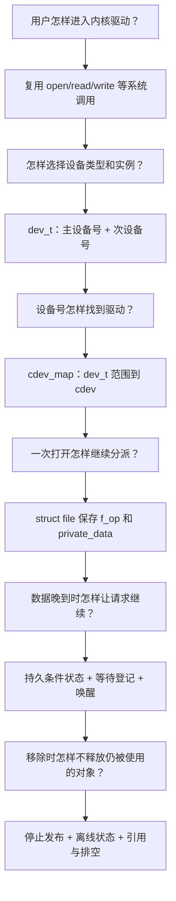
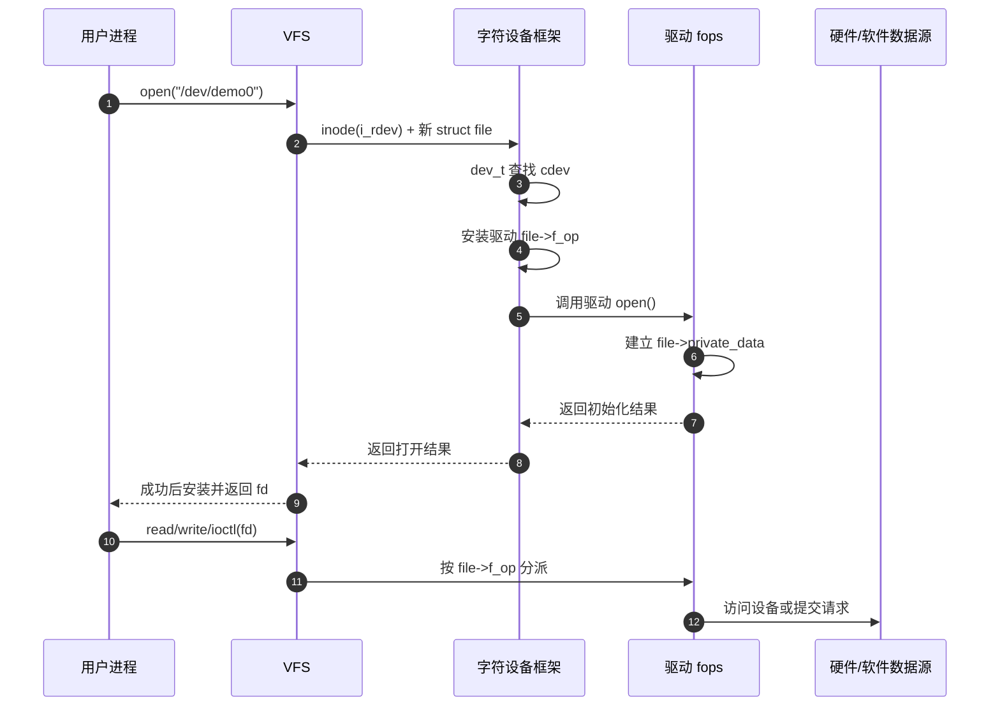
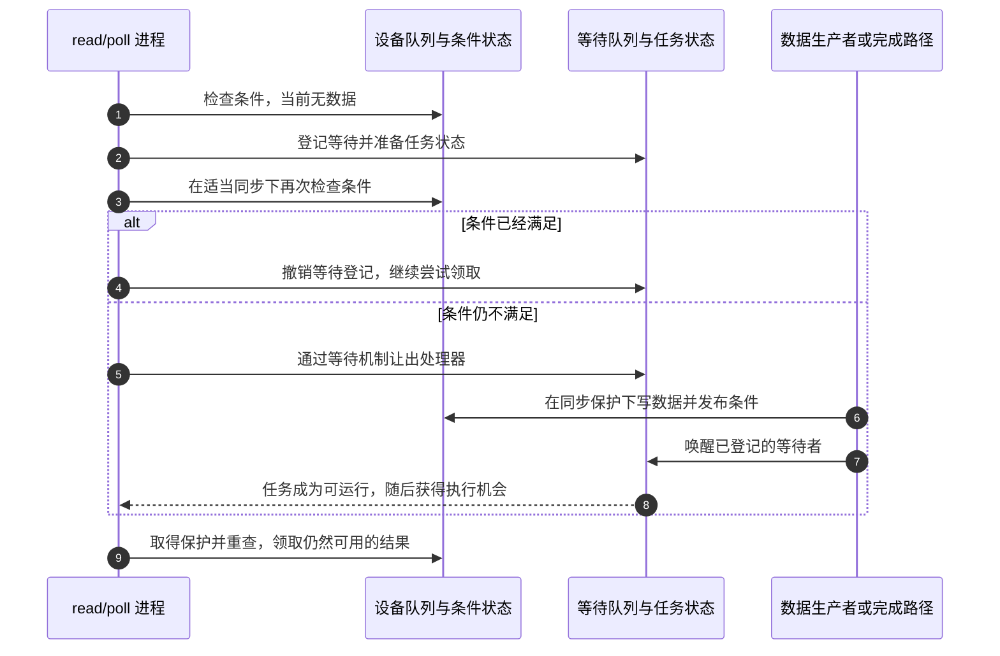
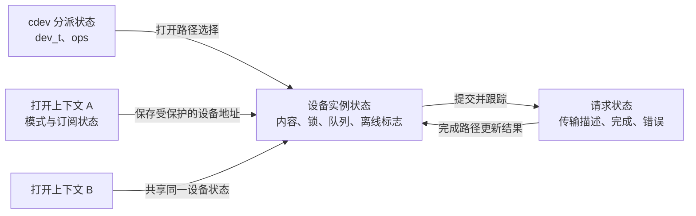

# 第1章\_字符设备最小模型

## 1.1\_问题从哪里产生

先沿用前面的 Hello 模块：代码已经装入，但它只打印日志。现在给它增加一块内存窗口，应用写进去的字节可以在后续读出。驱动内已经有 `demo_read()` 和 `demo_write()` 两个教学函数，问题是普通应用怎样找到并调用这项服务：

- 用户进程不能跳进内核地址调用函数；
- 系统中可能有多个同类设备，必须先确定操作哪个实例；
- 多个进程可以同时访问，驱动必须区分 **共享设备状态** 和 **本次打开状态**；
- 应用需要统一的权限检查、文件描述符、阻塞、复用和进程退出清理语义；
- 驱动可能被解绑，而已经打开的文件、等待者或映射仍然存在。

一种办法是为每种驱动增加专用系统调用，让应用交出设备编号和数据。然而每增加一种设备服务，都可能需要增加或维护用户与内核之间的调用约定，还要重新处理打开、权限和退出。因此 Linux 的字符设备复用文件接口：应用仍使用打开和读写操作，虚拟文件系统（VFS，前面内核概貌建立的公共文件层）处理路径和打开文件，字符设备框架再把特殊文件携带的设备号映射到驱动操作。这是接口组织方式，不是要求硬件只能一个字符一个字符地传送。

本章先完成“路径怎样选中窗口、一次打开留下什么、数据晚到时怎样继续”的最小闭环。挂载和路径查找的内部推导由 [VFS 抽象机制推演](../../kernel_subsystems/vfs/P02_VFS抽象机制推演.md)承担；本地先解释字符设备推理必需的对象，后续源码章节再沿明确前置深入。

> **字符设备首先是一套 VFS 分派机制。** “字符”不保证硬件逐字节工作，也不要求驱动必须实现 `read()` 和 `write()`；它表示该设备通过字符特殊文件和 `file_operations` 接入用户文件接口。

## 1.2\_从最小方案逐步补齐对象

先只考虑一个窗口。应用给出 `/dev/demo0` 这个路径，内核必须知道它表示字符服务，再决定调用哪张操作表。把名字直接写进驱动并不合适：用户可能给同一服务建立别名，也可能把节点放到另一个目录。于是让节点保存数值身份 **设备号（device number）**，打开路径按这个号寻找服务。

Linux 用 `dev_t` 类型保存主号和次号。驱动发布一段号码到 `struct cdev` 的关联，cdev 再指向操作表；固定版本把这组运行时映射保存在 `cdev_map`。这些名字分别表示数值类型、分派对象和映射入口，不是三种硬件。

打开以后，应用交出的通常是整数文件描述符，而不再是路径。内核因此需要一个持续存在的打开文件对象 `struct file`，其中 `f_op` 记住操作表，`private_data` 可由驱动保存窗口或本次会话地址。两次独立打开可以各有读取位置，却共享同一窗口内容；状态需要按拥有者分开，而不能都塞进操作表。

在这条同步路径建立后，才增加两个后续约束：数据还没到时需要等待，设备退出时需要阻止新请求并保护旧使用者。下面的图把已建立的名字和这两个待解问题连起来：

这条推演也是本专题的阅读主线。`cdev_add()` 只是中间一步，不是字符设备的全部。

## 1.3\_七个对象分别回答什么

现在为一次打开补齐文件系统侧的两个名字。`struct inode` 表示文件系统中的对象，它保存字符类型和设备号；`struct file` 表示一次打开得到的状态，也称 **打开文件描述（open file description）**。操作表 `struct file_operations` 保存回调地址，窗口自己的内容、长度和锁则放在驱动设备对象。下面的表用于核对这些已经有用途的对象：

| 对象 | 它代表什么 | 关键状态属于谁 |
| --- | --- | --- |
| `/dev/demo0` | 文件系统中的字符特殊文件，是用户路径入口 | inode 保存文件类型和 `i_rdev` |
| `dev_t` | 主、次设备号组成的数值身份 | 节点和内核登记必须使用同一数值 |
| `struct cdev` | 一段设备号到一组字符设备操作的内核分派对象 | 驱动设备实例或其分派层 |
| `struct inode` | 文件系统对象，不等于一次打开 | 保存 `i_rdev`，并可缓存 `i_cdev` |
| `struct file` | 一次 open file description | 保存 flags、位置、`f_op`、`private_data` |
| `struct file_operations` | VFS 能调用哪些驱动入口 | 通常是只读共享表，不保存设备运行状态 |
| 驱动设备对象 | 真实设备的共享运行状态 | 寄存器、锁、队列、离线标志、硬件请求 |

`dup()` 复制文件描述符，`fork()` 创建继承打开文件的子进程，两者都可以让多个 fd 引用同一个 `struct file`。所以准确说法是 **一次成功的 `open()` 建立一个 open file description**，不是“每个整数 fd 都有一份 `private_data`”。

## 1.4\_两个方向的完整数据流

先让内存窗口的一次同步读写走通，再把“数据立即可用”的条件拿掉。请求进入和完成返回会复用同一份设备状态，不能各画一条没有交接对象的箭头。

### 1.4.1\_请求从进程走向设备

下图选择尚未缓存 cdev 的第一次打开，并假定驱动提供了 open 回调。驱动回调负责自己的窗口或会话状态，用户文件描述符的安装由 VFS 打开路径负责。

步骤 1～3 由路径和号码选中分派对象，步骤 4～8 把操作表和私有状态交给这次打开。只有成功走到步骤 9，用户才得到可使用的 fd。步骤 10～12 从这个已建立的对象继续调用；`ioctl` 是文件控制请求接口，具体命令由驱动约定，不是另一次重新按路径选择设备。

### 1.4.2\_完成从设备返回进程

同步窗口可以在回调内完成复制并返回。如果换成等待外部数据的设备，读者发现没有数据时就需要暂停，让生产者以后通知它。生产者可以是另一个任务，也可以是处理中断或 **直接内存访问（Direct Memory Access，DMA）** 完成的驱动路径；中断负责事件通知，DMA 负责设备与内存的数据传输，二者并非同一个动作。

设驱动对象中有数据队列、表示有数据的 `ready` 条件和等待队列。等待队列保存“谁想在条件改变后重新运行”，数据队列保存结果本身。先读条件再直接睡眠有漏洞：生产者可能恰好在检查后、登记前完成写入，此时没有登记的等待者会收到通知。正确等待必须在登记以后重新检查条件，只有仍不满足才进入调度等待。

> **通知不是状态本身。** `wake_up()` 只促使任务重新运行；`ready`、队列非空、错误或离线标志才是双方通信的持久依据。

步骤 2、3 关闭检查与登记之间的窗口；步骤 5 若与唤醒交错，等待机制还要保证不会覆盖已经发生的任务唤醒。步骤 9 仍需在保护下复查，因为另一个读者可能先取走数据；没有数据时重新等待，而不是把唤醒当成已经获得一条记录。`poll()` 先登记再观察就绪，实际睡眠由外层等待逻辑安排，不是在驱动 poll 回调里等待数据。具体等待接口与取消分支到第六章展开。

## 1.5\_四套状态各自归谁所有

有了请求与等待过程，可以判断字段应该放在哪里。分派关系在多个打开之间复用，窗口内容由所有使用者共享；某次打开的模式只属于那次会话；一次尚未完成的数据请求又有自己的结果和取消状态。它们是可以同时变化的几组状态，不是一个全局枚举的四个互斥值。

- **分派状态** 回答设备号进入哪组操作。
- **设备状态** 被同一硬件的所有打开实例共享。
- **打开状态** 保存本次 `open()` 的策略和会话信息。
- **请求状态** 只活到一次同步或异步 I/O 完成、取消或失败。

锁和引用计数必须根据这四层状态选择。按层区分不要求每层都单独分配内存：最简单的窗口可以让 private_data 直接指向设备对象，文件位置使用 file 自身字段。真正不能省的是拥有者、同步与寿命说明，不能由结构体的数量判断设计是否正确。

## 1.6\_注册\_发布和移除的最小闭环

窗口内容已准备好，还需要保留号码、发布 cdev 映射，并让应用拿到字符节点。三者不是一个原子动作：节点可以先存在，映射也可能先发布。发布映射时回调就可能被已有节点访问，所以所有被访问的状态必须事先成立；不能把“新节点还没创建”当作无人访问的保证。

退出时反过来提出两组问题：怎样停止新访问，旧使用者怎样结束？撤销设备模型入口、删除 cdev 映射和归还号码分别处理可见对象、分派入口和占用记录；它们都不等于关闭旧文件或释放窗口内容。`device_destroy()`、`cdev_del()` 和设备对象回收因此不能互相代替。

普通模块卸载与硬件独立移除有不同的进入条件，不能把这张职责图当作所有驱动固定的 API 调用顺序。真实硬件还要停止中断、DMA 等活动，并防止旧回调访问已经解绑的资源。下一章用一个具体发布周期拆开这些状态，第四、九章再讲旧文件怎样退出。

## 1.7\_源码定位与版本边界

先用三个预测检查本章模型。两个路径保存相同设备号时，不能单凭路径数量判断有两个窗口；唤醒两个读者而只有一条记录时，后取得锁的读者可能需要继续等待；删掉路径时，已经打开的文件也不会自动归还其对象引用。三种情况分别检查分派身份、数据所有权和对象寿命，不能用一个“已经注册/已经通知/已经删除”的词包办。

本文实现依据 NXP 官方 Linux 6.12.20 固定提交 `dfaf2136deb2af2e60b994421281ba42f1c087e0`。版本化说明从[字符设备源码阅读入口](../../../research/source_reading/character_device/navigation/P01_Linux_6.12_字符设备源码阅读索引.md)定位，以下原始文件用于核对本章分派事实：

- [`fs/char_dev.c`](../../../research/source_reading/linux/fs/char_dev.c)：设备号登记、`cdev_map`、`chrdev_open()`、`cdev_add()` 和 `cdev_del()`；
- [`fs/open.c`](../../../research/source_reading/linux/fs/open.c)：`open` 系统调用和 `do_dentry_open()`；
- [`fs/namei.c`](../../../research/source_reading/linux/fs/namei.c)：路径打开流程；
- [`include/linux/fs.h`](../../../research/source_reading/linux/include/linux/fs.h)：`struct inode`、`struct file` 和 `struct file_operations`。

下一章先拆开三件经常被混称为“注册字符设备”的事情：[设备号、注册与设备节点](P02_设备号_注册与设备节点.md)。
