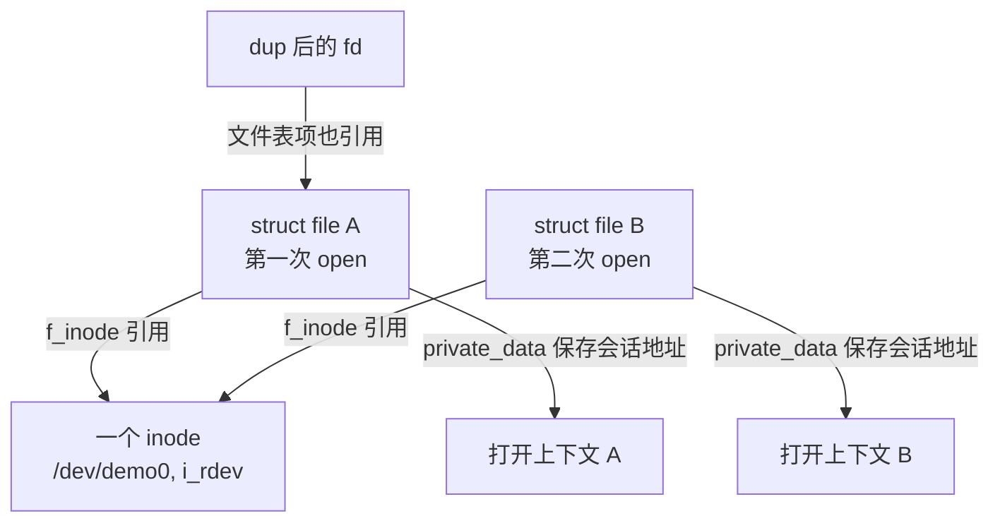
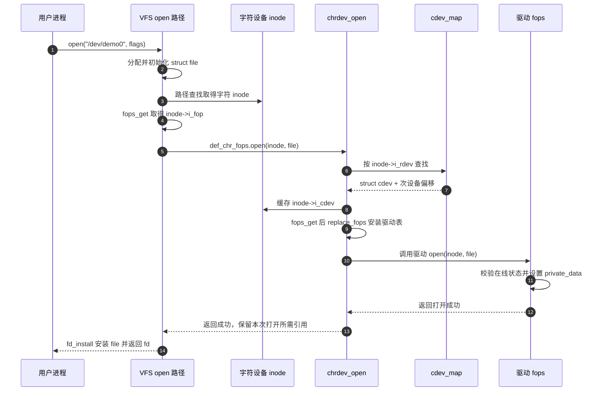
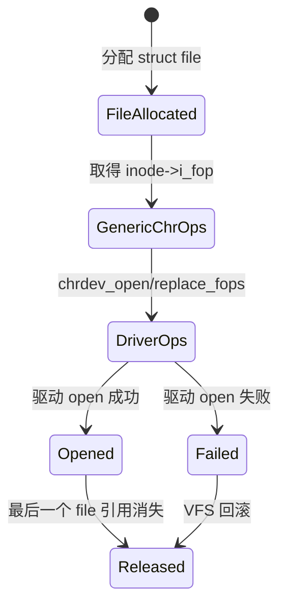

# 第3章\_打开路径与文件操作

## 3.1\_本章在完整链中的位置

上一章[设备号、注册与设备节点](P02_设备号_注册与设备节点.md)建立了三套状态：设备号范围、`cdev_map` 和设备节点。本章回答它们怎样在一次 `open("/dev/demo0")` 中汇合。

这里不是 VFS 的完整教程。文件系统注册、挂载、路径查找、缓存和通用生命周期由 [VFS 子系统专题](../../kernel_subsystems/vfs/大纲.md)维护；本章只完整展开 **VFS 与字符设备相交的调用链**，保证字符设备主线不断。

阅读本章前，应先理解 VFS 的 [状态与对象拓扑](../../kernel_subsystems/vfs/P03_VFS_状态与对象拓扑.md)和 [open 状态机](../../kernel_subsystems/vfs/P12_open状态机.md)。本章从 VFS 已取得字符特殊文件 inode、正在执行 `do_dentry_open()` 的交接点开始，不重复路径查找和 fd table 的完整实现。

## 3.2\_先分清路径对象与打开对象

让两个应用依次打开同一个窗口：它们找到的是同一字符节点，但各自可以保存不同的读取位置。再让第一个应用复制文件描述符，新得到的整数入口却沿用原来的位置。于是要分开三个关系：名称如何找到文件系统对象，一次打开如何保存访问状态，进程中的整数如何引用这次打开。`dentry`、`inode`、`file` 和 fd 分别承担这些关系；下表回收 VFS 前置模型，定位字符设备新增的字段。

| 对象 | 形成时间 | 代表什么 | 字符设备关心的字段 |
| --- | --- | --- | --- |
| `dentry` | 路径查找和缓存期间 | 名称到 inode 的关联 | 指向对应 inode |
| `inode` | 文件系统实例化文件对象时 | 文件系统中的一个对象 | `i_mode`、`i_rdev`、`i_cdev` |
| `file` | 每次成功打开时 | open file description | `f_flags`、`f_pos`、`f_op`、`private_data` |
| fd | 安装进进程文件表时 | 指向 `struct file` 的整数索引 | 可被 `dup/fork` 共享底层 file |

同一 `/dev/demo0` 的多次 `open()` 通常共用 inode，却产生不同 `struct file`。`dup()` 不会重新执行驱动 `open()`，它只是给同一 `struct file` 增加一个引用和新的 fd。

这些对象的通用创建和释放规则见 [fd table 与 open file description](../../kernel_subsystems/vfs/P13_fd_table与file生命周期.md)。字符设备特有状态从 `inode->i_rdev/i_cdev`、`cdev_map` 和 `file->private_data` 开始。



## 3.3\_VFS\_怎样走到字符设备入口

这里需要先定位两个时刻：建立一个候选 file，和成功以后把它安装进进程的 fd 表。候选对象在路径打开过程中就可能分配，随后任何失败都需要回收；不能把“分配 file”画到驱动 open 成功以后。`O_PATH` 是只取得路径引用、用于后续路径操作的一种打开标志，不走这里的普通驱动打开过程。Linux 6.12 的普通非 O_PATH 打开主干可压缩为：

```text
open/openat/openat2
  -> do_sys_openat2()
     -> do_filp_open()
        -> path_openat()
           -> do_open()
              -> vfs_open()
                 -> do_dentry_open()
                    -> file->f_op = fops_get(inode->i_fop)
                    -> file->f_op->open(inode, file)
```

文件系统把 inode 设置成字符特殊文件时，其 `inode->i_fop` 指向默认操作表 `def_chr_fops`，其中 `.open` 是 `chrdev_open()`。因此 VFS 首先进入字符设备的公共分派入口；这时驱动自己的操作表还没有安装到 `file->f_op`。下面选择尚未缓存 cdev、驱动有 open 回调且成功的路径：



步骤 2 的候选 file 到步骤 14 才发布给用户。步骤 4 取得公共操作表，步骤 9 才替换成驱动表；两次取表都涉及相应引用处理。驱动在步骤 11 建立私有状态、步骤 12 返回结果，既不替 VFS 安装 fd，也不直接向用户进程返回系统调用结果。失败与缓存命中分支在下节分别说明。

## 3.4\_chrdev\_open()\_的状态和锁

`fs/char_dev.c:chrdev_open()` 的关键工作不是一句“找到 cdev”可以概括的：

1. 读取 `inode->i_cdev`，判断该 inode 是否已经缓存分派对象；
2. 首次打开时调用 `kobj_lookup(cdev_map, inode->i_rdev, &idx)`；
3. 在 `cdev_lock` 保护下再次检查缓存，处理多个 CPU 同时首次打开同一 inode；
4. 把 inode 加入 `cdev->list`，并保存 `inode->i_cdev`；
5. 通过 `fops_get(p->ops)` 取得驱动操作表及其 owner 模块引用；
6. 使用 `replace_fops(filp, fops)` 替换默认字符设备操作表；
7. 若驱动实现 `.open`，再调用驱动 `open()`。

这里存在两级复用：`cdev_map` 提供第一次查找，`inode->i_cdev` 为以后打开缓存结果。两条路径都需要取得 cdev 使用引用，不能只拿缓存中的裸地址直接调用。`cdev_get` 先尝试取得 cdev 的 owner 模块引用，再取得其内部 kobject 引用；操作表的 `fops_get` 又处理操作表 owner 的引用，二者保护的对象不同。

为什么查完映射后还要第二次检查缓存？假设任务甲发现缓存为空，放开 `cdev_lock` 去查映射；任务乙也进入，并先把查到的对象登记进 inode。甲回来以后必须使用已经发布的缓存，并归还自己额外取得的候选引用，不能再把同一 inode 重复挂入链表。固定实现用局部变量 `new` 保存这份候选，最后的 `cdev_put(new)` 处理未采用的引用。缓存本来就非空时，也可能因引用取得失败而返回错误。

inode 侧的关联由 `cd_forget` 在相应清理路径摘除；cdev 最终引用归还触发的释放回调通过 `cdev_purge` 清除其关联 inode。`cdev_del` 本身撤映射并归还一个引用，不等于所有关联对象、旧打开和在途打开都立即消失。`cdev_lock` 保护缓存和关联链，不保护窗口内容，也不替驱动判断设备是否在线。

## 3.5\_为什么要替换\_file->f\_op

系统调用后续拿到的是 `struct file`，不是每次重新从路径和设备号开始查找。打开成功后，驱动操作表已经固定在 `file->f_op`：



因此 `cdev_del()` 只能阻止以后的映射查找，已经打开的 `file` 仍可能保存驱动 `f_op`。安全移除必须另设 `disconnected` 状态并保证设备对象、操作表所属模块和请求状态仍然有效。

## 3.6\_驱动\_open()\_应该建立什么

现在给同一窗口增加“每次打开各自的模式和订阅状态”。它们不能放进所有使用者共享的操作表，也不该因为另一个进程打开设备就被重置。因此由 open 分配会话，private_data 保存会话地址，release 收回会话。

下面是 **普通模块整组窗口的回调片段**，并非热拔插模板：共享设备对象在模块装入期间始终有效，cdev 和操作表的 owner 均已设置为本模块，初始化在发布前完成；所有打开结束、普通模块卸载获准后才释放共享对象。这里的 disconnected 只裁决服务是否开放，不触发设备内存回收。满足这些前提以后，取得设备地址和锁才安全：

```c
struct demo_file_ctx {
    struct demo_device *dev; /* 依赖本例普通模块的整组对象寿命 */
    u32 mode;                /* 本次打开的配置 */
    bool async_enabled;      /* 本次打开是否订阅异步通知 */
};
```

代码使用 `container_of` 从内嵌 cdev 的地址还原外围设备对象；`kzalloc` 分配并清零会话，`GFP_KERNEL` 允许分配路径按规则睡眠。内存不足返回 `-ENOMEM`，设备离线返回 `-ENODEV`。这些动作在进程上下文执行，下面的 mutex 只保护在线检查与会话交接，不承担对象地址保活。

本例的步骤是：

1. 通过 `inode->i_cdev` 和 `container_of()` 找到设备实例；
2. 在合适的锁或引用保护下检查设备是否已离线；
3. 确认本例整组对象寿命覆盖这次打开；独立移除的设备则必须另外取得相应使用资格；
4. 分配并初始化打开上下文；
5. 把上下文保存到 `file->private_data`；
6. 若任何步骤失败，按逆序撤销，不把半初始化上下文留给后续回调。

```c
static int demo_open(struct inode *inode, struct file *file)
{
    struct demo_device *dev;
    struct demo_file_ctx *ctx;

    dev = container_of(inode->i_cdev, struct demo_device, cdev);

    ctx = kzalloc(sizeof(*ctx), GFP_KERNEL);
    if (!ctx)
        return -ENOMEM;

    mutex_lock(&dev->lock);
    if (dev->disconnected) {
        mutex_unlock(&dev->lock);
        kfree(ctx);
        return -ENODEV;
    }
    /* 本例由整组模块寿命保活；检查与保存之间不释放 dev。 */
    ctx->dev = dev;
    mutex_unlock(&dev->lock);

    file->private_data = ctx;
    return 0;
}
```

本例成功以后由 release 释放 ctx，打开失败则由 open 自行释放尚未交付的 ctx。它没有用一条注释冒充热拔插引用协议。若共享设备允许独立回收，必须从查找地址时就有保活依据，再取得跨回调引用；对已经失效的地址调用引用计数函数无法修复问题。下一章比较普通模块、软件会话和硬件绑定三种不同寿命。

## 3.7\_后续文件操作怎样分派

打开以后，`read/write/unlocked_ioctl/poll/mmap/release` 都从 `file->f_op` 进入驱动。驱动通常从 `file->private_data` 取得本次打开上下文，再访问共享设备状态：


VFS 负责调用约定，但不会自动串行化同一驱动的全部回调。两个不同 `struct file`、共享同一 file 的线程、IRQ 和 DMA 完成回调都可能并发访问设备对象。下一章由此进入状态、锁、等待和移除问题。

## 3.8\_失败路径不能省略

- 路径或权限失败：尚未进入字符设备分派；
- `kobj_lookup()` 找不到 cdev：返回 `-ENXIO`，表示该设备号没有可用的分派目标；
- `fops_get()` 不能取得操作表/模块引用：打开失败；
- 驱动 `open()` 返回错误：fd 不会安装给用户，VFS 清理候选 file；驱动 open 必须自行回滚已取得的私有资源，不能等正常 release 补做；
- 设备在查找和驱动 `open()` 之间开始移除：驱动仍需用自己的在线状态和引用规则裁决。

最后一项说明 `cdev_map` 只解决分派对象查找，并不替具体驱动完成热拔除同步。

## 3.9\_源码定位

先做一个路径预测：两次独立 open 建立 A、B 两个 file，再对 A 执行 dup。此时有三个 fd，但只有 A、B 两份打开状态；只有前两次 open 进入驱动的打开回调。若 B 在私有分配阶段失败，则 B 不会发布为用户 fd，驱动也必须在失败返回前收回已经取得的资源。这个预测同时检查“分配、发布、共享、失败回收”四个时刻。

源码按 NXP 官方 Linux 6.12.20 固定提交 `dfaf2136deb2af2e60b994421281ba42f1c087e0` 核对。沿[字符设备源码阅读入口](../../../research/source_reading/character_device/navigation/P01_Linux_6.12_字符设备源码阅读索引.md)进入版本化范围，当前分派的原始证据为：

- [`fs/open.c`](../../../research/source_reading/linux/fs/open.c)：`do_sys_openat2()`、`do_dentry_open()`、`vfs_open()`；
- [`fs/namei.c`](../../../research/source_reading/linux/fs/namei.c)：`do_filp_open()` 和路径打开状态机；
- [`fs/char_dev.c`](../../../research/source_reading/linux/fs/char_dev.c)：`def_chr_fops`、`chrdev_open()`、`cdev_map`；
- [`include/linux/fs.h`](../../../research/source_reading/linux/include/linux/fs.h)：inode、file、file_operations；
- [`include/linux/cdev.h`](../../../research/source_reading/linux/include/linux/cdev.h)：cdev 对象。

下一章承接 `file->private_data -> 设备对象` 这条边，解释多个执行上下文怎样通信以及设备移除为何困难：[文件操作并发与生命周期](P04_文件操作并发与生命周期.md)。
