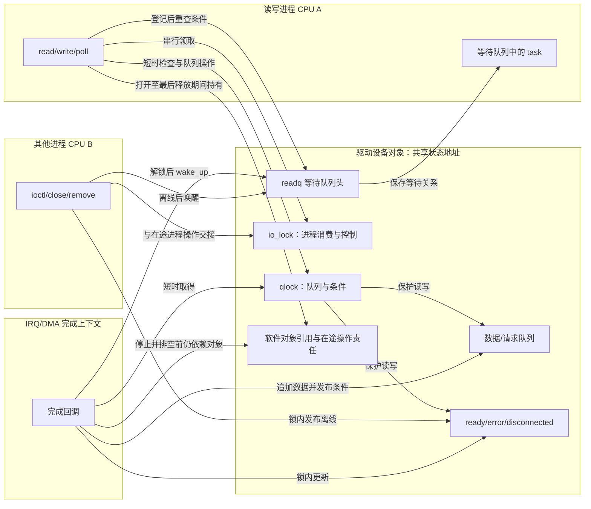
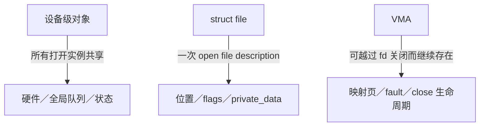
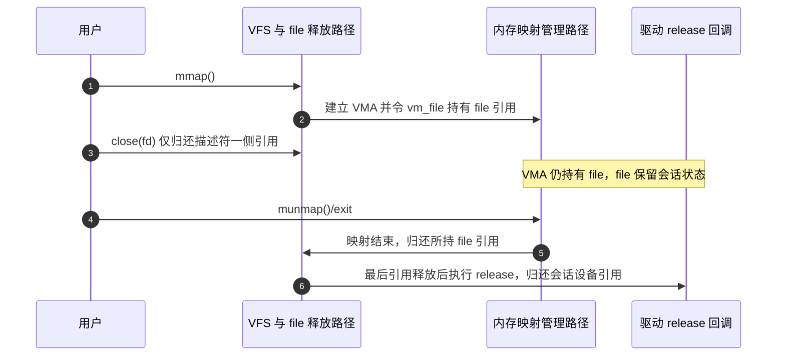
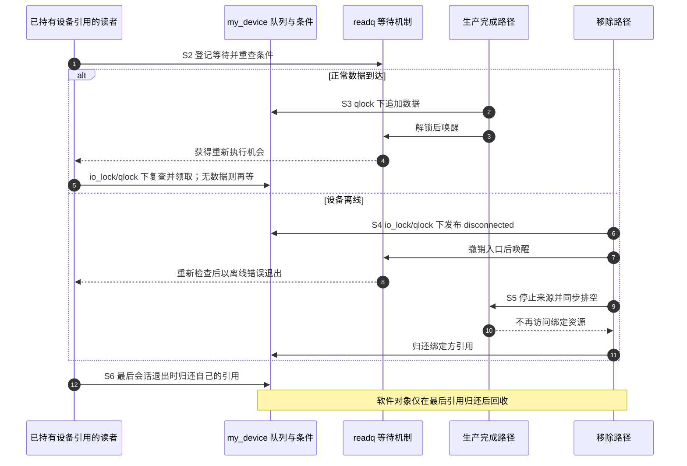

# 第4章\_文件操作并发与生命周期

本章承接上一章[打开路径与文件操作](P03_打开路径与文件操作.md)的 `file->private_data -> 设备对象`。打开路径已经把调用送到正确实例，但它没有回答：进程、中断（IRQ）和 DMA 回调怎样交换状态，设备移除时谁阻止新请求，以及最后一个旧引用由谁释放。

沿用一个数据设备，让甲、乙两个应用各自打开它。设备每次完成一条记录，任一读取者取走后，另一人就不能再消费同一条；接着考虑读取者睡眠期间拔掉设备。原来的“open 记住一个地址”不足以处理这些变化。本章逐步增加条件状态、登记通知、领取保护与寿命交接，最后把它们放进同一个退出周期。

## 4.1\_先画清角色\_状态地址和通知方向

本章选择一个具体设计边界：数据生产者只向队列追加，可能运行于硬中断；进程读者领取数据，可能因用户复制而睡眠；remove 关闭服务并停止硬件。队列与离线标志放在同一个 `my_device` 软件对象中，由短时自旋锁 `qlock` 保护。进程之间另用可睡眠互斥锁 `io_lock` 串行化消费与控制操作。顺序固定为先 io_lock、再短时 qlock；硬中断只使用 qlock，不能取得 mutex。

`readq` 是该对象中的等待队列头，保存等待关系；`struct device` 引用负责保活软件对象，硬件请求还需自己的停止和排空协议。这些字段分工明确以后，才能看通信图：



交互并不依赖“某个 CPU 猜另一个 CPU 是否仍在回调中”。各执行上下文访问 **同一个设备对象或请求对象中的状态地址**：

- 锁规定谁能并发修改队列和状态；
- `ready/error/disconnected` 保存可重复检查的事实；
- 等待队列保存等待者并提供唤醒通道；
- 引用或在途计数阻止对象在旧访问完成前释放。

> **状态负责记住发生了什么，通知负责让观察者及时重新运行，生命周期机制负责保证保存状态的地址仍然存在。** 三者缺一不可。

## 4.2\_先分清三个共享层次

两个独立 open 共享队列，却可有不同的会话模式；dup 得到新整数时，连会话也可能共享。若应用再把设备内存映射进地址空间，关闭 fd 后映射还可能存在。因此除了设备和 file，还要追踪 **虚拟内存区域（Virtual Memory Area，VMA）**，即内核对一段用户虚拟地址范围及其属性的记录。



一次成功 `open()` 通常创建新的 open file description 和 `struct file`，但 `dup()`、`fork()` 等可以让多个 fd 共享同一个 `struct file`。因此不能把 `struct file` 简化成“每进程独立”或“每个 fd 永远独立”。

VFS 如何发布 fd、取得 file 引用以及在最后引用消失后执行 `fput()`，见 [fd table 与 file 生命周期](../../kernel_subsystems/vfs/P13_fd_table与file生命周期.md)。本章从驱动已经收到 file 回调以后开始，关注设备对象、会话、请求和 VMA 的附加生命周期。

`file->private_data` 常指向每次打开的会话对象，也可以指向设备对象。选哪一种决定 read/write/ioctl/poll/release 之间共享什么状态。

## 4.3\_VFS\_不会替驱动串行化所有回调

同一设备可以被多个任务并发 open，不同或共享 `struct file` 上的 read/write/ioctl/poll 也可能并发。VFS 的局部锁不能替代驱动对硬件、队列和私有状态的同步设计。

| 回调 | 上下文 | 典型并发 |
| --- | --- | --- |
| `open()` | 进程上下文，可睡 | 多任务同时打开、与 remove 竞争 |
| `read()/write()` | 进程上下文，通常可睡 | 多 fd、共享 file、信号和超时 |
| `unlocked_ioctl()` | 进程上下文，通常可睡 | 与数据路径和配置路径并发 |
| `poll()` | 进程上下文 | 高频调用、与 IRQ/worker 更新条件并发 |
| `mmap()`/VMA callbacks | 建立映射及后续 VMA 生命周期 | fork、munmap、进程退出、remove |
| `release()` | 最后一个 file 引用释放时 | 不等于每个 `close(fd)` 都立即调用 |

## 4.4\_open\_与每次打开状态

先解决最早的寿命窗口：从 cdev 还原设备地址以后，凭什么可以访问它的锁和引用计数？`kref_get_unless_zero` 只能在 **地址已经有效** 时尝试增加非零计数，不能使一个已经释放的地址复活。只在 open 中加这行代码，仍没有回答查找到取得引用之间由谁保活。

这里选择一种具体兑现方式：my_device 同时内嵌 cdev 与 device，内存由 device 的最终 release 回调释放；注册前初始化 device、设置 devt/release 和两种锁，将 cdev 与操作表 owner 设为所属模块，然后通过 `cdev_device_add` 发布。固定版本中该接口把 device 设为 cdev 的父对象，并让 cdev 的引用保活这个父对象。因此字符打开路径持有 cdev 时，外围 my_device 地址也有效；open 可再用 `get_device` 取得持续到会话结束的引用。

这种发布顺序还意味着 cdev 先于 device 的完整发布，`cdev_device_add` 即使失败也可能已经被打开，注册失败路径必须按后面的关闭协议处理。以下是该设计的回调片段，依赖上述注册契约，不是可单独加载的完整模块：

```c
struct my_file_ctx {
    struct my_device *mdev;
    struct mutex lock; /* 只保护本会话的设置，不代替设备 qlock/io_lock */
    u32 mode;
};

static int my_open(struct inode *inode, struct file *file)
{
    struct my_device *mdev = container_of(inode->i_cdev,
                                          struct my_device, cdev);
    struct my_file_ctx *ctx;
    unsigned long flags;

    /* cdev 的父引用先保证 mdev 地址有效，再接出本次打开的引用。 */
    get_device(&mdev->dev);

    ctx = kzalloc(sizeof(*ctx), GFP_KERNEL);
    if (!ctx) {
        put_device(&mdev->dev);
        return -ENOMEM;
    }

    mutex_init(&ctx->lock);
    spin_lock_irqsave(&mdev->qlock, flags);
    if (mdev->disconnected) {
        spin_unlock_irqrestore(&mdev->qlock, flags);
        kfree(ctx);
        put_device(&mdev->dev);
        return -ENODEV;
    }
    ctx->mdev = mdev;
    spin_unlock_irqrestore(&mdev->qlock, flags);
    file->private_data = ctx;
    return nonseekable_open(inode, file);
}
```

`get_device/put_device` 维护 device 对象引用，`kzalloc` 分配并清零会话，`GFP_KERNEL` 允许在这个进程路径按规则睡眠；分配失败返回 `-ENOMEM`，离线拒绝返回 `-ENODEV`。`spin_lock_irqsave` 保护条件并保存本地中断状态，配对恢复，避免本地硬中断与进程同时操作队列锁。

如果 remove 在在线检查以后开始，本次 open 可能成功；这没有违反契约，因为软件对象已有引用，后续每个需要硬件的操作还要重新检查离线状态。`nonseekable_open` 在固定版本只清除相应 seek/pread/pwrite 能力位并返回零，本例由它结束成功路径；不能据此把未来换成可失败帮助器的代码也写成无条件交付。独占设备还需在同一同步域内检查并设置独占状态，不能使用无保护布尔变量。

## 4.5\_read/write\_的锁与等待边界

接着看两个读者同时等一条记录。通知可以让两者都成为可运行；甲先取得 io_lock 并消费后，乙即使刚从等待中返回，队列仍可能再次为空。因此等待与消费必须组成可重复的循环：

1. 不持 mutex 地等待数据条件，避免生产者无法取得锁；
2. 醒来后取得 mutex；
3. 在 qlock 下重新检查数据和 disconnected 状态；
4. 复制或移动队列内容；
5. 若被其他读者取空，放开 io_lock 重新等待；有进度或错误才返回。

下面是 **阻塞、非零长度请求的控制流片段**。`read_ready` 是本例自定义条件帮助函数：在 qlock 下读取“队列非空或离线”，随后立即解锁；`queue_empty` 只在 qlock 内检查队列。`copy_one_record` 也是教学帮助函数，假定调用者持 io_lock，它在 qlock 下取得所需数据快照，放开自旋锁后才复制用户内存，并按实际进度维护消费状态。完整复制契约在第五章展开，不能把这些名称当成可直接调用的内核 API。

```c
for (;;) {
    ret = wait_event_interruptible(mdev->readq, read_ready(mdev));
    if (ret)
        return ret;

    ret = mutex_lock_interruptible(&mdev->io_lock);
    if (ret)
        return ret;

    spin_lock_irqsave(&mdev->qlock, flags);
    if (mdev->disconnected) {
        spin_unlock_irqrestore(&mdev->qlock, flags);
        mutex_unlock(&mdev->io_lock);
        return -ENODEV;
    }
    if (queue_empty(mdev)) {
        spin_unlock_irqrestore(&mdev->qlock, flags);
        mutex_unlock(&mdev->io_lock);
        continue; /* 唤醒不授予记录所有权，其他读者可能已领取。 */
    }
    spin_unlock_irqrestore(&mdev->qlock, flags);

    /* 本例所有消费者都持 io_lock；生产者只追加，不抢走记录。 */
    ret = copy_one_record(mdev, buf, count);
    mutex_unlock(&mdev->io_lock);
    return ret;
}
```

生产者在 qlock 内修改数据与条件，解锁后唤醒；等待宏负责登记与条件复查，外面的循环负责真正消费之前的再次裁决。锁等待或事件等待被信号打断时，片段直接返回相应错误，不遗留持锁状态。非阻塞请求应在“当前无数据”时返回 `-EAGAIN`，零长度请求另按接口约定处理，不能无条件套入这条等待路径。`READ_ONCE` 本身也不替代这里对复合队列的锁保护。

## 4.6\_poll\_的注册再检查

读者有时只想知道“现在读会不会需要等待”，于是进入 poll。驱动 poll 回调 **不能在这里等数据变为就绪**，应先通过 `poll_wait` 登记通知，再观察同一条件并返回掩码。不要把它缩成“poll_wait 绝不会睡眠”：普通 poll 登记路径可能为等待项分配内存，它不是可以随意放进原子上下文的接口。

```c
static __poll_t my_poll(struct file *file, poll_table *wait)
{
    struct my_file_ctx *ctx = file->private_data;
    struct my_device *mdev = ctx->mdev;
    __poll_t mask = 0;
    unsigned long flags;

    poll_wait(file, &mdev->readq, wait);

    spin_lock_irqsave(&mdev->qlock, flags);
    if (!queue_empty(mdev))
        mask |= EPOLLIN | EPOLLRDNORM;
    if (mdev->disconnected)
        mask |= EPOLLHUP | EPOLLERR;
    spin_unlock_irqrestore(&mdev->qlock, flags);
    return mask;
}
```

`EPOLLIN/EPOLLRDNORM` 表示本例有普通可读数据，`EPOLLHUP/EPOLLERR` 表示离线后的挂断/错误观察。可读掩码只是一刻的状态，不替下一次 read 预留记录；应用必须处理状态变化。先登记再检查关闭了遗漏事件的窗口，生产者修改条件后调用匹配的 `wake_up_interruptible_poll()` 或其他唤醒接口。

## 4.7\_ioctl\_控制面

如果控制命令要改变后续记录的格式，它就会影响正在读数据的任务。ioctl 是文件控制请求接口；本例设备级修改先取得 io_lock，与读者领取过程串行，再在需要改队列条件时短时取得 qlock。会话私有的模式则由 ctx 中的锁保护，不能把会话锁当成跨两个 open 的设备锁。确定这些所有者以后，再逐项检查：

- 哪些命令可以与 read/write 并发；
- 哪些命令必须在设备 mutex 下串行；
- 长时间硬件操作是否应拆成“锁内改状态、锁外等待、锁内提交”；
- `copy_from_user()/copy_to_user()` 失败和信号路径如何回滚；
- 32/64 位兼容结构是否由 `.compat_ioctl` 正确处理。

不要持自旋锁调用用户拷贝；用户缺页可能睡眠。也不要在锁外使用未经保活的设备对象。

## 4.8\_mmap\_改变了生命周期

如果用户需要直接访问一段共享内存，mmap 会在用户地址空间建立映射。它返回后，即使 fd 已关闭，VMA 仍可能因为 fork、拆分或进程继续运行而存在。**关闭整数 fd 与最后一份 file 引用消失是不同事件。** 普通文件映射由 `vma->vm_file` 持有 file 引用；如果会话引用已经足以保活纯软件后端，这条链本身就可能继续保活它，不要求所有映射都再造一套计数。

映射另有独立对象或回调状态时，再通过 `vm_operations_struct` 的相应回调建立和归还引用，并核对第一次建立、复制与关闭是否成对。下面只展示“一份普通文件映射保留 file，且没有其他引用”的简化情形：



步骤 3 之后映射仍持有 file；步骤 5、6 才可能使本例会话退出。实际 file 释放可能经过延后执行路径，图表示引用依赖，不承诺在 close 的调用栈上立即释放。

软件对象在不等于硬件还可访问。**内存映射 I/O（Memory-mapped I/O，MMIO）** 把设备寄存器放入地址空间；向用户映射时必须限定页范围、权限和缓存属性，并设计设备移除后的访问处置。设备可直接访问的 DMA 缓冲应使用相应 DMA API 的映射帮助器，不可把 CPU 虚拟地址随意当作 `remap_pfn_range` 要求的物理页帧。后者是映射页帧范围的接口，不会替你完成地址类型转换或寿命管理。具体映射协议在第七章展开。

## 4.9\_remove\_与旧文件描述符

把前面的事件串成一次生命周期，便会看到设备状态和软件对象寿命是两个轴。设备移除时应用可能还持有 fd，本例让旧会话继续存在并返回离线错误，不无限等待应用主动关闭。统一阶段如下：

| 阶段 | 触发、写入者与状态位置 | 后续读取者及完成条件 |
| --- | --- | --- |
| S0 准备与发布 | 注册路径初始化 my_device 的锁、队列、readq 与 device/cdev 父引用关系，再发布 | 打开路径可找到对象；此后失败也按关闭协议处理 |
| S1 打开交接 | open 在 cdev 已保活地址的前提下取得 device 引用，在 qlock 下检查离线，交付 ctx | file 回调通过 private_data 找到会话，软件地址跨回调有效 |
| S2 条件等待 | read 通过 readq 登记并复查；poll 登记并返回当前掩码 | 生产者可通过等待队列通知，等待期间不持 io_lock |
| S3 生产与领取 | 完成路径在 qlock 下追加数据后唤醒；读者在 io_lock/qlock 下复查并领取 | 后到读者无数据则回 S2；持久条件而非通知次数决定进度 |
| S4 关闭服务 | remove 取得 io_lock，再在 qlock 下置 disconnected；撤销入口并唤醒 | 新回调检查离线后拒绝，旧等待者可以退出，软件对象仍保活 |
| S5 停止与排空 | 退出路径停止硬件来源、同步结束 IRQ/DMA/工作，并归还绑定方引用 | 不再有硬件路径访问已释放资源；不要求所有 fd 此刻关闭 |
| S6 最终回收 | file/VMA 等使用者归还引用，cdev 的父引用也结束后，由 device release 回调释放软件对象 | 所有引用归零才回收对象，不能把 S4 当成 S6 |

S4 与 S5 的实际退出过程是：

1. 先取得 io_lock，与已进入的进程操作完成交接，再在 qlock 下标记 disconnected；按逆序释放两把锁。
2. 撤销 cdev/device 入口；已经取得打开资格的路径仍按离线标志裁决，不能只靠路径消失。
3. 唤醒 readq，使等待者在下一次检查中返回 `-ENODEV` 或观察 HUP/ERR。
4. 停止硬件来源，按所属子系统协议同步 IRQ、timer、DMA 和 work；同步等待期间不持有被等待回调也需要的锁。
5. 硬件不再访问资源以后，归还绑定方的软件对象引用。旧会话只保留软件状态，不再碰已撤销的硬件资源。



步骤 2～5 依靠队列条件交付数据，步骤 6～11 依靠离线状态和停止协议结束等待及硬件访问。步骤 12 不能被步骤 6 的标志写入替代；正常分支中只结束当前会话时，绑定方引用仍在，软件对象也不会因此释放。

device 引用不等于 driver binding 引用，不能仅靠 `get_device()` 延长 devm MMIO、IRQ 或 DMA 资源的寿命。详见[生命周期集成专题](../../linux/object_lifetime/integration/大纲.md)。

## 4.10\_release\_的职责

S6 中，`.release()` 在最后一个 `struct file` 引用消失时清理每次打开状态。它归还 S1 取得的 device 引用，而不是为每次 close 都执行一次：

```c
static int my_release(struct inode *inode, struct file *file)
{
    struct my_file_ctx *ctx = file->private_data;

    put_device(&ctx->mdev->dev);
    kfree(ctx);
    return 0;
}
```

它不应释放 probe 阶段所有打开实例共享的设备资源。共享硬件资源在 remove/driver detach 路径停止，私有会话资源在 release 释放，两者必须分层。

## 4.11\_常见错误

| 错误 | 后果 |
| --- | --- |
| 认为每个 fd 都有独立 `struct file` | dup/fork 后共享状态发生竞态 |
| 认为 VFS 会串行化 fops | 多任务并发破坏设备状态 |
| 持 mutex 调用 `wait_event()`，生产者也需该锁 | 永久死锁 |
| poll 先检查，再登记而不复查 | 丢失检查—登记窗口中的事件 |
| close fd 就释放 mmap 后端 | VMA 后续访问 UAF |
| remove 等所有用户主动 close | 热拔出或 unbind 永久阻塞 |
| `get_device()` 被当作 devm 资源保活 | device 在，但 driver 资源已释放 |
| release 释放设备级共享资源 | 其他打开实例继续访问已释放对象 |

## 4.12\_核对表

- 状态属于设备、open file description 还是 VMA？
- dup/fork 后共享同一 `struct file` 是否安全？
- read/write/ioctl/poll 的锁顺序和等待边界是否一致？
- poll 是否先登记等待队列再检查状态？
- remove 如何阻止新入口并唤醒旧等待者？
- fd/VMA 如何保活纯软件对象，又如何避免访问已释放的绑定资源？
- release 是否只清理每次打开状态？

再用两个交错检验这张核对表。甲乙都被唤醒、甲先取走唯一记录时，乙必须回到 S2；remove 在 open 的在线检查之后开始时，open 可以已经成功，但后续操作仍由 S4 的离线状态拒绝，S1 的引用保护软件地址。两种情况都不能通过“唤醒过了”或“打开成功过了”推断现在还有数据或硬件。

本章按 NXP 官方 Linux 6.12.20 固定提交 `dfaf2136deb2af2e60b994421281ba42f1c087e0` 核对：`fs/char_dev.c` 的 cdev 父引用与发布失败边界、`include/linux/wait.h` 的等待登记后复查、`fs/select.c` 的 poll 等待项登记，以及 `mm/mmap.c` 中映射取得 file 引用、`mm/vma.c:remove_vma` 归还引用的路径。版本导航从[字符设备源码入口](../../../research/source_reading/character_device/navigation/P01_Linux_6.12_字符设备源码阅读索引.md)继续；这些依据分别支撑地址、条件和引用，不代替完整设备驱动的测试。

下一章沿 S3 的实际字节进度，继续讨论[文件操作契约与数据路径](P05_文件操作契约与数据路径.md)：用户复制一半失败时，驱动到底可以提交多少数据？
