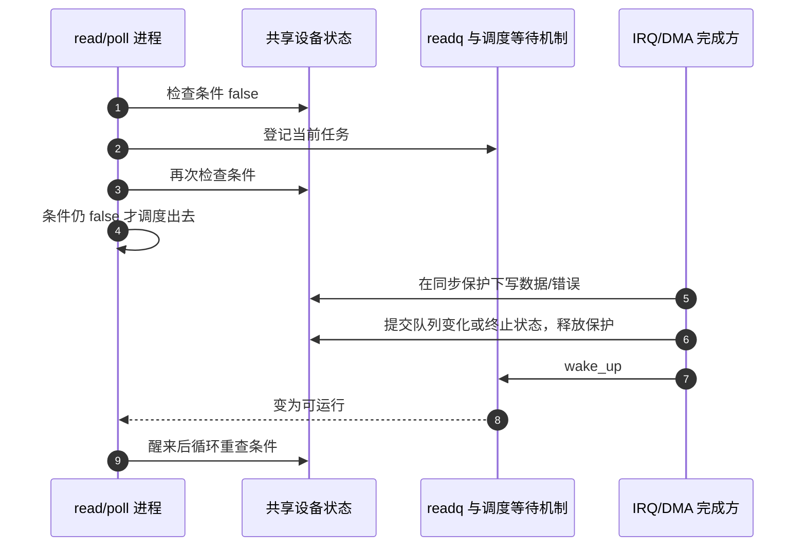

# 第6章\_阻塞\_poll与异步通知

[上一章](P05_文件操作契约与数据路径.md)已经规定“完成多少就报告多少”，但还没有数据时，流式设备不能用零字节把暂时无数据伪装成结束。沿用第四章的双读者队列：甲等一条记录，乙同时观察是否可读，设备完成路径稍后追加数据。本章解释他们怎样观察同一事实，而不用各自保存一份容易失步的“已通知”标志。

这里继续使用第四章的阶段：S2 是登记与等待，S3 是生产和领取，S4 是关闭服务。软件对象已经被打开引用保活；队列和离线状态由设备的 qlock 保护，进程消费由 io_lock 串行化。完整等待队列实现属于通用同步专题，本章把这些机制接到字符设备的 read、poll 和信号订阅上。

## 6.1\_通信必须同时有状态和通知

先考虑最朴素的方案：甲不断调用非阻塞 read，空队列就立即再试。这样可以观察数据，但设备长时间没有产出时，甲仍反复进入内核、取得保护并检查同一个空队列。让甲睡眠可以避免这段空转，不过生产者必须知道怎样找到它，甲也必须知道醒来后读哪里。

因此设备对象保存两类不同的信息：数据队列及错误/离线字段保存事实，`readq` 等待队列保存通知关系。生产者在 qlock 下追加记录，解锁后通知 readq；读者使用相同锁读取条件。处理器缓存一致性和锁协议使双方看到同一个对象的更新，不需要读者去轮询另一个 CPU 的“是否正在临界区”字段。

只把“检查为空”后面改成“睡眠”仍然不对。若生产者恰好在甲检查后、甲登记前完成，它看不到等待者，甲随后就可能睡过已有数据。等待机制必须先登记并设置任务等待状态，再重查条件；条件仍不满足才调度。下面画一次确实需要等待的路径：

步骤 1～3 处理检查与登记的交错；步骤 4 即使与步骤 7 的唤醒交错，也不能把已唤醒的任务重新遗留在睡眠状态。步骤 5、6 先发布数据，再由步骤 7 通知；步骤 9 重新检查的是队列和终止状态，不能只问“是否被叫醒过”。等待结束还要取消登记、恢复任务状态，标准等待接口承担这些配对操作。

**条件状态是通信内容，wait queue 保存等待关系，wake_up 是通知动作。** 甲乙都可能被通知，甲先消费唯一记录以后，乙仍需回到 S2。等待登记不预留数据；在第四章的消费锁内重新裁决，才确定哪一个读者拥有这条记录。

## 6.2\_阻塞\_read()\_的判断顺序

现在把等待放回一次正长度读取。本例选择“离线优先拒绝，否则领取数据”的协议：回调在保护下检查 disconnected，再检查队列；当前在线且队列为空，才决定是否等待。其他设备可以允许离线后排完已有记录，但必须同时改变 read 与 poll 的约定，不能让两者描述不同设备状态。

`wait_event_interruptible(readq, condition)` 是可被信号打断的等待宏。条件表达式必须安全地读取“队列非空或设备离线”，不能在表达式里消费记录。固定版本中条件成立返回 0，被信号打断返回 `-ERESTARTSYS`；驱动无进度时可以直接把这个结果向上传递，系统调用退出路径再决定重启或向用户报告中断，不需把所有非零结果重新映射一次。

返回 0 也只说明某次条件检查成立。随后取得 io_lock 和 qlock 时，另一个读者可能已经取空队列，所以仍要用第四章的循环复查，空则解锁再等；用户复制在可睡眠区域进行，不能持 qlock 复制。这样才从 S2 的“可继续检查”走到 S3 的“真正领取”。

非阻塞标志 `O_NONBLOCK` 保存在 `file->f_flags`。当前不能交付任何数据时，本例返回 `-EAGAIN`，不进入等待数据的路径；它不承诺整个系统调用没有锁竞争、缺页或任何内核调度。与第五章一样，已有部分字节进度时按既定短传输契约处理，零长度请求也不应无条件等待一条记录。

## 6.3\_poll()\_怎样观察就绪而不占有数据

乙可能同时监视多个设备，不能先在其中一个设备的 read 里无限等待。poll/epoll 提供“哪些描述符现在值得尝试 I/O”的观察接口；驱动 `.poll` 则把设备条件接到外层等待机制。对于本例，驱动不必为了回答就绪再读一遍硬件，只需在 qlock 下观察完成路径已经发布的队列和离线状态。其他驱动是否需要额外硬件查询取决于其实现，poll 这个名字本身不禁止它。

驱动先调用 `poll_wait(file, &dev->readq, wait)`，再读取条件并返回掩码。这里的 wait 是外层传入的登记上下文，不是驱动自己创建的新数据队列；其登记回调可以把普通 poll 等待项或 epoll 关联接到 readq。固定接口也允许上下文为空或当前不要求继续登记，所以不能把每次调用都理解成一定新增一名睡眠任务。

登记以前到来的事件应由后面的条件检查发现，登记以后的事件则可以通知已经挂入的观察者。这依赖匹配的状态同步与等待接口顺序，不能只把两个函数名摆对就省略锁。poll 回调不等待数据就绪；登记过程本身可能分配内存，因此也不能放到任意原子上下文执行。

掩码细节用于表达已判断的条件：

| 本例条件 | 返回给外层的典型掩码 | 对下一次操作的含义 |
| --- | --- | --- |
| 在线且有记录 | `EPOLLIN`，普通读常同时给 `EPOLLRDNORM` | 值得尝试读取，不预留记录 |
| 可写队列有容量 | `EPOLLOUT`，普通写常同时给 `EPOLLWRNORM` | 值得尝试写入，不预留全部请求长度 |
| 错误或离线 | `EPOLLERR`、按协议给 `EPOLLHUP` | 重新执行 I/O 可得到错误或已定义的终止结果 |

生产者应使用与等待者和事件类型匹配的唤醒，例如可中断等待配 `wake_up_interruptible_poll` 并传递相应掩码。漏掉写空间释放的通知，会让写者在已有空间时仍睡眠；只通知可读而不通知离线，也可能遗漏需要退出的观察者。`.poll` 不消费数据，下一次 read/write 必须重新检查。

## 6.4\_fasync与SIGIO\_怎样提示同一份状态

如果应用希望在执行其他工作时收到“有 I/O 事件”的信号，还可以建立异步通知订阅。SIGIO 是这条文件异步通知路径常用的信号名称；它不把记录内容塞进信号里，也不会替进程完成 read。应用先安排接收信号的方式，再通过 fcntl 设置接收者并启用 `O_ASYNC`，驱动支持 `.fasync` 回调时才会接通该机制。

驱动通常在设备对象中保存一个 `struct fasync_struct *` 链表头，由 `fasync_helper(fd, file, on, &head)` 登记或移除与 file 关联的订阅项。数据队列仍由 qlock 保护；订阅链的内部同步由帮助函数处理，不是第三份 ready 状态。生产者先发布同一条记录，再调用 `kill_fasync` 请求向订阅者发送信号；该函数名中的 kill 不能被解释为“杀死应用”。信号能否交付还受接收者、权限和信号处理规则约束。

关闭订阅时必须把 file 从这张链摘除。在固定版本的最终 file 释放路径中，若设置了内核异步订阅标志 FASYNC 且有对应回调，VFS 会先调用 `.fasync(-1, file, 0)`，再进入 `.release`。驱动应让关闭订阅回调使用相同的帮助函数，保证链头与设备对象保活；不能把普通 close(fd) 的发生当成最后 file 已经退出。仅在 release 中释放会话而遗留自建订阅地址同样不安全。

普通信号可能合并，不提供无限事件计数。生产者连续产生三条记录，即使应用只观察到一次信号，仍应能从队列读出协议保留的三条；收到信号后却读到 EAGAIN 也可能只是另一读者先消费。高频事件的载荷与计数放在队列，信号只催促应用重新观察。订阅身份、信号回退和完整接收实验见[fasync专题任务入口](../../linux/synchronization_and_asynchrony/asynchrony/async_notification/大纲.md#1.3_按当前任务选择入口_实验需要什么环境)。

## 6.5\_移除是必须通知的终止事件

最后把生产者换成移除路径。它可能再也不会产生数据，因此等待条件不能只包含“队列非空”。沿第四章 S4，移除方在同步域内发布 disconnected，关闭新入口，并通知读、写和 poll 的相关队列；订阅信号也按设备约定报告终止事件。等待者重新运行后从同一离线字段得到退出结论，不需要猜测某次中断是否已经消失。

通知以后仍不能立即释放 readq。等待项和 epoll 关联可能暂时还使用它；本专题选择由软件设备引用维持队列地址，并让旧 file 结束后再回收。若另行设计独立于 file 的短寿命等待队列，必须实现相应的 poll 关联撤销协议，不能照搬这条保活前提。

用三个交错检验本章：生产者在首次检查后、登记前提交数据，登记后复查必须看到它；甲乙醒来只剩一条记录，后到者重新等待；设备无数据时离线，等待条件因 disconnected 成立而退出。答案都来自持久状态及其同步，单独“多发一次 wake_up”不能修复缺少条件或失效地址。

本章按 NXP 官方 Linux 6.12.20 固定提交 `dfaf2136deb2af2e60b994421281ba42f1c087e0` 核对 `include/linux/wait.h` 的登记后条件循环和返回值、`include/linux/poll.h` 的按需登记、`fs/select.c` 的等待项与唤醒，以及 `fs/fcntl.c`、`fs/file_table.c` 的异步订阅及最终撤销。版本入口沿用[字符设备源码索引](../../../research/source_reading/character_device/navigation/P01_Linux_6.12_字符设备源码阅读索引.md)；等待队列的通用实现和信号返回语义见[等待队列](../../linux/synchronization_and_asynchrony/synchronization/waiting_notification/P01_等待队列.md)。本章在本地闭合字符设备观察关系，后面的流式模板再提供可执行的读写与 poll 实验。

下一章处理会越过 fd 生命周期的设备映射：[mmap 与跨文件生命周期](P07_mmap与跨文件生命周期.md)。
