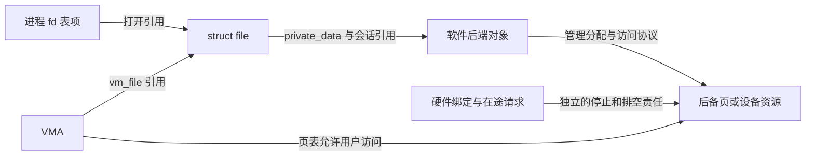
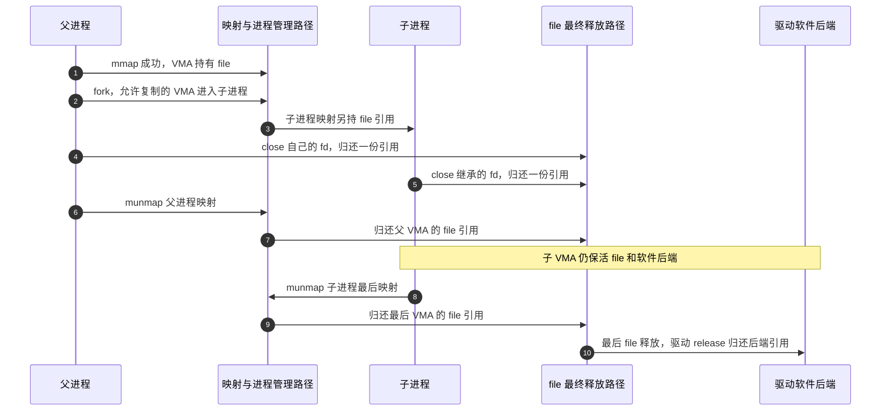

# 第7章\_mmap与跨文件生命周期

前两章仍由 read/write 回调复制数据并检查设备状态。现在假设应用反复读取一大块采样结果，希望把结果区映射到自己的地址空间，直接访问其中的字节。这样可以省去部分重复复制，但应用后续的普通内存访问不一定再进入驱动回调：谁继续保活后备内存，设备移除怎样阻止访问，就成了新的问题。

本章沿第四章已经建立的 file 与 **虚拟内存区域（VMA）** 引用关系，先看普通软件后端，再区分 DMA 内存和设备寄存器。目标是能够决定映射对象、访问权限和退出策略；不把一个页帧映射函数当成适用于所有字符设备的模板。

## 7.1\_映射改变了所有权问题

普通同步 read/write 的回调结束后，驱动不能继续随意使用本次传入的用户缓冲区。mmap 则建立持续的地址关联：调用返回以后，应用仍可通过映射地址读写。`close(fd)` 只删除这个整数描述符持有的引用，不等于解除映射。

这里不能再把 close 与 `.release()` 混为一谈。普通文件映射通过 `vma->vm_file` 持有 file 引用；在没有其他特殊关系的例子里，这个引用恰好能把最终 release 延后到映射结束。如果 release 再归还软件后端引用，后端就能经由这条链继续存活。是否需要额外的 VMA 引用，要看映射是否还有独立于 file 的后备对象，而不是看到 mmap 就一律加一套计数。

VFS 如何从 file 建立 VMA、在 page fault 时取得文件页以及维持 `vm_file` 引用，见 [文件 mmap 与 page fault](../../kernel_subsystems/vfs/P18_文件mmap与page_fault.md)。本章只解释设备 MMIO、DMA 缓冲区和可热拔硬件带来的额外约束。

图中有两种不同的边：引用边决定软件对象何时能回收，映射边决定用户还能访问什么地址。file 存活不自动保住驱动解绑时撤销的 MMIO 或 DMA 资源。反过来，即使设备已离线，设计为独立存活的纯软件结果页仍可以留给应用读取。

## 7.2\_先确定映射对象类型

同样叫“采样结果区”，地址的含义可能完全不同。若驱动只想给应用一份普通内存结果，应分配可按所选页映射接口管理的后备页，并保证整个可见范围已初始化。若设备也会直接写这片内存，便要遵守 DMA 分配与映射接口的地址、缓存和所有权要求。若要暴露的是设备寄存器，则是在允许应用触发硬件动作，已经超出“共享普通字节”的承诺。

**物理页帧号（Page Frame Number，PFN）** 是物理地址按页划分后的编号；CPU 虚拟地址、PFN 和设备使用的 DMA 地址不是可互换的整数。设备地址可能经过总线或 IOMMU 转换，不能把 DMA 地址直接右移就当成可映射的 CPU 物理页帧。IOMMU 在这里指设备侧的地址转换与访问隔离机制。

有了这个区分，再选择映射路径：

| 后备对象 | 应保持的关系 | 需要特别检查的边界 |
| --- | --- | --- |
| 普通内核页 | 页及其拥有者活到最后映射结束，使用适合这类页的映射接口 | 不能泄漏页内未初始化数据或同页其他对象 |
| 一致性 DMA 缓冲 | 使用匹配 DMA 分配结果的 mmap 帮助器，例如 `dma_mmap_coherent` | 使用相同设备、分配范围及地址身份；缓存一致不代表操作顺序和并发所有权自动正确 |
| 设备 MMIO | 仅暴露允许用户访问的资源范围，并设置合适属性 | 寄存器读写可能有副作用；权限、缓存属性、断电及移除行为必须明确 |
| 任意 kmalloc 小对象 | 不能直接视为一份可独占映射的页资源 | 与其他对象共页、分配大小和释放方式可能都不满足映射契约 |

`vm_pgoff` 表示用户请求的页偏移，映射长度来自 VMA 的地址范围。驱动要在换算前检查偏移是否能安全转换，换算后先确认偏移不超过资源大小，再用“长度不大于剩余大小”判断范围，避免先计算偏移加长度导致整数溢出。还要检查请求的读写权限、共享方式及所选接口要求的标志；一个只读结果区不能因为应用要求可写就直接照办。

例如资源大小为 4 页，请求从第 3 页开始映射 2 页，会越过资源末尾；不能因为起始页有效就接受。映射粒度是页，设备只实现半页寄存器时，同页剩余范围也必须经过硬件与权限评估，不能用“只允许访问前半页”的文字代替页表实际授予的权限。

## 7.3\_VMA\_也是一个独立共享层

先选择最简单的软件后端：file 会话已经持有后备对象，后备页不依赖硬件绑定，没有额外 VMA 私有对象。应用建立一份映射，再 fork 出子进程；父进程关闭 fd 和解除自己的映射以后，子进程仍可能保留映射。谁最后结束映射，谁才可能触发最后 file 引用归还。

步骤 4、5 结束的是整数入口；步骤 7 后仍有步骤 3 建立的映射引用。只有步骤 9 结束且不存在其他引用时，步骤 10 才成立。实际释放可能延后执行，图表达依赖，不承诺立即在某个系统调用栈上回收。

若每份映射还有独立上下文，可以用 `vm_private_data` 保存其地址，通过 `vm_operations_struct` 操作表中的 open/close 回调配对取得和归还引用。要检查第一次 mmap 成功时是谁取得初始引用，不能假定“设置 open 指针，内核就一定替初次映射加了一次”；fork、拆分等后续变化也要按固定实现核对，失败回滚不得多归还或少归还。选择 file 保活还是附加 VMA 保活，依据是对象归属与回调需要。

映射建立后，应用读写这些地址通常不经过 read/write 回调，所以驱动的 io_lock 不会自动串行化用户的直接访问。若用户和 DMA 设备共享一个环形区，还需定义哪个索引由谁写、数据何时发布、何时允许覆盖，以及相应内存顺序；“一致性 DMA 内存”只解决相应缓存可见性问题，不能消除协议竞争。没有这样的共享协议时，继续采用受控 read/write 往往更容易保证正确性。

## 7.4\_移除策略必须在\_ABI\_设计时决定

把纯软件页换成 MMIO，设备移除时原映射仍可能直达失效资源。只在 file 中写 disconnected 没用：已有页表允许的普通加载/存储可以绕过 read 回调，甚至不发生新的缺页。**缺页处理（page fault）** 只处理需要建立或修复映射的访问，不能看见每一次已经映射成功的读写。

因此“离线后 fault 返回错误”仅覆盖未来进入 fault 的访问。如果设计支持撤销，必须在正确同步下阻止新映射与新 fault 建立，撤销已有用户映射并处理已经在途的访问，再按硬件协议释放资源；不能只加一个错误返回。`unmap_mapping_range` 可在相应 address_space 关联范围中撤销映射，但它不自动完成设备停止、任意自建映射发现或整个热移除协议。具体总线和内存映射方式可能根本不提供所需保证。

根据产品需求选择一种完整策略：

| 需求与条件 | 可选择的设计 | 换来的限制 |
| --- | --- | --- |
| 需要热移除，但没有可靠撤销协议 | 不提供硬件 mmap，保留 read/write | 保留复制或系统调用开销，访问裁决仍集中在驱动 |
| 只需读取最终软件结果 | 让后备页独立于绑定存活，停止设备写入后留给旧映射 | 占用内存持续到旧映射结束，不能把已释放 DMA 资源当成普通结果页 |
| 必须直映且确有完整撤销机制 | 同步关闭建立入口、撤销旧映射、处理 fault 和在途访问 | 实现与验证复杂，需要具体内存管理和总线证据 |
| 生命周期由上层严格约束 | 映射期间禁止相关移除并保证约束实际可执行 | 用户可能长期持有映射，必须接受其运维与资源代价 |

第四章的 S4 离线仍负责拒绝新文件操作，S5 必须新增本设计的映射/硬件交接，S6 才是软件对象最终回收。问自己三个问题：关闭两个 fd 但子 VMA 还在，后端能否释放？只改 fault 返回值，已装入页表是否马上失效？映射 4 页资源的最后 2 页时，起始偏移应该至多是多少？答案依次是不能、不会、2 页；这三项分别检查引用、访问路径和范围。

上述边界按 NXP 官方 Linux 6.12.20 固定提交 `dfaf2136deb2af2e60b994421281ba42f1c087e0` 核对：`mm/mmap.c` 建立 vm_file、`kernel/fork.c:dup_mmap` 复制 VMA 与引用、`mm/vma.c:remove_vma` 关闭并归还 file、`mm/memory.c` 的页帧映射与范围撤销；DMA 接口类型见同版本 `include/linux/dma-mapping.h` 和 `Documentation/core-api/dma-api.rst`。这些是软件契约证据，不证明任意开发板都能安全直映或热拔。

下一章把字符设备放回真实驱动的组合环境：[设备模型与硬件子系统交接](P08_设备模型与硬件子系统交接.md)。
