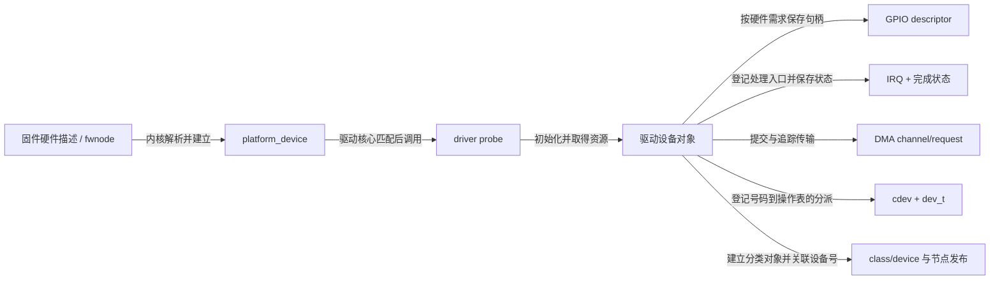
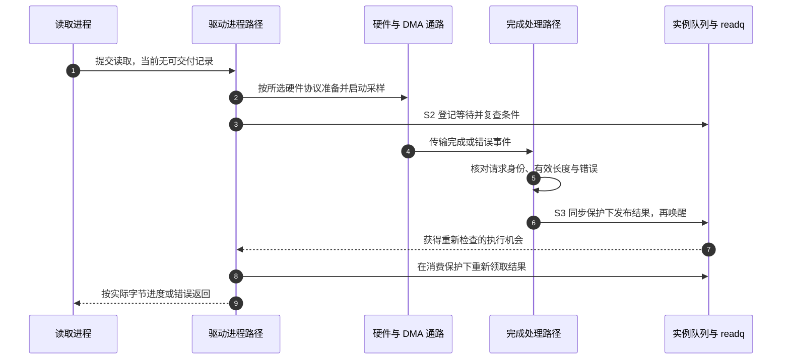

# 第8章\_设备模型与硬件子系统交接

前面的内存窗口和队列已经能接收应用请求，但其中的“生产者”仍可由软件模拟。现在换成一块片上采样单元：驱动需要知道寄存器在哪里、完成事件对应哪个中断、数据是否由 DMA 写入内存，最后才把结果交给用户。字符设备号没有包含这些信息，所以必须把用户入口接到另一条硬件发现与资源管理链上。

本章承接[设备映射的资源边界](P07_mmap与跨文件生命周期.md)，选择 Linux 的 platform 设备作为组合场景。先解释这些资源各自交付什么，再走一轮准备、发布、完成的过程；总线匹配和各硬件子系统的全部实现仍由对应专题承担。

## 8.1\_字符设备不是设备发现机制

先从来源分开两个号码体系。用户节点中的 dev_t 只帮助打开路径找到 cdev；硬件描述中的地址和中断连接则帮助驱动找到实际资源。它们即使都包含数字，也不在同一个命名空间中。创建 `/dev/sample0` 不会让内核凭这个名字推断采样单元的物理地址。

对于不能像可枚举总线设备那样自行发现的片上单元，系统可通过 **设备树（Device Tree，DT）** 描述节点、资源与连接，Linux 根据描述建立 `platform_device` 设备对象。另一些平台使用 **高级配置与电源接口（Advanced Configuration and Power Interface，ACPI）** 提供固件描述；二者是硬件信息来源，不是字符文件操作表。`fwnode` 是内核统一表示固件节点的接口，让使用者不必总直接依赖某一种描述格式。

设备与驱动匹配以后，驱动核心调用 `probe` 探测/初始化回调。probe 取得并校验资源，准备实例状态，再按失败协议发布服务。这里采用 platform 只是为了闭合一个具体场景：可枚举总线有自己的发现与匹配路径，但最后同样需要明确资源和用户入口的交接。

## 8.2\_贯穿对象应是设备实例

同一采样单元同时有三种进入方式：probe/remove 从总线设备进入，open 从 cdev 进入，数据回调从 file 会话进入。若各自分配一份互不关联的“设备状态”，完成方就可能把数据写进甲对象，等待者却在乙对象里观察 ready。因此选择一个实例对象 `struct demo_device`，保存锁、队列、离线状态以及所需资源句柄；每条入口都必须能追到它。

`platform_set_drvdata` 把实例地址关联到 platform 设备，remove 用对应 getter 找回；`inode->i_cdev` 配合内嵌成员关系让 open 找回实例；`file->private_data` 则保存本次会话地址，会话再引用实例。中断处理入口登记时还可传入实例上下文，DMA 完成路径从其请求对象找到拥有者。这里的“保存地址”只建立查找边，不自动增加引用。

尤其要区分两个 device 角色。platform_device 中的 `struct device` 表示硬件模型对象；第四章用于保活自有软件后端的 device 可以是另一对象，不能只因类型名称相同就认为父引用必然保住整块驱动私有内存。若实例用 devm 分配，它可能在解绑后回收，即使 platform device 仍被引用、旧 file 也还存在。设计允许旧 file 继续返回离线错误时，须为它访问的软件状态建立独立且确实覆盖旧引用的寿命。

## 8.3\_GPIO\_IRQ\_DMA\_各自交付什么

假设采样单元需要一根控制线启动采样，用完成中断报告结果，大块数据由 DMA 搬入内存。这三条路径分别改变控制电平、报告事件和搬运数据，并不是三个可替换的“读取设备”函数。实际硬件也可能不需要其中某一条，不能为了凑齐图中模块全部申请。

**通用输入输出（General Purpose Input/Output，GPIO）** 子系统给出描述符形式的引脚句柄和相应操作；驱动要按接口是否允许睡眠选择调用上下文。IRQ 子系统交付 Linux 中断号与处理入口的登记关系；中断处理程序需要依据设备状态辨认完成或错误，不能仅凭进入了 IRQ 回调就判定用户缓冲已有完整数据。DMA 子系统负责传输准备、提交与完成关系；描述符保存一次传输描述，cookie 是提交后的跟踪标识，均不能替代请求对象的寿命和结果状态。

按这些职责再整理交接边：

| 子系统 | 交给字符设备组合层的对象/事件 | 字符设备保存的交叉状态 |
| --- | --- | --- |
| 设备树/fwnode | 属性、资源描述、依赖关系 | 不复制节点，保存解析后的资源句柄 |
| GPIO | `gpio_desc` 和方向/值操作 | 设备配置、错误和并发策略 |
| IRQ | Linux IRQ 号与处理入口 | 数据就绪、错误、计数及等待队列 |
| DMA | channel、映射、descriptor/cookie、完成回调 | 请求所有权、完成和取消状态 |

IRQ/DMA 完成方必须先按同步协议更新共享状态，再通知等待者。字符设备不能把一个瞬时中断信号直接等同于“用户尚未读取的事件”；若事件不可丢，必须用计数或队列保存。

步骤 2 只是启动，不是步骤 9 的完成承诺；步骤 4 也不直接把数据交给应用，要先经过步骤 5、6 的请求判定和共享发布。实际完成可能早于步骤 3，登记后复查仍应发现已有结果。图采用有明确请求结果的采样协议；持续流设备可能在 open 以前就已运行，不能把这张图的启动位置照搬过去。

## 8.4\_初始化发布顺序

上面的正常路径隐含了一个前提：第一次可能进入完成回调时，锁、队列和实例地址都已经有效。申请 IRQ 后就可能收到事件，发布 cdev 后已有同号节点就可能打开，所以初始化不是“probe 返回以前做完就行”，而是必须早于各自的可进入时刻。

`probe()` 应在任何可进入的回调或中断之前准备好它们依赖的状态。号码预留、cdev 分派、模型对象和节点有不同发布点；顺序要根据失败之后是否可能已有使用者来设计，而不是固定要求“cdev 总在节点之前”。例如[class 与属性控制实例](../../linux/device_model/class_sysfs/P02_让属性控制字符读取.md#2.3_发布顺序为何这样选择)先准备全部状态和模型对象，最后 cdev_add，允许短暂的可见而不可打开窗口；若反过来，后续失败必须处理已经打开的 file。真实硬件还要单独处理已启用的中断和 DMA，不能把软件实例的顺序直接当作硬件模板。

沿第四章 S0/S1，可把本实例的准备理解为：先建立回调要用的软件状态和引用协议，再取得并配置资源，在允许硬件产生回调以前准备完成状态；最后发布用户服务。硬件若在注册处理程序时就能发中断，需要在此前完成处理路径前提或使用子系统允许的关闭来源方案。不能用未经验证的固定 API 顺序代替设备协议。

`devm_*` 把资源清理登记到设备管理机制中，减少手工释放配对；它不会替驱动排空已打开 file、停止所有在途 DMA 或关闭用户映射。回滚既要逆转已完成的取得步骤，也要阻止新的使用者并同步结束已经进入的访问。某一步失败时，先问“哪些入口已经可进”，再决定撤销哪些关系。

例如 cdev 尚未发布但 IRQ 已登记，不能只释放实例然后返回错误，因为中断处理路径可能已经取得实例地址；反过来，新节点尚未创建但 cdev 已发布，也不能声称不存在旧 fd，用户可能从已有同号节点打开。这两种反例分别检验硬件入口与用户入口，下一章统一处理它们的退出。

设备模型完整状态机见[设备模型专题](../../linux/device_model/大纲.md)；GPIO、IRQ、DMA 分别由其权威专题解释。这里的接口职责按 NXP 官方 Linux 6.12.20 固定提交 `dfaf2136deb2af2e60b994421281ba42f1c087e0` 的 `include/linux/platform_device.h`、`drivers/base/dd.c`、`drivers/base/devres.c` 及 `fs/char_dev.c` 核对，采样时序是教学集成方案，不是对某个具体 SoC 寄存器或接线的声明。

下一章沿反方向执行 remove：[安全移除、旧 fd 与模块卸载](P09_安全移除_旧fd与模块卸载.md)。
