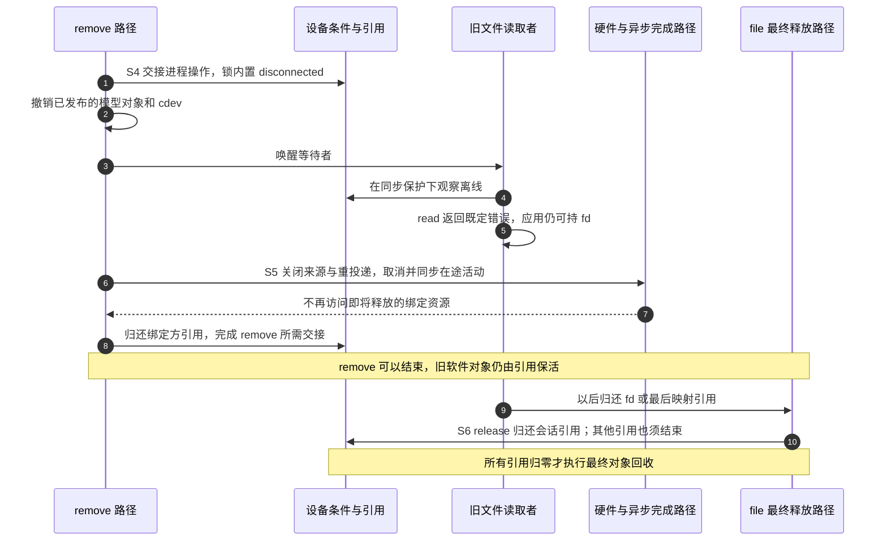

# 第9章\_安全移除\_旧fd与模块卸载

[上一章](P08_设备模型与硬件子系统交接.md)把用户请求接到了真实采样单元。现在让应用打开设备并睡在 read 中，同时触发驱动解绑：内核需要停止硬件，但应用没有义务立即 close。若 remove 一直等待用户关闭，解绑可能永远不结束；若 remove 直接释放实例，醒来的 read 又会访问失效地址。

本章沿第四章 S4～S6 区分两项完成条件：**硬件绑定已经停止并可以退出**，以及 **旧软件使用者全部归还引用，可以最终回收对象**。这两件事不必发生在同一时刻。映射是否支持撤销，继续采用[第七章建立的映射策略](P07_mmap与跨文件生命周期.md)，不能在移除时临时补一句“禁止再访问”。

## 9.1\_删除入口不等于释放对象

删除一个节点只撤销那条路径入口，其他同号别名可能还在，已经开始的打开也可能持有对象。`cdev_del` 撤销号码到 cdev 的映射并归还注册引用，旧 file 已保存的 f_op 与 private_data 不会因此消失；在途打开、VMA 和 IRQ/DMA 请求仍需各自的结束条件。

所以本例先在共同同步域中标记 disconnected，阻止任何后来取得操作资格的路径继续触碰硬件，再撤销发布关系。标志必须由所有相关 I/O 和提交路径读取；只写在 remove 里、数据路径不检查的布尔值，没有关闭入口的作用。

VFS 的 close、`fput()`、VMA 和通用 file/inode 回收关系见 [VFS 对象回收](../../kernel_subsystems/vfs/P21_file_dentry_inode与superblock回收.md)。字符设备 remove 还必须在这一通用生命周期之外排空设备私有请求和硬件回调。

## 9.2\_remove返回与最终回收是两个完成点

先保留第四章的锁协议：进程在 io_lock 下进入需要硬件的操作，短时取得 qlock 修改队列或离线状态；完成路径只短时取得 qlock。remove 取得 io_lock，意味着此前持锁的进程操作已经交接完；随后在 qlock 内置离线，再释放两把锁。异步请求可能比提交回调活得更久，所以这一步仍不能证明硬件已停止。

接着撤销模型对象与 cdev 入口，发布终止状态并唤醒相关等待队列。等待者读取离线条件后可以返回错误，旧 fd 留着也不会继续等待永远不会到来的新数据。然后停止设备发起新事务，并按所属子系统协议同步结束中断处理、DMA、timer 和工作项；若工作项还能重新启动 DMA，还要关闭这条重新投递边，不能只取消眼前那一个请求。

“禁止中断”和“设备不再访问内存”不是同一件事。只屏蔽完成通知，DMA 仍可能继续写缓冲；只等待当前 IRQ 回调返回，未来硬件事件仍可能重新进入。具体停止顺序由设备协议决定，必须同时证明来源关闭、在途访问结束以及不再重新投递。同步等待时不能持有被等待回调也要取得的锁。

步骤 6、7 是 remove 为硬件资源必须等到的结论；步骤 9、10 可能晚很久。remove 不必等应用愿意关闭文件，但必须保证旧回调只访问仍被保活的软件状态。第四章的 device/cdev 父引用、会话引用以及此处的绑定方引用共同维持地址，不能把其中某一个 put 当成“立即 kfree 整个实例”。

三组状态在退出时的分工如下：

| 状态与位置 | 写入/结束者 | 哪个完成点依赖它 |
| --- | --- | --- |
| 实例中的 disconnected 与队列终止结果 | remove 在同步域中发布，旧 I/O 读取 | S4 关闭服务，等待者可以退出 |
| 硬件请求、IRQ、工作项等在途责任 | 子系统停止与同步协议 | S5 允许解绑资源退出，remove 可以返回 |
| 软件对象、会话、映射的使用引用 | 各持有者归还，最终释放回调回收 | S6 回收内存，可能晚于 remove 返回 |

devm 管理的资源还会在驱动核心相应清理阶段释放。remove 返回以前必须完成它们所要求的停止与排空，不能指望“以后最后一个 fd 关闭”才停止使用这些资源。

## 9.3\_旧\_fd\_的行为必须稳定

按照本例协议，旧 fd 的新 I/O 返回表示设备不可用的 `-ENODEV`，poll 报告离线的错误/挂断状态；其他设备也可以定义输入输出错误 `-EIO` 或先排完已完成数据。选择哪一种属于应用与驱动的 ABI 契约，关键是 read、poll、等待和映射的说法一致。

现在预测一个边界：open 已经取得软件引用并通过在线检查，remove 才开始。这个 open 仍可能返回成功，但紧随其后的 read 会看到离线并失败；这不是引用失效，而是服务状态变化。与之相反，若 remove 释放软件对象，旧回调连读 disconnected 都不安全，就违反了寿命协议。

`.release()` 因此只清理会话与其引用，必须能在硬件已消失后执行，不能在这里最后再读一次已撤销寄存器。若文件仍有 VMA 引用，最终 release 还可能更晚；对直接 MMIO 的撤销需已经在 S5 设计中处理，不能靠推迟软件对象释放保护失效硬件。

## 9.4\_模块引用和设备对象引用解决不同问题

解绑某个设备和卸载驱动模块也不是同一个动作。一个驱动模块可能服务多个实例，单个设备已经解绑时，旧 file 仍可能需要调用这个模块的 release 代码。因此既要保住被访问的数据，也要保住访问它的代码。

`fops_get` 会通过操作表的 `.owner = THIS_MODULE` 取得相应模块引用，普通模块卸载流程不能在这些使用引用仍存在时回收代码；它不自动保活 private_data 指向的任意分配。设备对象引用保证软件地址有效，却不替代 IRQ 同步和 DMA 取消。省略 owner、绕过引用或强制卸载的配置不满足这里的普通卸载前提。

当模块引用已经阻止普通卸载时，不能把“rmmod 没成功”误判成 remove 必须等待所有 fd 的证据：可能根本没有进入模块退出。主动解绑则可能在代码仍加载的情况下先撤销某个设备的硬件绑定，旧软件会话留到以后清理。这正是需要分开代码、实例与硬件三种寿命的原因。

## 9.5\_失败初始化也是缩短版\_remove

回到 probe 的失败路径，判断依据不是“新节点创建到了哪一行”，而是哪些访问入口已经发布。即使 device 节点还未创建，只要 cdev 已可查找，已有同号节点就可能让应用进入。第四章的 `cdev_device_add` 更明确要求调用者假定：即使帮助函数最终失败，用户也可能已经打开过。

如果用户入口与硬件回调都尚未可进，回滚只需归还本路径已经取得的资源。若 IRQ 已登记、DMA 已提交或 cdev 已发布，就必须先关闭相应新访问、发布终止、同步在途路径，再归还绑定方引用；已交付的会话按 S6 退出。不能把尚未初始化的锁用于清理，也不能对帮助函数已经撤销的发布关系再无条件删除一次。

按成功点分别记录拥有者和撤销责任，比单独维护一个“初始化成功”布尔值更准确。代码可以使用顺序清理标签，但每个标签必须对应真实已取得的资源集，并保持回调可能继续执行时的地址有效性。

试着判断两个失败：cdev 发布后，模型对象创建失败，是否能直接释放实例？已经停止发中断，但 DMA 引擎尚未停止，是否能释放结果缓冲？两题都不能；前者可能已有旧 file，后者仍有设备内存访问。修复分别需要使用引用交接和硬件停止证明，不能交换这两种证据。

本章采用 NXP 官方 Linux 6.12.20 固定提交 `dfaf2136deb2af2e60b994421281ba42f1c087e0`：`fs/char_dev.c` 说明删除入口和发布失败后旧打开的边界，`fs/file_table.c` 在最终释放中调用驱动回调并归还 cdev/fops 引用，`drivers/base/dd.c` 与 `drivers/base/devres.c` 确定解绑清理层次。具体硬件的取消和停止仍须核对对应子系统与设备协议；本章没有把某个固定 API 顺序宣称为所有驱动的通用实现。

完成生命周期闭环后，下一章先用[字符设备驱动模板](P10_字符设备驱动模板.md)落实纯软件窗口。它没有真实硬件绑定，不会伪装成这里所有热移除责任的通用实现；后续流式模板再增加等待与通知。
