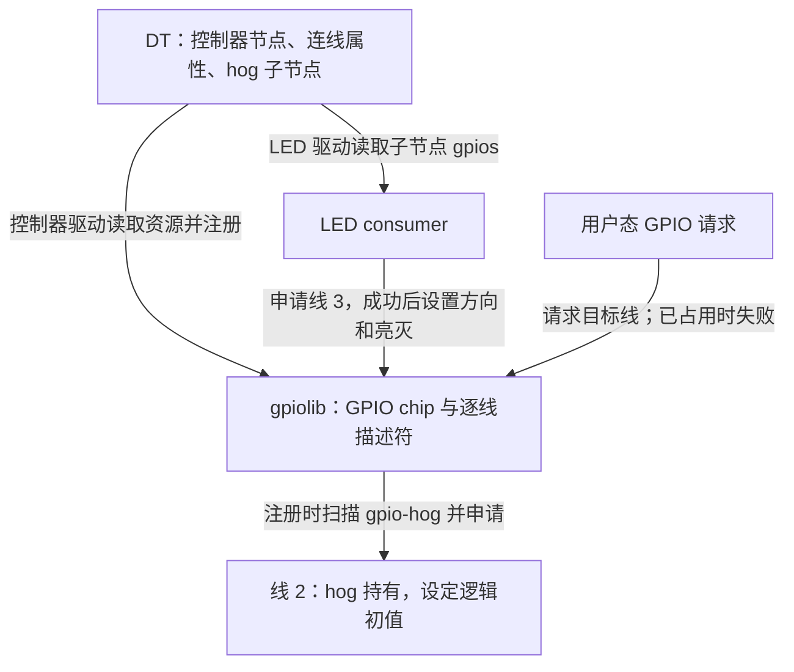
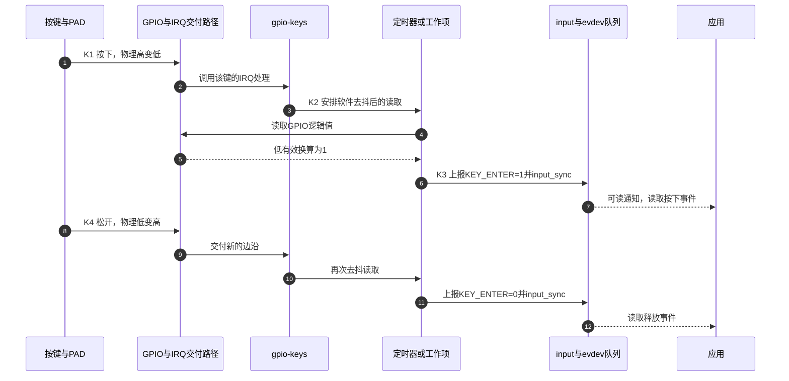

# 第1章\_GPIO连接命名占用与按键事件

一块板上有指示灯、按键和上电后必须保持的控制线。它们都接到了 GPIO，却不能用同一套“写一个编号，再读写电平”的办法处理：指示灯要响应亮灭请求，按键要报告按下与松开，固定控制线则需要在控制器可用后取得持续占用。设备树必须把连接、使用者和使用目的交代清楚，Linux 才能把合适的驱动放到这条线上。

本篇承接 [GPIO连接引脚复用与编号空间](设备树+platform开发/P06_GPIO连接引脚复用与编号空间.md)，重点练习板级描述中的命名、hog 与 gpio-keys；描述符数组和 `gpio-ranges` 的完整推导留在前置章节。GPIO 控制器、物理 PAD、pinctrl 和 Linux IRQ 仍是不同对象，不能因它们涉及同一根线就合成一个编号。文中 Linux 行为按 [源码基线](../../../research/source_reading/linux/SOURCE_BASELINE.md) 所记录的 NXP Linux 6.12.20 固定提交核对，不把“6.1+”当作未经验证的通用兼容承诺。

## 1.1\_先确定谁使用线再写引用

**讲解层次：概念层，Linux GPIO 绑定与描述符契约。** 先看一只低有效 LED：电流路径和板上反相关系决定 GPIO 输出低时 LED 亮。设备树应记录这条连接，使 LED 驱动可以用“亮”这个逻辑请求工作；换成高有效的另一块板时，驱动算法不用为了布线重新写一遍。

一个常见的引用是 `gpios = <&gpio_a 3 GPIO_ACTIVE_LOW>;`。它先找到 `gpio_a`，再由该控制器的绑定解释余下参数。在本篇选定的两参数格式里，`3` 是控制器内部的局部偏移，最后一个参数携带有效极性等标志。**`#gpio-cells = <2>` 只数 phandle 后面的两个参数；整个引用在 DTB 中占三个 32 位 cell。** 它不是封装引脚 3，也不是 `/dev/gpiochip3` 或 Linux IRQ 3。

### 1.1.1\_控制器声明了格式并不等于已经注册

控制器节点中的 `gpio-controller;` 声明其提供 GPIO，`#gpio-cells` 声明引用参数数目。硬件驱动还必须识别该节点、取得寄存器或总线资源，并向 gpiolib 注册 GPIO chip。消费者随后才能解析引用、申请描述符并设置方向。少了控制器驱动，设备树解析成功也不会凭空产生能控制引脚的对象。

这时再整理属性，才能看出每一项分别解决什么问题：

| 所在节点与属性 | 类型与含义 | 本文需要的边界 |
| --- | --- | --- |
| 控制器 `gpio-controller` | 无值布尔属性，声明 GPIO 提供者 | 不能代替驱动注册 |
| 控制器 `#gpio-cells` | 一个整数，定义每个引用的参数个数 | 参数顺序由该控制器绑定定义；不全都固定为二 |
| 控制器 `gpio-line-names` | 字符串列表，按局部偏移从 0 排列的线名 | 可有空字符串；允许只命名前面部分线 |
| 控制器 `ngpios` | 对支持它的绑定，描述有效 GPIO 槽位数 | 不能据此把不存在的引脚变出来 |
| 控制器 `gpio-reserved-ranges` | 起始偏移与数量组成的保留区间 | 用于不能使用的线，支持情况由绑定和驱动确定 |
| 消费者 `<用途>-gpios` | 一个或多个 GPIO 引用 | 名称必须符合消费者绑定，不能自行改名后期望驱动猜测 |

例如通用驱动请求用途 `reset` 时，通常寻找 `reset-gpios`。同一设备的 reset、enable 是两种职责，应分别命名；同一职责的多根并行数据线可组成 `data-gpios` 数组。SPI 的 `cs-gpios` 也有其总线绑定和索引规则，不能把不同职责随意装进一个数组。既有 `gpio-leds` 和 `gpio-keys` 的子节点使用无前缀 `gpios`，这是它们的既有契约；新绑定不应据此默认采用无用途名称。

下面是 **消费者片段**，前提是板级已有两个真实 GPIO 提供者；它展示同一职责的数组，而不是完整板级树：

```dts
data-gpios = <&gpio_a 7 GPIO_ACTIVE_HIGH>,
             <&gpio_b 1 GPIO_ACTIVE_LOW>;
reset-gpios = <&gpio_a 2 GPIO_ACTIVE_LOW>;
```

数组索引 0 对应 `gpio_a` 的线 7，索引 1 对应 `gpio_b` 的线 1；它们各自的有效极性可以不同。驱动按用途、索引取得描述符后才使用这些约定。逗号方便分组，最终属性仍是一串 cell，并不是运行时创建了 C 数组对象。

> 依据：[固定内核 GPIO 通用绑定，1 gpios property、1.1 GPIO specifier best practices、2 gpio-controller nodes](https://github.com/nxp-imx/linux-imx/blob/dfaf2136deb2af2e60b994421281ba42f1c087e0/Documentation/devicetree/bindings/gpio/gpio.txt)。这里给出的是绑定契约；某个控制器实际接受哪些参数，还需它自己的绑定。

### 1.1.2\_线名帮助定位而不改变连线

板上连的是电源保持线还是用户灯，比“GPIO0”更能帮助维护者定位。可以给已存在的控制器追加名称：

```dts
/* 板级片段：gpio_a 是已有控制器标签。 */
&gpio_a {
    gpio-line-names = "", "", "RESET_N", "USER_LED", "", "USER_KEY";
};
```

这表示线 2、3、5 得到了名称。第 0、1、4 项为空，不能删掉它们，否则后面的名字就移到了错误偏移；第 6 项以后没写不等于这些线不存在。线名不会把线 3 自动配置成输出，也不会让 LED 驱动改用它。`gpio-line-names` 的生产者线名、hog 的 `line-name` 占用标签和消费者绑定里的 `label` 用途不同，工具可能分别展示它们；字符串相同并不建立硬件连接，也不能假定名称全系统唯一。

## 1.2\_有效极性和电气方式分别改变什么

对低有效 LED，描述符逻辑写 1 表示激活，控制器引脚应呈低；逻辑写 0 表示不激活，应呈高。`GPIO_ACTIVE_LOW` 使逻辑访问执行这个换算，**不会为输入自动打开上拉，也不会把中断设为下降沿**。

| 描述符逻辑值 | 高有效推挽线的物理值 | 低有效推挽线的物理值 |
| --- | --- | --- |
| 0，不激活 | 低 | 高 |
| 1，激活 | 高 | 低 |

这里限定推挽，是因为开漏输出“高”时通常释放为高阻，需要外部或受支持的内部上拉形成电压；缺上拉时，逻辑换算正确也不保证测到高。单端输出可以由硬件实现，也可能由框架按支持条件以方向切换模拟，不能看到 `GPIO_OPEN_DRAIN` 就断言芯片一定有独立开漏输出寄存器。

| 常用标志 | 对描述的补充 | 不能替代的条件 |
| --- | --- | --- |
| `GPIO_ACTIVE_HIGH` / `GPIO_ACTIVE_LOW` | 逻辑激活对应的控制器侧极性 | 外设自身可配置极性的约定、板上反相关系 |
| `GPIO_PUSH_PULL` / `GPIO_OPEN_DRAIN` / `GPIO_OPEN_SOURCE` | 推挽或单端电气方式 | 硬件支持、电压兼容、必要的拉电阻 |
| `GPIO_PERSISTENT` / `GPIO_TRANSITORY` | 是否允许在低功耗时丢失输出状态的请求 | 电源域和控制器真正保持状态的能力 |
| `GPIO_PULL_UP` / `GPIO_PULL_DOWN` | 通用标志中的简单拉电阻请求 | 提供者是否实现；复杂强度配置仍需 pinconf |

合法组合可写成 `(GPIO_ACTIVE_LOW | GPIO_OPEN_DRAIN)`。这些宏来自内核 `include/dt-bindings/gpio/gpio.h`；它们需要 C 预处理，不是 `dtc` 自己认识的关键词。`GPIO_PULL_UP` 是真实存在的标志，不能笼统判为错误写法；也不能反过来承诺所有控制器接受它。关于当前线实际采用哪一条电气配置路径，要依据提供者实现，避免在 GPIO 标志和 pinctrl 中下达互相矛盾的请求。

> 依据：[固定内核 GPIO 消费者接口，The active-low and open drain semantics](https://github.com/nxp-imx/linux-imx/blob/dfaf2136deb2af2e60b994421281ba42f1c087e0/Documentation/driver-api/gpio/consumer.rst)；[GPIO 绑定的标准标志位](https://github.com/nxp-imx/linux-imx/blob/dfaf2136deb2af2e60b994421281ba42f1c087e0/Documentation/devicetree/bindings/gpio/gpio.txt)。有效极性属于请求解释，输出保持和偏置请求仍受实现能力约束。

## 1.3\_谁在什么时候取得占用

GPIO 属性只是连线说明，并不会在解析 DTB 时自动使所有消费者开始工作。LED 驱动可能后来才探测成功，固定控制线却希望在 GPIO 控制器注册时就取得占用。**GPIO hog** 为后一种情况提供声明式请求：由控制器注册路径替这条固定用途的线申请并配置方向与初始值，不需要再写一个独立的消费者驱动。

这不代表“无需驱动参与”或“通电瞬间生效”。GPIO 控制器驱动尚未执行前，管脚依然受复位默认值、固件和硬件电路约束。若信号必须从通电起保持安全，不能只靠 Linux hog 弥补早期空窗。

### 1.3.1\_用逻辑值理解hog的输出初值

以下是追加到已有 GPIO 控制器的片段，固定线 2 为低有效复位的释放状态：

```dts
&gpio_a {
    reset-release-hog {
        gpio-hog;
        gpios = <2 GPIO_ACTIVE_LOW>;
        output-low; /* 逻辑 0：低有效复位不激活，推挽物理高。 */
        line-name = "reset-release";
    };
};
```

`gpio-hog;` 是识别该子节点的必要属性，节点名字含有 hog 不算声明。其 `gpios` 省略 phandle，因为提供者就是父控制器；本例每条占两个 cell。`input`、`output-low`、`output-high` 应只选一个。Linux 6.12 的 hog 路径把后两项转换成描述符逻辑输出 0、1，因此上例换成 `output-high;` 会 **激活复位并驱动物理低**，不是释放。

| 低有效线的hog设置 | 逻辑意义 | 推挽物理结果 |
| --- | --- | --- |
| `output-low` | 不激活 | 高 |
| `output-high` | 激活 | 低 |
| `input` | 作为输入，不主动驱动 | 由外部电路与偏置决定 |

hog 占用成功后，另一驱动或普通用户态 GPIO 请求不能把同一条线再当空闲线使用。若复位需要在 probe、错误恢复和休眠时动态拉起放下，就应交给有该生命周期的设备驱动或复位框架；hog 适合持续固定用途，不是“先设置一下，随后自动交还”的初始化脚本。

下面图里的框是软件参与者与描述状态，箭头表示注册或请求；它没有把不同消费者画成连续的数据流水线。



hog、LED 和用户态请求都涉及同一组逐线占用状态，但各自只申请目标线。申请失败首先说明资源或配置条件未满足，不能直接推断输出寄存器坏了。

> 依据：[GPIO 绑定的 hog 定义](https://github.com/nxp-imx/linux-imx/blob/dfaf2136deb2af2e60b994421281ba42f1c087e0/Documentation/devicetree/bindings/gpio/gpio.txt)；[固定版本 gpiolib-of.c 的 hog 解析与注册路径](https://github.com/nxp-imx/linux-imx/blob/dfaf2136deb2af2e60b994421281ba42f1c087e0/drivers/gpio/gpiolib-of.c)。本节依据其接口结果解释逻辑初值，不要求读者展开函数体。

### 1.3.2\_LED由已有子系统管理

对于要正常亮灭的 LED，可以使用已有 `gpio-leds` 驱动。以下板级片段假定 `gpio_a` 和 `board_led_pins` 已由真实 SoC/板级描述定义：

```dts
/ {
    leds {
        compatible = "gpio-leds";
        pinctrl-names = "default";
        pinctrl-0 = <&board_led_pins>;

        led-user {
            label = "board:user";
            gpios = <&gpio_a 3 GPIO_ACTIVE_LOW>;
            default-state = "off";
        };
    };
};
```

驱动申请 GPIO 后，`off` 对低有效线意味着逻辑不激活。后续亮灭通过 LED 子系统控制，不需要用户态绕开驱动重新申请 GPIO。换线时既要修改 `gpios`，也要按新 PAD 检查 pinctrl、布线和冲突；换极性必须由真实电路支持，不是为了把观测结果“调成正常”随便翻转标志。

> 依据：[固定内核 leds-gpio.yaml](https://github.com/nxp-imx/linux-imx/blob/dfaf2136deb2af2e60b994421281ba42f1c087e0/Documentation/devicetree/bindings/leds/leds-gpio.yaml)。这是片段，未提供的板级 pin 组不能用空标签伪装成可直接启动的整板配置。

## 1.4\_pinctrl怎样让GPIO请求到达正确的PAD

**讲解层次：概念到实现的映射，Linux pinctrl 与 i.MX6UL/Rockchip 绑定示例。** GPIO 数据寄存器里的一个位和焊盘外的电压之间，还可能隔着复用选择器。若 PAD 当前接 UART 发送器，GPIO 输出值变了，外部引脚也未必跟着变。因此要分别建立“GPIO 控制器的线”和“PAD 当前选择的功能”。

一般由 pinctrl 配置复用和 pad 电气属性，由 GPIO consumer 配置方向、数据和逻辑极性；GPIO 请求也可能通过 pinctrl 的 GPIO 回调完成复用，固定功能 GPIO 甚至没有可选的复用器。故正确要求是 **有效硬件状态必须匹配用途**，不能说每个板级消费者都必须手写一组 `pinctrl-0`。反过来，固件碰巧配对也不能证明 Linux 描述完整。

### 1.4.1\_先看一个i.MX宏究竟展开成什么

以固定源码的 i.MX6UL 引脚头文件为例，真实定义为：

```c
/* 上游宏：五项分别是寄存器偏移和选择值，不是 GPIO 输出初值。 */
#define MX6UL_PAD_GPIO1_IO03__GPIO1_IO03 0x0068 0x02f4 0x0000 5 0
```

在 `fsl,pins` 中，这五项后面还要接一个 pad 配置值。本例使用 `0x10b0` 说明格式，不作为任意电路的推荐电气值：

```dts
/* 板级片段：iomuxc 标签来自所用 SoC dtsi。 */
&iomuxc {
    board_led_pins: ledgrp {
        fsl,pins = <MX6UL_PAD_GPIO1_IO03__GPIO1_IO03 0x10b0>;
    };
};
```

这里把 GPIO1_IO03 PAD 选择到 GPIO 功能；前节 LED 的 `gpio_a` 若要对应它，必须实际指向该 SoC 的 GPIO1 控制器。两种标签不能仅靠相似名字认定对应。展开后的六项按绑定解释如下，寄存器偏移均相对所用 IOMUXC 编程基址：

| 序号 | 本例值 | 绑定字段与作用 |
| --- | --- | --- |
| 1 | `0x0068` | `mux_reg`，复用选择寄存器偏移 |
| 2 | `0x02f4` | `conf_reg`，PAD 电气配置寄存器偏移 |
| 3 | `0x0000` | `input_reg`，本选择无须独立输入选择寄存器 |
| 4 | `5` | `mux_val`，写入的复用模式，选择 GPIO |
| 5 | `0` | `input_val`，输入选择值；本选择未使用独立输入寄存器 |
| 6 | `0x10b0` | `pad_setting`，PAD 配置值，不是 GPIO 输出数据 |

为避免把这个常见十六进制值当成咒语，下面按该绑定中的字段拆开。这里只解释已使用的配置，不能将它搬到所有 i.MX PAD 或其他 SoC：

| 位或字段 | `0x10b0` 中的值 | 此绑定中的含义 |
| --- | --- | --- |
| HYS，bit 16 | 0 | 未开启输入迟滞 |
| PUS，bits 15:14 | 0 | 拉电阻选择编码为 100 kΩ 下拉；是否真正作为 pull 工作还看 PUE/PKE |
| PUE，bit 13；PKE，bit 12 | 0；1 | 使能 keeper/pull 功能并选择 keeper；不能把它解释成已打开上拉 |
| ODE，bit 11 | 0 | 未选择开漏 |
| SPEED，bits 7:6 | 2 | 该绑定没有为编码 2 列出具名速度，不能仅凭示例断言它等于 low/medium/high |
| DSE，bits 5:3 | 6 | 该绑定列出的驱动编码为 43 Ω；不是“6 mA” |
| SRE，bit 0 | 0 | 慢转换速率选择 |

这张表足以否定“`0x10b0` 就是通用上拉配置”的说法，也说明为何上板必须用目标芯片手册与电气要求决定值。这里不把未核对的 SPEED 编码扩展成硬件结论；要选明确设置，应从目标 PAD 支持的字段逐项组成，而不是继续复制该常见数值。

> 依据：[固定版本 imx6ul-pinfunc.h](https://github.com/nxp-imx/linux-imx/blob/dfaf2136deb2af2e60b994421281ba42f1c087e0/arch/arm/boot/dts/nxp/imx/imx6ul-pinfunc.h)；[fsl,imx6ul-pinctrl.yaml 的 fsl,pins 六项和 PAD 字段](https://github.com/nxp-imx/linux-imx/blob/dfaf2136deb2af2e60b994421281ba42f1c087e0/Documentation/devicetree/bindings/pinctrl/fsl,imx6ul-pinctrl.yaml)。这些表说明本产品绑定如何组织写入，不能代替板级电气验收。

### 1.4.2\_状态名与厂商格式是两层规则

同一 UART 可能在工作时使用串口功能，在睡眠时让 PAD 进入低功耗配置。设备树可先把这两套配置命名，再由实际电源管理路径选择；仅写一个 `sleep` 名称不会自动出现 suspend 回调。

```dts
/* 消费者片段：三组标签都必须在目标控制器下真实定义。 */
&uart1 {
    pinctrl-names = "default", "sleep";
    pinctrl-0 = <&uart_work_pins &uart_aux_pins>;
    pinctrl-1 = <&uart_sleep_pins>;
};
```

第 0 状态名为 `default`，可引用多个组；第 1 状态名为 `sleep`。状态选取会改变这些组所对应 PAD 的复用或配置，不能推导 GPIO 输出方向也已经设置。比如把 UART1_TX_DATA 切成 GPIO1_IO16 只完成复用选择，若还要求输出固定电平，必须明确哪条受支持路径同时负责方向和数据。

不同平台描述组内内容的格式不同，不能互相翻译成几个名称相近的“flags”：

| 组内格式 | 一项的组织 | 本地阅读规则 |
| --- | --- | --- |
| i.MX6UL `fsl,pins` | 五项 pin-function 宏 + 一项 pad 设置 | 前面五项包含偏移与选择值，最后一项是硬件配置编码 |
| Rockchip `rockchip,pins` | bank、bank 内 pin、mux、配置节点 phandle | 第四项是引用，**不是直接的电气 flags 数值** |
| 通用 pinconf 配置节点 | `bias-pull-up`、`drive-strength` 等属性 | 放置位置、可用组合与取值由该控制器绑定决定 |

例如 Rockchip 的 `<0 3 0 &pcfg_pull_up>` 指 bank 0 的 pin 3、GPIO 复用及一个配置节点。`pcfg_pull_up` 节点里可以按绑定写 `bias-pull-up;`，它不是一个要直接写入某寄存器的数字宏。通用 `drive-strength` 通常以 mA 表达；`slew-rate` 的编码由控制器规定，不能一概解释为 0 慢、1 快。`input-enable` 控制输入缓冲，`bias-disable` 禁止拉偏置，`output-high/low` 则是 pinconf 请求；不要把 pinconf 的物理输出要求与上一节 hog 的描述符逻辑极性直接套用。

> 依据：[pinctrl-bindings.txt 的 client states 与 pin configuration](https://github.com/nxp-imx/linux-imx/blob/dfaf2136deb2af2e60b994421281ba42f1c087e0/Documentation/devicetree/bindings/pinctrl/pinctrl-bindings.txt)；[rockchip,pinctrl.yaml 的 rockchip,pins](https://github.com/nxp-imx/linux-imx/blob/dfaf2136deb2af2e60b994421281ba42f1c087e0/Documentation/devicetree/bindings/pinctrl/rockchip,pinctrl.yaml)。完整引脚组配置继续阅读 [pinctrl 专项](设备树语法专题-02-pinctrl.md)。

## 1.5\_按键需要从电平变化得到输入事件

**讲解层次：概念到实现的映射，GPIO 中断连接与 Linux 6.12 gpio-keys。** 低有效按键通常由拉电阻维持松开时为高，按下接地变低。应用需要知道“按下了哪个键”，而不是不断打开 GPIO 设备自己轮询。GPIO 中断负责通知输入变化，gpio-keys 负责读取状态、去抖并把结果转换成 input 事件。

### 1.5.1\_先分清下游线号与上游汇聚中断

GPIO 控制器可同时提供 GPIO 和中断两种服务。它的 `#gpio-cells` 定义 GPIO 引用；`#interrupt-cells` 定义 **下游使用该 GPIO 中断控制器** 的参数。它自己向 GIC 发请求所用的 `interrupts`，则由上游 GIC 的绑定解释。这是相邻两层各自的格式，不是 ARM 上所有控制器都采用三元组。

| 描述对象 | 提供者决定的格式示例 | 本项中的数字归属 |
| --- | --- | --- |
| i.MX GPIO 输入连接 | `<&gpio1 5 GPIO_ACTIVE_LOW>` | GPIO1 内偏移 5，后跟 GPIO 极性 |
| i.MX GPIO 下游中断 | `interrupt-parent = <&gpio1>; interrupts = <5 IRQ_TYPE_EDGE_FALLING>;` | GPIO1 内中断线 5，后跟 IRQ 触发类型；该绑定是两参数 |
| GPIO bank 向 GIC 的汇聚请求 | SoC dtsi 中的 GIC SPI 三参数条目 | GIC 类型内的 SPI 索引，不能从 GPIO 偏移 5 计算 |

一个 GPIO bank 还可能有多条上游汇聚中断，具体数量和接线由芯片确定。不能为讲 GPIO 中断把 SoC 内部 UART 的真实 `interrupt-parent` 改成 GPIO 控制器。外接设备的 INT 引脚真实接到 GPIO 时，才应描述那条 GPIO 中断连接。

Linux 将提供者域内的硬件编号映射为 Linux IRQ，映射可能按请求建立，**不能用 `IRQ base + GPIO offset` 作为通用公式**。取得描述符后的 `gpiod_to_irq()` 只返回相应中断身份或错误；它不安装处理函数，不替调用者读按键状态，也不证明该线具备中断能力。

> 依据：[固定内核 fsl-imx-gpio.yaml 的 GPIO 与 interrupt cell](https://github.com/nxp-imx/linux-imx/blob/dfaf2136deb2af2e60b994421281ba42f1c087e0/Documentation/devicetree/bindings/gpio/fsl-imx-gpio.yaml)。中断编号完整推导见 [中断连接怎样成为驱动可用的IRQ](设备树+platform开发/P05_中断连接怎样成为驱动可用的IRQ.md)。

### 1.5.2\_用gpio-keys描述按下和松开

下面是板级片段。`gpio_a`、`gpio_b` 是已有且支持相应用法的控制器，`board_key_pins` 是实际的输入复用与偏置组。头文件供内核 DTS 预处理使用；不是把此片段单独交给 `dtc` 就能生成目标板树。

```dts
#include <dt-bindings/gpio/gpio.h>
#include <dt-bindings/input/input.h>

/ {
    keys {
        compatible = "gpio-keys";
        pinctrl-names = "default";
        pinctrl-0 = <&board_key_pins>;

        key-user {
            label = "user";
            linux,code = <KEY_ENTER>;
            gpios = <&gpio_a 5 GPIO_ACTIVE_LOW>;
            debounce-interval = <10>;
        };

        key-back {
            label = "back";
            linux,code = <KEY_BACK>;
            gpios = <&gpio_b 7 GPIO_ACTIVE_LOW>;
        };
    };
};
```

gpio-keys 取得子节点 GPIO 输入后，本例没有显式中断，所以由描述符取得对应 IRQ。GPIO 路径通常请求上升沿和下降沿以观察松开、按下两种变化，然后读取逻辑状态。因而低有效不是“只处理下降沿”，把极性写反也未必导致完全没中断，更可能颠倒按下与松开的判断。

第二个键省略去抖值，固定版本默认 5 ms；第一个要求 10 ms。驱动先尝试硬件去抖，失败时使用软件路径；可睡眠 GPIO 与不可睡眠 GPIO 的延后读取方式不同。去抖减少抖动事件，但引入判断延迟，不能承诺任意短脉冲都保留。

| 子节点属性 | 当前例子的意义 | 选择边界 |
| --- | --- | --- |
| `linux,code` | `KEY_ENTER`、`KEY_BACK` 是 input 键码 | 不是 GPIO 偏移和 IRQ 编号 |
| `label` | 人类可读的键描述 | 不能代替 `gpios` 连接 |
| `linux,input-type` | 省略时为 `EV_KEY` | GPIO 型还支持绑定定义的其他事件类型；不能任意填数字 |
| `debounce-interval` | 毫秒，默认 5，本例首键 10 | 实际去抖方式取决于 GPIO 能力 |
| `wakeup-source` | 请求作为系统唤醒源 | 仍需要电源、pad、IRQ 路由、驱动与系统策略共同支持 |
| `wakeup-event-action` | 对已声明唤醒的键选择激活、释放或两者 | 由逻辑极性推导所需物理边沿，不等于普通运行时只收该边沿 |
| `interrupts` / `interrupts-extended` | 按绑定显式给出主 IRQ 或独立唤醒 IRQ | 有两个中断时还需按绑定写 `interrupt-names` |

GPIO 和显式 IRQ 可同时出现，此时 GPIO 仍用来读状态；只有 IRQ、没有 GPIO 的按键分支不能直接测到持续电平，释放事件由该分支的定时规则合成，不能当作真实松开沿。没有可用 GPIO 中断时，可考虑 `gpio-keys-polled` 与必需的 `poll-interval`，但周期采样有开销和短脉冲遗漏边界，不自动获得相同唤醒能力。

### 1.5.3\_沿一次按键追踪状态与事件

为避免把“电压变了”“收到 IRQ”“应用收到按键”当作同一时刻，固定以下阶段。前提是 GPIO 路径、input 设备和 IRQ 均已初始化成功，按键由低有效接线提供稳定输入。

| 阶段 | 发生什么 | 状态或信息在哪里 | 下一方怎样知道 |
| --- | --- | --- | --- |
| K0，松开 | 线为高，逻辑不激活 | PAD/GPIO 输入状态；驱动的输入事件状态 | 等待下一次变化 |
| K1，按下 | 线变低，GPIO 检测变化 | 控制器的中断检测状态 | 经上游中断路径进入该键 IRQ 处理 |
| K2，去抖读取 | 按硬件或软件去抖方式读取逻辑值 | GPIO 描述符极性、驱动去抖定时器/工作项 | 去抖路径运行后取得状态 1 |
| K3，上报 | 产生 `EV_KEY/KEY_ENTER/1` 并同步 | input 设备与已打开 evdev 客户端的事件队列 | 阻塞读或 poll 被唤醒，应用读取 |
| K4，松开再走一轮 | 上升变化经同样路径得到逻辑 0 | 对应输入状态与事件队列 | 应用收到释放事件 |

下面展开 **软件去抖** 分支，图中的 GPIO/IRQ 框概括硬件检测与内核交付路径，不把控制器误画成直接调用 C 函数：



步骤 2 只证明处理路径被调用；步骤 4～5 才把物理状态解释为逻辑状态；步骤 6～7 才使用户态得到事件。步骤 8～12 说明为什么只盯下降沿不足以验证普通按键的完整按下/松开周期。若软件去抖尚未结束就松开，最终读取的状态可能已经回到 0，这与“每个电气脉冲必有一对按键事件”的错误预期不同。

> 依据：[固定内核 gpio-keys.yaml](https://github.com/nxp-imx/linux-imx/blob/dfaf2136deb2af2e60b994421281ba42f1c087e0/Documentation/devicetree/bindings/input/gpio-keys.yaml) 与 [gpio_keys.c 的 GPIO/IRQ 分支和去抖上报路径](https://github.com/nxp-imx/linux-imx/blob/dfaf2136deb2af2e60b994421281ba42f1c087e0/drivers/input/keyboard/gpio_keys.c)。表与时序限定 GPIO 按键路径，没有把 IRQ-only 的合成释放套入 K4。

## 1.6\_先验证描述再验证运行

前面的连接关系可以先在主机上验证编码，再到目标板核对驱动和信号。两种验证回答不同问题：编译与属性读取检查“写进了什么”，运行观察检查“谁使用了它、产生了什么结果”。先把描述中的错误排除，才能避免将一个 cell 写错误诊为硬件故障。

### 1.6.1\_不接板也能验证引用的编码

建立一个空的 `gpio-description` 实验目录，把下面内容保存为 `gpio_description.dts`。它是 **离线编码练习**：提供者是教学节点，没有可驱动硬件的 compatible 和寄存器，因此不能拿生成的 DTB 启动板子。本例用数值 0/1 表示高/低有效，28 表示 `KEY_ENTER`，省去 C 预处理，以便直接交给 `dtc`。

```dts
/dts-v1/;

/ {
    gpio_demo: gpio-controller {
        gpio-controller;
        #gpio-cells = <2>;
        gpio-line-names = "", "", "RESET_N", "USER_LED", "", "USER_KEY";

        reset-release-hog {
            gpio-hog;
            gpios = <2 1>;
            output-low;
            line-name = "reset-release";
        };
    };

    leds {
        compatible = "gpio-leds";
        led-user {
            gpios = <&gpio_demo 3 1>;
            default-state = "off";
        };
    };

    keys {
        compatible = "gpio-keys";
        key-user {
            linux,code = <28>;
            gpios = <&gpio_demo 5 1>;
            debounce-interval = <10>;
        };
    };
};
```

主机需有 DTC 与配套 `fdtget`，先编译出同目录 DTB：

```bash
# 工作目录：新建的 gpio-description 实验目录。
dtc -I dts -O dtb -o gpio_description.dtb gpio_description.dts
```

退出码为 0 表示这个描述能编码；没有真实驱动的教学节点仍然不是可用硬件。接着分别读取提供者 phandle 和消费者属性：

```bash
# 工作目录：gpio-description 实验目录。
fdtget -t x gpio_description.dtb /gpio-controller phandle
fdtget -t x gpio_description.dtb /leds/led-user gpios
fdtget -t x gpio_description.dtb /gpio-controller/reset-release-hog gpios
```

设第一行返回 `H`，第二行应为 `H 3 1`，第三行应为 `2 1`。不要把 H 的具体数值写死：phandle 是编译后的引用身份；hog 没有 phandle，但消费者有。再反编译查看布尔属性和节点结构是否保留：

```bash
# 工作目录：gpio-description 实验目录。
dtc -I dtb -O dts -o decoded.dts gpio_description.dtb
```

在 `decoded.dts` 中找 `gpio-hog;`、`output-low;` 和 `#gpio-cells`。随后把源码中的 hog 从 `output-low` 改成 `output-high`，重复编译和反编译：输出属性应变化，但 `gpios` 仍是 `2 1`。这能验证描述变化，**物理电平的相反结果来自前文逻辑契约推导，此离线实验没有测量电压**。完成后恢复 `output-low`。

### 1.6.2\_在目标板上检查每一层的证据

目标板运行检查另需正确 DTB、相应控制器/LED/input 配置与驱动、实际接线，以及可读取设备节点的权限。先只观察：

```bash
# 工作目录：目标板 Linux 的任意可读目录。
gpioinfo --version
gpioinfo
```

`gpioinfo` 展示的是当前注册的芯片、线名、占用者、方向等信息。`gpiochipN` 的 N 不保证与 DTS 标签里的数字一致；先按芯片标签和线名核对目标，再谈编号。libgpiod 1.x 与 2.x 选项不同，若要限定芯片，1.x 常用 `gpioinfo gpiochip0`，2.x 使用 `gpioinfo -c gpiochip0`；必须先确认版本。线名缺失先核对 DT 列表位置和实际加载树，不要要求名字列表必须填满控制器所有线。

按键线已经归 gpio-keys 占用时，不用 `gpioget` 再次申请它来验证状态，也不用 `gpioset` 把它改成输出。沿 input 入口观察：

```bash
# 工作目录：目标板 Linux 的任意可读目录。
cat /proc/bus/input/devices
```

根据目标 input 设备的名称和 Handlers 字段找它的 `eventN`，再监视那个实际节点。以下 `event3` 仅展示命令形状，执行前替换为本板查到的编号：

```bash
# 工作目录：目标板 Linux；event3 已替换为本板目标 input 节点。
evtest /dev/input/event3
```

普通按键预期出现对应 `EV_KEY` 键码的值 1 与值 0，以及同步事件。自动重复时还可能有值 2。先验证完整按下/松开周期，再研究唤醒；一次成功唤醒只证明所测电源状态和配置，`wakeup-source` 存在本身不是验收结果。

若目标内核提供启动 FDT，可复制并反编译它，以检查固件实际交给内核的内容：

```bash
# 工作目录：目标板上可写的诊断目录。
dtc -I dtb -O dts -o boot_received.dts /sys/firmware/fdt
```

此文件是启动 FDT 证据，不一定反映后来的动态 overlay；要查看当前设备树，可在接口存在且有权限时使用 `dtc -I fs -O dts -o live_tree.dts /sys/firmware/devicetree/base`。复用诊断还可读取已挂载 debugfs 下目标控制器的 `pinmux-pins`、`pinconf-pins`，但这些调试接口取决于内核配置和驱动，不能把文件不存在等同于硬件没有 pinctrl。

对于 **确实空闲且用途已确认** 的测试线，用户态 `gpioget`、`gpioset`、`gpiomon` 才分别适合读取、输出请求和边沿监控。其请求会建立自身配置和占用，不能继承另一个已释放 consumer 的逻辑约定；也不能依赖 `gpioset` 进程退出后仍保持电平。libgpiod 2.x 的具体选项见 [官方命令工具文档](https://libgpiod.readthedocs.io/en/v2.3.1/gpio_tools.html)，本篇不向已归 LED/按键/hog 的线下达第二份请求。

| 观察到的现象 | 先查哪一层 | 不能草率下的结论 |
| --- | --- | --- |
| 没有 GPIO chip | 控制器节点、驱动、资源与 probe 日志 | 不是先改消费者线号 |
| 请求 busy | 当前占用者与是否为 hog/LED/按键 | 不是必须绕过框架直接写寄存器 |
| 能申请但 PAD 没变化 | 复用、方向、电压域、开漏上拉与电路连接 | 不是只靠 active-low 修复 |
| 按下/松开颠倒 | 实际接线与 GPIO 极性 | IRQ 已到达不代表逻辑意义正确 |
| 有中断但没输入事件 | 去抖读取、input 注册、目标 event 节点 | GPIO 中断计数不等于应用收到事件 |
| 无法唤醒 | 电源状态、pad 保持、唤醒路径与策略 | 不只是漏写一个布尔属性 |

## 1.7\_改一个条件再预测结果

**练习一：** 控制器使用两参数 GPIO 格式，消费者属性为 `<&gpio_a 5 GPIO_ACTIVE_LOW>`，为什么编译后有三个数？答案是第一个为提供者 phandle，后两个才是 `#gpio-cells` 所数的参数；hog 在父节点中已知提供者，所以同类描述只有两个数。

**练习二：** 将低有效 hog 的 `output-low` 改成 `output-high`，能否说“引脚从低变高”？不能。描述符请求从逻辑 0 变成逻辑 1；对推挽低有效线，结果是物理高变低。若是开漏，还要区分主动拉低和释放高阻。

**练习三：** 给线 5 命名为 `USER_KEY` 后，就可以删掉 gpio-keys 的 `gpios` 吗？不能。线名是诊断名称，连接仍依赖 phandle 和参数；驱动不会靠同名字符串重建连线。

**练习四：** GPIO bank 上游使用 GIC 三参数中断，它的下游也必须三参数吗？不能这样推导。两个接口分别由 GIC 与 GPIO 控制器绑定定义，i.MX GPIO 下游使用两参数；更不能用上游 SPI 索引当作该键 Linux IRQ。

**练习五：** 只加入 `pinctrl-names = "default", "sleep"` 就证明休眠时线进入低电平吗？没有。还缺状态引用、实际选择路径、配置内容以及输出方向和极性责任；一个名字无法替代这些动作。

现在可以从连接描述追到占用，再从按键电平追到应用事件；还不能仅靠这些描述证明板级电气参数和电源状态正确。需要深入引脚组与状态选择时，进入 [pinctrl 专项](设备树语法专题-02-pinctrl.md)；需要 GPIO 框架内部角色和生命周期时，按 [GPIO 专题阅读地图](../gpio/大纲.md#1.2_阅读地图) 继续。
