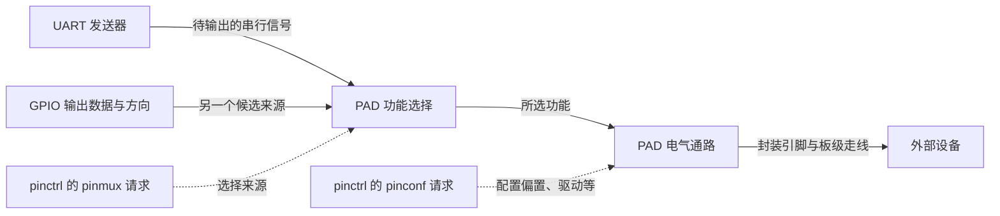

# 第2章\_引脚配置怎样连接外设与焊盘

串口驱动已经开始发送，连接器上却看不到波形。此时再改串口波特率之前，需要先确认另一件事：芯片内部的串口发送信号究竟接到了哪个 PAD？PAD 是芯片边缘与封装引脚相连的焊盘，不等于 UART、GPIO bank 或 Linux 设备节点。同一个 PAD 可以在几种内部信号间选择，选错后，外设内部运行正常也不代表板上连线可用。

本章承接 [GPIO连接命名占用与按键事件](P01_GPIO连接命名占用与按键事件.md)，把引脚控制从 GPIO 场景中单独展开。我们先建立职责，再写状态引用，最后用 i.MX6UL 的真实格式把配置落到具体偏移和值。这里只解决“要配置什么、怎样描述”；何时执行、失败怎样处理，在 [下一章](P03_引脚状态切换与GPIO占用交接.md) 继续。

## 2.1\_内部信号接对以后还需要电气条件

**讲解层次：概念层，Linux pinctrl 契约。** 设串口发送器已经产生 0、1 的序列，一个可复用 PAD 同时有 UART_TX 和 GPIO 输出两种候选输入。复用选择器必须选 UART_TX，这条序列才可能到达 PAD。这类“选择哪个内部功能”的工作叫 **引脚复用，pin multiplexing，简称 pinmux**。

但选择正确还不够。PAD 的输出能力、边沿速率和输入偏置也要符合板上电压、负载与接线要求。例如输入没有外部驱动时，需要合适的偏置避免悬空；长连线上的强驱动、快边沿可能带来振铃和干扰；驱动太弱也可能无法在接收时刻达到有效电平。这类电气设置称作 **引脚配置，pin configuration，简称 pinconf**。

Linux 用 **pinctrl，引脚控制子系统** 组织这两类职责，让外设驱动选择一组板级配置，而不是把每块板的 PAD 寄存器地址写死在驱动里。硬件上可以有多个控制器，也可以由一个硬件块提供 GPIO、pinmux、pinconf 多种功能；软件职责相邻不等于它们必定是同一个物理模块。

下图是功能关系图，表示信号选择和电气作用位置，不声明所有芯片都采用相同内部电路：



实线是信号关系，虚线是配置动作。GPIO 写一个数据位通常不会顺便重写 pinmux；UART 开始传输也不会自动纠正板上选错的 PAD。另一方面，PAD 的输入缓冲使能不等于 GPIO 方向已设为输入，更不等于 IRQ 处理程序已注册。

选择 pinctrl 的收益是把“外设何时工作”与“本板使用哪些引脚”分开维护。代价是必须让消费者、控制器驱动和绑定描述彼此匹配；通用属性并不能越过硬件能力。只有一套固定裸机程序时，直接初始化寄存器仍能完成任务；当同一外设驱动服务多块板或需运行时切换配置时，独立的状态描述才更有价值。

> 依据：[固定 NXP Linux 6.12.20 的 pin-control.rst，PINCTRL、PINMUX、PINCONF 与 consumer 接口说明](https://github.com/nxp-imx/linux-imx/blob/dfaf2136deb2af2e60b994421281ba42f1c087e0/Documentation/driver-api/pin-control.rst)。后面的具体实现位置按 [源码阅读索引](../../../research/source_reading/pinctrl/navigation/P01_Linux_6.12_pinctrl源码阅读索引.md) 定位；抽象职责不据此推断所有 SoC 的物理分块。

## 2.2\_把一组设置命名后交给消费者选择

假设 UART 运行时要配置 TX、RX 两个 PAD，睡眠时又要采用另一组设置。若每次调用都传入一串偏移和值，外设驱动就重新依赖了板级细节。pinctrl 将这些设置组织为 **状态 state**：状态名是消费者选择配置的入口，状态内容则由板级描述提供。

### 2.2.1\_控制器配置节点与消费者状态各管一层

一个设备树片段可写成：

```dts
/* 消费者片段：uart1 与三个配置标签均须由目标树定义。 */
&uart1 {
    pinctrl-names = "default", "sleep";
    pinctrl-0 = <&uart_tx_work &uart_rx_work>;
    pinctrl-1 = <&uart_quiet>;
};
```

`pinctrl-names` 的第 0、1 项分别命名 `pinctrl-0`、`pinctrl-1`。一个状态可以引用多个配置节点，甚至涉及不同控制器；这些节点内部究竟写数字元组、引脚名还是组名，由各自控制器绑定决定。配置标签只是 DTS 引用名称，标签里带 `default` 不会自动使它成为默认状态。

| 对象 | 保存什么 | 谁解释或选择 |
| --- | --- | --- |
| 控制器节点 | 控制器身份、寄存器或其他访问资源 | 相应 pinctrl 提供者驱动 |
| 配置节点 | 一组 pinmux/pinconf 请求 | 提供者的设备树解析逻辑 |
| 消费者 `pinctrl-N` | 当前状态引用哪些配置节点 | pinctrl core 根据引用寻找提供者 |
| 消费者 `pinctrl-names` | 索引 N 对应的状态名 | 驱动/core 按名称查找状态 |

这不是父子包含关系的一一翻译。一个 UART 状态可引用控制器下面的配置，但 UART 并没有成为控制器的硬件子模块；同一个配置节点被两个消费者引用，也不表示同时使用同一 PAD 一定合法。

### 2.2.2\_pinctrl-N不是通用的带参数引用

本章所用的通用 consumer 绑定中，`pinctrl-N` 是 **配置节点 phandle 列表**。例如 `<&uart_tx_work &uart_rx_work>` 的两个 cell 都是引用，不是“一个控制器引用再加一个 pin 参数”。不能套用 `gpios` 的形式写 `<&iomuxc 16 5>`，再添加 `#pinctrl-cells = <2>` 期待 core 改变解释方式。

`#pinctrl-cells` 在某些控制器专用绑定中确有用途，例如描述配置表项格式；它并非虚构属性。但它 **不是所有 pinctrl 控制器必需的统一 phandle 参数数目**，更不对应控制器的 `npins`。本章选定的 i.MX6UL、Rockchip 和 Allwinner 配置节点，均应按各自绑定写，不能自创“i.MX 两个、Rockchip 一个、Allwinner 三个”的统一规则。

还有两个容易混淆的边界：

| 写法 | 固定 Linux 实现怎样理解 | 不能由此推出什么 |
| --- | --- | --- |
| 存在 `pinctrl-0`，没有 `pinctrl-names` | 可按数字字符串 `"0"` 命名状态 | 不会凭空获得名为 `default` 的状态 |
| `pinctrl-0 = <>;` 且名为 `default` | 显式空状态，可建立 dummy 映射 | 选择它不表示写了“默认硬件值” |
| 缺少 `pinctrl-0` | 未描述这个入口 | 不等于一个显式空状态 |
| 从 `pinctrl-0` 跳到 `pinctrl-2` | 固定实现的连续索引遍历会在缺失项停止 | 不能把缺口当作自动跳过的空状态 |

因此，空状态适合某些板型明确不需要配置的场景；如果硬件依赖引脚初始化，却用空状态让软件查找成功，只是隐藏了缺口。名字、引用和实际配置必须一起判断。

> 依据：[pinctrl-bindings.txt 的 client device node](https://github.com/nxp-imx/linux-imx/blob/dfaf2136deb2af2e60b994421281ba42f1c087e0/Documentation/devicetree/bindings/pinctrl/pinctrl-bindings.txt)；数字名、空状态和连续遍历的实现证据见 [状态映射讲解](../../../research/source_reading/pinctrl/source_explanations/P01_状态映射选择与探测交接.md#1.2_从连续属性建立映射与状态)。

## 2.3\_在i.MX6UL上把UART设置写成六个cell

**讲解层次：实现层，固定 NXP Linux 6.12.20 的 i.MX6UL IOMUXC 绑定。** 先独立建立这套实现，再比较其他形式。该 SoC 的主 IOMUXC 节点提供一段 MMIO 寄存器区域；GPIO bank 与它在 SoC 总线描述中并列。GPIO1_IO03 PAD 不是“GPIO1 控制器内部的第三个 IOMUXC 寄存器”。

固定 SoC dtsi 已声明主 IOMUXC 的 `compatible = "fsl,imx6ul-iomuxc"` 与 `reg = <0x020e0000 0x4000>`。板级通常在 `&iomuxc` 下追加组，**不要另造一个同地址控制器节点**。地址和长度按该父总线的 cell 规则解释，不能把控制器子节点的 `#address-cells` 当作本节点 `reg` 的格式。

### 2.3.1\_宏封装的是偏移和选择值

UART1 的 TX、RX 宏分别展开为五项。它们不是 C 运行时函数，也不是一个整数 pin ID；DTS 构建时的 C 预处理器把宏展开，随后 DTC 才把数值编码进 DTB。

| PAD 与功能 | mux_reg | conf_reg | input_reg | mux_val | input_val |
| --- | --- | --- | --- | --- | --- |
| UART1_TX_DATA → UART1_DCE_TX | `0x0084` | `0x0310` | `0` | `0` | `0` |
| UART1_RX_DATA → UART1_DCE_RX | `0x0088` | `0x0314` | `0x0624` | `0` | `3` |
| UART1_TX_DATA → GPIO1_IO16 | `0x0084` | `0x0310` | `0` | `5` | `0` |
| UART1_RX_DATA → GPIO1_IO17 | `0x0088` | `0x0314` | `0` | `5` | `0` |

前两列是复用与 PAD 配置寄存器偏移。第三列是输入选择寄存器偏移：一个外设输入可能来自多个 PAD，RX 例子还需要选择 UART1_RX_DATA 这一路，输入选择值为 3。输出 TX 没有同样的输入选择要求，零表示该项未使用；不能把最后的零解释成“GPIO 输出低”。

`fsl,pins` 每个条目还接一个 PAD 设置值，总计 **六个 32 位 cell，24 字节**。以下是板级片段；其中两个数值仅用于演示字段组合，必须经本板电压、负载、唤醒和信号完整性要求核对后才能使用：

```dts
&iomuxc {
    uart_work: uartworkgrp {
        fsl,pins = <
            MX6UL_PAD_UART1_TX_DATA__UART1_DCE_TX 0x1b071
            MX6UL_PAD_UART1_RX_DATA__UART1_DCE_RX 0x1b071
        >;
    };

    uart_quiet: uartquietgrp {
        fsl,pins = <
            MX6UL_PAD_UART1_TX_DATA__GPIO1_IO16 0x13070
            MX6UL_PAD_UART1_RX_DATA__GPIO1_IO17 0x13070
        >;
    };
};
```

工作组选择 UART，quiet 组选择 GPIO。**切到 GPIO 只改变复用，不自动保证输入、高阻或固定低电平**；GPIO 方向、数据及外部驱动仍需有明确责任方。这也是下一章讨论状态交接的原因。

### 2.3.2\_PAD配置值必须逐字段读

前例两个 PAD 值的组合按所引绑定说明如下。此处讨论写入意图，不承诺实际器件的电气测量结果：

| 字段 | `0x1b071` 工作示例 | `0x13070` quiet示例 | 本字段回答什么 |
| --- | --- | --- | --- |
| HYS，bit 16 | 1 | 1 | 输入迟滞使能 |
| PUS，bits 15:14 | 2，100 kΩ 上拉选择 | 0，100 kΩ 下拉选择 | pull 电阻方向/档位编码 |
| PUE，bit 13 | 1 | 1 | 选择 pull 模式 |
| PKE，bit 12 | 1 | 1 | keeper/pull 使能 |
| ODE，bit 11 | 0 | 0 | 未选择开漏 |
| SPEED，bits 7:6 | 1 | 1 | 绑定列出的 medium 编码 |
| DSE，bits 5:3 | 6 | 6 | 绑定列出的 43 Ω 驱动编码，不是 6 mA |
| SRE，bit 0 | 1 | 0 | 快/慢转换速率选择 |

软件传给 IOMUXC 的配置编码与通用 pinconf 的单位不是同一层。不能把 `drive-strength = <4>` 随手加到这个 `fsl,pins` 组里，就宣称它覆盖了六元组中的 DSE；该绑定的组格式不允许这样混写，驱动也不会因此获得一个新的通用配置解释器。

对照常见旧值也能检验是否读懂：`0x1b0b1` 与 `0x1b0b0` 只差 bit 0，所以不能把前者说成上拉、后者说成下拉。这两个值的 SPEED 位为 2，所引绑定没有给该编码具名速度；本文不把它推断成某种频率能力。选择配置应按目标 PAD 的权威手册核对，不从十六进制值的流行程度推导安全性。

| 本例访问位置 | 主 IOMUXC 基址加偏移 | 请求效果与边界 |
| --- | --- | --- |
| TX mux | `0x020e0084` | 模式 0 选 UART_TX，模式 5 选 GPIO1_IO16 |
| RX mux | `0x020e0088` | 模式 0 选 UART_RX，模式 5 选 GPIO1_IO17 |
| TX PAD | `0x020e0310` | 写所选 PAD 配置编码 |
| RX PAD | `0x020e0314` | 写所选 PAD 配置编码 |
| UART RX 输入选择 | `0x020e0624` | UART 工作示例写入 3；GPIO 模式条目没有该输入选择写入 |

这些是绑定与源码确认的访问位置，用来解释当前两根 PAD；它们不是让读者绕开驱动执行 `devmem` 写入的操作清单。GPIO1_IO03 的偏移是另一组，不能用它的 `0x0068/0x02f4` 观察 UART1_TX_DATA 的状态。

> 依据：[imx6ul-pinfunc.h](https://github.com/nxp-imx/linux-imx/blob/dfaf2136deb2af2e60b994421281ba42f1c087e0/arch/arm/boot/dts/nxp/imx/imx6ul-pinfunc.h)、[fsl,imx6ul-pinctrl.yaml 的六元组及 PAD 位定义](https://github.com/nxp-imx/linux-imx/blob/dfaf2136deb2af2e60b994421281ba42f1c087e0/Documentation/devicetree/bindings/pinctrl/fsl,imx6ul-pinctrl.yaml)、[imx6ul.dtsi 的主 IOMUXC 区域](https://github.com/nxp-imx/linux-imx/blob/dfaf2136deb2af2e60b994421281ba42f1c087e0/arch/arm/boot/dts/nxp/imx/imx6ul.dtsi)。写入兑现见 [i.MX6UL实现讲解](../../../research/source_reading/pinctrl/source_explanations/P02_iMX6UL配置解析与寄存器落点.md)。

## 2.4\_换一种控制器格式时保持什么不变

已经建立的共同问题是“选择 PAD 的功能，并提供电气请求”，共同入口是 consumer 的状态引用。换到其他 SoC 后，配置的表达和兑现方式可以变化；不能仅因属性都叫 pinctrl，就移植 i.MX 的偏移和值。

### 2.4.1\_Rockchip用配置引用复用电气设置

以固定 RK3568 dtsi 中 UART2 m0 组为例，RX/TX 使用 bank 0 的 PD0、PD1，mux 为 1：

```dts
/* 固定 SoC 描述中的组片段，pcfg_pull_up 在该树中已有定义。 */
uart2m0_xfer: uart2m0-xfer {
    rockchip,pins = <0 RK_PD0 1 &pcfg_pull_up>,
                    <0 RK_PD1 1 &pcfg_pull_up>;
};
```

四项依次为 bank、bank 内 pin 编号、mux 选择和 **配置节点 phandle**。第四项不是 flags 数值；多个组可以指向同一个写有 `bias-pull-up;` 的配置节点，避免重复描述电气请求。PD0、PD1 对应 bank 内偏移 24、25；按每组 8 根计数，B0 为 8，C0 为 16，不能把 16 注释成 B0。

mux 值 1 在这里对应这组 UART 路由，不代表 Rockchip 所有 PAD 的 mux 1 都是 UART。复用哪组信号仍要核对具体 SoC 的 pin 表和 dtsi，硬件已经接在 m0 的板不能靠换成 m1 的标签重新布线。

### 2.4.2\_字符串形式也依赖真实的引脚表

固定 Allwinner A13 绑定示例采用：

```dts
uart1_pe_pins: uart1-pe-pins {
    pins = "PE10", "PE11";
    function = "uart1";
};
```

`pins` 列出提供者可识别的引脚名，`function` 选择它们支持的功能。有些其他控制器采用 `groups` 引用驱动声明的组名；`pins`、`groups` 与 `function` 不是可随意添加到所有厂商节点中的万能属性。

字符串表达便于阅读，但还要由驱动把名字解析为本控制器选择器。**格式简单不能证明硬件每个 pin 只有一个合并寄存器**，也不能据此虚构统一 MUX/PULL/DATA 位表。要比较物理寄存器布局，必须另取具体芯片依据；本章只比较已建立的配置格式。

| 选定实现 | consumer引用 | 配置节点内表达 | 移植时重新核对什么 |
| --- | --- | --- | --- |
| i.MX6UL | 配置节点 phandle | 五项 pin-function 宏加 PAD 编码 | PAD/偏移、mux、输入选择、电气位 |
| RK3568 | 配置节点 phandle | bank、pin、mux、pinconf节点引用 | bank内编号、路由选项、配置支持 |
| A13绑定示例 | 配置节点 phandle | `pins` 与 `function` 字符串 | 引脚与功能名称是否被提供者接受 |

通用 pinconf 中 `bias-disable`、`bias-pull-up/down`、`input-enable`、`output-high/low`、`drive-strength` 与 `slew-rate` 表达各类请求；某个控制器可只支持其中一部分。驱动强度不是电流源设定，不意味着 LED 可以任意直接接到 PAD；内部弱上拉也不能仅凭存在就替代满足总线时序所需的外部电阻。选择条件来自电气要求和硬件支持，不是“高速就全开最大值”。

> 依据：[固定 rk3568-pinctrl.dtsi 的 uart2m0_xfer](https://github.com/nxp-imx/linux-imx/blob/dfaf2136deb2af2e60b994421281ba42f1c087e0/arch/arm64/boot/dts/rockchip/rk3568-pinctrl.dtsi)、[Rockchip pinctrl绑定](https://github.com/nxp-imx/linux-imx/blob/dfaf2136deb2af2e60b994421281ba42f1c087e0/Documentation/devicetree/bindings/pinctrl/rockchip,pinctrl.yaml)、[Allwinner绑定的A13示例](https://github.com/nxp-imx/linux-imx/blob/dfaf2136deb2af2e60b994421281ba42f1c087e0/Documentation/devicetree/bindings/pinctrl/allwinner,sun4i-a10-pinctrl.yaml)。

## 2.5\_离线观察引用与配置保持分离

现在验证编译器到底保存了什么。在空的 `pinctrl-description` 目录中建立 `pinctrl_description.dts`。下面使用上文宏展开后的数值，避免额外预处理依赖；控制器格式取自 i.MX6UL，但 consumer 是无硬件驱动的教学节点。它只用于编码检查，缺少真实整板描述，不得用作目标板启动 DTB。

```dts
/dts-v1/;

/ {
    #address-cells = <1>;
    #size-cells = <1>;

    iomuxc: pinctrl@20e0000 {
        compatible = "fsl,imx6ul-iomuxc";
        reg = <0x020e0000 0x4000>;

        uart_work: uartworkgrp {
            fsl,pins = <0x0084 0x0310 0 0 0 0x1b071>,
                       <0x0088 0x0314 0x0624 0 3 0x1b071>;
        };
        uart_quiet: uartquietgrp {
            fsl,pins = <0x0084 0x0310 0 5 0 0x13070>,
                       <0x0088 0x0314 0 5 0 0x13070>;
        };
    };

    pin-client {
        pinctrl-names = "default", "sleep", "unused";
        pinctrl-0 = <&uart_work>;
        pinctrl-1 = <&uart_quiet>;
        pinctrl-2 = <>;
    };
};
```

主机准备 DTC 及配套 `fdtget`。先在实验目录编译：

```bash
# 工作目录：新建的 pinctrl-description 实验目录。
dtc -I dts -O dtb -o pinctrl_description.dtb pinctrl_description.dts
```

然后分别读取状态引用和组内配置：

```bash
# 工作目录：pinctrl-description 实验目录。
fdtget -t x pinctrl_description.dtb /pin-client pinctrl-0
fdtget -t x pinctrl_description.dtb /pinctrl@20e0000/uartworkgrp phandle
fdtget -t x pinctrl_description.dtb /pinctrl@20e0000/uartworkgrp fsl,pins
```

前两行应相等，说明状态引用指向工作组；第三行应有 12 个数，即两个六 cell 条目。它们不是 `pinctrl-0` 后面附带的 12 个参数，DTC 也不会执行寄存器写入。

再将源码中 `pinctrl-0` 改为 `<&uart_quiet>`，重新编译、读取：consumer 现在应与quiet组的phandle匹配，`uartworkgrp` 的六元组不会因它暂时无人使用就自动变成 GPIO 配置。编译器可能重新分配phandle数值，所以应在同一份DTB里比较引用与目标，不能只要求新旧两次输出的数字不同。恢复原引用后再编译。最后反编译可以观察空状态属性仍然存在：

```bash
# 工作目录：pinctrl-description 实验目录。
dtc -I dtb -O dts -o decoded.dts pinctrl_description.dtb
```

反编译器可将零长度 `pinctrl-2 = <>;` 显示成 `pinctrl-2;`，两者都是空属性，不是缺失属性。此实验只证明编码、引用和空属性保留；Linux 是否建立状态、控制器是否接受配置、PAD 是否符合电气要求，分别需要后续实现与目标验证。

## 2.6\_用反例检查是否读懂了配置

**问题一：** `pinctrl-0 = <&uart_tx_work &uart_rx_work>` 中第二项是第一个控制器的参数吗？不是。两项都是配置节点引用，必须分别能解析到实际配置。

**问题二：** 工作状态和睡眠状态只把 `0x1b0b1` 改成 `0x1b0b0`，能证明关闭上拉吗？不能，差异只有 SRE bit 0；必须检查 PUE/PKE/PUS 等真正决定偏置的字段。

**问题三：** GPIO1_IO03 的局部 GPIO 编号是 3，能用 IOMUXC pin 3 观察它吗？不能。它在选定实现中是 pin 26；编号映射在下一章展开。本文 UART1_TX_DATA/RX_DATA 则是另一对 PAD。

**问题四：** 增加 `bias-pull-up;` 后 DTC 编译成功，就证明 i.MX `fsl,pins` 的 PAD 值被覆盖了吗？不能。DTC 编码、绑定约束和驱动解析是不同层；选定组格式不能按其他控制器风格混写。

现在已能从 consumer 状态追到配置节点，并把 i.MX6UL 条目拆成实际寄存器访问意图。尚未解决的是：谁选择状态，选择过程中哪些设置先改变，GPIO 占用与 PM 怎样配合？这些运行问题进入 [引脚状态切换与GPIO占用交接](P03_引脚状态切换与GPIO占用交接.md)。
