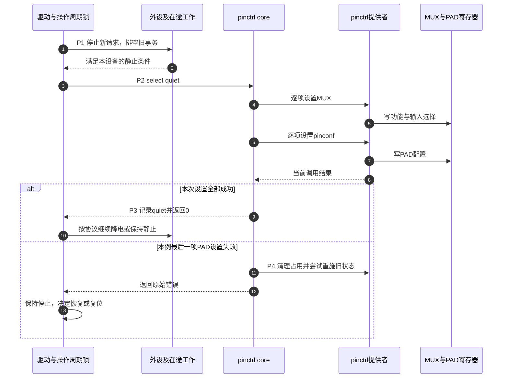

# 第3章\_引脚状态切换与GPIO占用交接

[上一章](P02_引脚配置怎样连接外设与焊盘.md) 已经能把 UART 的工作与静默配置写成两个状态。现在假设发送器仍在输出，软件直接将 TX PAD 切到 GPIO，会发生什么？未发送完的帧可能被截断；GPIO 原有方向与数据可能立即出现在 PAD 上；外部设备也未必知道此刻应停止接收。这些问题不能靠一个状态名称解决。

本章沿“取得状态 → 停止旧用途 → 选择新状态 → 验证结果 → 恢复使用”建立完整交接，随后说明 GPIO 占用与电源管理如何参与。pinctrl 提供配置接口，负责使用这些 PAD 的驱动还要协调设备协议、并发和生命周期。

## 3.1\_状态对象与硬件状态分别保存在哪里

**讲解层次：概念到实现的映射，Linux 6.12.20 pinctrl。** 消费者的 `struct pinctrl` 句柄引用它能使用的状态；每个 `struct pinctrl_state` 保存名字与设置列表。设置列表中的条目再指向提供者 `struct pinctrl_dev`，告诉它选择哪个功能/组，或应用哪组电气参数。硬件实际状态仍保存在控制器寄存器及电路中，软件的“当前状态”指针不是每一位硬件的镜像。

因此这里是 **多组有关联的状态**，不是只有 default/sleep 两个取值的单一开关：

| 状态组 | 固定实现中的落点 | 谁写、谁读 | 不能替代什么 |
| --- | --- | --- | --- |
| consumer可用配置 | `pinctrl.states`、各state的`settings`链表 | 建立句柄时解析；lookup/select读取 | 不能证明设置已写入硬件 |
| consumer当前选择 | `pinctrl.state` | 状态选择路径在成功后更新 | 不能证明寄存器后来未被别处修改 |
| pin占用 | 控制器pin描述中的`mux_owner`、`mux_usecount`、`gpio_owner` | request/free及状态选择维护；冲突检查读取 | 不能自动协调DMA、外设协议与板上驱动冲突 |
| 实际复用与电气配置 | IOMUXC或相应控制器的硬件寄存器 | 提供者回调写入；硬件用它控制PAD | 不保证能被一个通用debugfs字段完整读取 |
| 设备是否仍在使用信号 | UART/DMA/IRQ及驱动私有状态 | 外设驱动停机、恢复、排空路径维护 | pinctrl不能凭状态名替它完成 |

其中内部字段用于解释实现，不是 consumer 应直接访问的 ABI。版本化结构与源码细节从 [pinctrl源码阅读索引](../../../research/source_reading/pinctrl/navigation/P01_Linux_6.12_pinctrl源码阅读索引.md) 进入，并见 [状态载体与所有权](../../../research/source_reading/pinctrl/source_explanations/P01_状态映射选择与探测交接.md#1.1_句柄状态与设置分别保存什么)。

## 3.2\_取得和查找都没有代替选择

驱动需要先取得句柄，再查找状态，最后选择它。前三个动作分别解决访问对象、名称匹配和执行配置，不能合并成“调用 get 后引脚就正确了”。

| 接口 | 参数与成功结果 | 失败或生命周期要求 |
| --- | --- | --- |
| `devm_pinctrl_get(dev)` | 为这个consumer取得句柄，随设备devres释放 | `CONFIG_PINCTRL=y`下检查错误指针；可能延迟探测 |
| `pinctrl_lookup_state(p, name)` | 返回该句柄中的状态对象 | 查找错误须检查，不能直接传给select；状态随句柄生存 |
| `pinctrl_select_state(p, state)` | 请求执行状态，返回0表示该调用成功 | 负值不可忽略；不保证硬件事务原子性 |
| `pinctrl_get` / `pinctrl_put` | 非devres取得与交还 | 成功取得后配对，状态指针不能逃逸到put之后 |
| `devm_pinctrl_get_select_default` | 合并取得、查找default、选择 | 仍需检查错误；不替设备完成业务初始化 |

这些路径可能分配内存、取得互斥锁并调用可睡眠的控制器操作，应在允许睡眠且与该设备操作串行化的上下文使用。不能在任意硬中断里查状态或切引脚，也不能以“内部有锁”为由省掉驱动自身的操作周期锁。

配置关闭时还有特殊边界：`CONFIG_PINCTRL=n` 的若干 consumer stub 返回 NULL 或成功但不执行硬件操作，`CONFIG_PM=n` 的 PM helper 也可能是空操作。因此“返回 0”要结合配置解释。硬件正确性依赖 pinctrl 的驱动应在 Kconfig 或显式检查中要求该能力，不能把空操作成功当作配置完成。

> 依据：[固定 consumer.h](https://github.com/nxp-imx/linux-imx/blob/dfaf2136deb2af2e60b994421281ba42f1c087e0/include/linux/pinctrl/consumer.h)；接口与配置分支的逐项证据见 [状态选择与退化边界](../../../research/source_reading/pinctrl/source_explanations/P01_状态映射选择与探测交接.md#1.3_选择过程为何不是原子事务)。

### 3.2.1\_probe之前的default与init是明确的核心调用

固定设备核心在调用驱动 probe 前绑定 pinctrl：有 `default` 且没有 `init` 时选择 default；两者都有时先选择 init。probe 后，若当前仍停留在 init，核心再尝试切到 default。若驱动已主动选择别的状态，这一步不会强行覆盖它。缺少可用 pinctrl/default 的设备不必一概探测失败，延迟探测和部分错误又需要向上返回；不能用一个“自动默认”概括所有分支。

`init` 的意义是允许设备初始化尚未完成时先保持合适的引脚配置。它不是电源刚接通的复位默认状态，也不能覆盖固件之前的时段。这个版本在probe后调用初始化完成接口时没有接收其返回值，因而驱动绑定成功也不能单独证明最后一次default选择成功；需要结合错误日志与状态检查。实际顺序和错误处理见 [探测交接](../../../research/source_reading/pinctrl/source_explanations/P01_状态映射选择与探测交接.md#1.4_设备探测怎样交接init与default)。

## 3.3\_沿一次切换规定谁先停止谁后继续

现在选定一个具体教学场景：设备使用 work 状态运行，准备进入 quiet 状态；quiet 的内容已经按板级要求确定，并不自动等于“GPIO下拉”。调用者拥有此设备的操作周期锁，能阻止新请求，并有办法等待在途工作结束。控制器资源在切换期间保持可访问。

| 阶段 | 进入条件与动作 | 主要状态变化 | 退出条件 |
| --- | --- | --- | --- |
| P0，配置已建立 | 取得句柄与所需状态，核对错误 | 软件有状态列表，尚不能由lookup判断硬件状态 | 必需状态存在 |
| P1，旧用途静止 | 驱动阻止新提交，排空DMA/队列，停妥外设信号 | 设备不再向旧通路提交事务 | 在途活动归还，外部协议允许切换 |
| P2，执行新配置 | 调用select，core按设置调用提供者 | 旧mux占用记录调整；逐项写新mux，再写pinconf | 所有必要操作成功，或出现错误 |
| P3，选择成功 | core记下新的当前状态，驱动观察返回0 | 软件选择与本次执行成功对应 | 可按新状态继续下一步，如降电 |
| P4，选择失败 | 停止继续业务，记录错误并进入恢复策略 | 可能已有部分写入；core尝试恢复旧状态 | 由实际恢复结果决定是否重试/复位，不能假定原状 |
| P5，恢复旧用途 | 保证供电/控制器可访问，选择工作状态，再恢复外设 | 配置成功后重新开放请求 | 通信与可观察结果符合工作条件 |
| P6，最终移除 | 关闭所有调用入口，停止工作，选择必要安全状态后交还句柄 | devres或put释放软件对象与占用 | 不再访问状态指针；硬件结果由移除协议决定 |

P1 不是所有设备都用同一种排空函数：UART、SPI 和 GPIO 模拟协议各有自己的完成条件。这里共同的不变量是 **仍可能驱动旧信号的路径不能与P2无约束交错**。P2 也不是一次原子硬件提交；若在第二根 pin 上失败，第一根 pin 可能已经改变。



步骤 1～2 确认旧用途已静止，不能用步骤 9 的成功倒推它们可以省略。步骤 4～7 暴露跨寄存器窗口；图中失败固定发生在最后一项PAD设置，因而前面的动作在两条分支中都已发生。若更早的MUX设置失败，core会直接进入恢复，不继续执行后面的PAD请求。错误分支尝试重施旧状态，但原始返回值不能额外证明每一次恢复写入都成功。这个分支要求驱动保留停止状态，防止带着未知配置重新发送。

固定实现对“选择的就是当前状态对象”还可直接返回成功。如果外部代码绕过框架改了寄存器，再选择同一个 state，不能假定会强制重写。电源丢失后的恢复应遵守控制器/设备自己的 PM 协议，而不是用重复 select 充当通用修复。

## 3.4\_sleep名字为什么不能自动完成休眠

系统 suspend 影响整机，Runtime PM 在系统仍运行时暂停某个空闲设备；它们都可能需要 pinctrl，但策略不同。例如作为唤醒输入的 PAD 可能必须保留输入通路和偏置，强行下拉或切走功能反而破坏唤醒。

`pinctrl_pm_select_sleep_state(dev)`、`pinctrl_pm_select_default_state(dev)` 和 idle helper 是供实际 PM 路径调用的接口，返回 `int`。**写了sleep状态、甚至写了标准dev_pm_ops，都不意味着通用PM核心会在late阶段替所有驱动自动选择它。** 必须找到真实调用者。

固定 NXP i.MX UART 驱动就是具体例子：其 `suspend_noirq` 在保存UART上下文并关闭一项时钟后调用 sleep helper，`resume_noirq` 在恢复时钟和上下文前调用 default helper。这个顺序属于该实现及其电源约束；不能复制成“所有设备必须先关时钟再切引脚”。它也不是“仅在DTS写sleep就会切换”的证据。

| 名称 | 被选择后实际做什么 | 调用责任 |
| --- | --- | --- |
| `default` | 执行这个名字对应的配置 | probe交接或设备明确恢复路径 |
| `init` | 执行初始化前置配置 | 设备核心探测交接规则 |
| `sleep` | 执行板级定义的睡眠配置 | 实际系统PM/相关设备路径调用 |
| `idle` | 执行板级定义的空闲配置 | 使用者自己的策略与调用 |
| 自定义名字 | 执行驱动和绑定约定的配置 | 显式lookup/select；无名字自带的触发器 |

缺少可选状态时 PM helper 可返回 0 而没有切换，配置关闭时也可能没有动作。这有助于同一驱动支持无需额外引脚配置的板型；若本板安全性要求该状态必需，驱动就要显式检查，而不能只检查helper返回0。缺状态不能直接解释所有 suspend 卡死，`power/control` 写成 auto 也不等于设备已经实际暂停。

> 依据：[固定imx.c的suspend_noirq/resume_noirq](https://github.com/nxp-imx/linux-imx/blob/dfaf2136deb2af2e60b994421281ba42f1c087e0/drivers/tty/serial/imx.c)；[PM helper实现与无状态分支](../../../research/source_reading/pinctrl/source_explanations/P01_状态映射选择与探测交接.md#1.5_PM辅助接口只执行被调用的选择)。

## 3.5\_GPIO申请与pinctrl状态不是同一份所有权

GPIO consumer申请一条线，首先取得gpiolib管理的逐线占用；控制器的request路径还可能转入pinctrl，核对这条线对应哪个pin以及pin侧的占用。这里需要 **gpio-ranges** 将两个编号空间连接起来。它不把GPIO数据读写重定向成每次重写复用寄存器，也不把两个框架合并成一套字段。

### 3.5.1\_用真实三段映射计算一次

固定 `imx6ul.dtsi` 的 GPIO1 映射为：

```dts
/* 固定SoC描述摘录：每条为提供者、GPIO局部起点、pin起点、数量。 */
gpio-ranges = <&iomuxc 0 23 10>,
              <&iomuxc 10 17 6>,
              <&iomuxc 16 33 16>;
```

因此不能将它简化成 `<&iomuxc 0 0 32>`：

| GPIO1局部偏移范围 | IOMUXC pin范围 | 例子 |
| --- | --- | --- |
| 0～9 | 23～32 | offset 3 → pin 26，即GPIO1_IO03 PAD |
| 10～15 | 17～22 | offset 10 → pin 17 |
| 16～31 | 33～48 | offset 16 → pin 33，即UART1_TX_DATA PAD |

计算只在对应范围内使用 `pin起点 + offset - GPIO起点`。pin ID不是封装球号；Linux历史全局GPIO号、`gpiochipN`序号和IRQ号也不由这张表统一生成。命名型组等其他range形式以及跨控制器例子见 [GPIO编号主线](设备树+platform开发/P06_GPIO连接引脚复用与编号空间.md)。

### 3.5.2\_request与free不承诺切换和恢复所有寄存器

提供者可以实现专用 `gpio_request_enable` 和 `gpio_disable_free` 回调，以参与GPIO请求与释放；它们不等于无条件调用 `.set_mux(GPIO_MODE)` 和 `.set_mux(DEFAULT_MODE)`。某些控制器的GPIO请求只有占用管理，复用由consumer的pinctrl状态负责。固定i.MX6UL所用的pinmux操作表就没有通用的GPIO请求使能回调，不能把不存在的函数写进调用链。

释放GPIO意味着调用者交还这次占用，不保证恢复到UART、不保证PAD回到输入，也不保证回到上电复位值。若后续需要UART，由持有完整设备协议的责任方显式建立UART状态，再启动通信。

冲突检查还取决于控制器的 `strict` 策略。某些硬件允许在外设复用时旁路读取GPIO输入，因此Linux可以保留不同的GPIO与mux占用视图；strict模式则加强它们之间的互斥。即使框架允许某个组合，也不能推导板上两个输出可以相互驱动。应用不能靠“没返回busy”替代电路与生命周期检查。

**动态交接的可行条件** 是同一责任方控制旧用途、新用途和相关驱动生命周期，并能执行P1～P5。一个独立LED驱动已经占用PAD时，另一UART驱动不应靠强制改mux抢线；应先解决整体设计和所有权。若只是固定板型选择LED或UART，启动时选择一种配置通常比运行时抢占更简单。

GPIO中断是另一个相邻职责：pinctrl准备PAD通路，GPIO设置输入方向，irqchip维护检测/屏蔽，irqdomain映射身份，consumer安装处理。普通按键直接使用 [gpio-keys完整过程](P01_GPIO连接命名占用与按键事件.md#1.5_按键需要从电平变化得到输入事件)，不要复制一个每次IRQ只打印“pressed”的假输入驱动。

> 依据：[固定imx6ul.dtsi](https://github.com/nxp-imx/linux-imx/blob/dfaf2136deb2af2e60b994421281ba42f1c087e0/arch/arm/boot/dts/nxp/imx/imx6ul.dtsi)；GPIO request/free及strict边界见 [GPIO交界实现](../../../research/source_reading/pinctrl/source_explanations/P02_iMX6UL配置解析与寄存器落点.md#2.4_GPIO请求怎样经过pin占用而不承诺自动复用)。

## 3.6\_写一个只消费状态的完整驱动

为了专注get/lookup/select与清理，本例只管理已经验证的引脚状态，没有UART传输、GPIO输出或异步工作。它不能替代真实外设的P1排空动作。教学节点必须使用板上空闲且可用于实验的PAD，不能绑定正在工作的串口控制台、存储或已有LED。

在目标内核的外部模块实验目录建立 `pin_state_demo.c` 和 `Makefile`。需要匹配目标版本、架构、配置的完整内核构建输出，且启用 `CONFIG_PINCTRL`；本例代码按Linux 6.12接口组织，不声称已在目标环境编译或运行。

```c
#include <linux/module.h>
#include <linux/of.h>
#include <linux/platform_device.h>
#include <linux/pinctrl/consumer.h>
#include <linux/pm.h>
#include <linux/mutex.h>
#include <linux/slab.h>

struct pin_state_demo {
    struct mutex lock;
    struct pinctrl *pctl;
    struct pinctrl_state *work;
    struct pinctrl_state *quiet;
};

/* 只串行化本驱动的选择；不能替其他驱动停止硬件。 */
static int demo_select(struct device *dev, bool quiet)
{
    struct pin_state_demo *ctx = dev_get_drvdata(dev);
    int ret;

    mutex_lock(&ctx->lock);
    ret = pinctrl_select_state(ctx->pctl, quiet ? ctx->quiet : ctx->work);
    mutex_unlock(&ctx->lock);
    if (ret)
        dev_err(dev, "选择引脚状态失败：%d\n", ret);
    return ret;
}

static int demo_probe(struct platform_device *pdev)
{
    struct device *dev = &pdev->dev;
    struct pin_state_demo *ctx;

    /* 此实验依赖真实pinctrl能力，不接受空stub当作成功。 */
    if (!IS_ENABLED(CONFIG_PINCTRL))
        return -EOPNOTSUPP;

    ctx = devm_kzalloc(dev, sizeof(*ctx), GFP_KERNEL);
    if (!ctx)
        return -ENOMEM;
    mutex_init(&ctx->lock);

    ctx->pctl = devm_pinctrl_get(dev);
    if (IS_ERR(ctx->pctl))
        return dev_err_probe(dev, PTR_ERR(ctx->pctl), "取得pinctrl失败\n");
    ctx->work = pinctrl_lookup_state(ctx->pctl, "default");
    if (IS_ERR(ctx->work))
        return dev_err_probe(dev, PTR_ERR(ctx->work), "缺少default状态\n");
    ctx->quiet = pinctrl_lookup_state(ctx->pctl, "sleep");
    if (IS_ERR(ctx->quiet))
        return dev_err_probe(dev, PTR_ERR(ctx->quiet), "缺少sleep状态\n");

    platform_set_drvdata(pdev, ctx);
    return demo_select(dev, false);
}

static int __maybe_unused demo_suspend(struct device *dev)
{
    /* 本例没有在途I/O；真实外设必须先完成P1。 */
    return demo_select(dev, true);
}

static int __maybe_unused demo_resume(struct device *dev)
{
    /* 真实设备还须保证控制器可访问，选择成功后才重开I/O。 */
    return demo_select(dev, false);
}

static void demo_remove(struct platform_device *pdev)
{
    int ret = demo_select(&pdev->dev, true);

    /* void remove不能让调用方重试；失败不能说安全状态已成立。 */
    if (ret)
        dev_warn(&pdev->dev, "移除时静默配置未确认，需要平台恢复\n");
    /* 无异步入口；返回后devres交还句柄和私有内存。 */
}

static const struct dev_pm_ops demo_pm_ops = {
    SET_SYSTEM_SLEEP_PM_OPS(demo_suspend, demo_resume)
};

static const struct of_device_id demo_match[] = {
    { .compatible = "example,pin-state-demo" },
    { }
};
MODULE_DEVICE_TABLE(of, demo_match);

static struct platform_driver demo_driver = {
    .probe = demo_probe,
    .remove = demo_remove,
    .driver = {
        .name = "pin_state_demo",
        .of_match_table = demo_match,
        .pm = &demo_pm_ops,
    },
};
module_platform_driver(demo_driver);
MODULE_LICENSE("GPL");
MODULE_DESCRIPTION("仅用于验证pinctrl状态消费接口的教学模块");
```

`Makefile` 内容为：

```makefile
obj-m += pin_state_demo.o
```

目标板DTS中只添加一个consumer片段；`board_demo_work` 和 `board_demo_quiet` 必须是已经按本板电路核对的真实配置组。该教学compatible不是上游硬件绑定，不应把实验节点加入生产树：

```dts
/ {
    pin-state-demo {
        compatible = "example,pin-state-demo";
        pinctrl-names = "default", "sleep";
        pinctrl-0 = <&board_demo_work>;
        pinctrl-1 = <&board_demo_quiet>;
    };
};
```

本例不使用init，避免把probe中的主动选择与额外初始化策略混合。若控制器注册或lookup需要延迟，probe保留原始错误；若选择失败，模块不声称已完成硬件初始化。`devm`只管理软件资源释放，remove中的选择和失败报告仍有独立意义。

在已有目标构建环境中，由实际环境设置 `KDIR` 为匹配内核构建输出、`ARCH` 和 `CROSS_COMPILE` 为已验证的目标工具链，再从模块目录调用：

```bash
# 工作目录：保存pin_state_demo.c与Makefile的模块实验目录。
make -C "$KDIR" M="$PWD" ARCH="$ARCH" CROSS_COMPILE="$CROSS_COMPILE" modules
```

检查编译和MODPOST返回码，再决定目标部署。宿主C编译器接受语法不等于内核模块已构建；DT片段编译也不能证明两个板级组安全。本篇不提供对任意板执行系统休眠的通用命令：先准备独立恢复通路、明确目标电源状态，再按本板实验流程触发。如何从真实debugfs和日志确认P0～P6的结果，见 [下一章诊断过程](P04_沿状态与寄存器定位引脚问题.md)。

## 3.7\_预测失败与释放后的结果

**练习一：** select在第二个PAD的电气设置上失败，驱动可以因为core有回退代码就继续发送吗？不可以。已有部分寄存器可能改变，回退也可能失败；返回的错误要求驱动保持停止并执行自己的恢复策略。

**练习二：** `gpio_free()`后看到GPIO占用标签消失，能证明UART复用恢复了吗？不能。释放记录与重新选择UART是不同动作；需要明确的后续状态选择和通信恢复。

**练习三：** GPIO1 offset 17对应哪个pin？选第三段，得到 `33 + 17 - 16 = 34`，即UART1_RX_DATA PAD；不是pin 17，也不是Linux IRQ 17。

**练习四：** sleep helper返回0，是否证明引脚已下拉？不能。先确认配置开启、状态存在、调用路径实际执行，再看sleep内容是否要求下拉；即便如此还要核对硬件结果。

本章把静态配置推进到了运行周期：状态选择必须位于具体生命周期中，软件占用、当前选择与硬件寄存器分别验证。下一步不再猜“到底是哪层没生效”，而是用可观察证据沿这三层定位。
