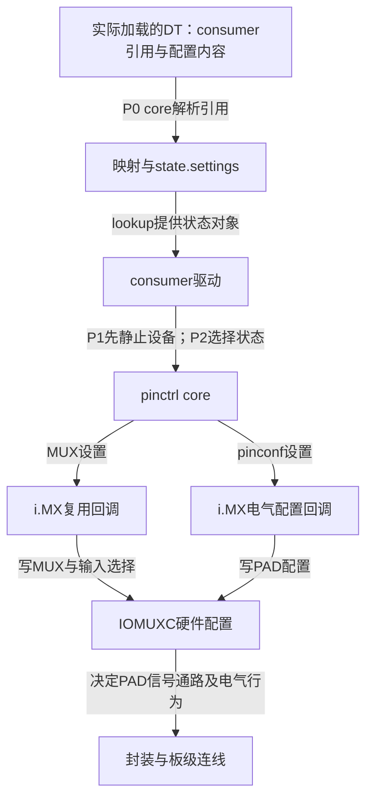

# 第4章\_沿状态与寄存器定位引脚问题

已经在DTS写好default和sleep，驱动也调用了选择接口，实际波形却不符合预期。直接改另一个十六进制值，可能只是把问题从一层推到另一层。本章沿 [上一章P0～P6](P03_引脚状态切换与GPIO占用交接.md#3.3_沿一次切换规定谁先停止谁后继续) 检查描述、解析、选择和硬件结果，使每一步观察都对应一个能被证明的结论。

贯穿问题仍是i.MX6UL UART1_TX_DATA/RX_DATA的工作与静默配置。源码边界固定为NXP Linux 6.12.20；debugfs名称、驱动回调和日志都以这个版本为准。本章给出读取方法，不伪造一次成功的板上实验。

## 4.1\_先定位配置在哪一步停止推进

**讲解层次：概念到实现的映射，Linux pinctrl与i.MX6UL提供者。** 在P0建立配置时，core读取consumer的`pinctrl-N`，取得各配置节点的提供者，再请求提供者生成映射。映射随后变成state里的settings。这里的“解析”主要是在软件内存中组织将要执行的动作，不能画成DTS主动调用硬件。

P2选择状态时，core才按设置向提供者下发复用与pinconf请求。i.MX6UL的复用路径写MUX和必要的输入选择，pinconf路径写PAD配置；GPIO方向/数据仍由GPIO控制器路径管理。给GPIO数据寄存器写1，并不能证明IOMUXC切到了GPIO功能。



图中的状态列表和硬件寄存器是两个不同的检查位置。完整结构与回调的版本化证据见 [源码阅读索引](../../../research/source_reading/pinctrl/navigation/P01_Linux_6.12_pinctrl源码阅读索引.md) 和 [实现阶段导读](../../../research/source_reading/pinctrl/navigation/P02_从描述到选择与硬件落点导读.md)。

因此，诊断按四个问题逐步缩小范围：

| 问题 | 可读证据 | 当前能证明什么 |
| --- | --- | --- |
| 内核看见的是哪份描述 | 启动FDT、当前live tree | 引用、组内容和状态名称确实进入该视图 |
| 提供者与软件状态是否成立 | pinctrl-devices/maps/handles | 控制器注册、映射和consumer当前选择记录 |
| 本次选择是否完成 | 返回码、真实调用日志、必要的受控寄存器读取 | 本次执行路径与已检查寄存器的结果 |
| 信号是否满足任务 | 外设数据、示波器/逻辑分析仪、input事件 | 所测条件下的端到端行为 |

这些证据互补。读到寄存器值不代表外部接线正确，看到一帧UART数据也不能证明所有sleep/wakeup路径都正确。

## 4.2\_描述检查必须针对真正加载的树

在主机上修改DTS后，先按目标内核构建流程生成对应DTB，并运行适用的 `dtbs_check`。DTC编码检查、Schema绑定检查和目标驱动行为是三种不同验证：错误属性可能被DTC忠实编码，随后被Schema拒绝或被驱动忽略。

目标板若提供启动FDT，在可写诊断目录执行：

```bash
# 工作目录：目标板上的可写诊断目录。
dtc -I dtb -O dts -o boot_received.dts /sys/firmware/fdt
```

检查consumer的 `pinctrl-names`、每个 `pinctrl-N` 和被引用配置的完整内容。不要仅搜索组名：标签可能在编译后变成phandle，未引用标签也不能证明consumer使用了它。启动FDT不一定包含后来的动态修改；如需当前设备树且接口存在，再读取：

```bash
# 工作目录：目标板上的可写诊断目录。
dtc -I fs -O dts -o live_tree.dts /sys/firmware/devicetree/base
```

若两个视图不同，先确认是否有overlay或固件修改，并保留各自采集时刻。不要为了让它们一致而任意重写运行树。不存在上述接口时，记录配置/环境限制，不能把手边源DTS冒充内核实际加载的证据。

## 4.3\_按真实debugfs对象读取软件状态

**讲解层次：实现层，固定Linux 6.12 pinctrl debugfs。** debugfs是调试接口，依赖配置、挂载、权限与提供者回调，不是稳定用户ABI。先检查现有挂载和目录；下面命令假设debugfs已挂载到通常位置：

```bash
# 工作目录：目标板Linux的任意可读目录。
ls /sys/kernel/debug/pinctrl
```

该版本在pinctrl根目录有三类总览，控制器子目录则保存逐pin/组的诊断。不是每个consumer各有一个可写的 `state` 文件：

| 位置 | 文件 | 用于当前哪一步 | 证明边界 |
| --- | --- | --- | --- |
| pinctrl根目录 | `pinctrl-devices` | 检查提供者注册及能力 | 控制器存在不代表consumer已选配置 |
| pinctrl根目录 | `pinctrl-maps` | 检查状态名、控制器、组/配置映射 | 映射存在不代表已执行 |
| pinctrl根目录 | `pinctrl-handles` | 检查consumer句柄、当前state与settings | 当前state是软件记录，不能代替所有硬件回读 |
| 实际控制器目录 | `pins` | 查pin ID与名称 | 名称/ID不是GPIO局部偏移 |
| 实际控制器目录 | `pingroups` | 查组及成员pin | 组存在不代表正在被选择 |
| 实际控制器目录 | `gpio-ranges` | 查GPIO到pin映射 | 不分配Linux IRQ或封装引脚号 |
| 有pinmux能力的控制器目录 | `pinmux-functions`、`pinmux-pins` | 功能候选与占用/设置视图 | 回调内容与strict策略有关 |
| 有pinconf能力的控制器目录 | `pinconf-pins`、可能的`pinconf-groups` | 电气配置诊断 | 提供者可能输出原始值而非通用属性名 |

先读取总览，找出目标consumer和实际控制器目录名：

```bash
# 工作目录：目标板Linux的任意可读目录。
cat /sys/kernel/debug/pinctrl/pinctrl-devices
cat /sys/kernel/debug/pinctrl/pinctrl-maps
cat /sys/kernel/debug/pinctrl/pinctrl-handles
```

如果目标consumer没有句柄，回到probe日志和绑定条件；如果有句柄但当前state不是预期，检查真实选择路径；如果当前state正确，再核对所含settings与目标控制器。目录名由设备和描述符名称组成，不能硬写成旧示例中的 `serial@02020000`。`<controller>` 是阅读位置占位符，不是可以原样执行的路径。

i.MX提供者可能显示PAD原始十六进制值。没有 `drive-strength=8` 这串文字并不证明电气配置未解析；应该先查该提供者的debug输出契约。UART1_TX_DATA在选定实现是pin33，GPIO1_IO03是pin26，不能对输出简单 `grep 3` 后就认定找到正确对象。

> 依据：[固定core.c的debugfs创建与pinctrl_show](https://github.com/nxp-imx/linux-imx/blob/dfaf2136deb2af2e60b994421281ba42f1c087e0/drivers/pinctrl/core.c)、[pinmux.c](https://github.com/nxp-imx/linux-imx/blob/dfaf2136deb2af2e60b994421281ba42f1c087e0/drivers/pinctrl/pinmux.c)、[pinconf.c](https://github.com/nxp-imx/linux-imx/blob/dfaf2136deb2af2e60b994421281ba42f1c087e0/drivers/pinctrl/pinconf.c)。诊断视图与软件状态对应见 [源码导读的观测位置](../../../research/source_reading/pinctrl/navigation/P02_从描述到选择与硬件落点导读.md#2.4_观察位置与不能证明的结论)。

### 4.3.1\_pinmux-select不是消费者状态切换入口

选定版本的控制器debugfs可能提供可写 `pinmux-select`。它接受“组名 空白 功能名”，查找选择器后直接调用提供者的 `set_mux`；单独写 `sleep` 不符合该接口格式，也不会选择consumer的sleep状态。

这个调试入口不执行完整state的pinconf设置，不替consumer排空DMA，不执行PM协议，也不等同于更新consumer当前state。因而不能用它证明“系统休眠切换成功”，更不能把 `echo sleep > .../state` 当作通用命令。验证完整状态应通过真正拥有设备生命周期的驱动路径，并同时记录返回结果和硬件观察。

这里保留该接口的真实用途：在明确隔离设备和占用的驱动调试中验证一个提供者mux选择。它不是普通板级应用控制接口，本章的采集脚本只读，不借此修改运行状态。

## 4.4\_日志寄存器和波形要围绕同一次动作

如果状态列表正确，而选择返回错误，日志应围绕P2/P4看具体哪个提供者、哪个组或配置失败。不要根据一个 `-EINVAL` 就自动补 `gpio-ranges = <&iomuxc 0 0 32>`：pin不合法、组不匹配和配置解析失败可能都表现为参数错误。

dynamic debug仅打开源码中已经存在的动态日志点，不会凭空生成“state applied”的固定输出。先在已启用该机制的目标系统查找精确文件的可用点，再选择需要启用的条目；下面针对i.MX提供者示范启用与恢复，使用前确认这些点原先未启用：

```bash
# 工作目录：目标板Linux的任意可读目录。
grep 'drivers/pinctrl/freescale/pinctrl-imx.c' /sys/kernel/debug/dynamic_debug/control
```

保存当前标志后，若这些点原本未启用，可临时打开打印，再执行已准备好的单次驱动操作：

```bash
# 工作目录：目标板Linux，需有debugfs控制文件写权限。
printf '%s\n' 'file drivers/pinctrl/freescale/pinctrl-imx.c +p' > /sys/kernel/debug/dynamic_debug/control
```

读取本次操作的内核日志，核对真实文件中已有的组、mux、PAD写入日志点。结束后对原本未启用的点撤销本次打印设置：

```bash
# 工作目录：目标板Linux，仅恢复本次原先为关闭状态的日志点。
printf '%s\n' 'file drivers/pinctrl/freescale/pinctrl-imx.c -p' > /sys/kernel/debug/dynamic_debug/control
```

若原来只有部分点开启，应按保存的逐点状态恢复，不能用最后一条全关破坏已有调试环境。`printk_devkmsg` 控制的不是这些动态日志点；改变它不能作为“开启pinctrl中断调试”的替代办法。

寄存器读取则必须先确认控制器基址、当前电源和访问权限、寄存器读取语义与宽度。对本例，UART1_TX_DATA的MUX/PAD位置是 `0x020e0084/0x020e0310`，RX则为 `0x020e0088/0x020e0314`，还有输入选择 `0x020e0624`；前文已给 [本地访问表](P02_引脚配置怎样连接外设与焊盘.md#2.3.2_PAD配置值必须逐字段读)。不能把另一个PAD的地址读出来，再按UART解释。受控回读还应注明状态切换前、返回后哪个时刻采样；跨多个寄存器的读数不是自动原子快照。

实际电气结果最后由合适仪器验证。上拉、驱动强度和边沿速率的配置值只表达选择，不等于测得特定电压、阻值或可靠通信；传输成功的证据也必须注明负载、速率和电源状态。

## 4.5\_保存一份只读诊断快照

下面脚本用于汇总现有pinctrl调试文件，不负责挂载debugfs、修改状态或操作寄存器。在目标板可写诊断目录保存为 `collect_pinctrl.sh`，用POSIX sh执行；脚本只有只读采集，输出为标准输出，错误为标准错误。

```sh
#!/bin/sh
# 只读采集固定版本常见pinctrl视图；缺少可选文件不判定硬件失败。
debug_root=${1:-/sys/kernel/debug/pinctrl}
result=0

if [ ! -d "$debug_root" ]; then
    printf 'pinctrl目录不存在：%s\n' "$debug_root" >&2
    exit 1
fi

read_view()
{
    view_path=$1
    if [ ! -f "$view_path" ]; then
        return 0
    fi
    printf '\n--- %s ---\n' "$view_path"
    if [ ! -r "$view_path" ]; then
        printf '无读取权限：%s\n' "$view_path" >&2
        return 1
    fi
    cat "$view_path"
}

for view_name in pinctrl-devices pinctrl-maps pinctrl-handles; do
    if [ ! -f "$debug_root/$view_name" ]; then
        printf '总览文件缺失：%s\n' "$debug_root/$view_name" >&2
        result=1
    else
        read_view "$debug_root/$view_name" || result=1
    fi
done

for controller_dir in "$debug_root"/*; do
    [ -d "$controller_dir" ] || continue
    for view_name in pins pingroups gpio-ranges pinmux-functions pinmux-pins pinconf-pins pinconf-groups; do
        read_view "$controller_dir/$view_name" || result=1
    done
done

exit "$result"
```

在同一目录执行并保留返回码：

```bash
# 工作目录：目标板上保存collect_pinctrl.sh的可写诊断目录。
sh ./collect_pinctrl.sh > pinctrl_snapshot.txt 2> pinctrl_snapshot.err
snapshot_status=$?
printf '采集退出码：%s\n' "$snapshot_status"
```

0表示该脚本要求的总览和现有可选文件读取未失败，不表示引脚配置正确。采集时设备若仍在切换，不同文件可能来自不同瞬间；对比两次结果前，按P1固定被测设备的运行条件，并记录触发动作。若调试fs在其他挂载点，可将实际pinctrl目录作为第一个参数传入。输出文件由操作者保留，脚本不自动覆盖另一套“权威状态”。

## 4.6\_把常见现象还原到责任边界

诊断中保留现象与候选原因的区别。下面的判断不依赖虚构的统一错误日志：

| 现象 | 进一步观察 | 可能修复方向 |
| --- | --- | --- |
| DTC成功但Schema拒绝组属性 | 目标控制器绑定是否允许该属性 | 删除跨厂商混写，按真实格式表达同一请求 |
| consumer延迟探测 | 引用的提供者是否注册、资源是否就绪 | 修复真正的依赖；不要吞掉`-EPROBE_DEFER` |
| 软件state缺失 | 名称与连续索引、空状态和缺属性是否混淆 | 修正描述与lookup契约 |
| MUX改变但GPIO电平不对 | GPIO方向/数据、逻辑极性、开漏上拉 | 由GPIO使用者完成其职责，不能只改pinconf |
| busy或占用冲突 | 逐pin mux/GPIO owner及真实消费者 | 协调生命周期，不能直接绕过所有者改寄存器 |
| free后仍是GPIO功能 | 是否执行新的状态选择 | 不把释放占用当作恢复默认硬件 |
| sleep与default都选择成功但没降功耗 | 两状态内容、实际电源与外部负载 | 先解释功耗路径，不给sleep名字附加魔法 |
| 复用正确却无按键事件 | GPIO输入、IRQ检测、去抖与input路径 | 逐层观察；GPIO IRQ计数不等于输入事件 |

恢复策略也要遵守证据边界。错误状态可能已经部分写入时，停止设备、保持外部协议安全，并通过已验证的恢复/复位路径重新建立工作条件；简单重复选择同一个软件state可能不会重写硬件。若没有足够证据判断某个物理寄存器的含义，应回到对应芯片资料，而不是从相邻SoC猜地址。

## 4.7\_完整验证能够得出什么结论

用前两章的离线DTS先验证状态引用和六元组，能排除编码层混淆；用固定源码核对映射、select与PM调用，能解释控制流；在目标板执行驱动路径并记录返回、调试视图及信号，才能证明所测条件下的实际行为。三者都应保留，不能把一种结果包装成另一种。

**练习一：** `pinctrl-maps`中已经有sleep，为什么还不能说P3完成？map只是P0建立的请求描述，需有P2选择与成功结果。

**练习二：** 当前state显示default，另一个调试路径却改过mux，重复select default能保证恢复吗？不能，固定core可以因state指针相同直接返回；必须走明确的恢复协议。

**练习三：** `pinconf-pins`只显示原始十六进制值，能判断驱动没解析drive-strength吗？不能，该提供者使用原始配置编码和自己的显示方法，须按其字段表解释。

**练习四：** `pinmux-select`写组名和功能名成功，是否证明sleep的PAD配置与PM时序也验证了？没有，它只验证了该调试路径的mux调用，未覆盖完整consumer状态和生命周期。

至此，配置格式、运行交接和诊断证据形成了一条可逐步核对的路径。继续查看组合场景时，保持这些边界：GPIO数据、引脚复用、电气配置、中断检测、输入事件和PM策略各有状态与责任方，不能由一个属性或一次成功返回代替整条链。
