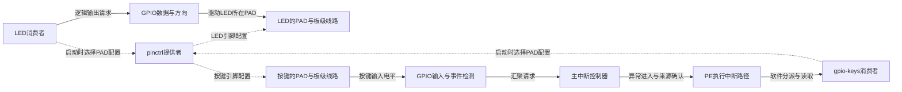
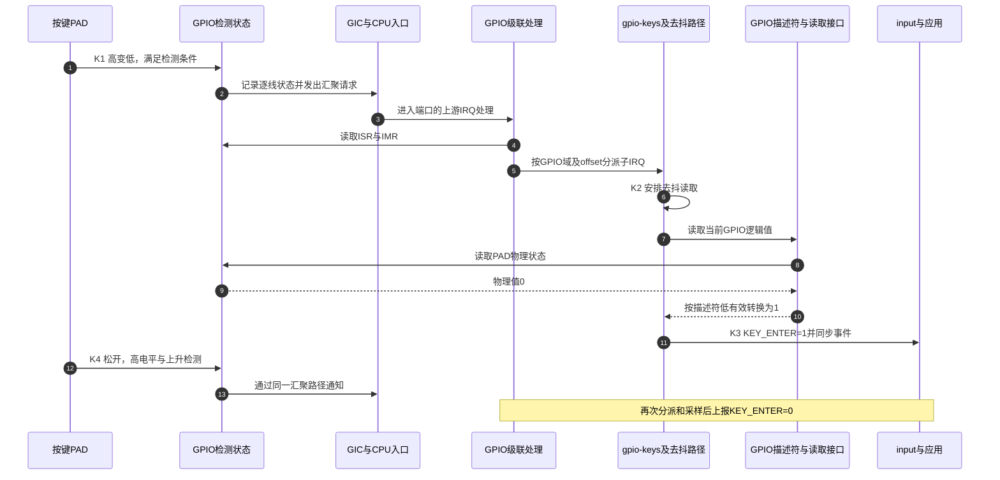

# 第5章\_GPIO输入怎样成为中断与按键事件

[引脚诊断章](P04_沿状态与寄存器定位引脚问题.md) 已能区分描述、软件选择与PAD寄存器。现在把同一套知识放进两个实际任务：一根GPIO线控制LED，另一根线读取按键并产生输入事件。它们都需要正确的PAD通路，却不需要完全相同的资源：LED一般不申请IRQ，按键则需要把电平变化转换成可消费的事件。

本章先分开配置关系和运行信号流，再追踪i.MX6UL GPIO汇聚中断，最后比较普通GPIO按键、IRQ-only按键与多中断设备。前几篇已建立的字段在需要处短暂回顾，平台私有格式与寄存器按固定NXP Linux 6.12.20源码核对，不把“6.1以后都一样”当作依据。

## 5.1\_同一根线为什么需要几种不同的描述

**讲解层次：概念层，GPIO、pinctrl与IRQ的交接。** 外设驱动需要先获得通路，再执行任务。pinctrl选择PAD接哪个内部功能并配置电气条件；GPIO接口管理线的占用、方向和数据；IRQ接口管理事件来源、触发与处理函数。三者有联系，但不是“每次写GPIO先调用pinctrl，再调用中断”的固定流水线。

LED亮灭的高频动作通常只改变GPIO输出数据，之前选择好的复用配置保持有效。按键则相反：应用不主动写线，外部按下使PAD电平改变，GPIO检测硬件记录事件，经过中断处理后驱动再读线判断按下还是松开。配置方向与事件方向不能画成同一条箭头。



实线区分输出、输入及软件交付动作，虚线表示配置。LED与按键分别连接两个PAD；图中GPIO的数据功能与事件检测功能也按职责分开，并不声明它们必定是独立物理器件。

Linux中提供者驱动注册 `gpio_chip`、`pinctrl_dev` 或IRQ域，消费者取得描述符、状态或Linux IRQ；DT节点只提供匹配和资源信息。**写上 `gpio-controller;` 不会自动创造一个已经可用的gpio_chip**，还需要匹配驱动成功探测与注册。用于索引中断的 `irq_domain` 也不是电平信号经过的物理硬件。

| 当前对象 | 使用的描述 | 请求由谁解释 | 请求不会额外完成什么 |
| --- | --- | --- | --- |
| LED GPIO线 | 子节点的 `gpios` | gpio-leds与gpiolib | 不自动申请IRQ |
| 按键可读电平 | 按键子节点的 `gpios` | gpio-keys与gpiolib | 不自动知道外部开关是否可靠去抖 |
| 一套PAD设置 | `pinctrl-names/pinctrl-N` | pinctrl core与提供者 | 不替驱动排空I/O或建立GPIO方向 |
| 独立事件输入 | `interrupts` 或 `interrupts-extended` | IRQ解析与相应域，随后由驱动申请 | 不自动生成input键码或调用某个处理函数 |

结构和占用细节分别见 [GPIO核心证据](../../../research/source_reading/linux/gpio/linux_6.12_gpio_核心路径.md#1.1_核心对象) 与 [pinctrl源码索引](../../../research/source_reading/pinctrl/navigation/P01_Linux_6.12_pinctrl源码阅读索引.md#1.1_版本边界与阅读路线)。当前只需记住各自状态归属，不凭几段裁剪结构体推断全部注册行为。

## 5.2\_先用LED检验逻辑值与物理电平

设LED经限流电阻接电源，GPIO输出低时导通。这是明确的低有效接法；换成另一种接法，需要重新确定极性。在已定义gpio1和IOMUXC的板级DTS里，消费片段可写为：

```dts
/ {
    leds {
        compatible = "gpio-leds";
        pinctrl-names = "default";
        pinctrl-0 = <&board_led_pins>;
        led-status {
            label = "status:green";
            gpios = <&gpio1 3 GPIO_ACTIVE_LOW>;
            default-state = "off";
        };
    };
};
```

这是板级片段，不是独立完整DT；需要GPIO宏头文件和经本板核对的 `board_led_pins` 组。i.MX6UL组按 `fsl,pins` 六cell格式定义，RK3568按 `rockchip,pins` 的bank、pin、mux、配置引用定义，不能将两者拼成 `pins=<...>; function="gpio"` 后假定任一驱动都会接受。两套格式的完整解释见 [引脚配置章](P02_引脚配置怎样连接外设与焊盘.md#2.4_换一种控制器格式时保持什么不变)。

| LED接口请求 | GPIO逻辑值 | 本例物理电平 | 本例LED结果 |
| --- | --- | --- | --- |
| off或brightness=0 | 0，不激活 | 高 | 熄灭 |
| on或非零亮度 | 1，激活 | 低 | 点亮 |

这里“非零亮度”对普通开关型GPIO LED不意味着GPIO产生对应模拟电压。trigger可能再次改变亮灭，排查时也要识别谁在控制。正常亮灭路径由LED子系统进入GPIO值接口，按active-low转换后交给GPIO提供者；它不会每次先重新选择pinctrl，更不会由PAD配置回调把数据位写低。

## 5.3\_可读按键与只有中断的按键为何不同

按键按下并保持时，驱动需要知道它仍在按下，而不是只知道“刚才来过一次边沿”。有可读GPIO就能在去抖后采样当前逻辑值；只有一个IRQ脉冲而没有可读状态时，驱动无法从静默推断手指已经松开。两种输入条件需要不同的报告规则。

### 5.3.1\_普通开关优先表达可读GPIO

下面仍是已有SoC树上的板级片段。假设GPIO1线5接低有效开关，板上偏置与PAD组已经验证：

```dts
/ {
    gpio-keys {
        compatible = "gpio-keys";
        pinctrl-names = "default";
        pinctrl-0 = <&board_key_pins>;
        key-enter {
            label = "ENTER";
            linux,code = <KEY_ENTER>;
            gpios = <&gpio1 5 GPIO_ACTIVE_LOW>;
            debounce-interval = <10>;
        };
    };
};
```

这里KEY_ENTER来自input事件码头文件，GPIO_ACTIVE_LOW来自GPIO绑定头文件。`linux,code` 和GPIO连接写在 **按键子节点**，不能只把 `interrupts` 放在gpio-keys父节点就期望驱动找到一个完整按键。

固定 `gpio_keys.c` 在GPIO路径以输入方式取得描述符，没有显式按键IRQ时调用 `gpiod_to_irq` 得到Linux IRQ，随后申请上升和下降双边沿。物理下降对应按下，物理上升对应松开；GPIO_ACTIVE_LOW负责读取结果的逻辑反相，并不把IRQ_TYPE_EDGE_FALLING自动改成其他触发方式。

去抖首先尝试硬件接口，失败后按GPIO读取能否睡眠使用相应软件路径。`debounce-interval` 单位是毫秒，省略时固定绑定默认5；软件延时后读取不等于证明整个窗口内连续稳定。按键过程的K0～K4阶段由 [按键状态与事件正文](P01_GPIO连接命名占用与按键事件.md#1.5.3_沿一次按键追踪状态与事件) 统一定义，本章稍后只放大K1的中断分派。

### 5.3.2\_显式IRQ解决另一条通知连接

某些设备同时提供可读GPIO和独立通知线，绑定与驱动可以允许同时描述 `gpios` 和 `interrupts`。固定gpio-keys在该情况下使用显式IRQ作为通知入口，GPIO仍用于读取状态。不是“两个属性重复所以一定冲突”，也不是“框架自动屏蔽所有冲突位域”；可行性来自驱动的具体处理和硬件连接。

固定GPIO按键路径仍按双边沿申请IRQ，所以不能写一个下降沿specifier后宣称此驱动运行期间只处理下降沿。如果目标通知硬件只允许别的触发方式，应先核对设备绑定和驱动是否适合，不靠追加一个属性改变驱动算法。

只有IRQ而没有GPIO的键则走另一条分支：固定实现仅支持EV_KEY，IRQ到来报告按下，使用释放定时器按配置延迟合成释放；延迟为零时可立即合成释放。它不测量真实保持时长。需要真实按下/松开状态的机械开关，应使用可读GPIO路径或与硬件能力相符的其他驱动。

> 依据：[固定gpio-keys绑定](https://github.com/nxp-imx/linux-imx/blob/dfaf2136deb2af2e60b994421281ba42f1c087e0/Documentation/devicetree/bindings/input/gpio-keys.yaml)；[gpio_keys.c的setup_key、GPIO/IRQ处理与释放定时器](https://github.com/nxp-imx/linux-imx/blob/dfaf2136deb2af2e60b994421281ba42f1c087e0/drivers/input/keyboard/gpio_keys.c)。本节比较的是同一驱动的输入模型，不把“IRQ已申请”当成“input状态已正确报告”。

## 5.4\_从GPIO状态位追到汇聚中断和子IRQ

**讲解层次：实现层，固定i.MX6UL GPIO1与gpio-mxc。** GPIO1的32条线不各自占一条独立的GIC SPI。SoC描述提供两条上游汇聚中断，同时GPIO控制器保存逐线检测状态。CPU先从上游知道“这个端口有请求”，再由GPIO处理路径找出具体哪条线。

### 5.4.1\_同一节点既消费上游又提供下游

固定 `imx6ul.dtsi` 中GPIO1的关键内容如下。为说明两层格式裁剪了时钟和其他资源；应在原SoC节点上引用，不能照此重新创建一个不完整同地址节点。

```dts
/* 固定SoC描述的裁剪片段：interrupt-parent由上级环境提供。 */
gpio1: gpio@209c000 {
    compatible = "fsl,imx6ul-gpio", "fsl,imx35-gpio";
    reg = <0x0209c000 0x4000>;
    interrupts = <GIC_SPI 66 IRQ_TYPE_LEVEL_HIGH>,
                 <GIC_SPI 67 IRQ_TYPE_LEVEL_HIGH>;
    gpio-controller;
    #gpio-cells = <2>;
    interrupt-controller;
    #interrupt-cells = <2>;
    /* 原节点另有clocks和三段gpio-ranges，不能在实板省略所需资源。 */
};
```

GPIO1消费GIC的三cell描述，同时为下游提供自己的两cell中断描述。下游的 `<5 IRQ_TYPE_EDGE_FALLING>` 中5是GPIO域内线号；上游的 `<GIC_SPI 66 IRQ_TYPE_LEVEL_HIGH>` 中66是SPI相对编号，对应GIC INTID 98。两者都不是当然等于 `/proc/interrupts` 左栏的Linux IRQ号。

| 身份 | 当前例子的值 | 由谁解释 |
| --- | --- | --- |
| GPIO局部线 | GPIO1 offset 5 | gpio1的GPIO或IRQ接口 |
| pinctrl pin ID | 三段ranges中由线5映到pin28 | IOMUXC提供者；不是封装球号 |
| GPIO1上游SPI | 相对编号66、67 | 选定GIC绑定与驱动 |
| 对应GIC INTID | 98、99 | GIC硬件及其驱动 |
| 子线Linux IRQ与汇聚Linux IRQ | 运行时分配/映射结果 | Linux IRQ核心与各域 |

常规GIC三cell绑定的SPI相对编号范围是0～987，PPI是0～15，分别对应INTID32～1019和16～31；不能把第二cell统一写成INTID0～1019。更大范围或不同cell格式要按对应绑定核对。本例只使用常规SPI，GIC硬件协议由 [GIC专题](../../../platforms/arm/architecture/gic/大纲.md) 展开。

### 5.4.2\_硬件级联不等于软件域对象必有父指针

固定gpio-mxc通过自己的IRQ域映射GPIO线号，并在上游IRQ安装chained处理入口。入口读取GPIO状态与屏蔽寄存器，逐个找出有效来源，再以该GPIO域和局部线号调用通用分派。GPIO子IRQ与上游汇聚IRQ是两份Linux身份，不是“把每个GPIO自动改编号成SPI66”。

本实现使用 `irq_domain_add_legacy` 建立端口域，再用 `irq_set_chained_handler_and_data` 连接上游处理；这不足以推出 `irq_domain.parent` 指向GIC。另一种hierarchical irqdomain设计会在同一个Linux IRQ下组织多层irq_data资源，但不能仅从硬件连线图判断采用哪一种。相关模型比较见 [中断控制器与Linux实现](../../linux/synchronization_and_asynchrony/asynchrony/interrupts/P09_层级中断控制器与_ARM_GIC_在_Linux_中的实现.md)。

为什么还需要GPIO状态寄存器？因为汇聚请求只告诉上游“至少有一个满足条件的来源”，不会携带所有GPIO线号。下表是固定驱动所选imx35寄存器布局在GPIO1基址 `0x0209c000` 上的当前查用表，不能外推到imx1等布局。

| 寄存器 | 偏移/物理地址 | 当前用到的字段与访问效果 |
| --- | --- | --- |
| DR | `0x00 / 0x0209c000` | 逐线输出数据；写值的实际PAD效果仍取决于方向和复用 |
| GDIR | `0x04 / 0x0209c004` | 逐线方向，0输入、1输出 |
| PSR | `0x08 / 0x0209c008` | 逐线PAD输入观察；与输出数据寄存器作用不同 |
| ICR1/ICR2 | `0x0c/0x10` → `0x0209c00c/0x0209c010` | 每线两位；分别覆盖0～15、16～31；编码0低、1高、2升、3降 |
| IMR | `0x14 / 0x0209c014` | 逐线掩码，置1允许该线参与中断请求 |
| ISR | `0x18 / 0x0209c018` | 逐线中断状态；驱动以写1确认相应位，不可当普通RAM改写 |
| EDGE_SEL | `0x1c / 0x0209c01c` | 逐线双边沿选择，选定时不靠ICR单边沿编码表达 |

例如线5在ICR1的位11:10，IMR/ISR对应bit5。父入口读取 `ISR & IMR` 得到当前待分派集合；一个状态位不是无限深的边沿计数器，多个物理变化可能在软件处理前合并。IRQ计数不应直接用作按键抖动次数或所有物理边沿的精确记录。

### 5.4.3\_沿K1到K4看通知与读取怎样合作

下面沿用 [K0～K4按键周期](P01_GPIO连接命名占用与按键事件.md#1.5.3_沿一次按键追踪状态与事件)，限定可读GPIO且走软件去抖的路径。K0已经完成复用、输入配置、映射和处理函数申请。



步骤4保留原始来源识别，步骤5才进入按键对应的子IRQ。步骤7请求当前逻辑值，步骤8～10读取物理状态并按GPIO描述符极性转换，不是把上游SPI号翻译成“按下”。控制器确认、屏蔽及上游完成由各irqchip/flow路径按协议完成，图中没有规定所有实现必须在同一位置确认，也没有让按键驱动直接清GIC状态。

> 依据：[固定gpio-mxc.c的布局、域建立、chained入口与逐位分派](https://github.com/nxp-imx/linux-imx/blob/dfaf2136deb2af2e60b994421281ba42f1c087e0/drivers/gpio/gpio-mxc.c)；[固定imx6ul.dtsi](https://github.com/nxp-imx/linux-imx/blob/dfaf2136deb2af2e60b994421281ba42f1c087e0/arch/arm/boot/dts/nxp/imx/imx6ul.dtsi)。本节是该实现的组合解释，不把驱动寄存器访问当作本轮板上测量。

## 5.5\_固定配置与动态消费者怎样分配所有权

有些线在启动后只需维持一个逻辑值，另一些线需要驱动按协议反复控制。GPIO hog适合前者；如果后来的驱动还要取得同一条线，不能先让hog占住，再期待它自动让路。低有效reset的 `output-high` 是逻辑激活，通常物理为低，即保持复位；要表达逻辑释放应使用对应的不激活值。完整极性推导见 [GPIO hog初值](P01_GPIO连接命名占用与按键事件.md#1.3.1_用逻辑值理解hog的输出初值)。

pinctrl也有hog，但职责不同：控制器作为自己的consumer，在启用时选择自身default状态，配置不属于独立外设的PAD。对本例i.MX控制器，可用以下结构表达，而不是凭空增加 `hog;` 或改用另一个驱动的 `pinctrl-single,pins`：

```dts
/* 结构片段：board_fixed_pins须是本控制器格式的真实配置组。 */
&iomuxc {
    pinctrl-names = "default";
    pinctrl-0 = <&board_fixed_pins>;
};
```

它在提供者启用路径执行，仍依赖控制器驱动成功探测，不保证上电复位瞬间已经生效，也不是永久不可更改的硬件锁。控制器的状态与GPIO线hog占用分开管理，不能拿pinctrl hog代替GPIO方向和值，更不能用GPIO hog替UART完成mux选择。

| 需要的行为 | 合适的责任方 | 不应依赖的假设 |
| --- | --- | --- |
| 保持固定GPIO逻辑值 | GPIO hog或确有对应协议的设备驱动 | 后来的consumer会自动接管hog |
| 控制器启用时应用自身PAD配置 | pinctrl自身default/hog | 通用 `hog;` 自动识别或永久锁定 |
| UART随工作/休眠切换PAD | UART及其真实PM路径 | 写了sleep名字就会自动执行 |
| LED按应用或trigger改变亮灭 | gpio-leds | 每次brightness都重跑pinctrl |
| 按键读取、去抖和报告 | gpio-keys | IRQ号或一次IRQ等于一次完整按下释放 |

固定状态本来就足够时，不必引入动态切换。确需切换时，继续遵守 [P0～P6交接周期](P03_引脚状态切换与GPIO占用交接.md#3.3_沿一次切换规定谁先停止谁后继续)：先停止旧用途，再执行选择，失败保持停止并处理恢复。源码入口见 [控制器自身状态消费者](../../../research/source_reading/pinctrl/source_explanations/P01_状态映射选择与探测交接.md#1.6_控制器怎样成为自己的状态消费者)。

## 5.6\_多个事件输入要逐项写清提供者

一个传感器可以有READY和FAULT两根通知线，甚至连接不同GPIO控制器。`interrupts-extended` 将每个提供者引用与参数写在一起，解决的是描述歧义；驱动仍需逐项取得IRQ、检查错误并申请处理函数，不会由属性自动生成IRQ数组和回调。

```dts
/* 教学consumer片段；example,multi-event不声称存在生产驱动。 */
multi-event {
    compatible = "example,multi-event";
    interrupts-extended = <&gpio1 5 IRQ_TYPE_EDGE_FALLING>,
                          <&gpio2 7 IRQ_TYPE_EDGE_RISING>;
    interrupt-names = "ready", "fault";
};
```

两个名字按顺序对应两项引用。实际platform驱动可按名字取得相应IRQ，再分别建立处理；I²C/SPI等设备应按自己的总线与绑定接口获取，不把platform示例照搬到所有驱动。`interrupts-extended` 已携带各项父级，与 `interrupts` 同时存在时优先解释extended；正常新描述选择一种清楚的写法，避免留下互相矛盾的两套连接。

`interrupt-parent` 可以从上级上下文找到，也可以在当前节点明确指定。继承只解决省略重复引用的问题，不改变cell含义；是否把它提升到共同父节点，要看该父节点下所有使用者是否确实共享同一个中断提供者，不能给整个复杂板树统一套一个“更推荐”的父级。

中断specifier与驱动资源获取的完整契约见 [中断连接主线](设备树+platform开发/P05_中断连接怎样成为驱动可用的IRQ.md#5.2_先确定提供者再解释那几个整数)。本例无需自己实现GPIO控制器或重新计算Linux IRQ。

## 5.7\_离线检验三种引用没有混成一种编号

在空的实验目录保存下面完整文件为 `gpio_irq_links.dts`。两个GPIO节点和顶层中断节点只提供教学编码契约，没有硬件驱动与寄存器资源；这是可编译的引用实验，不能作为可启动板级DTB或Schema合规硬件实例。

```dts
/dts-v1/;
/ {
    intc: interrupt-controller {
        interrupt-controller;
        #interrupt-cells = <3>;
        #address-cells = <0>;
    };
    gpio_a: gpio-controller-a {
        gpio-controller;
        #gpio-cells = <2>;
        interrupt-controller;
        #interrupt-cells = <2>;
        #address-cells = <0>;
        interrupt-parent = <&intc>;
        interrupts = <0 66 4>, <0 67 4>;
    };
    gpio_b: gpio-controller-b {
        gpio-controller;
        #gpio-cells = <2>;
        interrupt-controller;
        #interrupt-cells = <2>;
        #address-cells = <0>;
        interrupt-parent = <&intc>;
        interrupts = <0 68 4>, <0 69 4>;
    };
    gpio-keys {
        compatible = "gpio-keys";
        key-enter {
            linux,code = <28>;
            gpios = <&gpio_a 5 1>;
            debounce-interval = <10>;
        };
    };
    multi-event {
        interrupts-extended = <&gpio_a 5 2>, <&gpio_b 7 1>;
        interrupt-names = "ready", "fault";
    };
};
```

数值1在按键gpios里表示低有效，在第二条中断specifier里表示上升沿。这两个字段属于不同提供接口，数值恰好相同不建立转换关系。

```bash
# 工作目录：保存gpio_irq_links.dts的主机实验目录。
dtc -I dts -O dtb -o gpio_irq_links.dtb gpio_irq_links.dts
fdtget -t x gpio_irq_links.dtb /gpio-controller-a phandle
fdtget -t x gpio_irq_links.dtb /gpio-keys/key-enter gpios
fdtget -t x gpio_irq_links.dtb /gpio-controller-a interrupts
fdtget -t x gpio_irq_links.dtb /multi-event interrupts-extended
```

按键gpios应包含GPIO A的phandle、5和1；A的上游interrupts有六cell，其中66/67十进制显示为十六进制42/43；extended有六cell，但分成两组“phandle+两个参数”。同样是六cell，它们的分组规则不同。

再把按键 `gpios` 中的线5改成6，重新编译读取：按键连接改变，上游汇聚中断仍是两条原有SPI。恢复5再编译。这个实验检验描述的独立性，不能证明驱动能够申请线、控制器已经解屏蔽或按键能唤醒系统。

## 5.8\_在目标板逐层观察而不制造假成功

先从真实设备和接线确定LED名称、input设备及Linux IRQ，不能把示例中的event0或66直接当作目标身份。`/proc/bus/input/devices` 中的名字、能力和Handlers可帮助定位input节点；`/proc/interrupts` 左栏是Linux IRQ，后面的chip和硬件号列由实际实现决定，不能用一条伪造输出证明域关系。

```bash
# 工作目录：目标板任意可读目录，均为只读观察。
cat /proc/bus/input/devices
cat /proc/interrupts
cat /sys/kernel/debug/pinctrl/pinctrl-handles
cat /sys/kernel/debug/gpio
```

后两项依赖debugfs、配置及权限。取得真实event节点后，可用目标系统已有的 `evtest` 观察按下与释放。EV_KEY值1/0分别表示按下/松开，SYN_REPORT划分同步批次；不能只见到按下就声称保持时长与释放路径均正确。普通GPIO按键应检查K1与K4两条路径，IRQ-only则要按合成释放模型解释。

LED实验应先读取当前trigger、亮度和最大值，明确当前由谁控制，再经LED接口改变亮灭并恢复原设置；不要对已被LED/按键驱动占用的线再次用GPIO导出或请求来“验证”，这只会测试占用冲突。旧sysfs的全局GPIO号也不能由局部offset直接代入。

| 需要核对的结论 | 合适证据 | 容易误用的替代动作 |
| --- | --- | --- |
| PAD使用所需功能 | 实际state、对应MUX/PAD读回 | 只看pins列表里有这个名字 |
| 按键确有事件进入 | 已识别的子IRQ计数与input事件 | 只grep到一个gpio字符串 |
| 运行中断是否被禁止 | 拥有者驱动的IRQ生命周期与状态 | 向smp_affinity写disable |
| 输入变化是否被检测 | 外部输入激励与检测/事件证据 | 对输入GPIO写value期待触发下降沿 |
| 系统可被唤醒 | PM策略、供电、PAD与实际唤醒测试 | 只写wakeup-source或看到一次运行IRQ |

`smp_affinity` 表示允许处理IRQ的CPU集合，不是中断禁用接口。要临时停用一个设备事件，应由拥有它的驱动按设备协议处理屏蔽、在途处理及恢复；不可用任意用户空间写入替代。唤醒还需要保留信号通路、触发条件与上游资源，sleep配置把输入切走或偏置改错都会破坏原本正常的运行中断。

## 5.9\_用反例检验组合是否完整

**练习一：** 低有效LED写brightness=0后物理线变高，是否极性处理反了？在本章接法下没有，逻辑关闭对应物理高。先核对实际接法，再判断结果。

**练习二：** GPIO1线5的按键没有事件，能否把IRQ写成SPI71来补偿“66+5”？不能。GPIO子域线号、汇聚SPI和Linux IRQ是不同身份，应该检查GPIO检测、域映射及子处理路径。

**练习三：** GPIO控制器没有domain parent，能否认定级联断开？不能。选定实现用上游chained入口读取端口状态，再在自己的域内分派；需要核对实际处理连接。

**练习四：** IRQ-only按键在延迟后产生释放，是否证明物理开关已经松开？不能，那是缺少可读状态时的合成报告。需要保持时长就应选择能够观察状态的方案。

本章把PAD配置、GPIO数据、事件检测、软件分派和input报告接成完整过程。下一步的复杂外设组合还要加入电源、复位、总线与设备自身状态，不能用“同时写了三个属性”代替完整驱动协议；继续阅读 [组合工程实例](P06_从供电复位到SDIO无线设备枚举.md)。
