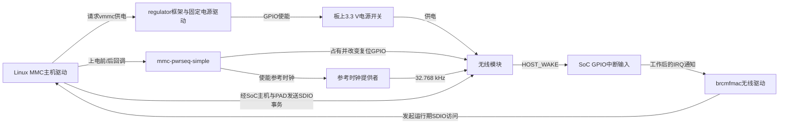
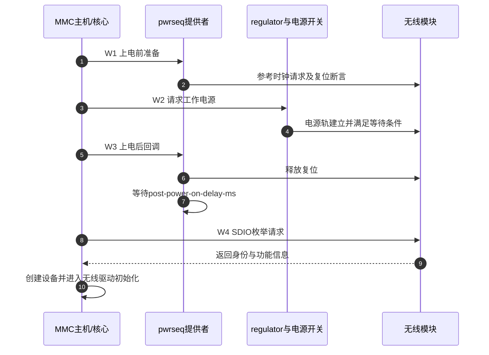

# 第6章\_从供电复位到SDIO无线设备枚举

上一章已经把一个按键的引脚配置、GPIO电平、中断和input事件接了起来。现在换成无线模块：线路都连对了，系统却连SDIO设备都看不到。若只给无线节点补一条`reset-gpios`，驱动甚至还没有被枚举出来，谁来先释放这根线？

本章从这个启动依赖出发，把供电、复位时序、总线枚举与工作后的通知分开。**讲解层次：概念到实现的映射。** 应用契约用固定NXP Linux 6.12.20版本核对；具体模块接线是教学假设，不代表某块i.MX6ULL或RK3568开发板。GPIO逻辑有效值及pinctrl状态沿用 [GPIO连接](P01_GPIO连接命名占用与按键事件.md) 与 [状态交接](P03_引脚状态切换与GPIO占用交接.md) 的前置结论。

## 6.1\_模块还没出现时谁来准备它的电源与复位

**SDIO（Secure Digital Input Output）** 是这里承载无线设备访问的总线。SoC中的主机控制器发出时钟、命令并传输数据；模块只有在供电、参考时钟和复位条件成立以后，才可能回答枚举请求。Linux的MMC子系统管理这类主机与设备，不能因为模块用于Wi-Fi，就把启动前的一切动作都交给无线驱动。

先固定一块教学板：模块工作电源来自可开关的固定3.3 V电源，低有效的`WL_REG_ON`用来维持模块复位/关闭，模块另有32.768 kHz参考时钟；枚举以后，通过SDIO交换数据，并用独立`HOST_WAKE`信号通知主机。`WL_REG_ON`只是这块板的信号名，不是设备树的通用属性名；实际有效电平及信号用途必须来自模块手册。

如果无线驱动取得设备以后才释放`WL_REG_ON`，而主机又必须等模块释放复位以后才能创建设备，就形成启动循环。解决办法是把 **枚举之前的准备职责** 交给主机可调用的时序提供者。`mmc-pwrseq-simple`是一个具体Linux驱动及其compatible，用GPIO复位、可选外部时钟和延时实现简单时序；它不是无线数据驱动，也不是任意复杂上电脚本的执行器。

固定电压也不等于一直有电。**regulator** 框架把“消费者需要一条供电轨”与“哪个GPIO或硬件开关实际控制它”分开。模块电源可由`regulator-fixed`提供，主机通过`vmmc-supply`引用它。主机请求使能时，框架协调共享使用计数与约束，再控制真实开关；无线驱动不应绕过框架抢同一根使能GPIO。



框表示软件角色或已标出的板上硬件，箭头区分控制请求与真实信号。电源使能、模块复位和HOST_WAKE是三根不同用途的线；图中的主机驱动也不是直接连接电源引脚的物理电路。

## 6.2\_让设备树分别描述供电者时序提供者和总线设备

有了职责划分，再看配置就能判断属性该属于哪个节点。下面是待嵌入真实板级DTS的 **连接片段**：`gpio1`、`mmc_host`和pin组都必须由真实SoC及板文件提供，线号、时间和电压须按原理图替换。没有提供控制器MMIO、时钟树和完整PAD配置，因此不能将此片段宣称为可启动板文件。

```dts
/* 放在板级DTS中，依赖已核实的SoC节点及pin组。 */
/ {
    wifi_3v3: regulator-wifi {
        compatible = "regulator-fixed";
        regulator-name = "wifi-3v3";
        regulator-min-microvolt = <3300000>;
        regulator-max-microvolt = <3300000>;
        gpio = <&gpio1 2 0>; /* 本板教学假设：线2，高有效使能。 */
        enable-active-high;
        startup-delay-us = <5000>;
    };

    wifi_ref: clock-wifi {
        compatible = "fixed-clock";
        #clock-cells = <0>;
        clock-frequency = <32768>;
    };

    wifi_seq: wifi-pwrseq {
        compatible = "mmc-pwrseq-simple";
        pinctrl-names = "default";
        pinctrl-0 = <&wifi_reset_pins>;
        reset-gpios = <&gpio1 3 1>; /* 1表示低有效：断言复位时输出低。 */
        clocks = <&wifi_ref>;
        clock-names = "ext_clock";
        post-power-on-delay-ms = <20>;
    };
};

&mmc_host {
    pinctrl-names = "default";
    pinctrl-0 = <&sdio_pins>;
    bus-width = <4>;
    non-removable;
    vmmc-supply = <&wifi_3v3>;
    mmc-pwrseq = <&wifi_seq>;
    #address-cells = <1>;
    #size-cells = <0>;
    status = "okay";

    wifi@1 {
        compatible = "brcm,bcm4339-fmac", "brcm,bcm4329-fmac";
        reg = <1>; /* SDIO功能号，不是I2C地址或MMIO地址。 */
        pinctrl-names = "default";
        pinctrl-0 = <&wifi_wake_pins>;
        interrupt-parent = <&gpio1>;
        interrupts = <4 8>; /* 假设HOST_WAKE是低电平保持型。 */
        interrupt-names = "host-wake";
    };
};
```

这里用数值表示`GPIO_ACTIVE_HIGH=0`、`GPIO_ACTIVE_LOW=1`和`IRQ_TYPE_LEVEL_LOW=8`，目的是让片段不依赖隐藏的头文件；工程中可以使用对应`dt-bindings`宏。第二个compatible是此固定版本绑定要求的家族回退身份，不能只保留产品名就断定所有OF设置都会被读取。

电源开关的PAD配置仍须在电源提供者的实际配置中建立。复位pin组归时序设备使用，SDIO组归主机使用，唤醒输入组归需要该输入的设备使用；同一PAD不要再同时交给GPIO hog、LED或其他驱动。原理图若把复位和电源控制做成一根线，应重新核对模块协议和框架支持，不能简单把同一GPIO复制到两个消费者节点。

这些属性的差别在启动时会直接影响行为：

| 属性及所属节点 | 谁使用它 | 当前含义及边界 |
| --- | --- | --- |
| 电源节点`gpio`、`enable-active-high` | 固定电源驱动/框架 | 定义电源开关；此绑定有历史极性规则，不套用所有GPIO消费者的默认值 |
| 电源节点`startup-delay-us` | regulator框架 | 开关使能后的供电稳定等待，单位微秒；不证明电源已实测稳定 |
| 主机`vmmc-supply` | MMC供电路径 | 卡/模块工作供电；不能替代实际IO电压匹配，必要时另查`vqmmc-supply` |
| 主机`mmc-pwrseq` | MMC核心 | 找到枚举前后调用的时序提供者 |
| 时序节点`reset-gpios` | pwrseq驱动 | 逻辑1断言复位、逻辑0释放；低有效时对应物理低、高 |
| 时序节点`ext_clock` | pwrseq驱动 | 可选参考时钟；和SDIO总线时钟不是一回事 |
| `post-power-on-delay-ms` | pwrseq驱动 | 释放复位以后再等待，单位毫秒；不替代电源稳定延时 |
| 无线节点`host-wake`中断 | 无线驱动 | 枚举后的带外通知；不负责先把模块从复位中救出来 |

此版本的Broadcom绑定 **也允许无线节点上的`reset-gpios`**，它描述`WL_RST`连接。不能由此推断所有总线分支都在枚举前消费它，更不能把它与pwrseq使用的同一根复位线同时声明。应依据模块的两根信号是否真实独立、目标驱动路径和首次操作时点选择归属；不存在通用`brcm,reset-gpios`替代规则。

> 依据：固定提交的 [MMC时序绑定](https://github.com/nxp-imx/linux-imx/blob/dfaf2136deb2af2e60b994421281ba42f1c087e0/Documentation/devicetree/bindings/mmc/mmc-pwrseq-simple.yaml)、[Broadcom无线绑定](https://github.com/nxp-imx/linux-imx/blob/dfaf2136deb2af2e60b994421281ba42f1c087e0/Documentation/devicetree/bindings/net/wireless/brcm,bcm4329-fmac.yaml) 及 [固定电源绑定](https://github.com/nxp-imx/linux-imx/blob/dfaf2136deb2af2e60b994421281ba42f1c087e0/Documentation/devicetree/bindings/regulator/fixed-regulator.yaml)，分别证明属性契约，不证明示例接线与延时适用于实际模块。

## 6.3\_沿一次上电看每种状态何时改变

配置写好以后，电源和复位不会按DTS行号依次执行。驱动必须取得提供者并执行运行协议。以下W0～W4是本例的应用阶段，不替代上一章按键K0～K4；两者处理的是不同操作周期。pinctrl的查找和选择在其中仍按前文的状态交接契约进行。

| 阶段 | 动作与状态落点 | 推进条件及失败意义 |
| --- | --- | --- |
| W0 取得提供者 | GPIO描述符归时序/电源消费者持有；pwrseq保有时钟句柄及延时值 | 未就绪可能导致延迟探测；不是调整DTS节点先后顺序 |
| W1 上电前准备 | pwrseq请求参考时钟，向复位GPIO写逻辑1 | 此时模块仍不得回应枚举；GPIO与clock状态来自真实提供者 |
| W2 电源启用 | 主机请求工作电源；regulator协调计数并驱动开关 | 电源稳定条件成立才进入后续协议；软件返回成功不等于量到了电压 |
| W3 释放并等待 | pwrseq向复位GPIO写逻辑0，再等待配置的毫秒数 | 低有效复位线升高；等待结束只满足约定时间条件 |
| W4 枚举与工作 | 主机发送SDIO命令，创建功能设备；无线驱动继续固件与运行初始化 | 枚举、驱动绑定、固件加载、联网是四种不同证据 |



第2步的复位仍有效，第6步才释放；第7步等待不能补救错误电压或错误PAD复用。第9步得到身份还不能证明无线固件已启动。固定版本`mmc-pwrseq-simple`的部分操作没有向调用者返回完整硬件失败信息，不能把图理解成每条箭头都带可靠成功应答。对应状态、调用及返回值限制在 [组合外设源码阅读索引](../../../research/source_reading/peripheral_integration/navigation/P01_组合外设源码阅读索引.md#1.1_版本与证据范围) 中按W阶段展开。 继续按 [交接模块导读](../../../research/source_reading/peripheral_integration/navigation/P02_资源准备与事件完成怎样交接.md#2.1_先按交接责任定位模块) 定位参与者，具体分支可直达 [本周期实现讲解](../../../research/source_reading/peripheral_integration/source_explanations/P01_MMC简单时序怎样跨过枚举前准备.md#1.2_上电与关闭回调怎样使用这些句柄)。

关闭时也应由所属框架撤销本消费者的需求：时序路径断言复位、等待可选关机时间并释放参考时钟；供电路径撤销相应供电请求。其他使用者或板级约束可能仍使电源保持开启。不能用“反着写一遍GPIO”代替共享计数、总线停止与资源归属。

## 6.4\_运行中有中断为什么仍不保证可以从休眠唤醒

W4成立以后，模块可通过SDIO带内机制或独立HOST_WAKE发起通知，本文配置的是后者。驱动从中断描述建立Linux IRQ，收到通知后再通过设备协议找工作原因、读取数据并让请求条件撤销。HOST_WAKE电平有效不是“数据已被CPU读走”。

现在让系统休眠。若把无线电源关闭，或者把HOST_WAKE所在PAD改成不可接收的状态，即使节点写了唤醒意图，也没有完整物理通路。唤醒需要模块保持必要电源和固件功能、GPIO及上级中断路径处于允许状态、相关电源域保持可观测、驱动在正确PM阶段配置唤醒；具体主机还可能需要保留卡供电的能力和策略。

因此，`wakeup-source`不是一条“强制唤醒命令”；不能随意给任意节点加它并跳过binding和驱动核对。`sleep`也只是可被选择的状态名，不自动决定“所有引脚下拉”“所有时钟关闭”。例如HOST_WAKE为开漏低有效时，接收端必须有合适的上拉和供电条件；上拉是否来自板外电阻、是否属于常供电域，不能从IRQ触发类型推断。推挽信号则需要另一套电气判断。

本例尚未定义完整休眠策略，所以没有添加一份看似通用的sleep pin组。验证时应分别记录：正常运行中能收到通知、进入目标休眠状态、外部事件发生、系统实际恢复、驱动恢复后数据仍可处理。只看到`/proc/interrupts`计数增长，最多支持其中一部分。

## 6.5\_用故障预测检查职责是否分对

先做三个预测，再对照答案。

1. `wifi@1`下写了正确的中断属性，但SDIO从未枚举到设备，优先查HOST_WAKE还是W1～W3？
2. 复位GPIO已经被pwrseq取得，再用GPIO hog把它固定为高，能否提高启动可靠性？
3. 把电源延时5000微秒改成5毫秒含义的另一属性，能否保持全部时序不变？

**参考答案：** 第一题先核对W1～W3及总线接线、时钟、供电和复位；HOST_WAKE属于设备可工作后的路径。第二题会引入重复占用或互相矛盾的职责，不能替代时序协议；需要固定的板级信号才考虑专属hog。第三题不能仅比较时间数值：两个延时处于不同事件之间，即使都是5 ms，电源稳定到释放复位的窗口也可能改变。

本章已经说明如何避免“等设备出现才能准备设备”的循环。下一章 [摄像头控制连接与数据流](P07_摄像头控制连接怎样成为图像数据流.md) 继续追踪另一种缺口：控制总线能读到芯片身份，为什么仍不一定得到一帧图像。
