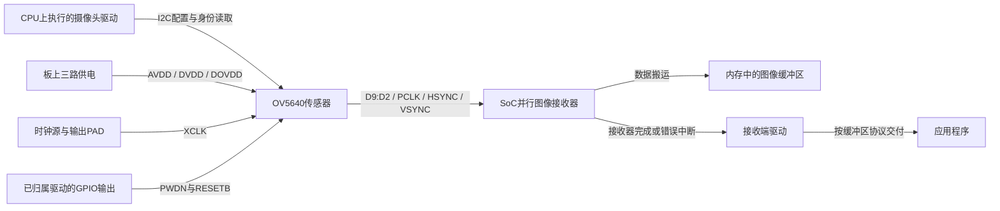
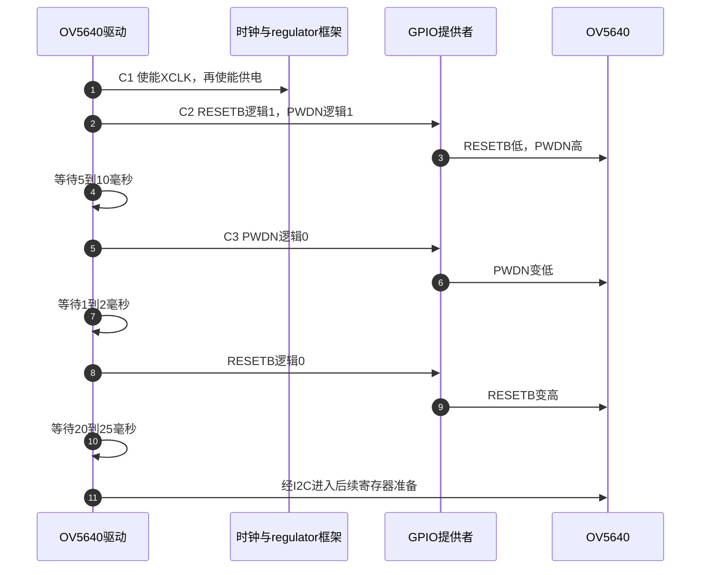

# 第7章\_摄像头控制连接怎样成为图像数据流

无线例子中，准备电源与复位以后，主机才能发现模块。摄像头也需要这样的准备，不过“发现设备”后仍有一个更大的缺口：I2C能读到OV5640的芯片身份，为什么屏幕上还是没有画面？

本章以OV5640图像传感器为对象，区分配置、像素传输和接收完成三条路径。**讲解层次：概念到实现的映射。** 板级连接采用明确的教学假设，绑定与驱动行为核对固定NXP Linux 6.12.20；不把示例当成i.MX6ULL或RK3568整板摄像头方案。供电消费者、GPIO逻辑有效值和pinctrl状态沿用前文。

## 7.1\_读到身份只说明控制路径有回应

OV5640是把光学输入转换成数字图像的传感器型号。处理器需要通过控制总线设置分辨率、格式与运行模式，但一帧图像的数据量很大，不靠逐个I2C寄存器读出每个像素。这里的 **I2C（Inter-Integrated Circuit）** 负责低速控制访问，图像则从另一组引脚或高速串行接口送到SoC的摄像头接收模块。

先选择并行数据接口作主线：传感器提供像素数据、像素时钟以及行场同步信号，SoC接收器按约定边沿采样，并通过自己的数据搬运路径写入内存。**PWDN** 是本器件的power-down控制输入名，**RESETB** 是低有效复位输入名，**XCLK** 是其外部输入时钟名；它们都是控制传感器是否具备工作条件的信号，不是像素数据。



图中数据使用传感器D9:D2这8根线，是下文配置的假设；换成另一组线必须同时改接线和端点描述。CPU上的传感器驱动与接收端驱动可协同工作，但它们管理的寄存器、时钟与中断不是同一份。

因此，“I2C读到身份”只说明在当时条件下，控制通路足以完成那次访问。它不能证明像素PAD复用、采样边沿、接收器时钟、数据格式、缓冲区或中断配置已经正确。反过来，接收器有中断也可能报告错误，不能直接当作完整图像到达。

## 7.2\_先把传感器的供电和控制连接写完整

下面片段描述并行输出的传感器。`camera_xclk`、三个regulator、GPIO和`camera_pins`来自真实板级定义；`capture_input`必须在真实接收器的端点处定义。`0x3c`是I2C地址，不能用它推导帧完成IRQ。

```dts
/* 嵌入已有I2C控制器；外部标签必须由实际板文件提供。 */
&i2c_bus {
    #address-cells = <1>;
    #size-cells = <0>;
    status = "okay";

    camera@3c {
        compatible = "ovti,ov5640";
        reg = <0x3c>;
        pinctrl-names = "default";
        pinctrl-0 = <&camera_pins>;
        clocks = <&camera_xclk>;
        clock-names = "xclk";
        AVDD-supply = <&camera_2v8>;
        DVDD-supply = <&camera_1v5>;
        DOVDD-supply = <&camera_1v8>;
        powerdown-gpios = <&gpio1 19 0>; /* 教学接线：PWDN高有效。 */
        reset-gpios = <&gpio1 20 1>;     /* 教学接线：RESETB低有效。 */

        port {
            camera_output: endpoint {
                remote-endpoint = <&capture_input>;
                bus-width = <8>;
                data-shift = <2>; /* 使用传感器D9:D2。 */
                hsync-active = <0>;
                vsync-active = <0>;
                pclk-sample = <1>;
            };
        };
    };
};
```

电源属性名区分大小写，必须是绑定中的`AVDD-supply`、`DVDD-supply`和`DOVDD-supply`。`powerdown-gpios`也不能改成作者自造的`pwdn-gpios`后仍期待原驱动读取。这里的三种电压来自此版本绑定说明；实际摄像头模组可能板载稳压或电平转换，应根据模组输入和真实供电网络调整提供者，不能给已带稳压的接口盲目施加裸芯片电压。

GPIO编号19和20没有声称是某块开发板连接。只有把PAD复用为相应GPIO、满足IO电压和方向，描述符操作才可能传到传感器引脚。XCLK则需要真实时钟提供者及输出复用，不能把它登记成GPIO输出高就代替连续时钟。

完整端点还需要接收端的反向连接。应在接收器绑定指定的位置定义`capture_input`，使其`remote-endpoint`指回`camera_output`，并核对接收器要求的总线宽度、数据位置和采样规则。**端点（endpoint）** 是设备树中描述接口两端连接的节点，不是自动创建设备链路的函数，也不是内存缓冲区。

| 配置类别 | 当前字段 | 能说明什么 | 仍不能说明什么 |
| --- | --- | --- | --- |
| 控制身份 | compatible、I2C reg | 选驱动和控制地址 | 图像已到内存 |
| 上电条件 | 三个supply、xclk | 提供者及输入时钟身份 | 实测电压、频率和时序 |
| 运行控制 | powerdown/reset GPIO | 线归属及逻辑极性 | 任意GPIO写入都符合器件时序 |
| 并行图像接口 | bus-width、data-shift | 哪些数据线参与 | 板上线路无错接 |
| 同步条件 | hsync/vsync-active、pclk-sample | 同步有效电平与采样边沿 | 时钟质量、建立保持时间达标 |
| 拓扑 | 两端remote-endpoint | 哪个输出连接哪个输入 | 驱动和缓冲区已开始流传输 |

> 依据：[OV5640绑定](https://github.com/nxp-imx/linux-imx/blob/dfaf2136deb2af2e60b994421281ba42f1c087e0/Documentation/devicetree/bindings/media/i2c/ovti,ov5640.yaml)，Properties、Required和并行接口示例。上表将本章使用的契约放在本地，链接用于核对完整模式及版本。

## 7.3\_用上电周期分清GPIO时序与pin状态

如果`default`状态已经被选择，是否就意味着摄像头已退出复位？并不成立。pin状态配置的是复用与电气属性；传感器驱动仍要通过GPIO和供电/时钟框架完成器件协议。名称为`init`或`sleep`的pin组也不自带“拉低复位”或“关闭XCLK”的行为。

在此版本驱动的正常路径中，先请求XCLK使能，再请求三路供电，随后执行传感器上电时序。下面固定 **PWDN和RESETB都存在** 的分支；无PWDN分支会使用软件复位，不能把图无条件套过去。

| 阶段 | 保存或修改的状态 | 正常路径与失败边界 |
| --- | --- | --- |
| C0 取得连接 | 传感器对象持有时钟、regulator和GPIO句柄，保存端点格式 | 取得失败要返回错误；配置文件存在不表示资源就绪 |
| C1 建立工作条件 | 时钟框架使能计数、电源使用计数与对应硬件状态 | 时钟失败立即退出；供电失败撤销已取得的时钟使能 |
| C2 断言控制 | RESETB逻辑1、PWDN逻辑1 | 本例物理电平分别低、高，保持复位/掉电状态 |
| C3 解除控制 | 先PWDN逻辑0，后RESETB逻辑0，中间有规定等待 | 本例物理电平分别低、高；等待来自器件协议 |
| C4 配置与出流 | 控制寄存器、传感器模式、接收器与缓冲区状态 | 身份检查、模式设置、启动出流是不同步骤；关闭要由驱动协调 |



图中的时间区间来自固定驱动的等待调用，不是本次仪器测量，也不是保证调度绝不晚于上限的硬实时承诺。第3步的两个物理电平不同，正是描述符极性转换的结果；第11步仍没有表示传感器已经输出图像。具体调用与错误回退见 [组合外设源码阅读索引](../../../research/source_reading/peripheral_integration/navigation/P01_组合外设源码阅读索引.md#1.1_版本与证据范围) 的C阶段入口。 继续按 [交接模块导读](../../../research/source_reading/peripheral_integration/navigation/P02_资源准备与事件完成怎样交接.md#2.1_先按交接责任定位模块) 定位参与者，具体分支可直达 [本周期实现讲解](../../../research/source_reading/peripheral_integration/source_explanations/P02_OV5640怎样建立时钟供电与复位时序.md#2.2_上电时序及失败回退的次序)。

如果模块内部已经把复位和PWDN组合成单个PWUP输入，应按模块及驱动支持重新映射连接，不能假装仍存在两根独立可控线。控制协议一旦改变，最小等待和错误恢复也需要重新核对。

## 7.4\_为什么不能给OV5640凭空增加帧中断

完成C3以后，还需要设置传感器输出模式、建立接收端数据格式并准备图像缓冲区。并行接口的VSYNC是传感器与接收器之间的同步信号，不因名字包含“同步”就自动成为传感器驱动申请的一条GPIO IRQ。

在本文核对的OV5640绑定中，没有供本文声明“帧完成IRQ”的`interrupts`属性；驱动也没有原文所假设的每帧`request_threaded_irq()`处理路径。若板上SoC接收器通过自己的中断报告帧完成或错误，应在 **接收器节点与驱动** 中核对资源及状态。把那条中断复制到I2C传感器节点，会让描述和实际执行者脱节。

端到端结果还依赖内存缓冲区管理。接收器收到一帧的硬件标志后，接收端驱动必须判断错误、确认哪些缓冲区完成，并按视频框架协议交给应用；应用不能仅凭GPIO电平变化认定一块内存已经完整可读。这里不展开各SoC接收器的DMA实现，因为没有指定实际接收硬件，但也不把这段必要职责省略为“传感器中断唤醒应用”。

如果改用 **MIPI CSI-2**，这是另一套串行图像接口协议，不是把并行`bus-width`改个数字。应在传感器与接收器两端声明时钟lane和数据lane，并核对接收器、物理层及带宽条件。本文绑定允许OV5640使用1或2条数据lane；不能把该范围推广到所有摄像头。

## 7.5\_按控制与数据的分界定位无画面

面对无画面，先记录故障到达哪个阶段：没有I2C回应时，查地址、电源、XCLK、复位/PWDN与控制总线；身份已匹配但未建立媒体连接时，查两端endpoint和对应驱动；连接存在但启动失败时，查支持的格式与流启动返回值；能够启动但图像异常时，再核对采样条件、时钟、数据位序及接收器错误状态。

这些是下一条证据的选择顺序，不是“一种现象只可能有一种原因”的表格。使用`media-ctl -p`前先确认目标系统安装该工具并选择正确媒体设备，读取到的拓扑只证明当前软件实体连接；使用示波器或逻辑分析仪测量时，应同时关联XCLK、复位、PWDN和图像信号，不能只测一根看起来有跳变的线。

练习：如果把`reset-gpios`从低有效改成高有效，驱动仍在C2写1、C3写0，本例RESETB的物理电平会怎样变化？答案是C2变高、C3变低，与本例器件复位要求相反。修改pinctrl状态名不能修复这一极性错误。

再想一个边界：I2C身份正确，是否可以删除`port`先跑起来？此固定驱动在探测时查找并解析端点，没有端点会失败；即便某个其他驱动容忍缺少端点，也不证明图像路径成立。

下一章 [扩展GPIO与共享中断](P08_扩展GPIO与共享中断怎样找到事件来源.md) 继续研究通知本身：多个来源汇到一根线以后，处理者怎样找出真正改变的输入。
