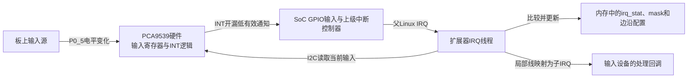
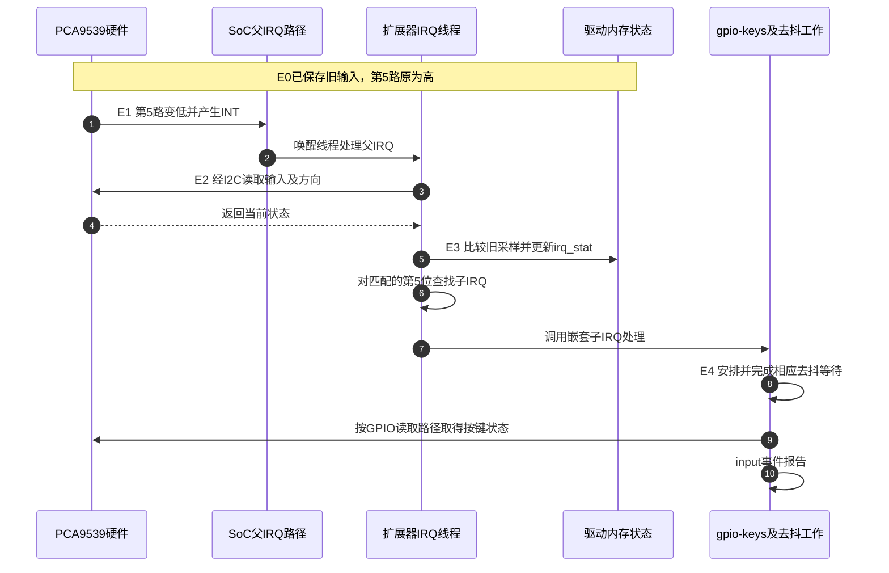

# 第8章\_扩展GPIO与共享中断怎样找到事件来源

前面把SoC中的一个GPIO输入连接成按键事件。若板上还需要十几个慢速输入，而SoC没有足够空闲PAD，可以增加一颗通过I2C访问的GPIO扩展器。它用少量SoC引脚换来更多输入输出，但也产生新的问题：扩展器只用一根INT线通知主机，究竟哪一路发生了变化？

本章沿PCA9539的一个输入变化追到Linux中的处理者，再比较同设备多IRQ与多设备共享IRQ。**讲解层次：概念到实现的映射。** PCA9539是具体器件型号，GPIO提供者是软件角色，Linux IRQ是运行时编号；三者不能混为一个“中断号”。软件路径限定为固定NXP Linux 6.12.20，普通SoC GPIO的局部编号与汇聚关系承接 [GPIO输入与按键事件](P05_GPIO输入怎样成为中断与按键事件.md)。

## 8.1\_用一根通知线换取多路输入的代价

先看没有中断线的方案：CPU定期通过I2C读取扩展器全部输入，再和上次读值比较。这能发现持续足够久的电平变化，但每次轮询都占用总线，检测延迟也受轮询周期限制。INT线的价值是让扩展器在输入变化时先通知SoC，CPU再读数据，而不是一直问“变了没有”。

INT只承担通知，不能携带“第5路变低”的完整身份。该身份仍要从器件状态中取得。PCA9539提供16路GPIO，输入/输出/极性/方向寄存器通过I2C访问；Linux驱动保存前次输入值及各线中断配置，将本次输入与旧值比较，再决定要分派哪些子IRQ。



扩展器与内存状态框不是同一份寄存器：`irq_stat`是驱动保存的历史采样，硬件输入可在两次访问之间变化。I2C事务可能阻塞等待，所以读取工作需要允许睡眠的执行环境。这个代价使扩展GPIO适合按键、状态指示等较慢信号，不能直接替代高频脉冲计数器。

## 8.2\_扩展器同时是I2C消费者与GPIO中断提供者

设备树需要同时表达两层关系。扩展器的`reg`属于I2C地址空间，`interrupts`描述它的INT接到哪个SoC GPIO；扩展器下面声明的两类`#*-cells`则定义它提供给其他消费者的参数格式。

```dts
/* 板级连接片段；i2c_bus、gpio5和电源由实际平台定义。 */
&i2c_bus {
    #address-cells = <1>;
    #size-cells = <0>;

    expander: gpio@74 {
        compatible = "nxp,pca9539";
        reg = <0x74>; /* 假设地址引脚选择了这个地址。 */
        vcc-supply = <&io_supply>;
        gpio-controller;
        #gpio-cells = <2>;
        interrupt-controller;
        #interrupt-cells = <2>;
        interrupt-parent = <&gpio5>;
        interrupts = <11 8>; /* SoC GPIO5局部线11，低电平有效。 */
    };
};

/ {
    gpio-keys {
        compatible = "gpio-keys";
        key-enter {
            label = "expander-enter";
            linux,code = <28>;
            gpios = <&expander 5 1>; /* 扩展器局部线5，低有效。 */
            debounce-interval = <10>;
        };
    };
};
```

按键使用`gpios`，gpio-keys可以通过描述符取得对应子IRQ并读取状态；这与只提供一个IRQ后用定时器合成释放事件不同。该按键没有直接引用SoC的GPIO5线11，因为后者接的是整颗扩展器的INT，而非按键本身。

外部INT需要正确电压和上拉；示例低电平触发用于持续有效的通知线，不是从“按键低有效”机械复制来的。扩展器内部第5路如何报告上升/下降，由子IRQ配置及驱动支持决定。父IRQ的触发方式与子输入的逻辑有效电平处于不同层。

声明`interrupt-controller`也不等于已经运行了IRQ驱动。内核需要相应GPIO扩展器及IRQ支持，I2C设备需要成功绑定，并建立映射。调换DTS节点顺序不会补齐未启用的驱动或解决供电依赖。

> 依据：[PCA95xx绑定](https://github.com/nxp-imx/linux-imx/blob/dfaf2136deb2af2e60b994421281ba42f1c087e0/Documentation/devicetree/bindings/gpio/gpio-pca95xx.yaml)，Properties及带中断示例。该绑定覆盖一个器件家族，不代表所有型号的寄存器和中断能力相同。

## 8.3\_从硬件输入到历史采样再到子IRQ

为了判断一次变化，先知道数据存在哪里。下表只列普通16位PCA9539在本次推理使用的寄存器；I2C地址`0x74`选芯片，表中的命令字节选芯片内部寄存器，两者不能相加当MMIO物理地址。

| 命令地址 | 寄存器组 | 本章使用的含义及访问效果 |
| --- | --- | --- |
| `0x00`、`0x01` | Input Port 0/1 | 读取当前输入状态；读取输入还涉及对应端口INT条件的复位，不能当无副作用的探针 |
| `0x02`、`0x03` | Output Port 0/1 | 保存输出锁存值；对配置为输入的引脚不等于改变外部输入电平 |
| `0x04`、`0x05` | Polarity Inversion 0/1 | 控制输入寄存器读值反相；与Linux GPIO描述符的逻辑极性是不同层 |
| `0x06`、`0x07` | Configuration 0/1 | 每位1为输入、0为输出；驱动据此排除输出线参与输入事件判断 |

这些地址和输入读副作用依据 [NXP PCA9539/PCA9539R数据手册](https://www.nxp.com/docs/en/data-sheet/PCA9539_PCA9539R.pdf) （Rev.9.1，2025-10-10）第6.2节Registers、表4及第6.6.3节Interrupt output说明；软件访问对应固定驱动的普通PCA953x布局。不要把PCAL型号额外的输入锁存/中断状态寄存器套到这里，也不要在驱动占用时随手用I2C工具读输入“旁观”，那可能改变驱动正在依赖的通知条件。

Linux为每颗扩展器保存`struct pca953x_chip`。其中`irq_stat`保存前次输入采样，`irq_mask`表示参与判断的线，`irq_trig_raise/fall`表示软件选择的边沿方向。它们在内存中，由驱动维护，和硬件寄存器不是镜像同义词。

本例把一次正常变化分成E0～E4。它放大的是前文按键周期中“电平变化→来源分派→读取并报告”这段，后续input事件仍遵守 [K1至K4的处理模型](P01_GPIO连接命名占用与按键事件.md#1.5.3_沿一次按键追踪状态与事件)。

| 本地阶段 | 谁写什么、谁接着读取 | 对应按键周期 |
| --- | --- | --- |
| E0 建立采样基线 | 扩展器驱动读输入/方向，把有效输入写入`irq_stat` | K0准备期间新增的历史状态 |
| E1 输入发生变化 | 外部源改变第5路电平，扩展器驱动INT通知SoC | K1物理输入变化 |
| E2 线程读取 | 父IRQ唤醒扩展器线程，线程经I2C读取当前输入/方向 | K2来源处理增加一次慢总线访问 |
| E3 比较与分派 | 比较新旧值、方向、mask和边沿；更新`irq_stat`，对匹配位查找子IRQ | K2分派到具体输入来源 |
| E4 消费事件 | 子处理者按自身协议读取/去抖/报告，input保存并交付事件 | K3读取与K4报告 |



第3～5步有真实总线传输和历史比较，不能压成“GIC知道扩展器第5路”。第8～10步由gpio-keys按去抖机制安排后续读取和报告，不保证全部在子IRQ回调返回前完成。图画的是稳定低电平足够久的正常输入，不证明任意窄脉冲都会留下事件。

假设输入在两次采样之间先低后高，最终采样又与旧值相同，普通PCA9539路径可能无法恢复中间发生了几次变化。INT通知不是一个无限事件队列。输入变化过快或I2C拥塞时，解决办法可能是更合适的硬件捕获能力或连接方式，而不是把Linux IRQ优先级调高就宣称无丢失。

此驱动使用线程化父IRQ，再调用嵌套子IRQ处理；硬件有级联连线，不表示软件必须使用有`parent`链的层级irqdomain。固定实现的状态计算及线程上下文见 [组合外设源码阅读索引](../../../research/source_reading/peripheral_integration/navigation/P01_组合外设源码阅读索引.md#1.1_版本与证据范围)。 继续按 [交接模块导读](../../../research/source_reading/peripheral_integration/navigation/P02_资源准备与事件完成怎样交接.md#2.1_先按交接责任定位模块) 定位参与者，具体分支可直达 [本周期实现讲解](../../../research/source_reading/peripheral_integration/source_explanations/P03_PCA953x怎样比较输入并分派嵌套中断.md#3.2_用新旧输入推导哪些局部线需要处理)。

## 8.4\_一个器件有两个IRQ时先保持两条来源身份

扩展器是“多个输入先汇聚”。另一个常见场景是传感器有两个独立输出，例如数据就绪和错误告警，它们接到不同GPIO提供者。此时描述应保留两条连接及名字，驱动也要分别取得和处理；不要为了少写一行强行合并。

```dts
/* 名称与事件意义是教学契约；实际器件须使用其真实binding。 */
interrupts-extended = <&gpio_a 5 2>, <&gpio_b 7 1>;
interrupt-names = "data-ready", "fault";
```

每个引用后分别按该提供者的`#interrupt-cells`解析。例中两者恰好都是“局部线+触发标志”，不意味着所有提供者都相同。名字由消费端binding约定，并不改变硬件信号；驱动须检查每次取得IRQ的返回值，再注册匹配的处理路径。

还要看设备由哪条总线创建。platform设备可以使用`platform_get_irq_byname()`，因为它取得的是platform资源。I2C或SPI设备不会因DTS写了同样属性就变成`platform_device`；多IRQ可使用适合其固件节点的查询接口，或该总线/器件驱动已约定的路径，再与目标对象生命周期配套。不能拿SPI回调中的设备强转成platform设备来复用示例。

## 8.5\_多颗器件共线时谁负责确认真正的来源

现在进一步节省SoC输入，让两颗器件共用一根中断线。首先要确认 **电气上能否共线**：例如兼容电压的开漏输出与合适上拉可让任一器件拉低；两个推挽输出在高低相反时可能冲突，`IRQF_SHARED`无法修复电路。

其次要确认协议：每颗器件必须有可查询的本地原因或状态，处理者只能清除自己拥有的来源。假设A先拉低共享线，B稍后也有事件；A处理完释放输出时，B仍拉低。若主机只等下一次下降沿，线没有先升高就不会再产生新的下降沿，B可能被遗漏。保持型通知通常适合按有效电平处理，但最终选择仍取决于器件和控制器支持，不能靠把标志统一写成falling解决。

Linux共享IRQ让同一IRQ上的多个处理者参与检查。每个注册者需要稳定且可区分的`dev_id`，注销时使用同一身份；处理者没有本设备事件就返回相应的未处理结果。可在硬中断中安全查询来源时，主处理函数先判断，再决定是否唤醒线程；若必须经过可睡眠总线，某些驱动采用默认主处理函数唤醒线程，由线程查询和过滤。本版PCA953x就是后一种路径之一，不能把“共享IRQ绝不允许NULL主函数”写成规则。

`IRQF_ONESHOT`用于在线程处理期间维持IRQ屏蔽配合，它不会自动读取每颗设备的原因寄存器，也不能代替清除中断条件。共享注册者之间还须满足标志与触发兼容要求。移除设备前，要先让本设备停止产生新请求，再按驱动生命周期撤销处理资源；不能只释放内存留下仍可能进入的回调。

练习：A与B共线，A处理后线仍低，是GIC内部状态机出错吗？答案是不能这样推断。先确认B是否仍有未清原因、A是否真正撤销输出，以及共享电路是否正常；这属于外设请求与处理协议。硬件内部状态机正确性和软件接口同步的边界仍应分别判断。

本章知道了“收到通知以后怎样找到来源”。下一章 [RS-485方向控制](P09_RS485方向控制为什么必须等待发送完成.md) 则追踪相反方向：软件已经发出数据，什么时候才有资格改变线路控制信号。
