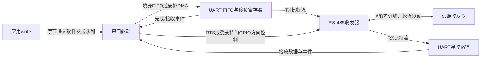
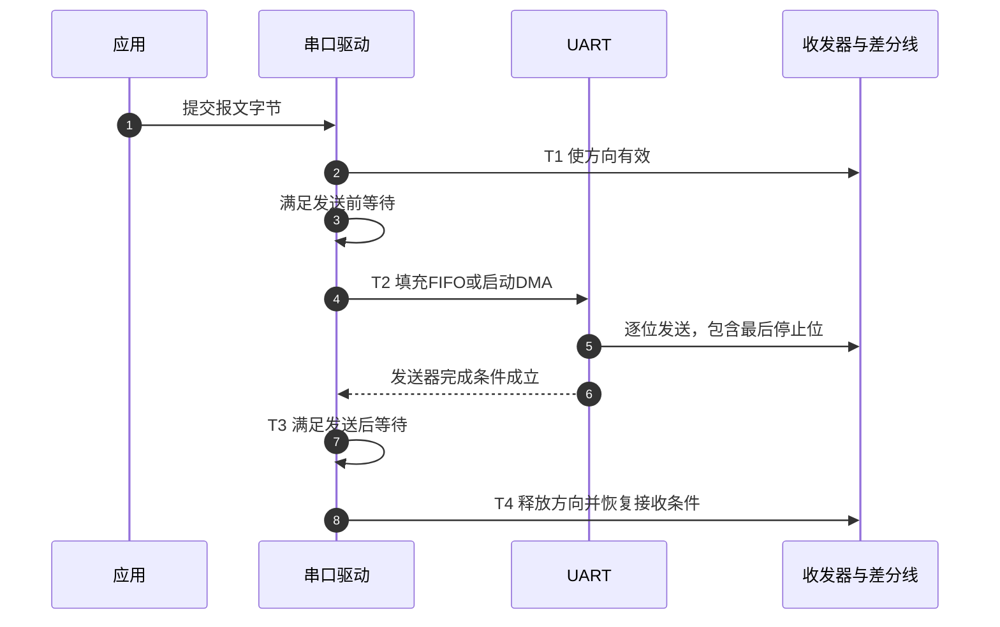

# 第9章\_RS485方向控制为什么必须等待发送完成

前面讨论输入事件怎样到达软件。现在把方向反过来：应用把数据写进串口以后，能否立即将收发器切回接收？如果最后几个比特仍在UART移位寄存器里，提前关闭线路驱动会截断报文；如果关闭太晚，又可能挡住对端回答。

本章解释半双工RS-485方向控制的时间边界，并把它映射到Linux串口配置和固定版本i.MX驱动。**讲解层次：概念到实现的映射。** GPIO、pinctrl与IRQ知识已经具备，但不能因此假设任何串口都支持相同RS-485能力。

## 9.1\_共享差分线为什么需要明确的发送窗口

**RS-485** 是规定平衡差分通信电气特性的标准名称。本章选择常见的两线半双工连接：一对差分线供多个节点轮流发送，不能把“两线”解释成只有一根信号线，也不能把RS-485本身当成自动决定谁先发言的上层协议。

SoC的UART发送/接收信号通常不是可以直接接到这对线路的电气信号，需要 **收发器（transceiver）** 做转换。典型收发器有发送使能`DE`和低有效接收使能`/RE`。本文假设两者接到同一个方向控制：高时发送、低时接收；真实芯片、反相器及板级接线可能不同。



UART内部的FIFO先保存字节，移位寄存器再按波特率逐位送出。FIFO空只意味着没有排队字节，最后一个字符可能仍在发送；DMA完成只意味着数据搬运阶段结束，也可能尚未从引脚离开。这就是方向控制必须依赖 **发送器完成条件** 的原因。

对于8N1格式，一个字符包含1个起始位、8个数据位和1个停止位，共10位。在115200 bit/s下，最后一个字符约需86.8微秒。这个估算有助于理解提前切换的风险，但不能代替硬件完成标志：实际尚余多少字节、时钟误差及驱动排队情况仍会变化。

## 9.2\_从方向有效到最后停止位再到释放总线

先建立不依赖寄存器名称的T0～T4周期。方向状态、UART状态和软件队列状态是相互配合的几组状态，不能只用“正在发送”一个布尔值表达全部时点。

| 阶段 | 状态变化及拥有者 | 进入下一阶段的条件 |
| --- | --- | --- |
| T0 接收/空闲 | 驱动保持发送器不驱动线路；应用可提交新字节 | 有数据且本节点按通信协议可以发送 |
| T1 建立方向 | 驱动或硬件使方向有效，收发器开始具备驱动能力 | 满足收发器建立时间及配置的发送前等待 |
| T2 传输 | 驱动填FIFO或DMA搬运，UART移位寄存器发送比特 | 软件队列推进不等于线路完成；继续等待真实完成条件 |
| T3 完成后保持 | 最后比特发送完成，驱动保留方向可选时间 | 满足发送后等待，期间若新数据加入需按状态机处理 |
| T4 释放 | 驱动撤销方向，按配置恢复接收 | 线路进入可供其他节点使用的状态，回到T0 |



第4步完成不能替代第6步；第1步`write()`返回也没有承诺第8步发生。通信协议还需要规定节点轮流发送、地址、报文边界和超时，否则两个节点都正确执行本地T周期，仍可能同时占用总线。

接收是否在发送期间保持开启也是独立选择。有些接线用于观察本机回波，有些要求关闭接收。`rs485-rx-during-tx`只能表达目标驱动支持范围内的选择，不能保证收发器`/RE`实际接法允许它。

## 9.3\_设备树表达初始请求而驱动决定支持范围

Linux使用`struct serial_rs485`保存串口RS-485配置，串口核心根据驱动提供的支持能力整理用户请求，再调用设备驱动的配置回调。DT提供启动配置，运行时应用也可以通过ioctl查询或修改；不是DT写了某个属性，硬件就凭空增加该功能。

以已有UART节点为基础，下面只展示通用启动请求：

```dts
/* UART本身的reg、IRQ、时钟及实际TX/RX/方向PAD必须已建立。 */
&uart_port {
    pinctrl-names = "default";
    pinctrl-0 = <&uart_rs485_pins>;
    linux,rs485-enabled-at-boot-time;
    rs485-rts-active-high;
    rs485-rts-delay = <0 0>; /* 两项单位都是毫秒，不是微秒。 */
    status = "okay";
};
```

这仍不是一份完整i.MX板级配置。此版本i.MX驱动需要实际RTS能力描述或受支持的`rts-gpios`路径，才能声明相应支持；哪个物理PAD在DTE/DCE模式下承担该信号，需要按芯片和板级连接核对。不要新造`gpio-rs485-de`属性，也不要同时用另一个GPIO驱动直接控制已交给串口的方向线。

| 当前使用的配置 | 含义 | 不能推出的结论 |
| --- | --- | --- |
| `linux,rs485-enabled-at-boot-time` | 初始请求启用RS-485模式 | 任意UART驱动都实现该模式 |
| `rs485-rts-active-high` | 发送时RTS高，此版本绑定中也是默认极性 | 板上DE经过反相器后仍一定高有效 |
| `rs485-rts-active-low` | 发送时RTS低 | 可以和active-high同时随意使用 |
| `rs485-rts-delay=<a b>` | 方向建立到发送、发送完成到释放的毫秒延时 | 两个数控制同一个时间窗口或具有硬实时精度 |
| `rs485-rx-during-tx` | 请求发送期间保持接收 | 硬件和板上接收使能已经允许 |
| `rts-gpios` | 在支持它的UART实现中连接RTS GPIO | 任意可睡眠GPIO都适合原子串口控制路径 |

固定版`rs485.yaml`明确允许`rs485-rts-active-high`，不能因另一个版本或个人习惯省略它，就把该属性说成虚构。具体驱动还有额外边界，例如i.MX硬件RTS路径对发送低有效且关闭接收的组合存在限制，驱动会调整接收行为；使用前必须查询实际配置并测量方向信号。

> 依据：[RS-485绑定](https://github.com/nxp-imx/linux-imx/blob/dfaf2136deb2af2e60b994421281ba42f1c087e0/Documentation/devicetree/bindings/serial/rs485.yaml) 与 [Linux串口RS-485接口说明](https://github.com/nxp-imx/linux-imx/blob/dfaf2136deb2af2e60b994421281ba42f1c087e0/Documentation/driver-api/serial/serial-rs485.rst)，第3～4节。配置请求、驱动支持和物理输出应分别验证。

## 9.4\_iMX驱动在哪里区分FIFO空与发送完成

**讲解层次：实现层，固定NXP Linux 6.12.20的i.MX UART驱动。** 该驱动用发送状态和定时器配合RTS控制；本文不推广到所有UART。方向动作发生在驱动管理的发送周期中，不是一个通用的`serial_rs485_start_tx()`函数替所有硬件完成。

| 上文阶段 | 此实现的状态 | 关键含义 |
| --- | --- | --- |
| T0 | `OFF` | 本发送周期未活动 |
| T1 | `WAIT_AFTER_RTS` | 方向已建立，等待发送前延时 |
| T2 | `SEND` | 正在推进发送，并等待真正结束条件 |
| T3 | `WAIT_AFTER_SEND` | 完成以后等待释放方向的时机 |
| T4 | 返回`OFF` | 调整RTS、恢复相应接收路径 |

状态保存在每个端口的`struct imx_port`中，驱动在发送启动、完成及定时器回调路径上修改。寄存器通过已映射的该UART MMIO窗口访问；下表偏移不是任意板上固定物理地址。

| 寄存器及偏移 | 本章使用的位 | 读写效果及阶段 |
| --- | --- | --- |
| `USR2`，`0x98` | `TXFE` bit14 | 读取FIFO是否空；不足以证明T2结束 |
| `USR2`，`0x98` | `TXDC` bit3 | 读取发送器完成状态，驱动据此判断移位器是否仍忙 |
| `UCR4`，`0x8c` | `TCEN` bit3 | 控制发送完成中断许可，使完成条件能推动后续处理 |
| `UCR1`，`0x80` | `TRDYEN` bit13 | 控制发送就绪中断，服务填充发送数据；不是最终线路完成证明 |

这里仅解释列出的位，不提供整寄存器写值。驱动还会处理DMA正在发送、接收控制及新数据进入等条件；表中没有宣称“读到TXDC后任意调用者都能改GPIO”。原驱动已经拥有这套状态，外部程序绕过它翻转方向会制造另一套互不协调的控制。

完整源码入口及T阶段映射见 [组合外设源码阅读索引](../../../research/source_reading/peripheral_integration/navigation/P01_组合外设源码阅读索引.md#1.1_版本与证据范围)。从此模型可预测：把停止路径的发送器完成检查删掉，即使FIFO已空也可能过早撤销方向；单纯增加固定睡眠只能碰巧覆盖某些波特率和负载。 继续按 [交接模块导读](../../../research/source_reading/peripheral_integration/navigation/P02_资源准备与事件完成怎样交接.md#2.1_先按交接责任定位模块) 定位参与者，具体分支可直达 [本周期实现讲解](../../../research/source_reading/peripheral_integration/source_explanations/P04_iMX串口怎样在发送完成后释放方向.md#4.2_停止发送必须先跨过硬件完成条件)。

## 9.5\_先查询运行配置再用波形验证时间边界

下面小程序只查询内核当前配置，不修改端口、不发送数据。它需要Linux用户空间头文件和C编译器；设备名从目标系统实际枚举取得，不预设`ttyS`或`ttymxc`编号。打开端口本身仍可能触发设备的打开/电源管理行为，应选择专用测试端口，避免正在承担控制台或业务通信的端口。

```c
/* rs485_query.c：查询当前端口的RS-485配置。 */
#include <fcntl.h>
#include <linux/serial.h>
#include <stdio.h>
#include <sys/ioctl.h>
#include <unistd.h>

int main(int argc, char **argv)
{
    struct serial_rs485 config = {0};
    int fd;

    if (argc != 2) {
        fprintf(stderr, "用法：%s 串口设备路径\n", argv[0]);
        return 2;
    }
    fd = open(argv[1], O_RDWR | O_NOCTTY | O_NONBLOCK);
    if (fd < 0) {
        perror("打开端口");
        return 1;
    }
    if (ioctl(fd, TIOCGRS485, &config) < 0) {
        perror("查询RS-485配置");
        close(fd);
        return 1;
    }
    printf("启用=%u 发送时RTS高=%u 发送后RTS高=%u\n",
           (unsigned int)!!(config.flags & SER_RS485_ENABLED),
           (unsigned int)!!(config.flags & SER_RS485_RTS_ON_SEND),
           (unsigned int)!!(config.flags & SER_RS485_RTS_AFTER_SEND));
    printf("发送前等待=%u ms 发送后等待=%u ms 发送时接收=%u\n",
           config.delay_rts_before_send, config.delay_rts_after_send,
           (unsigned int)!!(config.flags & SER_RS485_RX_DURING_TX));
    if (close(fd) < 0) {
        perror("关闭端口");
        return 1;
    }
    return 0;
}
```

将上面完整内容保存为`rs485_query.c`后，在Linux测试机的同一目录编译：

```sh
# Linux测试机；只生成查询程序。
cc -std=c11 -Wall -Wextra -Werror rs485_query.c -o rs485_query
```

编译成功只证明当前头文件提供了这些接口。接着查询实际端口，例如已确认的专用测试端口`/dev/ttymxc1`：

```sh
# 仅在该设备确实是当前专用测试端口时执行。
./rs485_query /dev/ttymxc1
```

若返回不支持ioctl，检查实际驱动及其支持能力；若权限失败，按目标系统设备访问策略处理。输出来自内核配置，不能证明DE已经在引脚上形成正确波形。需要修改时，应用使用`TIOCSRS485`提交完整初始化的结构，并再次`TIOCGRS485`读取驱动接受后的结果，不把请求原样打印成生效证据。

硬件验证时，以既定通信协议在专用总线上发送已知短报文，同时观察UART TX和方向信号；确认方向先于首个起始位有效、晚于最后停止位撤销，并验证对端响应能进入接收路径。调整发送前/后延时后，分别比较这两个窗口。收发器延迟、线路终端与偏置电阻仍按实际器件和网络设计核对，不能从DT延时推导出来。

练习答案也由这条时间线给出：把发送后等待从0改成2 ms，只能延后T3到T4的交接，不会修复TX/RX错接，也不能弥补T1方向建立过晚。下一章 [换板与分层诊断](P10_组合外设怎样换板并逐层定位故障.md) 将这些观察整理成可以迁移到另一平台的验证方法。
