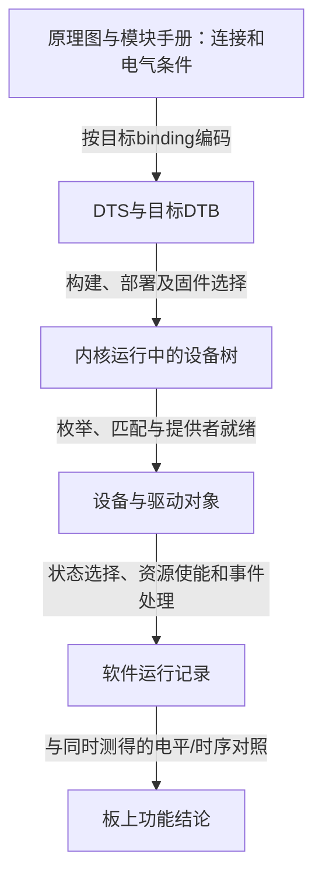

# 第10章\_组合外设怎样换板并逐层定位故障

前面已经分别建立无线启动、摄像头出流、扩展GPIO与RS-485发送周期。换一块SoC以后，设备树仍然使用GPIO、pinctrl和interrupt属性，但参数、硬件归属和驱动能力可能不同。本章解决怎样迁移这些连接，以及功能不通时该先取得哪条证据。

**讲解层次：概念到实现的映射。** 比较对象是固定NXP源码中i.MX6UL/i.MX6ULL相关实现与RK3568相关实现；它们是不同SoC平台，不能把一个板上现象写成整个厂商产品的能力排名。板卡原理图仍是引脚实际用途的依据。

## 10.1\_换板保留外设协议重新建立每个连接

假设外设仍是同一颗传感器，其RESETB有效电平、上电时间和输出协议没有变化。变化的是SoC把哪根PAD连接到它、该PAD由哪个pin控制器配置、GPIO属于哪个bank，以及事件怎样进入上级中断控制器。因此，正确迁移从原理图中的信号名开始，逐项建立新平台连接，而不是把旧DTS中的控制器标签替换一下。

单根指示灯仍可复用gpio-leds，固定板级信号可由专属hog持有；相关完整例子见 [GPIO消费者与占用](P01_GPIO连接命名占用与按键事件.md)。LED的active-low、default-state和触发器选项由接线与功能需求决定，不是i.MX与Rockchip的固有差异。启动后还需动态复位的线不能同时作为固定hog占用。

i.MX6UL主IOMUXC的`fsl,pins`条目通常由pinfunc宏提供5个cell，再跟1个配置cell；配置包含复用寄存器、PAD寄存器、输入选择寄存器及相应选择值。配置cell不是通用16位“GPIO属性”，电气字段与软件标志也不能直接搬到另一SoC。

RK3568的`rockchip,pins`则使用bank、bank内pin、复用功能值和配置节点引用。bank帮助识别哪个GPIO组，配置节点可包含该绑定支持的上拉/下拉/驱动强度等属性；不是省掉bank后的三项格式。已经逐项建立的pin映射见 [引脚配置](P02_引脚配置怎样连接外设与焊盘.md) 及 [引脚诊断](P04_沿状态与寄存器定位引脚问题.md)。

| 比较轴 | i.MX6UL主IOMUXC/GPIO1实例 | RK3568相关实例 | 迁移时保留与重做 |
| --- | --- | --- | --- |
| pin配置编码 | pinfunc展开及PAD配置cell | bank、pin、mux、配置引用 | 保留信号职责，重做复用及电气编码 |
| GPIO消费者参数 | 所引GPIO节点的局部线与flags | 所引GPIO bank的局部线与flags | 都不能直接使用旧全局GPIO号 |
| GPIO中断参数 | 局部线与触发类型 | 局部线与触发类型 | bank由phandle指定，不额外把bank塞入两cell中断参数 |
| 上级汇聚连接 | GPIO1有两条SPI，分别服务两组输入 | 此RK3568 bank实例各有一条汇聚SPI | 保留输入事件意义，按SoC描述重建上级资源 |
| Linux域实现 | 该固定驱动使用legacy域及chained入口 | 该固定驱动使用linear域及chained入口 | 两者均不能仅由硬件级联图推断成层级parent域 |
| 低功耗状态 | 由驱动PM调用和平台电源约束决定 | 同样需要核对驱动与平台约束 | 不复制一份“sleep全部下拉”模板 |

例如，固定`rk356x.dtsi`中的`gpio0`位于`0xfdd60000`，上级为SPI 33；`gpio2`位于`0xfe750000`，上级为SPI 35。这些是两个不同bank，不能把gpio0地址配上gpio2名字。它们的GIC SPI编号也不是运行时Linux IRQ；这组数据用来识别提供者，不授权读者对这些地址直接写寄存器。

> 依据：[rk356x.dtsi的pinctrl/GPIO节点](https://github.com/nxp-imx/linux-imx/blob/dfaf2136deb2af2e60b994421281ba42f1c087e0/arch/arm64/boot/dts/rockchip/rk356x.dtsi)、[gpio-rockchip.c](https://github.com/nxp-imx/linux-imx/blob/dfaf2136deb2af2e60b994421281ba42f1c087e0/drivers/gpio/gpio-rockchip.c) 中的域建立与chained入口，以及前文已核对的i.MX6UL和gpio-mxc路径。这些证据支持本表的实现差量，不支持“某厂商天然更先进”的评价。

## 10.2\_先在离线DT中检验连接没有串错对象

在操作真实板以前，可以先检验自己是否理解phandle的职责。下面是完整的 **离线连接模型**，保存为`peripheral_links.dts`。控制器都是教学对象，没有真实MMIO、clock或驱动实现；它只用于DTC编译和属性查询，不可启动硬件，也不是Schema通过的板级例程。

模型复用前文无线与摄像头连接，但去掉真实SoC细节，新增两组端点用于观察双向引用。这样一次实验只验证描述关系，不把未落实的板级配置伪装成完整工程。

```dts
/dts-v1/;
/ {
    gpio_a: gpio-controller-a {
        gpio-controller;
        #gpio-cells = <2>;
        interrupt-controller;
        #interrupt-cells = <2>;
        #address-cells = <0>;
    };
    gpio_b: gpio-controller-b {
        gpio-controller;
        #gpio-cells = <2>;
        interrupt-controller;
        #interrupt-cells = <2>;
        #address-cells = <0>;
    };
    supply: regulator-test {
        compatible = "regulator-fixed";
        regulator-name = "test-supply";
    };
    ref_clock: clock-test {
        compatible = "fixed-clock";
        #clock-cells = <0>;
        clock-frequency = <32768>;
    };
    seq: wifi-pwrseq {
        compatible = "mmc-pwrseq-simple";
        reset-gpios = <&gpio_a 3 1>;
        clocks = <&ref_clock>;
        clock-names = "ext_clock";
        post-power-on-delay-ms = <20>;
    };
    mmc {
        #address-cells = <1>;
        #size-cells = <0>;
        mmc-pwrseq = <&seq>;
        vmmc-supply = <&supply>;
        wifi@1 {
            compatible = "brcm,bcm4339-fmac", "brcm,bcm4329-fmac";
            reg = <1>;
            interrupt-parent = <&gpio_b>;
            interrupts = <4 8>;
            interrupt-names = "host-wake";
        };
    };
    i2c {
        #address-cells = <1>;
        #size-cells = <0>;
        camera@3c {
            reg = <0x3c>;
            reset-gpios = <&gpio_a 20 1>;
            powerdown-gpios = <&gpio_a 19 0>;
            port {
                camera_out: endpoint {
                    remote-endpoint = <&capture_in>;
                    bus-width = <8>;
                    data-shift = <2>;
                };
            };
        };
    };
    capture {
        port {
            capture_in: endpoint {
                remote-endpoint = <&camera_out>;
                bus-width = <8>;
            };
        };
    };
};
```

编译前先预测：无线复位引用A，HOST_WAKE引用B；摄像头复位与PWDN都引用A；两个endpoint互相引用。接着在安装DTC工具的实验目录执行：

```sh
# 已保存peripheral_links.dts的实验目录；不访问目标硬件。
dtc -I dts -O dtb -o peripheral_links.dtb peripheral_links.dts
fdtget -t x peripheral_links.dtb /gpio-controller-a phandle
fdtget -t x peripheral_links.dtb /gpio-controller-b phandle
fdtget -t x peripheral_links.dtb /wifi-pwrseq reset-gpios
fdtget -t x peripheral_links.dtb /mmc/wifi@1 interrupt-parent
fdtget -t x peripheral_links.dtb /mmc/wifi@1 interrupts
```

前两条查询取得本次编译分配的phandle数值。复位输出应以A的phandle开头、后接`3 1`；HOST_WAKE父节点应等于B的phandle，中断参数是`4 8`。不要把一次输出的phandle值写死到另一份DTB的预期里。

再检查图像接口两端：

```sh
# 同一实验目录；比较每个remote-endpoint与对端phandle。
fdtget -t x peripheral_links.dtb /i2c/camera@3c/port/endpoint phandle
fdtget -t x peripheral_links.dtb /capture/port/endpoint remote-endpoint
fdtget -t x peripheral_links.dtb /capture/port/endpoint phandle
fdtget -t x peripheral_links.dtb /i2c/camera@3c/port/endpoint remote-endpoint
```

第一、二条应相同，第三、四条也应相同。这证明两个引用指向预期节点，仍不证明接收器能接收传感器实际格式。

最后只把`wifi-pwrseq`的复位线3改为6，重新编译并查询。预期复位局部线改变，HOST_WAKE、摄像头两条GPIO及端点关系保持原语义；phandle数值若重排，按本次DTB重新配对。恢复原文再编译一次，确认修改与恢复都能解释。这项练习防止把不同职责的“同一类数字”一起改掉。

## 10.3\_把运行证据放回它能证明的那一层

离线模型没有错误以后，真实工程还要完成目标板的控制器、PAD、电源和时钟描述，并运行目标内核构建与适用的`dtbs_check`。编译器只检查结构及部分规则；Schema检查的是绑定约束；启动后读取实际设备树才知道固件最终交付了什么。这三步不能互相替代。



图的每条箭头都需要证据。例如磁盘上的DTB已更新，仍可能启动了另一分区中的旧文件；设备节点存在，仍可能尚未绑定驱动；回调执行了，仍可能因为PAD复用或供电问题没有改变线路。

| 当前问题 | 优先读取的证据 | 应保留的限制 |
| --- | --- | --- |
| 改动是否部署 | 启动配置、目标DTB身份、运行设备树对应属性 | 不能只看源码文件时间戳 |
| 设备是否枚举/绑定 | 实际总线设备目录、`driver`链接与探测日志 | `status="okay"`不等于驱动已成功 |
| GPIO是否属于预期消费者 | GPIO debug信息、设备资源、line名称和局部offset | 不固定全局GPIO基数，也不抢占已有消费者 |
| pin状态是否被选择 | pinctrl handles/maps及相应控制器信息 | 不存在通用debugfs `state/select`写法；软件记录不总等于完整硬件回读 |
| IRQ是否运行 | `/proc/interrupts`、正确IRQ身份、适用trace事件 | 计数不是设备数据正确，也不证明睡眠唤醒 |
| 电源/时钟是否被请求 | regulator/clock调试信息与驱动返回值 | 请求计数及估计频率不是仪器测量 |
| PAD波形是否成立 | 与软件操作对应的示波器/逻辑分析仪记录 | 一根线的波形不能替代端到端功能测试 |

固定电源没有通用的`/sys/class/regulator/某名字/enable`用户开关接口，不能编一个路径让读者反复写。若需要诊断共享供电，应观察框架及真实消费者，再通过已定义的设备协议改变需求。对正在由驱动管理的GPIO强行export或对设备寄存器直接`devmem`写入，可能破坏本来要观察的状态。

对报错也要保持因果边界。`-EBUSY`首先提示检查占用对象和重复连接，而不是给节点换个名字；延迟探测要追未就绪的提供者，而不是按DTS文本顺序重排；没有IRQ计数要从输入、触发、屏蔽和实际IRQ身份逐层缩小范围，而不是直接断定GIC故障。

## 10.4\_在独立trace实例里观察一次IRQ处理

有时需要知道某次外部动作是否进入Linux IRQ action处理。**tracefs** 是内核跟踪接口文件系统；它提供事件启停和缓冲区，和`set_ftrace_filter`的函数名过滤用途不同。`irq:irq_handler_entry`是事件名，不能把`function irq:irq_handler_entry`当作函数过滤表达式。

下面脚本只开启一个已确认Linux IRQ的entry/exit事件，并创建独立实例，避免清空别人的全局跟踪缓冲区。它需要目标Linux已挂载tracefs、支持实例和对应事件、当前用户具有访问权限。先从设备身份和`/proc/interrupts`确认IRQ，不把DTS中的SPI或GPIO局部线直接填入。

```sh
#!/bin/sh
# capture_irq.sh：在目标Linux创建独立IRQ跟踪实例。
set -eu
if [ "$#" -ne 1 ]; then
    printf '%s\n' '用法：capture_irq.sh Linux_IRQ号' >&2
    exit 2
fi
case "$1" in ''|*[!0-9]*) exit 2 ;; esac
irq_number=$1
trace_root=/sys/kernel/tracing
instance="$trace_root/instances/peripheral_irq_$$"
test -d "$trace_root/instances"
mkdir "$instance" # 已存在即失败，绝不复用未知实例。
cleanup() {
    printf '0\n' > "$instance/tracing_on" 2>/dev/null || :
    printf '0\n' > "$instance/events/enable" 2>/dev/null || :
    rmdir "$instance" 2>/dev/null || :
}
trap cleanup 0
trap 'exit 130' INT
trap 'exit 143' TERM
printf '0\n' > "$instance/tracing_on"
for event_name in irq_handler_entry irq_handler_exit; do
    event_dir="$instance/events/irq/$event_name"
    test -f "$event_dir/enable"
    printf 'irq == %s\n' "$irq_number" > "$event_dir/filter"
    printf '1\n' > "$event_dir/enable"
done
output_dir=$(mktemp -d ./irq_capture.XXXXXX)
printf '1\n' > "$instance/tracing_on"
printf '%s\n' '现在触发一次已约定的外设动作，完成后按回车。'
read -r reply
printf '0\n' > "$instance/tracing_on"
cat "$instance/trace" > "$output_dir/trace.txt"
printf '记录已保存：%s/trace.txt\n' "$output_dir"
```

保存为`capture_irq.sh`后，用`sh capture_irq.sh 已确认的十进制IRQ号`运行，其中最后一项须替换为实际数字。脚本报错即停止并清理自己创建的实例；保存的普通文件留在当前目录。若tracefs挂载在其他位置，先核对挂载点再修改`trace_root`，不盲目创建一个同名目录假装接口存在。

entry/exit配对能帮助观察action主处理函数的进入和返回时间，但线程化IRQ的后续I2C读取可能发生在另一个执行路径中。不能把这两个事件之间的时间称为“整个扩展器处理延迟”；要继续追线程和设备操作时，应按实际可用事件或函数入口补充观察范围。GPIO框架的`gpio_value`事件也记录软件读写动作，不是每一次外部物理边沿的自动日志。

> 依据：固定版本 [事件跟踪说明](https://github.com/nxp-imx/linux-imx/blob/dfaf2136deb2af2e60b994421281ba42f1c087e0/Documentation/trace/events.rst) 的事件启停、format和filter章节，以及 [IRQ事件定义](https://github.com/nxp-imx/linux-imx/blob/dfaf2136deb2af2e60b994421281ba42f1c087e0/include/trace/events/irq.h)、[GPIO事件定义](https://github.com/nxp-imx/linux-imx/blob/dfaf2136deb2af2e60b994421281ba42f1c087e0/include/trace/events/gpio.h)。上述脚本是目标环境操作方法，本次文档验证未将其作为板上已执行结果。

## 10.5\_迁移验收必须回到外设的完整周期

每个外设都应完成自己的正常、失败和电源管理路径。无线模块从W0到W4，需分别确认供电复位、枚举、驱动及固件；摄像头从C0到C4，需同时验证控制与数据通路；扩展GPIO从E0到E4，需看输入速度和总线访问是否满足用途；RS-485从T0到T4，需验证方向与最后停止位的关系。

休眠还会改变这些周期的前提。应从“哪条事件仍需要被观察”倒推保留的电源、时钟、PAD和IRQ通路，再安排停止、状态选择与恢复。直接反转启动动作可能关闭唤醒来源；只增加一个名叫`sleep`的状态不会让驱动自动执行正确协议。对UART默认/休眠状态的具体选择，继续使用 [状态切换与GPIO占用交接](P03_引脚状态切换与GPIO占用交接.md) 已建立的PM边界。

最后做一个综合判断：一份新RK3568 DTS通过DTC，GPIO局部编号正确，IRQ计数也增长，是否能宣布“从i.MX迁移完成”？不能。还需确认真实部署、驱动能力、PAD电气、电源时序、设备数据和目标PM功能；这些检查应围绕实际需求执行，不为未使用的功能制造无关验收项。

到这里已经能从器件协议建立连接、追踪执行者，并给每条观察划定证明范围。继续 [设备节点与驱动的绑定操作](P11_从设备描述到驱动服务怎样逐层确认.md)，将注意力转到设备模型中的绑定、解绑与生命周期；这些操作同样不能绕过正在使用的硬件资源。
