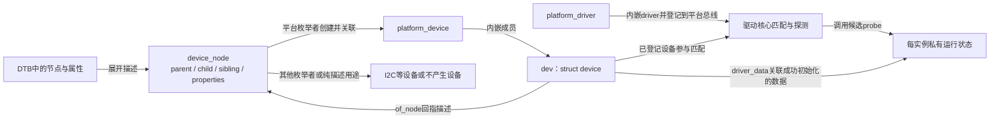
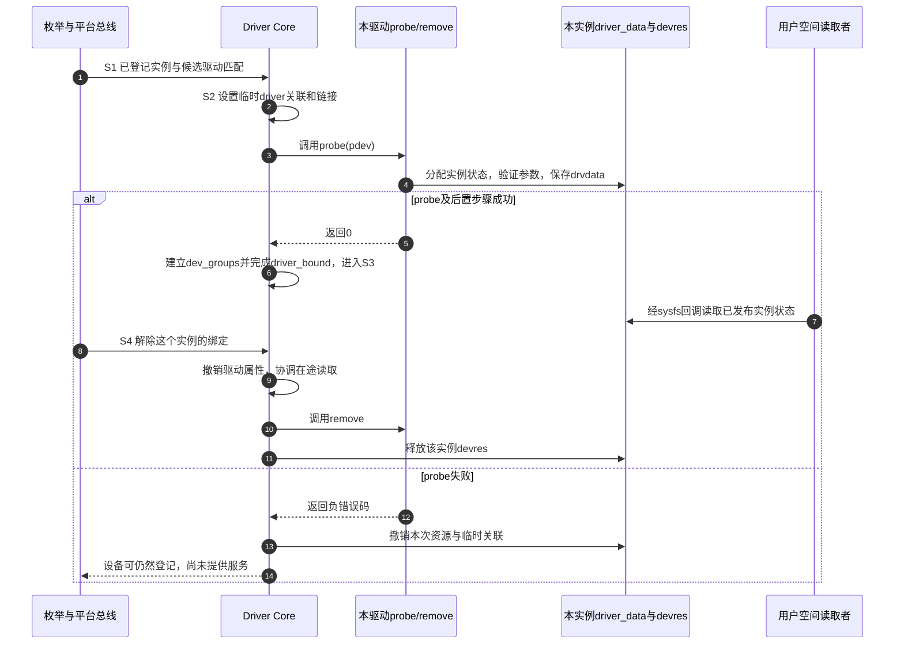

# 第11章\_从设备描述到驱动服务怎样逐层确认

上一章已经能沿外设连接检查供电、引脚、事件和数据。实际排查时却可能连驱动日志都没有：运行树里明明有节点，为什么`probe()`没有执行？又为什么模块装载返回成功，设备仍然不能使用？这些现象涉及不同的交接，不能用一句“设备树没有绑定上”概括。

本章承接主线 [设备树驱动开发方式](设备树+platform开发/P02_设备树驱动开发方式.md#2.2_DTB中的节点什么时候才成为Linux设备)，将观察推进到匹配细节与成功边界。以同一个驱动服务两个教学实例为例，先定位对象，再解释它选择哪份能力数据；下一章才让别名参与实例识别。这里的实现依据固定NXP Linux 6.12.20，不能拿旧版结构体或回调签名直接替代。

## 11.1\_有描述不等于已经有可供匹配的设备

启动固件交付DTB后，内核既可以早期扫描扁平数据，也可以将其展开为节点与属性对象。两者承担不同阶段的工作，不能画成“早期扫描函数一定在内部完成所有展开与驱动注册”的单条调用链。DTB从哪个寄存器传入也属于具体架构启动协议，不是所有CPU都使用某个ARM寄存器。

展开后的`device_node`保存描述关系。它不是正在执行的驱动，也没有自动获得寄存器映射和IRQ处理函数。枚举者随后决定哪些节点应成为设备：普通平台枚举处理适用的节点，I2C控制器下的器件由I2C子系统枚举，`chosen`等节点则保存固件交接信息。节点所在位置及用途决定执行者，不能遍历所有节点就为它们各注册一个`platform_device`。

对于普通OF平台创建路径，缺失`status`通常按可用处理，`okay`或`ok`也可用；`disabled`阻止这条路径创建可用设备。`compatible`参与严格平台枚举的判断，但`reg`是否必需仍由设备binding规定。一个不直接占用寄存器窗口的消费者可以没有`reg`。这些条件都不能外推成所有总线的统一枚举算法。



图中`platform_device`内嵌`struct device`，不是`device`在内部包含一个平台设备。`dev.of_node`只是从设备回到固件描述的关联，不会因为赋值就自动创造整棵节点树。驱动私有数据通过`driver_data`关联；OF核心的节点字段不能被当作某个消费者私有状态的仓库。

| 本章遇到的字段 | 保存什么 | 不能据此证明什么 |
| --- | --- | --- |
| `device_node.name`、`full_name` | 节点命名信息；打印完整OF路径宜用`%pOF` | 不保证sysfs设备名与DTS标签相同 |
| `parent`、`child`、`sibling` | 树的父子与兄弟链接 | 空child表示没有子节点，不是解析失败 |
| `properties`、`property.value/length` | 属性链及带长度的字节值 | 不能把所有值按主机整数或单个字符串读取 |
| `phandle`、`fwnode` | DT引用身份、通用固件节点接口 | 不是硬件地址或驱动指针 |
| `dev.of_node` | 此Linux设备关联的OF节点 | 不证明驱动已初始化 |
| `dev.driver_data` | 驱动通过接口保存的每实例数据 | 不自动管理其中异步活动的生命周期 |

此版本的`device_node`没有旧教材常见的`type`成员，也没有独立的`kref`成员；`kobj`受配置控制。节点引用需按取得接口归还，完整规则仍见 [OF属性与引用生命周期](设备树+platform开发/P09_OF属性读取与节点引用生命周期.md)。字段定义、配置和匹配入口集中在 [OF绑定源码索引](../../../research/source_reading/of_binding/navigation/P01_OF绑定与别名源码阅读索引.md#1.1_版本与阅读任务)，本章直接涉及的定义可查 [节点与匹配表实现](../../../research/source_reading/of_binding/source_explanations/P01_OF节点怎样选出驱动能力条目.md#1.1_描述节点与能力表保存不同的数据)。

## 11.2\_compatible选择能力而不是直接指定唯一驱动

假设某设备新版v2仍能按旧版v1协议工作。节点把更具体的身份写在前面：`compatible = "linux-note,binding-v2", "linux-note,binding-v1";`。这里两个名字是教学约定，不是正式硬件binding。顺序表达兼容关系，不能为了命中某个驱动随意给硬件编造能力。

一个驱动可在`of_device_id`表中同时支持v1和v2，并为每项的`.data`保存不同常量结构指针。匹配器读取节点的compatible列表，比较这张表中的候选，选出得分最高的一项；`probe`再取得其`.data`，决定使用哪组能力。这份指针属于内核驱动映像，不会作为地址被写进DTB。

### 11.2.1\_同一张表里不是先写的compatible永远获胜

在此固定版本中，compatible命中节点列表越靠前的位置，分数越高。若驱动表先写v1再写v2，节点仍是v2、v1，最后命中的最佳项依然是v2。只有得分相同，才保留较早的表项。因此表格排列和节点声明顺序是两个不同输入。

为看清差别，先保持表中每项只指定compatible，不附加name/type条件：

| 节点compatible列表 | 驱动表顺序 | 选中条目 | 原因 |
| --- | --- | --- | --- |
| v2、v1 | v1、v2 | v2 | v2在节点列表中的位置更前 |
| v1 | v1、v2 | v1 | 只有v1有匹配分数 |
| v2、v1 | 只有v1 | v1 | 当前驱动能使用声明的兼容协议 |
| v2、v1 | 两条完全相同的v2条目 | 第一条v2 | 同分不替换已有最佳项，应避免这类歧义 |

完整`of_device_id`还包含`name[32]`、`type[32]`、`compatible[128]`和`const void *data`。非空name/type是附加匹配条件，不是只有compatible为空才检查的备用字段。表尾全零项让扫描停止；单独有data而前三个名字全空也会成为终止项。普通现代驱动通常用compatible表达binding身份，用有类型的常量结构承载data，避免把小整数强转成指针再猜回类型。

这些规则在 [最佳表项的实现](../../../research/source_reading/of_binding/source_explanations/P01_OF节点怎样选出驱动能力条目.md#1.2_分数怎样表达节点兼容顺序和附加条件) 中有完整本地摘录。当前正文已经足以预测下一章两实例实验，不需要先读源码才能选出v2。

### 11.2.2\_表内最佳项与多个驱动之间的选择是两件事

上面的分数只用于 **一个候选驱动自己的表**。平台总线与Driver Core不会把所有驱动的所有OF项集中起来，举行一场全局“最具体者胜出”的排名。多个驱动声明同一硬件时，注册、探测策略和已有绑定都会影响结果；不能靠在DTS前面多写一个字符串来修复驱动归属设计冲突。

平台匹配还不是只有OF一条分支。固定版本首先检查`driver_override`：设置后按其指定的驱动名称判断；未设置时尝试OF，再尝试ACPI，然后使用平台ID表；有ID表时直接返回该表的匹配结果，没有ID表才回退到平台设备名与驱动名比较。这里ACPI是另一种固件描述来源，只为说明分支边界，不要求设备树作者同时学习它。

因此，`.driver.name`是注册身份，`.of_match_table`是运行期能力匹配表，节点名又是描述树中的名字，三者无需相等。`of_match_ptr()`只是配置宏，不执行匹配。具体顺序见 [平台入口怎样使用OF结果](../../../research/source_reading/of_binding/source_explanations/P01_OF节点怎样选出驱动能力条目.md#1.3_平台匹配与probe读取怎样接到同一张表)。

## 11.3\_匹配以后还必须完成一次可回退的初始化

两个节点可以具有相同compatible，各自形成不同的设备实例，分别调用同一个`probe`。共享的是驱动算法和只读能力表，运行状态必须按实例分配；一个全局指针无法同时代表两台设备。总线也不因它们compatible相同就自动把第二个合并进第一个。

沿用 [Driver Core状态拓扑](../../linux/device_model/P04_Driver_Core状态拓扑.md#4.3_把一次绑定推进到撤销) 的S0～S4，匹配发生在S1，初始化发生在S2，只有后续核心步骤也成功才到S3。`dev->driver`和某些sysfs链接在S2就会建立，失败后还要撤销；瞬时看见它们不能代替完整成功条件。



步骤1～4从匹配进入本实例初始化，5～7表示成功后发布并读取状态，8～11是随后只撤销该实例的路径；12～14则是probe失败、从未进入S3的分支。图中的sysfs属性是下一章通过`driver.dev_groups`发布的只读数据，不代表所有字符设备入口都有相同生命周期。若probe成功后建立属性失败，核心还会调用适用的移除/回退路径，不能把“probe返回0”当作无条件成功。真实硬件驱动还要按自己的协议停止DMA、IRQ和工作队列；`devm`不会替硬件发出停止命令。

模块装入属于另一条交接。`MODULE_DEVICE_TABLE(of, ...)`使模块构建工具生成alias元数据，设备管理器与模块加载器可据此查找磁盘上的模块；它不创建设备。手动`insmod`装入已有OF表的驱动时，即便没有这项元数据，也仍可能匹配。`modprobe`成功则只能证明该次模块加载请求成功，不证明某个设备probe成功，完整加载链见 [设备身份到模块装入](设备树+platform开发/P02_设备树驱动开发方式.md#2.4_匹配成功与模块自动装入之间还有一条通信链)。

## 11.4\_按同一个实例逐层收集证据

先找运行树，而不是只看源目录里的DTS。对下一章的教学节点`/binding-demo-a`，下列命令在目标Linux系统执行；此时只读取，不改变绑定关系：

```bash
# 节点必须来自实际启动的测试DTB；此路径不是源码标签。
dt_node=/sys/firmware/devicetree/base/binding-demo-a
test -d "$dt_node" || exit 1
tr '\0' '\n' < "$dt_node/compatible"
if test -f "$dt_node/status"; then
    tr '\0' '\n' < "$dt_node/status"
else
    printf '%s\n' '未写status；普通OF可用性检查按可用处理'
fi
```

`tr`把属性里的NUL分隔符转换成换行，否则多个compatible可能看起来粘成一个字符串。缺失status与整个节点缺失是两个不同分支，不能把两者都记录成“设备树未生效”。

接着查哪个平台设备的`of_node`确实指向它，而不是把`binding_demo_a:`标签直接拼到sysfs路径：

```bash
# 沿用上一块命令的dt_node；readlink -f用于比较解析后的路径。
target_node=$(readlink -f "$dt_node")
for device_path in /sys/bus/platform/devices/*; do
    test -L "$device_path/of_node" || continue
    test "$(readlink -f "$device_path/of_node")" = "$target_node" || continue
    printf '设备实例：%s\n' "$device_path"
    if test -L "$device_path/driver"; then
        readlink -f "$device_path/driver"
    else
        printf '%s\n' '当前没有driver链接'
    fi
    test ! -f "$device_path/modalias" || cat "$device_path/modalias"
done
```

没有输出时先检查枚举者与节点用途；输出实例但无driver时再检查候选驱动、依赖与probe错误。观察应在测试操作结束的稳态结合日志进行，系统仍在并发探测或解绑时，一次读取不是原子快照。

| 观察到的边界 | 已得到的证据 | 下一步仍需确认 |
| --- | --- | --- |
| 运行树有节点 | 本次固件交付包含该描述 | 正确总线是否枚举它 |
| 平台实例及of_node关联存在 | 设备登记并关联到所选节点 | 驱动是否注册、匹配与初始化 |
| 模块在`lsmod`中 | 可卸载模块当前已装入 | 内置驱动本来就不必出现在lsmod；实例仍可能失败 |
| 稳态driver关联及成功日志 | 与完成绑定相容 | 所需业务功能是否真正可用 |
| 功能数据正确 | 该测试路径通过 | 尚未覆盖的错误、并发或PM路径 |

`/sys/bus/platform/drivers/<驱动名>/bind`和`unbind`是 **写入操作入口**，不是可用`cat`读取的“绑定状态文件”。它们让核心尝试绑定或解除某个已登记设备，不生成OF节点；手动bind也要经过相应匹配和probe条件。不要为找状态去写正在服务磁盘、控制台或其他关键硬件的入口。下一章只对明确创建的无硬件教学实例演示这种操作。

## 11.5\_用反例检查自己是否跨越了证据层

假设A、B两个节点都声明v2、v1，而驱动只支持v1。两者匹配同一个v1表项，并不意味着只能创建一个实例：两次probe各有自己的设备和私有状态。若B随后参数验证失败，A仍可正常服务，不能在B的失败路径清掉A的对象。

再判断三件事：只有`dev->driver`非空，是否能宣布probe完成？不能，它可处于S2。把驱动表中的v1项移到v2前，是否能强制v2节点使用v1？不能，表内选择要看分数。把节点改为disabled后，运行树目录是否必须消失？不必，描述仍可能存在，变化的是适用枚举路径的处理。

现在能够把描述、登记、匹配和服务的证据分开，并解释同一驱动怎样选择能力。仍未解决的是“两个相同设备怎样给板级角色提供稳定称呼”。继续 [设备别名怎样参与多实例识别](P12_设备别名怎样参与多实例识别.md)，将名字从能力匹配中分离出来。

上一篇：[组合外设怎样换板并逐层定位故障](P10_组合外设怎样换板并逐层定位故障.md)。
