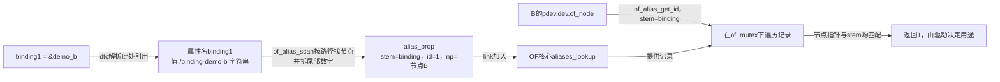
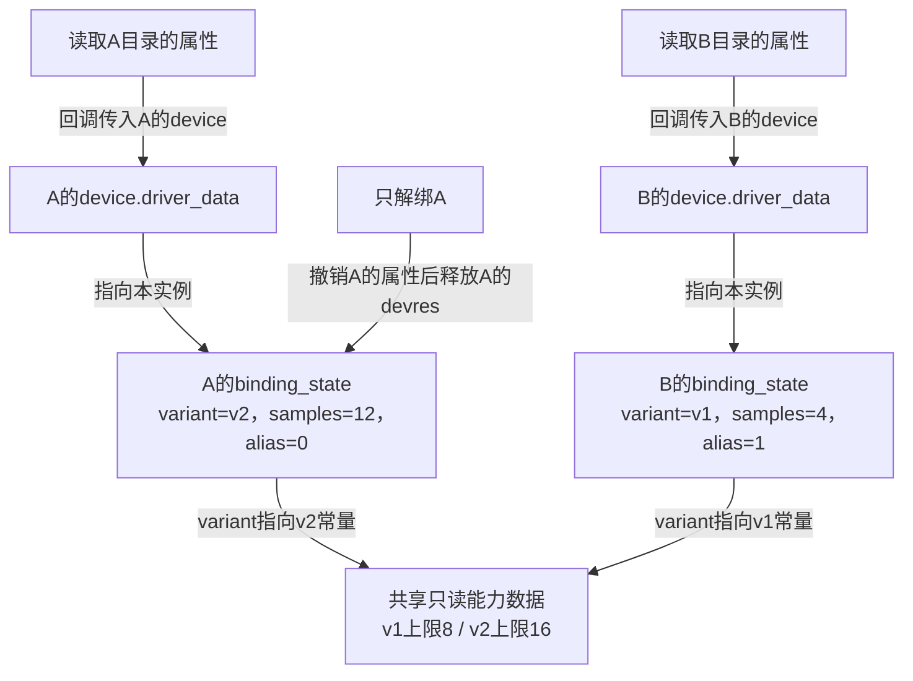

# 第12章\_设备别名怎样参与多实例识别

上一章让两个设备各自完成匹配与初始化。现在换一块板：驱动仍是同一个，两个实例的枚举顺序却可能变化，应用希望区分“板上的第一路”和“第二路”。把第一次probe记为0、第二次记为1，会把探测时间误当作板级角色；依赖尚未就绪引起重试时，这种编号尤其容易变化。

设备树的`/aliases`提供从短名字到节点路径的关联。它能保存板级描述中的命名意图，随后由消费者决定怎样使用。**声明名字、查询编号、分配设备号、创建`/dev`文件是不同动作。** 本章先看描述的字节，再用两个无硬件教学实例观察驱动自己的选择；不占用真实UART、GPIO或MMIO。

## 12.1\_别名指向节点路径而不是写入一个phandle整数

在DTS中，`binding0 = &demo_a;`里的`demo_a`是源码标签。dtc根据当前语法位置把引用处理成需要的表示：这里没有`< >`，结果是目标的完整路径字符串；`link = <&demo_a>;`则是在cell数组中生成节点的phandle引用。看见相同的`&标签`不能跳过外层语法判断编码。

这一区分来自 [Devicetree规范第3.3节 /aliases node](https://devicetree-specification.readthedocs.io/en/stable/devicenodes.html#aliases-node)：别名属性值是路径字符串。规范还限定别名使用小写字母、数字和连字符，长度1～31；源码标签常用的下划线不应照搬成别名。下面用完整离线输入直接观察，无需先启动板子。

### 12.1.1\_编译两个实例并读取别名的实际值

新建实验目录，在其中保存`binding_demo.dts`。这是 **离线教学树**，缺少真实机器启动所需的CPU、内存等描述，不能拿它替换板子的完整DTB。`linux-note,*`也是本章自定协议，不是上游硬件binding。

```dts
/dts-v1/;

/ {
    compatible = "linux-note,binding-demo-board";
    #address-cells = <1>;
    #size-cells = <1>;

    aliases {
        binding0 = &demo_a;
        binding1 = &demo_b;
    };

    demo_a: binding-demo-a {
        compatible = "linux-note,binding-v2", "linux-note,binding-v1";
        linux-note,sample-count = <12>;
        status = "okay";
    };

    demo_b: binding-demo-b {
        compatible = "linux-note,binding-v1";
        linux-note,sample-count = <4>;
        status = "okay";
    };

    reference-example {
        linux-note,peer = <&demo_a>;
    };
};
```

两个demo节点没有寄存器资源，不带`@地址`；最后一个节点只用于离线比较cell引用，不参与后面的驱动实验。`sample-count`是每实例参数，稍后让v1支持1～8，v2支持1～16。先预测A需要v2能力，B只需v1。

```bash
# 在刚保存DTS的实验目录；需要dtc和fdtget，文件没有C预处理include。
dtc -I dts -O dtb -o binding_demo.dtb binding_demo.dts
fdtget -t s binding_demo.dtb /aliases binding0
fdtget -t x binding_demo.dtb /reference-example linux-note,peer
fdtget -t x binding_demo.dtb /binding-demo-a phandle
```

第一条查询应输出`/binding-demo-a`；后两条应是相同的十六进制phandle数值。具体整数由编译结果决定，不要求是1，更不是硬件地址。需要检查其他参数时：

```bash
fdtget -t s binding_demo.dtb /binding-demo-a compatible
fdtget -t u binding_demo.dtb /binding-demo-a linux-note,sample-count
dtc -I dtb -O dts -o binding_demo.decoded.dts binding_demo.dtb
```

预期compatible按v2、v1排列，参数为12，反编译的aliases值为路径。dtc成功只证明输入能被编译，不证明枚举或驱动已运行，也不等于通过目标binding Schema。

### 12.1.2\_内核把可编号的别名整理成查询记录

固定Linux实现扫描`/aliases`属性，先用路径找到`device_node`，再拆分名字尾部的十进制数字。例如`binding1`被分为stem字符串`binding`和整数1。记录保存stem、编号以及节点指针，放入OF核心的`aliases_lookup`链表；驱动后来以自己的节点和stem查询。



图中的记录是软件数据，不是设备硬件寄存器。没有数字尾缀的合法路径别名仍可承担路径命名用途，但不一定进入这个 **编号查询** 的结果。`of_alias_get_id(np, "binding")`未找到匹配时返回`-ENODEV`，不会分配新号码，也不会把设备目录改名。

当前固定版本如何建立记录、如何加锁查询，见 [OF绑定与别名源码索引](../../../research/source_reading/of_binding/navigation/P01_OF绑定与别名源码阅读索引.md#1.1_版本与阅读任务)、[身份与编号模块导读](../../../research/source_reading/of_binding/navigation/P02_描述身份怎样交给匹配与编号消费者.md#2.2_编号查询的完成点由消费者接住) 和 [别名建立与查询实现](../../../research/source_reading/of_binding/source_explanations/P02_别名路径怎样成为编号查询记录.md#2.1_启动扫描怎样建立节点与编号的关联)。本章使用启动时静态树，不假定运行时修改aliases会自动重建该查询表。

## 12.2\_号码是否必需由使用它的驱动决定

为什么相同的缺失别名，有些驱动能继续、有些失败？因为号码的用途不同。固定版本i.MX串口驱动用`of_alias_get_id(np, "serial")`取得端口索引，失败就返回错误；另一个驱动可以明确选择动态分配。不能从前者推导“所有驱动必须有aliases”，也不能把后者称为OF核心的自动兜底。对应实例证据是固定提交 [`drivers/tty/serial/imx.c`](https://github.com/nxp-imx/linux-imx/blob/dfaf2136deb2af2e60b994421281ba42f1c087e0/drivers/tty/serial/imx.c) 的`imx_uart_probe()`。

本实验只显示查询结果，不把它用作设备号，所以允许缺失别名。A和B各有自己的sysfs目录及私有对象；两者都返回`-ENODEV`也不会碰撞。若改成字符设备并把缺失别名一律映射到minor 0，就会争用同一设备号，设计已经变了。

| 驱动策略 | 必须另外建立的规则 | 适合的用途 |
| --- | --- | --- |
| 缺失别名则拒绝probe | 对范围、冲突、板级配置给明确错误 | 端口号是不可省的板级契约 |
| 缺失则动态分配 | 分配器、并发保护、失败与移除归还 | 允许动态编号的实例集合 |
| 仅把别名作为描述信息 | 每实例对象独立，输出明确“缺失” | 本章观察实验 |

别名本身不规定probe顺序，不保证所有网卡名、`/dev`名或platform设备名随它变化；必须找到实际消费者。也不要发明`of_alias_get_alias()`等接口：本章所需的公开查询就是`of_alias_get_id()`，读取原始aliases属性可使用OF属性接口或运行树文件。

## 12.3\_让每个实例发布自己的一份只读状态

为观察这种选择，程序给每个实例分配一个`binding_state`，保存能力指针、参数和别名查询结果，随后通过`platform_set_drvdata()`关联到该实例。只读属性在probe成功后由Driver Core的`dev_groups`机制建立，读取回调根据传入的设备找到自己的数据，不能读取一个“最后探测设备”的全局指针。

解绑时核心先移除这组属性并协调其活动访问，再调用remove及释放devres。本例状态发布后不再修改，没有工作队列、IRQ、DMA或可持续访问的字符设备fd，因此无需再为读写数据引入一把业务锁。若以后加入异步修改或长期持有对象的接口，就必须重新设计同步与生命周期，不能把这个结论原样复制过去。



图中没有从解绑A到B状态的箭头。清理函数必须针对本次回调的实例；循环删除所有实例、使用未初始化局部指针，都会破坏这种所有权。

### 12.3.1\_完整驱动与构建入口

保存`binding_demo_driver.c`。它适用于本章核对的6.12.20接口，`.remove`返回void。常量表故意先放v1再放v2，便于验证上一章“节点列表位置决定表内优先级”的结论。

```c
#include <linux/device.h>
#include <linux/errno.h>
#include <linux/module.h>
#include <linux/of.h>
#include <linux/platform_device.h>
#include <linux/slab.h>
#include <linux/sysfs.h>

struct binding_variant {
    const char *name;
    u32 max_samples;
};

struct binding_state {
    const struct binding_variant *variant;
    u32 samples;
    int alias_id;
};

static const struct binding_variant variant_v1 = { "v1", 8 };
static const struct binding_variant variant_v2 = { "v2", 16 };

static ssize_t variant_show(struct device *dev,
                            struct device_attribute *attr, char *buf)
{
    const struct binding_state *state = dev_get_drvdata(dev);

    return sysfs_emit(buf, "%s\n", state->variant->name);
}
static DEVICE_ATTR_RO(variant);

static ssize_t sample_count_show(struct device *dev,
                                 struct device_attribute *attr, char *buf)
{
    const struct binding_state *state = dev_get_drvdata(dev);

    return sysfs_emit(buf, "%u\n", state->samples);
}
static DEVICE_ATTR_RO(sample_count);

static ssize_t alias_id_show(struct device *dev,
                             struct device_attribute *attr, char *buf)
{
    const struct binding_state *state = dev_get_drvdata(dev);

    /* 缺失是独立结果，不把负错误码伪装成自动分配的0。 */
    if (state->alias_id < 0)
        return sysfs_emit(buf, "absent\n");
    return sysfs_emit(buf, "%d\n", state->alias_id);
}
static DEVICE_ATTR_RO(alias_id);

static struct attribute *binding_attrs[] = {
    &dev_attr_variant.attr,
    &dev_attr_sample_count.attr,
    &dev_attr_alias_id.attr,
    NULL,
};
ATTRIBUTE_GROUPS(binding);

static int binding_probe(struct platform_device *pdev)
{
    struct device *dev = &pdev->dev;
    const struct binding_variant *variant;
    struct binding_state *state;
    u32 samples;
    int ret;

    variant = of_device_get_match_data(dev);
    if (!variant)
        return -ENODEV;

    ret = of_property_count_u32_elems(dev->of_node,
                                     "linux-note,sample-count");
    if (ret != 1)
        return dev_err_probe(dev, -EINVAL, "sample-count必须恰有一个cell\n");
    ret = of_property_read_u32(dev->of_node,
                              "linux-note,sample-count", &samples);
    if (ret)
        return dev_err_probe(dev, ret, "sample-count读取失败\n");
    if (!samples || samples > variant->max_samples)
        return dev_err_probe(dev, -EINVAL, "sample-count超出变体范围\n");

    state = devm_kzalloc(dev, sizeof(*state), GFP_KERNEL);
    if (!state)
        return -ENOMEM;
    state->variant = variant;
    state->samples = samples;
    state->alias_id = of_alias_get_id(dev->of_node, "binding");
    /* 本例显式允许缺失；若有其他错误则不隐瞒。 */
    if (state->alias_id < 0 && state->alias_id != -ENODEV)
        return state->alias_id;
    platform_set_drvdata(pdev, state);
    dev_info(dev, "节点=%pOF variant=%s samples=%u alias_result=%d\n",
             dev->of_node, variant->name, samples, state->alias_id);
    return 0;
}

static void binding_remove(struct platform_device *pdev)
{
    /* 核心已撤销本驱动的dev_groups；这里只记录本实例的退出。 */
    dev_info(&pdev->dev, "教学实例解除绑定\n");
}

static const struct of_device_id binding_matches[] = {
    { .compatible = "linux-note,binding-v1", .data = &variant_v1 },
    { .compatible = "linux-note,binding-v2", .data = &variant_v2 },
    { }
};
MODULE_DEVICE_TABLE(of, binding_matches);

static struct platform_driver binding_driver = {
    .probe = binding_probe,
    .remove = binding_remove,
    .driver = {
        .name = "binding_demo",
        .of_match_table = binding_matches,
        .dev_groups = binding_groups,
    },
};
module_platform_driver(binding_driver);
MODULE_LICENSE("GPL");
MODULE_DESCRIPTION("设备树多实例匹配与别名查询教学模块");
```

`DEVICE_ATTR_RO`生成只读属性描述，`ATTRIBUTE_GROUPS`把以NULL结尾的属性数组组织成组。它们不在定义位置执行读取；用户读文件时，sysfs才将对应device传给show。`sysfs_emit()`负责向回调缓冲区格式化输出。`state`在S2初始化，S3只读，S4随本次绑定的devres释放；同一设备重新绑定会分配新对象。

在同一目录保存`Makefile`，命令行前必须是真正的Tab：

```makefile
obj-m += binding_demo_driver.o
KDIR ?= /lib/modules/$(shell uname -r)/build

.PHONY: all clean
all:
	$(MAKE) -C $(KDIR) M=$(CURDIR) modules
clean:
	$(MAKE) -C $(KDIR) M=$(CURDIR) clean
```

```bash
# 在目标Linux的模块目录，KDIR默认指向运行内核的构建入口。
make
modinfo ./binding_demo_driver.ko -F alias
```

若交叉编译，显式传入已经准备好的目标构建目录、`ARCH`和`CROSS_COMPILE`，不能使用宿主机的build目录冒充目标。模块别名应包含v1和v2，但这仍只证明构建产物的声明。目标配置需要OF、平台总线、模块及sysfs等适用支持；本轮尚未执行目标Kbuild、MODPOST或加载，不能把接口核对写成编译成功。

### 12.3.2\_部署的是测试节点不是整份离线教学树

要运行驱动，应在专用测试环境的真实板级DTS根节点下加入两个demo节点，并合并aliases中的两项。先核对没有同名节点、标签或`binding0/1`；不要覆盖已有aliases节点的其他条目。`reference-example`只用于离线编码比较，无需部署。保留板上原有CPU、内存、总线和电源描述，沿已知的板级构建与启动流程生成、部署并选择测试DTB。

启动后先执行上一章的运行树与`of_node`关联检查。确认两个实例已经枚举，再加载模块：

```bash
# 仅在已部署教学节点、内核与模块匹配的测试系统执行。
sudo insmod ./binding_demo_driver.ko
sudo dmesg | tail -n 30
```

预期看到A选择v2、samples=12、alias_result=0，B选择v1、samples=4、alias_result=1。先后顺序不是验收条件。模块没有替你增加DT节点；没有实例时装入也可能成功，但不会出现这两次probe日志。

下面按已绑定驱动链接定位实验设备，不猜测其sysfs名字：

```bash
for device_path in /sys/bus/platform/devices/*; do
    test -L "$device_path/driver" || continue
    test "$(basename "$(readlink -f "$device_path/driver")")" = binding_demo || continue
    printf '\n实例：%s\n' "$device_path"
    cat "$device_path/variant" "$device_path/sample_count" "$device_path/alias_id"
done
```

每个属性文件是一项值。A的输出应为三行v2、12、0，B为v1、4、1。这里只证明该实例的匹配、参数和查询协议，实验从未读写真实外设，所以不能声称验证了UART传输或中断处理。

## 12.4\_只撤销一个实例检验状态是否独立

读两个实例还不足以验证清理归属。现在只解绑A，检查A的属性撤销后B仍能读取，再把A重新绑定。操作前必须按`of_node`定位目标，并确认当前驱动是本实验的`binding_demo`。将下面完整脚本保存为`rebind_demo.sh`，在测试系统用`sudo sh rebind_demo.sh`执行：

```bash
#!/bin/sh
set -eu
driver_dir=/sys/bus/platform/drivers/binding_demo
target_node=$(readlink -f /sys/firmware/devicetree/base/binding-demo-a)
test -d "$target_node"
device_path=
for candidate in /sys/bus/platform/devices/*; do
    test -L "$candidate/of_node" || continue
    test "$(readlink -f "$candidate/of_node")" = "$target_node" || continue
    test -z "$device_path" || { printf '%s\n' '发现多个匹配实例，停止'; exit 1; }
    device_path=$candidate
done
test -n "$device_path"
test "$(readlink -f "$device_path/driver")" = "$(readlink -f "$driver_dir")"
device_name=$(basename "$device_path")
printf '%s\n' "$device_name" > "$driver_dir/unbind"
printf '%s\n' 'A已解绑；其设备目录仍可存在，但驱动属性应撤销。'
test ! -e "$device_path/alias_id"
for candidate in /sys/bus/platform/devices/*; do
    test -L "$candidate/driver" || continue
    test "$(readlink -f "$candidate/driver")" = "$(readlink -f "$driver_dir")" || continue
    printf '仍在服务的实例：%s\n' "$candidate"
    cat "$candidate/variant" "$candidate/alias_id"
done
printf '%s\n' "$device_name" > "$driver_dir/bind"
cat "$device_path/variant" "$device_path/sample_count" "$device_path/alias_id"
```

脚本不写`driver_override`，也不强迫不匹配的设备接受此驱动。任何检查失败都会停止；若失败发生在unbind之后，A会保持已解绑，此时根据日志排除问题，再对 **已确认的同一实例名** 写入该驱动bind，或者卸载模块后重新加载恢复。重复bind不会修改DTB里的别名，重新probe仍应取得0。

实验结束，先卸载驱动，再按板级流程恢复原DTB并重启：

```bash
sudo rmmod binding_demo_driver
```

卸载会对仍绑定的各实例分别清理；平台设备与描述节点可以继续存在，不能把驱动卸载称为删除设备树。若要改造成字符设备，还必须处理设备号分配、cdev发布和旧fd继续访问，进入 [安全移除与旧fd](../character_device/P09_安全移除_旧fd与模块卸载.md#9.1_删除入口不等于释放对象)。仅把state改成devm分配并不能使旧fd安全。

## 12.5\_每次只改变一个输入再预测结果

先复制原DTS保留恢复点，以下修改都在离线文件或专用测试DTB中进行，部署后重启确保启动扫描重新建立索引，不假定热修改立即更新别名表。

| 修改 | 离线能够看到什么 | 按本驱动协议预期运行结果 |
| --- | --- | --- |
| 交换binding0、binding1指向 | aliases路径互换，compatible不变 | A的alias变1、B变0；v2/v1选择不变 |
| 删除binding1 | 该属性查询报告不存在 | B输出absent，仍使用自己的状态，不冒用A的编号 |
| B参数改为12 | DTB保存12，dtc仍可成功 | B在v1上超界，probe失败；A不受该失败影响 |
| A只保留v1，参数仍12 | compatible列表变为一项 | 匹配v1后参数超界；这不是“没有匹配” |
| 只调整驱动表v1/v2顺序 | DTB完全不变 | 原A仍命中v2，B仍命中v1 |

第一、二项可先用`fdtget -t s binding_demo.dtb /aliases 属性名`观察；查询缺失属性返回非零是预期反例，不应把整套验证因此误判为环境损坏。恢复原文件重新编译，两个路径和参数应回到初始值。运行结果则需要重新部署、读取日志及属性，离线编译不会替代这些步骤。

本轮已用DTC/fdtget核对静态树、路径与phandle差别及修改/恢复输入；驱动代码、dev_groups退出次序按固定源码复核。目标内核构建、Linux脚本和板上操作尚未执行，表中运行列是待验证预测。

现在可以解释命名意图怎样交给具体消费者，也能指出每实例状态在创建、读取、失败和移除时由谁管理。设备树负责描述关系，驱动决定编号用途，设备模型负责绑定周期，字符设备接口另有用户访问寿命；沿这四层继续开发，才不会用一个“别名”承担所有职责。

上一篇：[从设备描述到驱动服务怎样逐层确认](P11_从设备描述到驱动服务怎样逐层确认.md)。继续实现阅读：[OF绑定与别名大纲](../../../research/source_reading/of_binding/大纲.md)。
