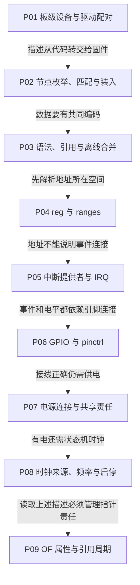

# 第1章\_设备树与平台资源学习大纲

## 1.1\_沿描述怎样成为可用资源逐步阅读

本专题解决“同一套驱动怎样知道本板的设备、资源和连接，并按正确生命周期使用它们”。读者需要基本 C、指针和函数返回值知识；不要求预先熟悉设备树、GPIO 全局号或 Linux IRQ 编号。主线先把板级信息从驱动算法中分离，再逐类解释连接契约，最后处理内核对象的取得与交还。

图的箭头是学习依赖，不是硬件必须按同样顺序配置。真实器件的供电、时钟、复位和引脚时序仍以手册与驱动协议为准。

| 正文 | 当前解决的问题 | 进入时依赖什么 | 留给下一篇的缺口 |
| --- | --- | --- | --- |
| [P01 旧式平台设备与资源机制](设备树+platform开发/P01_旧式平台设备与资源机制.md) | 设备实例、资源描述与驱动为何要分开 | C 基础 | 板级描述如何离开硬编码 |
| [P02 设备树驱动开发方式](设备树+platform开发/P02_设备树驱动开发方式.md) | 节点何时成为设备，匹配与模块装入为何不同 | 平台设备/驱动配对 | 属性与引用怎样编码 |
| [P03 设备树语法与标准示例](设备树+platform开发/P03_设备树语法与标准示例.md) | 源码合并、cell、标签与离线 overlay | 描述与运行对象不同 | reg 的数字属于哪个空间 |
| [P04 地址单元与总线窗口转换](设备树+platform开发/P04_地址单元与总线窗口转换.md) | reg 分组、ranges 逐层转换与 MMIO 资源 | cell 与父子关系 | 中断连接不能由地址推断 |
| [P05 中断连接怎样成为驱动可用的IRQ](设备树+platform开发/P05_中断连接怎样成为驱动可用的IRQ.md) | 提供者 specifier、硬件身份与 Linux IRQ | 引用与编号空间 | GPIO 输入/输出的 pin 归属 |
| [P06 GPIO连接引脚复用与编号空间](设备树+platform开发/P06_GPIO连接引脚复用与编号空间.md) | 局部线、pin ID、逻辑电平与描述符 | 提供者连接与基本资源责任 | 共享电源如何协调 |
| [P07 供电关系电压约束与启停责任](设备树+platform开发/P07_供电关系电压约束与启停责任.md) | supply、板级约束与启用计数 | 连接与硬件状态不同 | 时钟来源与频率条件 |
| [P08 时钟连接频率请求与使能计数](设备树+platform开发/P08_时钟连接频率请求与使能计数.md) | clock 输入、assigned 设置与共享启停 | 提供者与共享需求 | 节点/属性指针如何交还 |
| [P09 OF属性读取与节点引用生命周期](设备树+platform开发/P09_OF属性读取与节点引用生命周期.md) | 借用、持有、遍历推进与提前退出 | 各资源自己的解析契约 | 转到具体板验证完整交接 |

## 1.2\_补充文章与相邻专题的职责

目录中还保留已有的 [GPIO连接命名占用与按键事件](P01_GPIO连接命名占用与按键事件.md)、[引脚配置](P02_引脚配置怎样连接外设与焊盘.md)、[状态切换](P03_引脚状态切换与GPIO占用交接.md)、[引脚诊断](P04_沿状态与寄存器定位引脚问题.md)、[GPIO输入与中断组合](P05_GPIO输入怎样成为中断与按键事件.md)、[无线模块的供电与枚举](P06_从供电复位到SDIO无线设备枚举.md)、[摄像头控制与图像数据流](P07_摄像头控制连接怎样成为图像数据流.md)、[扩展GPIO与共享中断](P08_扩展GPIO与共享中断怎样找到事件来源.md)、[RS-485方向控制](P09_RS485方向控制为什么必须等待发送完成.md)、[换板与分层诊断](P10_组合外设怎样换板并逐层定位故障.md) 和 [绑定证据与能力选择](P11_从设备描述到驱动服务怎样逐层确认.md)、[别名与多实例实验](P12_设备别名怎样参与多实例识别.md)。它们作为对应场景的补充阅读，不改变上面的默认学习顺序；阅读版本化接口时按各文标注的源码边界核对。

| 需要继续研究的对象 | 权威入口 | 本专题与它的交接 |
| --- | --- | --- |
| GPIO 框架的运行状态与实现 | [GPIO 专题](../gpio/大纲.md) | 本专题负责固件连接与 consumer 用法 |
| 字符设备文件协议与旧 fd | [字符设备专题](../character_device/大纲.md) | 取得 GPIO 不等于文件生命周期安全 |
| GIC 控制器状态与硬件协议 | [GIC 专题](../../../platforms/arm/architecture/gic/大纲.md) | specifier 与 IRQ 获取只建立入口身份 |
| 板上 LED 与 DT 部署 | [i.MX6ULL LED 完整实验](../../../labs/platforms/nxp/imx6ull/drivers/P01_LED点灯/P03_字符设备_LED与设备树完整实验.md) | 需要核对真实接线、目标内核与固件交付 |
| pinctrl 状态与提供者实现 | [pinctrl源码阅读索引](../../../research/source_reading/pinctrl/navigation/P01_Linux_6.12_pinctrl源码阅读索引.md#1.1_版本边界与阅读路线) | 从状态映射、选择与失败恢复追到i.MX6UL寄存器 |
| 版本化 Linux 证据 | [源码基线](../../../research/source_reading/linux/SOURCE_BASELINE.md) | 本专题固定实现结论须保持版本身份 |

补充应用按“枚举之前谁准备设备 → 控制成功为何仍无数据 → 汇聚以后怎样辨认来源 → 发送何时真正完成 → 换板怎样逐层验证”推进。对应的 [组合外设源码索引](../../../research/source_reading/peripheral_integration/navigation/P01_组合外设源码阅读索引.md#1.1_版本与证据范围) 负责固定版本的状态落点与唯一函数讲解。

绑定补充篇从“描述为何还不是设备”推进到“表内能力选择为何不等于全局驱动选择”，再由多实例需求引出别名路径、编号消费者和单实例撤销。固定实现入口见 [OF绑定与别名源码索引](../../../research/source_reading/of_binding/navigation/P01_OF绑定与别名源码阅读索引.md#1.1_版本与阅读任务)，通用Driver Core和字符设备生命期保持各自权威正文。

## 1.3\_怎样判断自己已经能够迁移到另一块板

离线阶段应能预测 DTB 中的字节与引用、手工计算地址窗口、解释提供者的 specifier；驱动阶段应能区分句柄取得、资源使能和错误回退，指出每个节点引用在哪里交还。换板时再逐项核对 compatible、实际接线、时钟/电源、启动固件和目标内核配置，而不是只替换一个基地址或编号。

本路线不要求读者为 Linux 已有的 GPIO、LED、regulator 或 clock 提供者重复实现一套框架。需要新硬件驱动时，再由真实寄存器与协议证据进入实现；纯描述练习不能被称作板上验收。
