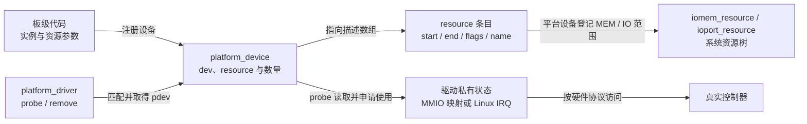
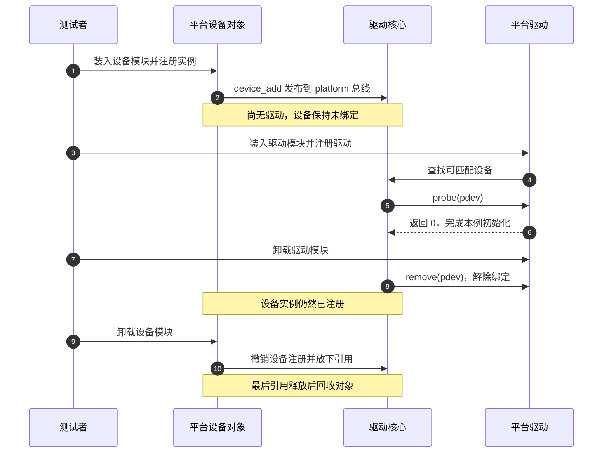

# 第1章\_旧式平台设备与资源机制

## 1.1\_驱动知道怎样操作却不知道设备在哪里

假设已经有一个串口控制器驱动。它知道哪个寄存器表示发送状态、哪个位表示发送完成，但同一种控制器放在两款 SoC 上，寄存器基地址和中断连接可能不同。若把地址直接写进驱动，每增加一种板级布局，就要改动本来没有变化的收发逻辑；若两个同型控制器同时存在，单个全局地址又无法区分实例。

需要分开的其实是两件事：**硬件实例提供“我在哪里、接到哪里”，驱动提供“拿到这些资源后怎样工作”**。板级 C 代码可以创建一份设备描述，把寄存器窗口、中断资源和板级参数交给 Linux；驱动随后从匹配到的设备对象中取得描述。这已经比所有地址写死在驱动里前进了一步。

这里的 **platform 总线** 是 Linux 驱动模型用于组织一类设备与驱动的软件总线，不是在芯片上额外铺了一条叫 platform 的导线。许多片上设备没有 PCI 那样的统一自枚举机制，需要固件、板级代码或父设备驱动告知其存在。`platform_device` 表示一个实例，`platform_driver` 表示一类实例可用的操作方法。二者分开注册，谁先到都可以；当二者都存在且匹配，驱动核心才可能执行初始化回调 `probe()`。

本章先使用 **板级 C 代码提供设备描述** 的模型，下一章再把描述移到设备树。它不意味着现代 Linux 只能从设备树建立 platform 设备，也不能把所有 2.6/3.x 内核概括为“不支持设备树”；是否采用某种枚举方式取决于架构、平台与具体版本。本章的 API 细节核对 **NXP Linux 6.12.20 固定提交**，不是照抄早期内核接口。

## 1.2\_把地址范围交给设备对象但不要混淆三种状态

要把“设备在哪里”从驱动里移出去，先需要一种保存地址和类型的描述。描述进入内核之后，还会经历系统登记、驱动申请使用和映射；下面沿这条顺序区分各层保存的状态。

### 1.2.1\_资源描述保存什么

考虑一个纯教学寄存器窗口：起点 `0x10000000`，长度 `0x1000`。这组数字只用于计算，不属于本章要访问的真实硬件。驱动需要的不只是起点，还要知道它是 MMIO 范围以及窗口有多大。Linux 使用 `struct resource` 表达这种资源描述，设备通过 `pdev->resource` 指向描述数组，通过 `pdev->num_resources` 给出条目数。



图中描述数组属于设备实例；驱动取得的映射、IRQ 和运行状态属于该次绑定。它们都不是硬件寄存器本身。描述错误时，Linux 不会替作者发现真正的芯片地址。

| 字段或对象 | 本章含义 | 需要维持的约束 |
| --- | --- | --- |
| `resource.start`、`end` | 首尾地址，或该资源类型使用的编号 | `end` 包含在范围内；有效区间长度为 `end - start + 1` |
| `resource.flags` | `IORESOURCE_MEM`、`IORESOURCE_IO`、`IORESOURCE_IRQ` 等类型及附加属性 | 通用 API 按约定解释，不能任意塞数据后仍期待通用驱动正确处理 |
| `resource.name` | 一个设备内用于按名查找的资源名 | 它不是驱动名，也不自动成为 IRQ action 名 |
| `parent`、`sibling`、`child` | 资源树中的关系 | 由资源管理路径维护，不表示设备树节点关系 |
| `pdev->resource`、`num_resources` | 描述数组及数量 | 资源所属实例由 `pdev` 确定，不靠全局变量猜测 |
| `pdev->name`、`id`、`dev` | 平台名称、实例编号和通用设备对象 | `PLATFORM_DEVID_NONE` 为 -1；不同实例也可以使用不同 ID |

这个表只列当前需要的字段，不能当作完整结构体定义替换内核头文件。教学窗口的末地址是 `0x10000fff`；若写成 `0x10001000`，长度就多了一个字节。真实资源还必须验证长度非零、加法没有溢出、地址经过所在总线的转换，并且范围确实属于该设备。

### 1.2.2\_登记范围申请占用和建立映射分别发生

一个容易误解的说法是：“资源结构只是描述，直到 `request_mem_region()` 或 `request_irq()` 才会进入同一棵资源树。”实际应拆成三步。

1. **描述与登记。** 代码准备资源数组；Linux 6.12.20 的 `platform_device_add()` 对 MEM/IO 资源选择相应父资源树，并尝试 `insert_resource()`，随后把设备加入驱动模型。登记可能因区间冲突而失败，此时要回滚已经插入的资源。
2. **驱动申请使用。** `probe()` 中的 `devm_ioremap_resource()` 路径会申请该 MMIO 区间的使用权。登记范围已经存在，不等于某驱动已经取得使用权；`/proc/iomem` 中能看到一个名称，也不能单凭这件事推出映射成功。
3. **建立映射与访问。** 成功申请后建立 CPU 可访问的 I/O 映射，返回 `void __iomem *`。驱动按寄存器规范用 `readl()` / `writel()` 等接口访问，不能把物理地址强转为普通指针后解引用。

IRQ 是另一套管理路径。`platform_get_irq()` 或按名版本得到 **Linux IRQ**；`request_irq()` 注册中断处理 action，并按中断子系统协议启用处理，不是把一个 IRQ 挂入 MMIO 资源树。设备树中的中断描述、控制器硬件编号与 Linux IRQ 不能仅因数值相同就当作同一身份。

因此，“LED 位于 GPIO1，就把 GPIO1 整块寄存器和 IRQ 35 都交给 LED 驱动”并不成立。GPIO 控制器是共享资源的提供者，一个 LED 通常只消费一根 GPIO。平台 GPIO 驱动管理控制器寄存器，LED 驱动通过 GPIO consumer 接口申请线路；直接重复占用整块控制器可能与现有驱动冲突。`35` 也必须有实际中断域与平台初始化依据，不能从芯片手册编号直接抄成 Linux IRQ。线路级操作继续阅读 [GPIO consumer 的请求与使用](../../gpio/P05_GPIO_Consumer_请求与使用.md)。

## 1.3\_先用无硬件实验看清设备与驱动何时相遇

真实 MMIO 实验需要已经确认的芯片、资源所有权和寄存器协议。本节先创建一个名为 `platform_note_demo` 的平台设备，再注册同名驱动。设备 **没有 MEM 和 IRQ 资源**，驱动也不会读写寄存器。这样可以直接观察注册、匹配、解绑和释放，而不需要伪造一段“空闲物理地址”。

实验用于能够加载自编模块的 Linux 测试系统。构建目录必须对应运行内核，包含该内核配置、生成头文件及需要的符号版本信息；模块签名策略也可能限制加载。源码按上述 6.12.20 API 编写，特别是 `platform_driver.remove` 返回 `void`。本轮核对了接口与控制流，但未完成目标内核构建、MODPOST 或加载运行；下面的日志是预期格式，不是实测记录。

### 1.3.1\_设备模块只发布一个实例

在同一实验目录中保存 `platform_note_device.c`：

```c
#include <linux/err.h>
#include <linux/init.h>
#include <linux/module.h>
#include <linux/platform_device.h>

static struct platform_device *demo_device;

static int __init demo_device_init(void)
{
    /* 由平台核心分配对象并安装释放回调，不注册虚构硬件资源。 */
    demo_device = platform_device_register_simple("platform_note_demo",
                                                  PLATFORM_DEVID_NONE,
                                                  NULL, 0);
    if (IS_ERR(demo_device))
        return PTR_ERR(demo_device);
    return 0;
}

static void __exit demo_device_exit(void)
{
    /* 撤销注册并放下引用，最后一个引用退出后由核心释放对象。 */
    platform_device_unregister(demo_device);
}

module_init(demo_device_init);
module_exit(demo_device_exit);
MODULE_LICENSE("GPL");
MODULE_DESCRIPTION("无硬件平台设备注册教学模块");
```

`platform_device_register_simple()` 返回设备指针或错误指针。成功只表示这个设备对象被注册；若没有匹配驱动，它可以一直处于未绑定状态。该辅助接口负责分配及最终释放，因此本例不需要向静态 `struct device` 填一个空 `release` 回调来消除警告。

真实旧式板级文件也可能使用静态 `platform_device` 和启动初始化调用。那种内置启动代码与可卸载模块不是同一生命周期方案：不能把只有 `arch_initcall()` 的片段直接称为完整模块，再省略退出和引用管理。本例选择两个可卸载模块，是为了让这两种身份及先后顺序可观察。

### 1.3.2\_驱动模块只观察绑定与资源缺失

保存 `platform_note_driver.c`：

```c
#include <linux/ioport.h>
#include <linux/module.h>
#include <linux/platform_device.h>

static int demo_probe(struct platform_device *pdev)
{
    struct resource *res;

    res = platform_get_resource_byname(pdev, IORESOURCE_MEM, "registers");
    if (res)
        dev_info(&pdev->dev, "资源描述：%pR\n", res);
    else
        dev_info(&pdev->dev, "预期没有 MEM 资源；本实验只验证绑定\n");

    dev_info(&pdev->dev, "probe 完成，资源条目数=%u\n",
             pdev->num_resources);
    return 0;
}

static void demo_remove(struct platform_device *pdev)
{
    /* 没有硬件和异步任务需要停用，本例只观察解除绑定。 */
    dev_info(&pdev->dev, "remove：设备与驱动解除绑定\n");
}

static struct platform_driver demo_driver = {
    .probe = demo_probe,
    .remove = demo_remove,
    .driver = {
        .name = "platform_note_demo",
    },
};

module_platform_driver(demo_driver);
MODULE_LICENSE("GPL");
MODULE_DESCRIPTION("无硬件平台驱动绑定教学模块");
```

两个模块的文件名不同，设备和驱动用于匹配的名称却相同。文件名不参与这里的名称比较。驱动没有 OF、ACPI 或 platform ID 匹配表，也没有 `driver_override`，因此落到平台名称匹配。完整匹配次序是 override（存在时独占判定）、OF、ACPI、platform ID 表，最后才是名称回退；若提供了 ID 表却未命中，不会继续用名称兜底。

`platform_get_resource_byname()` 查不到时返回 `NULL`，所以代码使用普通指针检查。`probe()` 对真实必要资源缺失通常应返回错误；本例的设计目标就是无资源配对，因此把缺失视为预期。不要把这个成功返回照抄到需要寄存器的设备驱动。

### 1.3.3\_构建再分两次装入

同目录保存 `Makefile`，两个命令行前使用 Tab：

```makefile
obj-m += platform_note_device.o
obj-m += platform_note_driver.o

KDIR ?= /lib/modules/$(shell uname -r)/build
module_dir := $(CURDIR)

.PHONY: all clean
all:
	$(MAKE) -C "$(KDIR)" M="$(module_dir)" modules
clean:
	$(MAKE) -C "$(KDIR)" M="$(module_dir)" clean
```

默认 `KDIR` 是本机正在运行的内核构建目录。交叉编译时必须显式换成目标内核构建目录，同时提供对应 `ARCH` 与 `CROSS_COMPILE`；本机 `uname -r` 不能代替目标版本身份。

```bash
# 在上述三个文件所在目录，用已准备好的目标内核构建环境执行
make
```

构建成功后应得到两个 `.ko`。若头文件、配置、符号版本或签名不匹配，先解决构建/加载前提，不把后续路径不存在解释为 platform 匹配失败。在测试系统先只装设备模块：

```bash
sudo insmod ./platform_note_device.ko
ls -l /sys/bus/platform/devices/platform_note_demo
```

该总线目录项应链接到设备层级中的真实目录。此时驱动尚未注册，通常还没有 `driver` 链接。例子没有父设备，所以落在 platform 根下；一般 platform 设备也可以有实际父设备，不能把所有实例都写死为 `/sys/devices/platform/名字` 的直属成员。

```bash
sudo insmod ./platform_note_driver.ko
readlink -f /sys/bus/platform/devices/platform_note_demo/driver
sudo dmesg | tail -n 20
```

预期驱动链接指向 `/sys/bus/platform/drivers/platform_note_demo`，日志包含“预期没有 MEM 资源”和“probe 完成”。完整前缀与时间戳由运行环境决定。模块在 `lsmod` 出现只说明装入；驱动绑定链接和该实例的 `probe` 成功才是下一层证据。

### 1.3.4\_把注册与解绑放在同一条时间线上



步骤 1～2 建立实例，步骤 3～6 才建立本次绑定。步骤 7～8 结束绑定但保留设备；步骤 9～10 才撤掉设备。`remove`、设备注销和最后引用释放不是同一个时间点。按这个顺序清理：

```bash
sudo rmmod platform_note_driver
ls -l /sys/bus/platform/devices/platform_note_demo
sudo rmmod platform_note_device
```

第一次卸载后设备目录仍应存在、`driver` 链接消失；第二次之后设备目录消失。若装入中途失败，只清理已成功装入的模块。也可以在清理完毕后先装驱动、再装设备，验证匹配不依赖固定加载顺序；不要同时保留上一轮同名实例。

## 1.4\_给真实控制器接上资源时要多完成哪些动作

无硬件实验已经回答“谁注册、谁匹配”。现在把真实硬件补回来，需要先有经过平台核实的 **资源提供者**。它可以调用 `platform_device_register_simple(name, id, res, count)` 复制资源数组，也可以走分步分配、添加资源和注册接口。直接使用静态对象则要自行保证描述、字符串及设备生命周期。

下面仅演示资源数组的 **形式**，常量均须来自真实平台定义，不是可直接加载的板级代码：

```c
/* 来源必须确认地址已转换、范围非零且无溢出，IRQ 已是有效 Linux IRQ。 */
static const struct resource controller_resources[] = {
    {
        .start = CONTROLLER_BASE,
        .end = CONTROLLER_BASE + CONTROLLER_SIZE - 1,
        .flags = IORESOURCE_MEM,
        .name = "registers",
    },
    {
        .start = CONTROLLER_LINUX_IRQ,
        .end = CONTROLLER_LINUX_IRQ,
        .flags = IORESOURCE_IRQ,
        .name = "event",
    },
};
```

`CONTROLLER_BASE` 等符号在本章故意没有定义，因为没有指定真实控制器。它们不是内核通用宏。由固件描述的设备，通常让枚举与中断域代码完成地址/IRQ 转换；不要在 consumer 驱动中复制固件解析工作或凭空创建第二个设备实例。

资源已经属于该控制器后，`probe()` 中的 MMIO 与 IRQ 获取片段可以写成：

```c
void __iomem *regs;
int irq;

regs = devm_platform_ioremap_resource_byname(pdev, "registers");
if (IS_ERR(regs))
    return PTR_ERR(regs);

irq = platform_get_irq_byname(pdev, "event");
if (irq < 0)
    return irq;
/* 后面还要初始化私有状态，并按控制器协议注册 handler 与启用事件。 */
```

这仍不是完整控制器驱动：没有寄存器定义、IRQ handler、时钟/复位、电源和停机协议。先准备 handler 会读取的私有状态，再申请中断，是因为中断可能在申请成功后很快进入；需要时先在设备端屏蔽事件源。解绑时先阻止新事件，等正在执行的 IRQ/工作退出，再释放其依赖状态。`devm_` 负责登记资源释放动作，不会自动推导设备端停机顺序。

| 接口 | 返回/效果 | 容易误判的地方 |
| --- | --- | --- |
| `platform_get_resource()` | 按类型和该类型内索引取得资源描述，失败 `NULL` | 不映射、不申请 IRQ，不要用数组绝对下标理解类型索引 |
| `platform_get_resource_byname()` | 按资源类型与名称取得描述 | `name` 是资源名，不是 driver 名 |
| `devm_platform_ioremap_resource_byname()` | 查 MEM 描述、申请区间、建立托管映射；失败错误指针 | 应使用 `IS_ERR`，不能只检查 `NULL` |
| `platform_get_irq_byname()` | 返回正的 Linux IRQ 或负错误 | 可能返回 `-EPROBE_DEFER`；取得编号不等于已注册 handler |
| `request_irq()` / `devm_request_irq()` | 为有效 Linux IRQ 注册处理 action | action 名来自申请时的参数，不自动取 `resource.name` |
| `readl()` / `writel()` | 执行相应 MMIO 读写 | `writel(value, address)` 参数顺序不能反写；可能有设备副作用 |

取得 `regs` 后，应把它放在该实例的私有结构中，运行路径通过该结构访问；不需要用户每写一次就重新 `platform_get_resource()`。用户态若通过字符设备写入，才存在 `write → 私有状态 → MMIO` 这条链；本章实验没有实现字符设备，因此不会产生 `/dev/myled`，也没有可以执行的 `echo 1 > /dev/myled`。

## 1.5\_用观察结果定位在哪一层停止

真实设备可以按“注册 → 绑定 → 资源取得 → 事件处理 → 外部功能”逐层观察。下面每一层的证据都有上限，不要用上一层替下一层作证。

| 观察 | 可支持的结论 | 仍不能证明 |
| --- | --- | --- |
| `/sys/bus/platform/devices/` 有实例 | 设备已加入平台总线 | 驱动已绑定、设备已工作 |
| 实例有 `driver` 链接且 `probe` 成功 | 此次绑定完成 | 外设收发或电气连接正常 |
| `/proc/iomem` 中有区间 | 资源树记录了某范围；还要看层级和标志 | 驱动一定完成映射或可随意读该地址 |
| 驱动保存了成功返回的 MMIO 映射 | 映射获取路径成功 | 时钟已开、寄存器协议正确 |
| `/proc/interrupts` 有 action 与计数 | IRQ 注册和已观测处理次数 | 这个事件已经正确消费或清除 |
| 子系统接口读写成功并有硬件观测 | 当前路径产生了相应结果 | 未覆盖的并发、卸载或错误路径也正确 |

`/proc/iomem` 的地址还可能因权限或内核策略被隐藏；无输出不能立即判定未登记。`/proc/interrupts` 的显示依赖架构和控制器，不能把一个伪造的固定行当作本章运行输出。IRQ 计数不断增长也可能是中断源未清除导致的风暴。

调试时可使用 `%pR` 打印资源，避免把可能为 64 位的 `resource_size_t` 强行用 `%lx` 截断：

```c
unsigned int i;
for (i = 0; i < pdev->num_resources; i++)
    dev_info(&pdev->dev, "resource[%u]=%pR\n", i, &pdev->resource[i]);
```

对匹配失败，先确认设备与驱动都注册，再按实际匹配分支核对名称、固件表或 ID 表；对资源失败，分清 `NULL`、错误指针和负 IRQ；对 `-EPROBE_DEFER`，检查尚未就绪的提供者。不要把“重试”写成无条件忙等。对于硬件不响应，还要检查时钟、复位、pinmux、电源以及手册要求的访问顺序。

旧式调试材料常建议直接使用 `devmem`。它通常经 `/dev/mem` 访问物理地址，并不依赖设备驱动实现的 `mmap`；这也意味着它绕过了该驱动的状态管理。寄存器可能读清、写一清零或影响共享控制器，普通 `hexdump` 不是通用的无副作用寄存器观察工具。只有已明确地址、权限、宽度和访问副作用的硬件调试过程才能决定是否这样访问。本章无硬件实验无需此操作。

## 1.6\_练习把描述绑定和功能拆开判断

先自行预测，再用本章模型核对：

1. 设备模块装入成功，驱动模块尚未装入，是否应该有平台设备目录？是否应该有 `driver` 链接？
2. 把驱动的 `.driver.name` 改成 `platform_note_other`，两个模块都装入成功，为什么仍没有绑定？
3. 资源起点 `0x10000000`、长度 `0x1000`，末地址应是多少？在资源树看见该范围能否证明设备已经映射？
4. 取到 Linux IRQ 后，没有申请 handler，能否期待本例出现对应处理计数？
5. 先卸载驱动，再卸载设备，哪一步调用 `remove`，哪一步撤销设备目录？

参考答案：第一题有设备目录，但没有本例驱动的绑定链接。第二题本例只能走名称回退，名称不同不会调用其 `probe`；模块装入不是绑定证据。第三题末地址为 `0x10000fff`，登记范围与映射成功是不同动作。第四题不能，取得编号尚未建立该驱动的中断 action。第五题卸载已绑定驱动时调用 `remove`，随后卸载设备模块才撤掉实例；对象内存还要等最后引用释放。

## 1.7\_板级代码已经分离职责为什么还需要设备树

现在可以看到，板级 C 代码并非没有抽象价值：它把设备实例与驱动算法分开，也允许同一个驱动服务多个实例。变化留在板级描述里，而不是为每块板复制整个驱动。

它的约束在于描述仍需作为内核或模块代码构建和部署。板子上新增一根控制线、改变设备连接或增减一个实例时，即使驱动算法不变，也要维护对应 C 描述及其生命周期；多板支持增加后，描述、初始化顺序和硬件操作容易再次混在一起。设备树把可描述的硬件拓扑与属性放入独立数据，让启动固件把匹配的描述交给内核。它改变描述的交付方式，**并不取消 platform_device、资源管理或驱动的 probe**。

有些设备仍适合由父驱动动态创建，或者由 ACPI 等其他固件机制枚举；不能把“有设备树”当作所有平台设备的必要条件。下一章的 [设备树驱动开发方式](P02_设备树驱动开发方式.md) 将追踪 DTS/DTB、内核节点、设备实例和匹配表之间的交接。

本章 API 核对依据为 [Linux 源码基线](../../../../research/source_reading/linux/SOURCE_BASELINE.md) 中的 NXP `linux-imx`，提交 `dfaf2136deb2af2e60b994421281ba42f1c087e0`：

- [`drivers/base/platform.c`](https://github.com/nxp-imx/linux-imx/blob/dfaf2136deb2af2e60b994421281ba42f1c087e0/drivers/base/platform.c)：`platform_device_add()` 的资源插入/回滚、`platform_match()` 的匹配次序，以及按名获取 IRQ 的固件优先路径。
- [`include/linux/platform_device.h`](https://github.com/nxp-imx/linux-imx/blob/dfaf2136deb2af2e60b994421281ba42f1c087e0/include/linux/platform_device.h)：设备对象字段、`platform_device_register_simple()` 的接口和 `remove` 返回类型。

这里引用函数位置用于追溯接口结论，没有逐行展开上游函数体。当前源码工作树的运行配置及本章模块的目标构建/运行仍未验证；不能把固定提交中的 API 核对写成某块板已经点灯或产生中断的记录。
