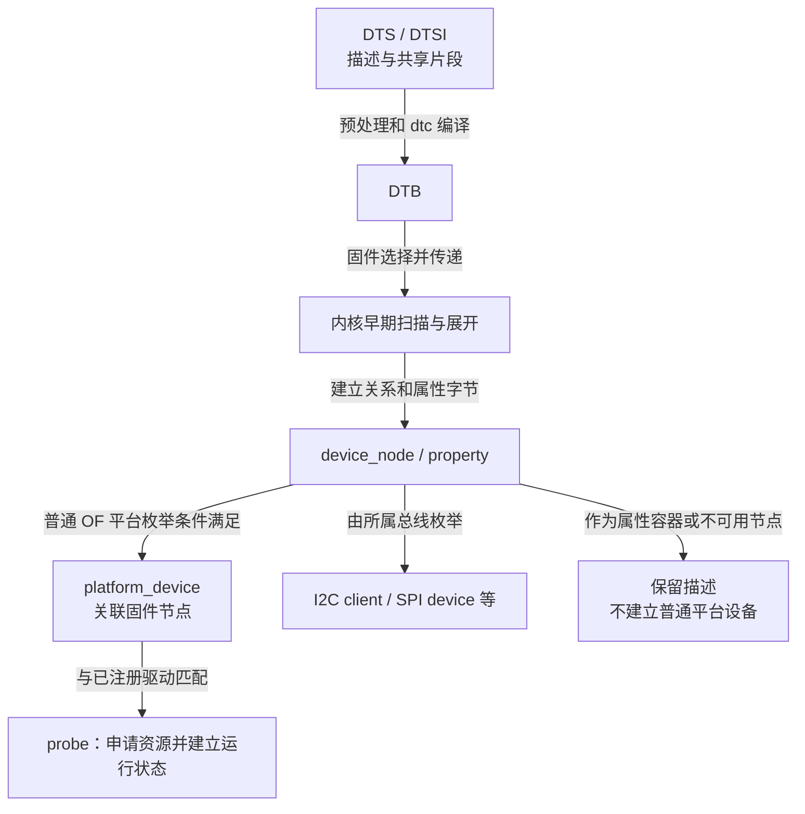
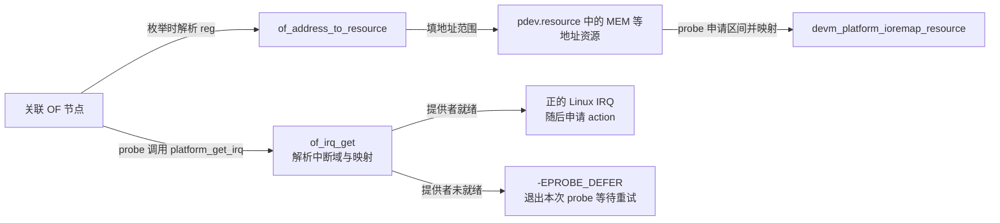
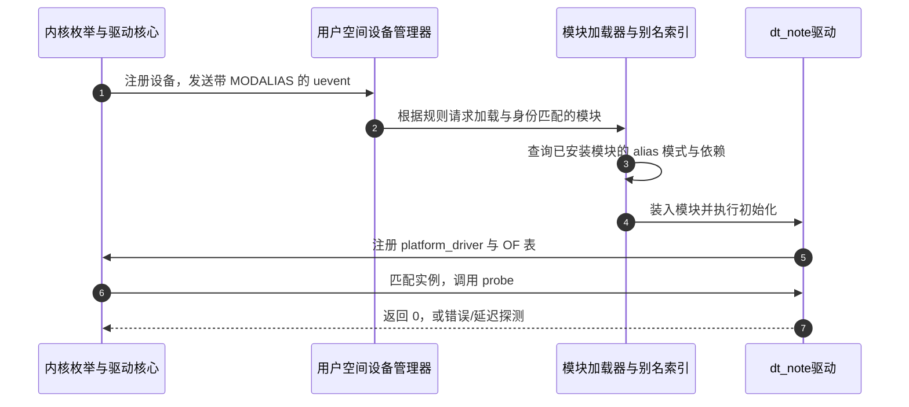

# 第2章\_设备树驱动开发方式

## 2.1\_从板级代码转交描述并没有替换驱动模型

上一章已经把硬件实例和操作方法分开：板级代码注册 `platform_device`，驱动注册 `platform_driver`，匹配后在 `probe()` 中取得资源。这样的驱动并不必然写死地址，也不需要每换一块板就复制整份驱动。仍然麻烦的是 **实例描述的交付**：同一个内核支持多块板时，板上连接、外设实例和参数分别在哪里维护，又怎样选择本次启动的那一份？

**设备树（Device Tree，DT）** 用树状数据描述硬件拓扑和属性。人编辑的源文件称为 DTS，常用 DTSI 组织共享片段；构建工具把它们编译成扁平二进制 DTB。启动固件选择适用于目标板的 DTB，并按架构启动协议交给内核。内核根据其中的信息建立自己的内存对象、枚举设备，随后仍走驱动模型的匹配和初始化。

因此，需要分清 **描述文件、内存中的描述节点、已经注册的设备、正在工作的驱动**。把一行 `compatible` 写进 DTS，不会立即装入模块，更不会自动产生一次中断；设备树也不会替代时钟、GPIO、中断等子系统的协议。本章沿这几层交接讲清开发流程，语法编码在下一章继续展开。

本章 API 与调用路径采用 NXP Linux 6.12.20 固定提交 `dfaf2136deb2af2e60b994421281ba42f1c087e0`。旧教程中的“枚举时把全部 IRQ 预先写入 resource 数组”不能直接套到这个版本。

## 2.2\_DTB中的节点什么时候才成为Linux设备

DTS 是文本，DTB 是供启动交接的数据。内核可以在启动早期直接扫描扁平树以取得内存等信息；随后 `unflatten_device_tree()` 建立通常用于运行期查询的节点和属性对象。这里说的 **OF** 是 Linux 设备树相关接口沿用的 Open Firmware 命名，看到 `of_` 前缀时应先想到对这类描述的查询或转换，而不是一个新驱动总线。

### 2.2.1\_节点与属性先保存描述并不执行驱动

`struct device_node` 通过 `parent`、`child`、`sibling` 组织节点关系，通过 `properties` 指向属性链表。`struct property` 的 `name` 表示属性名，`length` 表示字节数，`value` 指向属性值，`next` 指向下一项。属性是带长度的字节数据，并非都能按本机整数或 C 字符串直接读取。

例如 `compatible` 是 NUL 分隔的字符串列表，32 位 cell 按大端编码。`reg`、中断和 GPIO specifier 又有各自的上下文规则。`of_property_read_u32()` 可以读取适合该接口的标量属性，但不能因此把 `reg` 的第一个 cell 当作最终 CPU 物理地址，或者把 `interrupts` 的第一个 cell 当作 Linux IRQ。

| 描述或状态 | 存放处与负责者 | 后续谁使用 |
| --- | --- | --- |
| 编译后的扁平树 | 启动固件交给内核的 DTB | 内核早期扫描与展开逻辑 |
| 节点和属性 | `device_node`、`property`，由 OF 核心维护 | 枚举代码、资源解析器及驱动属性接口 |
| 已注册实例 | `platform_device.dev`，或 I2C/SPI 等总线自己的对象 | 驱动核心匹配和设备生命周期管理 |
| 运行状态 | 驱动分配的私有结构、子系统对象 | `probe`、运行回调与退出路径 |

`phandle` 是树内引用标识，用于从一个节点关联另一节点，不是物理地址或内核指针。设备对象与固件节点通过 `dev.of_node` / firmware node 关联；同一个物理设备的运行状态不能塞回设备树字节里作为共享变量。

### 2.2.2\_枚举要看所在总线和节点用途

对常见 OF 平台枚举，`of_platform_populate()` 沿指定根的子节点处理设备，并按匹配的总线类型递归；`of_platform_device_create_pdata()` 检查节点可用性与已枚举标记，分配并注册平台设备。**不是每个 device_node 都会变成 platform_device。**

典型反例是 I2C 控制器下面的传感器：控制器可以是 platform 设备，传感器则由 I2C 核心建立为 I2C client。`chosen` 等描述节点也不是普通平台外设；`gpio-leds` 的 LED 子节点由父驱动解释，不要求每个 LED 子节点都变成平台设备。`status = "disabled"` 的节点通常仍在内核设备树中，但不会被这条普通平台创建路径注册为可用实例。

`reg` 并不是所有设备节点都必须有。没有独立寄存器窗口的 GPIO consumer 或纯描述节点可以没有 `reg`；是否需要该属性，由节点所代表的硬件及其 binding 决定。binding 是规定 compatible、属性、父子关系与取值的接口文档/Schema，约束 DT 作者与驱动双方对同一组数据的理解。



图中分支解释了一个常见现场：`/sys/firmware/devicetree/base` 中有节点，但平台总线里没有同名设备。这时应该检查它由谁枚举、父总线是否就绪及节点是否可用，不应直接断定 compatible 拼错。

### 2.2.3\_地址资源与IRQ在这个版本走不同路径

对普通 OF 平台设备，`drivers/of/platform.c` 中的 `of_device_alloc()` 统计地址资源，再使用 `of_address_to_resource()` 填充 `pdev->resource[]`。地址解析要结合父总线的 cell 数及地址转换规则；结果是翻译后的资源描述，仍不是已经建立的 I/O 映射。

IRQ 在此版本可延后获取。驱动调用 `platform_get_irq(pdev, index)` 时，其内部先尝试通过关联 OF 节点调用 `of_irq_get()`；该路径解析中断描述，找到相应中断域并取得 Linux IRQ。控制器或中断域尚未准备好时可以返回 `-EPROBE_DEFER`。只有适用的回退路径才从 `IORESOURCE_IRQ` 描述取值，不能在本章流程图里把所有 IRQ 都强画成预先填好的数组元素。



对于真实 MMIO 控制器，下面是 `probe()` 内的资源取得片段，尚未包括 handler、时钟、复位和停机协议：

```c
void __iomem *regs;
int irq;

regs = devm_platform_ioremap_resource(pdev, 0);
if (IS_ERR(regs))
    return PTR_ERR(regs);

irq = platform_get_irq(pdev, 0);
if (irq < 0)
    return irq; /* 保留延迟探测等错误，不能当作“没有可选 IRQ”吞掉。 */
```

托管资源在探测失败或解绑时按 devres 规则释放，但设备端事件、工作队列与硬件运行仍需正确停用。申请 MMIO 区间能阻止遵守资源协议的使用者重复占用，**不能验证某物理地址真的有硬件**。一个未被占用但不存在的地址也可能通过资源申请，直到访问时才发生总线异常；不能把 `devm_ioremap_resource()` 描述为“自动识别错误 DTS 地址”。

普通自定义属性则应使用相应属性 API，没有必要都转换成 `resource`。对比的对象应是“标量属性读取、地址翻译、IRQ 翻译、资源申请”这几项职责，不是把所有 `of_property_read_*()` 都判为不安全，把所有 `resource` 都判为安全。

## 2.3\_用一个只读属性的节点建立最小匹配例子

上一节已经区分节点与设备。本节使用不占用硬件资源的教学节点，观察设备关联、OF 匹配和属性读取。示例中的 `linux-note,*` 是本仓库自定的教学命名，**不是上游批准的硬件 binding**。它不能作为生产板 DT 的标准模型，也不代表 Linux 支持某款真实设备。

### 2.3.1\_先编译描述再决定由谁部署

保存以下完整文件为 `dt_note.dts`。它只用于离线编译和查看结构，不含启动机器所需的 CPU、内存等完整描述，不能替换板子的启动 DTB。

```dts
/dts-v1/;

/ {
    compatible = "linux-note,dt-demo-board";
    #address-cells = <1>;
    #size-cells = <1>;

    note_demo: note-demo {
        compatible = "linux-note,dt-note-v1";
        linux-note,sample-count = <4>;
        status = "okay";
    };
};
```

`note-demo` 没有 `reg`，所以不用带地址的 `@...` 名称；`note_demo:` 是源码标签，不是最终 sysfs 设备名。设备需要的本地约定只有 sample-count：一个 32 位正整数，允许范围由驱动支持的变体决定。本例没有中断，也不应该强行给它加 `interrupts = <35>`。

```bash
# 在 dt_note.dts 所在目录；本例没有 C 头文件 include，可直接调用 dtc
dtc -I dts -O dtb -o dt_note.dtb dt_note.dts
dtc -I dtb -O dts -o dt_note.decoded.dts dt_note.dtb
```

打开反编译文件检查节点、compatible 和数值仍在。注释、标签及数值显示形式不保证原样保留；这不是文本往返测试。dtc 通过只证明它能够处理该描述，不能证明 binding 正确、目标硬件存在或启动固件会加载这个 DTB。

若要在测试板观察下面的驱动，需要将 **note-demo 节点** 加入那块板真实使用的测试 DTS，并沿其构建与启动流程部署正确 DTB；保持原 CPU、内存、总线等描述。是否有运行时 overlay 接口、是否支持应用/移除、节点何时枚举，都依赖平台与内核配置，本章不假定一个通用热插拔命令。回滚应恢复原 DTB 并重新启动测试系统。

### 2.3.2\_驱动把匹配结果和节点参数分别读取

保存 `dt_note_driver.c`。它只验证参数并打印，不访问 GPIO、MMIO 或 IRQ：

```c
#include <linux/errno.h>
#include <linux/module.h>
#include <linux/of.h>
#include <linux/platform_device.h>

struct note_variant {
    u32 max_samples;
};

static const struct note_variant variant_v1 = { .max_samples = 8 };
static const struct note_variant variant_v2 = { .max_samples = 16 };

static int note_probe(struct platform_device *pdev)
{
    const struct note_variant *variant;
    u32 samples;
    int ret;

    /* data 来自驱动匹配表，节点属性来自实际设备描述，二者不可混同。 */
    variant = of_device_get_match_data(&pdev->dev);
    if (!variant)
        return -ENODEV;

    ret = of_property_count_u32_elems(pdev->dev.of_node,
                                      "linux-note,sample-count");
    if (ret != 1)
        return dev_err_probe(&pdev->dev, -EINVAL, "sample-count 必须恰有一个 cell\n");
    ret = of_property_read_u32(pdev->dev.of_node,
                               "linux-note,sample-count", &samples);
    if (ret)
        return dev_err_probe(&pdev->dev, ret, "缺少有效的 sample-count\n");
    if (!samples || samples > variant->max_samples)
        return dev_err_probe(&pdev->dev, -EINVAL, "sample-count 超出变体范围\n");

    dev_info(&pdev->dev, "节点=%pOF sample-count=%u max=%u\n",
             pdev->dev.of_node, samples, variant->max_samples);
    return 0;
}

static void note_remove(struct platform_device *pdev)
{
    /* 本例没有异步任务和硬件，只观察解绑。 */
    dev_info(&pdev->dev, "只读教学设备解除绑定\n");
}

static const struct of_device_id note_matches[] = {
    { .compatible = "linux-note,dt-note-v1", .data = &variant_v1 },
    { .compatible = "linux-note,dt-note-v2", .data = &variant_v2 },
    { } /* 全零终止项，告诉匹配器数组到此结束。 */
};
MODULE_DEVICE_TABLE(of, note_matches);

static struct platform_driver note_driver = {
    .probe = note_probe,
    .remove = note_remove,
    .driver = {
        .name = "dt_note",
        .of_match_table = note_matches,
    },
};
module_platform_driver(note_driver);
MODULE_LICENSE("GPL");
MODULE_DESCRIPTION("设备树匹配与属性读取教学模块");
```

`.data` 指向驱动中的常量变体表，它没有作为地址写入 DTB。匹配 v1 时最大值是 8，匹配 v2 时是 16；sample-count 则由每个实例的节点提供。这样能让同一个算法处理有明确差异的实现，而不是在驱动里比较板子文件名。

本例使用 OF 接口，测试内核需启用适用的 OF/平台支持。`.of_match_table = note_matches` 是合法的直接引用。`of_match_ptr(table)` 只是按 `CONFIG_OF` 返回表指针或 `NULL` 的配置宏，不执行匹配，也不是所有 DT 驱动必须使用的语法；它不能单独保证驱动的全部非 OF 构建分支正确。`.driver.name` 仍是驱动注册所需身份，即使 OF 匹配并不要求它等于 compatible 或节点名称。

### 2.3.3\_哨兵解决数组边界不是另一种匹配规则

`of_device_id` 包含 `name`、`type`、`compatible` 和 `data`。本例只用 compatible 和 data，末尾 `{ }` 将各字段初始化为零。Linux 6.12.20 的 `__of_match_node()` 在前三个字符串任意一个非空时继续扫描，并比较匹配得分，所以不能把实现改述为“只检查 compatible[0]，遇见第一项相等就结束”。compatible 列表顺序可以表达从具体到较通用的兼容关系，驱动表与节点一起决定最终命中。

调用者只传表首指针，没有传独立长度，零终止项才给扫描提供边界。漏掉终止项可能导致越界读取，严重时崩溃，但不保证每次都立即崩溃。也不能类比为“file_operations 末尾有 NULL”：`file_operations` 是具名字段结构体，不是这种以哨兵结束的匹配数组。

`MODULE_DEVICE_TABLE` 是另一个问题：让模块构建工具从这张表生成设备别名。即使去掉它，已手工装入的驱动仍可以通过 `.of_match_table` 匹配；受影响的是依赖这些别名找到模块的自动加载路径。

### 2.3.4\_构建和观察时保留目标内核边界

使用上一章的外部模块 Makefile，把 `obj-m` 行改为 `obj-m += dt_note_driver.o`，其余 `KDIR`、`M` 和交叉编译规则不变。必须针对测试系统实际内核构建；本轮未执行该模块的目标 Kbuild、MODPOST 或加载。

```bash
# 在模块目录，使用已准备好的目标内核构建目录
make
modinfo ./dt_note_driver.ko -F alias
```

预期模块元数据中出现包含 `linux-note,dt-note-v1` 和 v2 的 OF alias 模式。此时只能证明构建产物声明了相应别名，还不能证明目标系统已经创建节点或完成绑定。若测试系统已通过真实 DTB 枚举了 note-demo，再手工装入模块：

```bash
sudo insmod ./dt_note_driver.ko
sudo dmesg | tail -n 20
ls -l /sys/bus/platform/drivers/dt_note/
```

预期 `probe` 打印 sample-count=4、max=8，驱动目录出现实际设备实例的链接。准确设备名要从运行系统读取，不能把 DTS 标签 `note_demo` 直接拼成 sysfs 路径。测试结束用 `sudo rmmod dt_note_driver` 解除绑定；这只卸载驱动，不会从正在使用的设备树中删除节点。

## 2.4\_匹配成功与模块自动装入之间还有一条通信链

驱动已经在内核里时，平台匹配可以直接使用其表。如果模块还在磁盘上，内核没有这张运行期驱动表，就需要另一条路径找到模块。**modalias 是设备身份的文本描述，模块 alias 是能匹配这类描述的模式**，二者通常不是逐字符相同的字符串。

构建阶段，`MODULE_DEVICE_TABLE(of, note_matches)` 使 modpost 的别名生成逻辑处理该表，模块带上 alias 元数据。安装模块后，`depmod` 建立供 kmod 查询的索引。设备创建产生 uevent，适用的用户空间设备管理规则读取其中的 `MODALIAS`，再通过模块加载器找到并装入模块。这依赖模块已经安装、索引存在、用户空间规则运行及签名等条件；单看到了 uevent 不能宣布自动加载正常。



步骤 1 是通知，步骤 2～4 才是用户空间加载动作，步骤 5～7 才进入内核绑定。驱动内置时不需要步骤 2～4；手工 `insmod` 也绕过按 alias 查找。驱动先注册、设备后出现同样可以匹配，不依赖本图所画的唯一先后顺序。

| 对象或接口 | 管什么 | 不管什么 |
| --- | --- | --- |
| `.of_match_table` | 已注册驱动与关联 OF 节点的运行期匹配 | 在磁盘搜索 `.ko` |
| `MODULE_DEVICE_TABLE(of, ...)` | 为构建工具提供 OF 表元数据 | 自动创建节点或保证 probe 成功 |
| `MODULE_ALIAS("platform:...")` | 显式提供一种模块查找模式 | 绕过运行期匹配；它不必匹配 OF 设备实际发出的 alias |
| `depmod`、kmod 与设备管理规则 | 建索引、按模式查找并加载模块 | 证明硬件初始化成功 |

PCI、USB、I2C、SPI 等也有对应 `MODULE_DEVICE_TABLE` 类型，但各总线的设备身份、别名编码和运行期匹配规则不同，不能只替换宏参数就认为完成移植。真实硬件 binding 也不能从教学名字推出来：例如固定版本的 `leds-gpio.yaml` 将 compatible 规定为 `gpio-leds`，没有接受 `mycompany,myled` 的通用条目。

## 2.5\_按状态交接排查为什么没有probe

先确认固件真正交给内核的树，再确认枚举、加载、匹配与初始化。下面的 Bash 观察脚本针对测试系统中的 `/note-demo`；如果加入真实板 DTS 时换了位置，应按实际节点路径调整。

```bash
# 运行期设备树投影；compatible 为 NUL 分隔字符串，不能当普通一行文本
dt_node=/sys/firmware/devicetree/base/note-demo
tr '\0' '\n' < "$dt_node/compatible"
od -An -tx1 "$dt_node/linux-note,sample-count"
```

预期数值字节是 `00 00 00 04`。目录存在表明当前运行树包含节点，不代表节点已被注册成设备；`/proc/device-tree` 在适用配置下也是相关入口，但它是目录，不能用 `cat /proc/device-tree` 读取整棵树。

通过设备的 `of_node` 链接寻找实例，避免猜测名称：

```bash
for entry in /sys/bus/platform/devices/*; do
    [ -e "$entry/of_node" ] || continue
    if [ "$(readlink -f "$entry/of_node")" = "$(readlink -f "$dt_node")" ]; then
        printf 'device=%s\n' "$entry"
        cat "$entry/modalias"
        readlink -f "$entry/driver"
    fi
done
```

没有输出时先检查节点是否由平台总线枚举、父总线与 `status`，以及部署的是否为所修改 DTB。有设备但没有驱动链接时，可能是模块未装入、匹配未命中、提供者依赖未就绪、`probe` 失败或延迟探测，不能只凭一个现象锁定 compatible。

```bash
# 观察后续真实设备事件；没有事件不代表启动时没有发生过枚举
udevadm monitor --kernel --property
```

此命令只监视后续通知，不会为当前静态节点重放启动过程。模块 alias 可用前面的 `modinfo` 查；实际自动加载还要查安装位置、`modules.alias` 等索引、设备管理器规则和错误日志。驱动目录存在只证明驱动已注册，目录内没有实例不等于已经证明“匹配失败”。

需要更深追踪时，先在目标系统的 `available_filter_functions` 或 `available_events` 中确认真实可用的函数或事件，再按该内核的 tracing 接口启用局部观察。不存在一个通用的 `probe:myled` 事件名可以直接写入 `set_event`。动态调试同样依赖驱动中存在对应 `pr_debug` / `dev_dbg` 调用与目标配置，日志沉默本身不是函数从未执行的证明。

| 停止位置 | 优先核对 | 不能跳过的下一层 |
| --- | --- | --- |
| 运行树没有节点 | DTS 构建目标、DTB 部署、固件选择和节点路径 | 不是先改驱动匹配表 |
| 有节点无平台实例 | 节点用途、所属总线、status、父设备及枚举路径 | 无 reg 不一定是错误 |
| 有实例无模块 | 内置/模块配置、模块安装、alias 与加载规则 | uevent 发生不代表已加载 |
| 模块已装无绑定 | 运行期匹配表、override、提供者依赖和 probe 错误 | 缺 `MODULE_DEVICE_TABLE` 不一定阻止手工加载后的绑定 |
| probe 运行但失败 | 必要属性、变体范围、资源错误和延迟探测 | 不把 `-EPROBE_DEFER` 当成功吞掉 |
| 已绑定但功能异常 | 设备端协议、事件处理、时钟/电源与硬件连接 | 本章只读例子不提供硬件功能验证 |

## 2.6\_改变一个条件预测哪一层会变化

先保持其他条件不变，再做以下思考或在测试环境修改对应来源：

1. 只把 sample-count 从 4 改为 12，compatible 仍为 v1，会发生什么？
2. 同时改成 v2 与 12，驱动中的最大值来自哪里？
3. 去掉 `MODULE_DEVICE_TABLE` 但保留 OF 表，手工加载后是否还可能绑定？
4. 节点改为 disabled 后，是否一定从运行期设备树目录消失？
5. 某真实控制器只有 MEM 条目，没有 `IORESOURCE_IRQ` 条目，是否足以判断 `platform_get_irq()` 必然失败？

答案：第一题属性能被读取，但 v1 的上限为 8，`probe` 返回 `-EINVAL`，不会完成绑定。第二题上限来自驱动匹配表 `.data` 指向的 v2 常量，节点只提供实例参数。第三题可以，手工加载绕过别名查找，运行期 OF 匹配表仍在。第四题不一定，节点可以保留在树中但不被普通平台枚举创建。第五题不能，6.12.20 可以通过 OF 节点与中断域延后取得 Linux IRQ。

现在已能解释描述怎样进入设备模型、属性为何不都变成资源、模块为何需要另一条加载路径。下一章 [设备树语法与标准示例](P03_设备树语法与标准示例.md) 再展开 cell、地址转换、phandle 和具体 binding 的编码规则，不把本章的教学节点当作通用硬件模板。

## 2.7\_源码位置与本章验证边界

固定来源身份见 [Linux 源码基线](../../../../research/source_reading/linux/SOURCE_BASELINE.md)。下面均针对同一 NXP 提交，引用的是接口与机制位置，不在本章逐行复制函数体。

| 上游路径与入口 | 支撑本章哪项判断 |
| --- | --- |
| [`drivers/of/fdt.c`](https://github.com/nxp-imx/linux-imx/blob/dfaf2136deb2af2e60b994421281ba42f1c087e0/drivers/of/fdt.c)，`unflatten_device_tree()` | DTB 展开与内存中的节点/属性 |
| [`drivers/of/platform.c`](https://github.com/nxp-imx/linux-imx/blob/dfaf2136deb2af2e60b994421281ba42f1c087e0/drivers/of/platform.c)，`of_device_alloc()`、`of_platform_bus_create()` | 地址资源准备、节点可用性、分层枚举与总线递归 |
| [`drivers/base/platform.c`](https://github.com/nxp-imx/linux-imx/blob/dfaf2136deb2af2e60b994421281ba42f1c087e0/drivers/base/platform.c)，`platform_get_irq_optional()`、`platform_match()` | OF IRQ 延后获取和完整匹配次序 |
| [`drivers/of/base.c`](https://github.com/nxp-imx/linux-imx/blob/dfaf2136deb2af2e60b994421281ba42f1c087e0/drivers/of/base.c)，`__of_match_node()`；[`drivers/of/device.c`](https://github.com/nxp-imx/linux-imx/blob/dfaf2136deb2af2e60b994421281ba42f1c087e0/drivers/of/device.c)，`of_match_device()` | 哨兵判断、得分选择及设备到节点的匹配入口 |
| [`include/linux/of.h`](https://github.com/nxp-imx/linux-imx/blob/dfaf2136deb2af2e60b994421281ba42f1c087e0/include/linux/of.h)，`of_match_ptr` | 配置宏与匹配动作的区别 |
| [`scripts/mod/file2alias.c`](https://github.com/nxp-imx/linux-imx/blob/dfaf2136deb2af2e60b994421281ba42f1c087e0/scripts/mod/file2alias.c)，`do_of_table()` | 构建阶段从 OF 表生成模块别名 |
| [`Documentation/devicetree/bindings/leds/leds-gpio.yaml`](https://github.com/nxp-imx/linux-imx/blob/dfaf2136deb2af2e60b994421281ba42f1c087e0/Documentation/devicetree/bindings/leds/leds-gpio.yaml) | GPIO LED 的真实 compatible 契约，不接受任意教学字符串 |

2026-10-17 使用 DTC 1.6.1 编译并反编译本章独立 DTS，退出状态均为 0；核对 compatible、sample-count=4 与 status 保留。该验证只证明文本可编译及这些属性往返保留，不是 binding Schema 或目标内核验证。后者还需要真实测试系统、所选 DTB、模块构建、加载及日志；本轮尚未执行，不能宣称例子已经在 i.MX6ULL 或其他板上运行成功。
