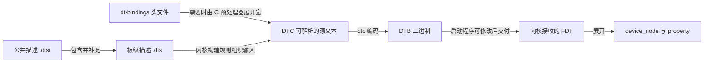
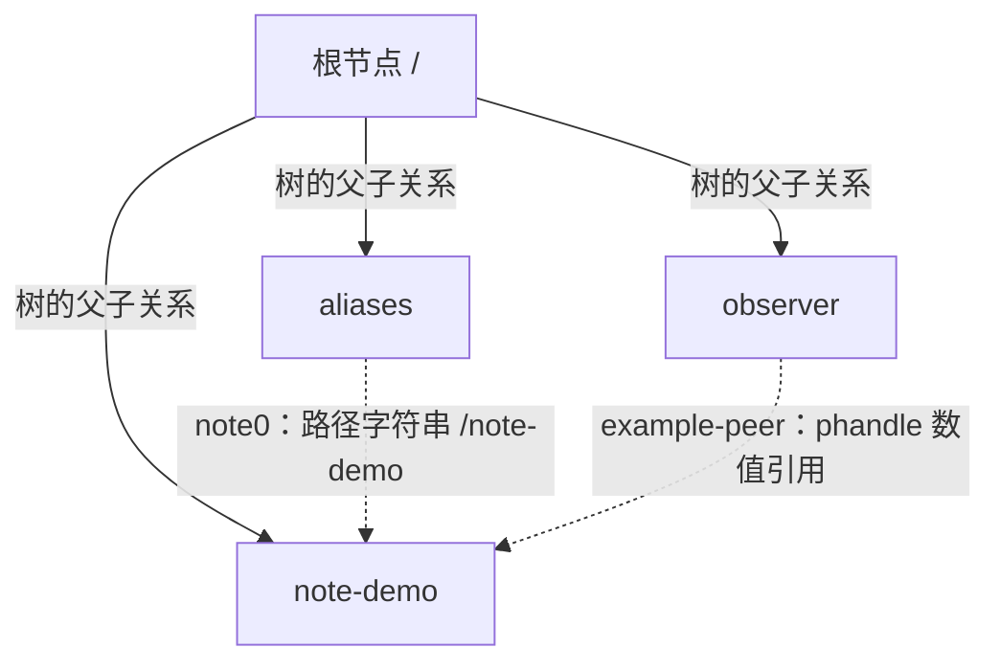

# 第3章\_设备树语法与标准示例

## 3.1\_描述已经交给驱动还需要约定怎样读

**讲解层次：概念到实现的映射。** [上一章](P02_设备树驱动开发方式.md#2.2_DTB中的节点什么时候才成为Linux设备)已经区分 DTB、运行期节点和 Linux 设备：编译成功的节点不一定会成为设备，设备建立也不等于驱动已经绑定。本章暂时停在这条链的输入端，回答一个更基本的问题：一串字符串、整数和引用，怎样让工具与驱动读出同一含义？

例如 `<4>` 可以是采样次数，也可以是某个控制器中的编号。尖括号只决定如何编码，不能替数字决定用途。**语法规定怎样表示数据，binding 规定这些数据描述什么硬件契约。** binding 是某类设备或总线的描述约定，包含属性名、类型、单位、数量、必选项和连接对象；写驱动和写 DTS 的人必须共同遵守它。

这个分工也解释了设备树的来历。设备树原本属于 Open Firmware 向客户程序传递硬件描述的接口，Linux 在 PowerPC、SPARC 上较早使用；后来 Flattened Device Tree（FDT，展平设备树）让启动程序能够传递一个二进制数据块，而不必提供完整 Open Firmware 服务。ARM 板级代码重复是 Linux 扩大使用这一机制的重要背景，不能反过来说设备树最初专为 ARM 板文件而生。

设备树可以减少每块板分别编写资源登记代码的重复，但不会替代驱动、硬件探测协议或全部固件接口。不同平台可以选择 DT、ACPI 等描述方式；不能仅按处理器架构或一个内核大版本推断整机一定采用哪一种。

本章使用一个 **只做离线编译的教学描述**，不声称它是上游硬件 binding，也不把它部署到开发板。后续章节再依次加入地址、中断、引脚、供电和时钟的真实契约。

## 3.2\_先看清源码文件到运行时数据的交接

人维护的 DTS 是文本；启动程序传递的 DTB 是编译后的二进制表示。公共 SoC 描述常放在 DTSI 中，板级 DTS 包含它并补充接线和启用状态。这种文件复用减少重复，却不等于运行时仍有“板级文件覆盖 SoC 文件”的两份对象：编译后得到的是合并后的树。



图中的每个箭头都可能改变后面看见的数据。源文件中的 `status` 不一定就是实际启动时的值；启动程序可以根据板型修改描述。U-Boot 自己用于驱动模型的控制设备树，与它交给操作系统的设备树，也可能是不同对象，不能只检查 U-Boot 源码里的一个 DTS 就认定 Linux 收到了同样内容。

| 材料或工具 | 当前用途 | 它不能单独证明什么 |
| --- | --- | --- |
| `.dts` / `.dtsi` | 编辑完整描述与可包含片段 | 哪一个 DTB 被固件实际加载 |
| `dtc` | DTS 与 DTB 的编译、反编译，执行结构检查 | 所有属性都满足硬件 binding、板上接线正确 |
| `fdtdump` | 查看二进制树的文本内容 | 驱动是否绑定、硬件是否工作 |
| `fdtget` | 按路径读取 DTB 属性，便于逐项比较 | Linux 中的资源分配结果 |
| `fdtoverlay` | 离线将 overlay 合并到基础 DTB | 某内核支持在线应用或撤销该 overlay |
| `dt_binding_check` | 检查 binding Schema 自身及其示例 | 指定板的完整描述正确 |
| `dtbs_check` | 用 Schema 校验构建的 DTB | 硬件运行、供电时序和固件交付正确 |

Linux 中的 binding 位于 `Documentation/devicetree/bindings/`；宏常量位于 `include/dt-bindings/`。本专题核对的 NXP Linux 6.12.20 树中，i.MX ARM 描述在 `arch/arm/boot/dts/nxp/imx/`。其他体系结构、内核版本或 U-Boot 版本的目录可能不同，应先从对应构建清单找到实际目标，不能凭旧教程路径猜测。

## 3.3\_用两份小文件建立节点与属性

先在一个空实验目录保存下面的 `note_common.dtsi`。名字由本实验约定，`.dtsi` 表示可包含的源码片段。`note-demo` 没有可寻址资源，因而不带 `@地址`。

```dts
/* note_common.dtsi：仅供离线语法实验。 */
/ {
    note_demo: note-demo {
        compatible = "linux-note,dt-demo-v1";
        sample-count = <4>;
        sample-bytes = [01 02 03 04];
        names = "first", "second";
        example-enabled;
        status = "disabled";
    };
};
```

最外面的 `/` 是根节点；花括号包围节点内容，属性以分号结束，节点结束的花括号后也有分号。属性必须写在该节点的子节点之前。`/* ... */` 与 `// ...` 都可以写注释。这里的自定义属性只服务语法观察，没有声称内核存在一个会处理它们的标准驱动。

再保存完整入口 `note_board.dts`：

```dts
/dts-v1/;
/include/ "note_common.dtsi"

/ {
    model = "linux-note offline syntax example";
    compatible = "linux-note,dt-demo-board";
    #address-cells = <1>;
    #size-cells = <1>;

    aliases {
        note0 = &note_demo;
    };

    observer {
        example-peer = <&note_demo>;
    };
};

&note_demo {
    sample-count = <6>;
    status = "okay";
};
```

`/dts-v1/;` 声明源格式。`/include/` 是 DTC 自己识别的包含语法，这份例子不需要 C 预处理。文件末尾的 `&note_demo` 修改前面已定义的同一节点，把次数从 4 改为 6、状态从 disabled 改为 okay；它没有创建第二个 `note-demo`。

`#address-cells` 与 `#size-cells` 规定根下可寻址子节点如何编码地址和长度。本例没有 `reg`，先保留显式声明，下一章再计算它们的作用。不要看到名称中的 `#` 就把这些属性当成 C 预处理指令。

节点名应表达设备类别，例如 `serial`、`gpio`；`@` 后的 unit address 表示父总线地址空间中的单元地址，应与 `reg` 的首地址按该总线规则对应。普通 MMIO 节点常写 `serial@1000`，I2C 子节点可能写 `eeprom@50`，二者的数值用途不同。Linux DTS 风格通常要求小写、连字符及无多余前导零的地址；这比 DTSpec 允许的字符集合更严格，不能把风格要求误报成所有解析器的语法限制。

## 3.4\_同样的字节长度不代表同样的数据类型

`sample-count` 与 `sample-bytes` 都占四字节，但前者是一个 32 位整数，后者是四个独立字节。读取它们的代码必须知道 binding 规定的类型，否则“读到了四字节”仍可能读错含义。

| 源码形式 | 二进制解释 | 例子需要注意的事 |
| --- | --- | --- |
| `<6>` | 一个大端 32 位 cell | 字节为 `00 00 00 06`，不是字符 `6` |
| `<0x1 0x20>` | 两个 32 位 cell | 只有契约规定为 u64 时，才合成 `0x100000020` |
| `[01 02 03 04]` | 四字节序列 | 不自动转换成四个整数 cell |
| `"first"` | 带结尾 NUL 的字符串 | 长度包含结尾的 `00` |
| `"first", "second"` | 两个带 NUL 字符串的串接 | 读一个字符串的接口不会自动遍历整个列表 |
| `example-enabled;` | 值长度为零的存在性属性 | 存在表达 true；删除表达 false，不能用 `<0>` 代替“不存在” |

尖括号中也能写括号包围的整数表达式，例如 `<(1 << 3)>`。DTC 计算它后存入数值，并不会把 C 表达式留给内核执行。某些 DTC 用法支持 `/bits/ 8` 等宽度声明，但能否用这种编码替换一个属性，仍由该属性的字节布局决定；不能把本应一个 u32 的属性随意缩短。

Linux 驱动用 `of_property_read_u32()` 这类接口完成大端到 CPU 数值的转换；不能把属性地址强转成 `u32 *` 后直接解引用。类型与长度检查、字符串指针生命周期将在 [OF 读取篇](P09_OF属性读取与节点引用生命周期.md) 继续建立。

## 3.5\_标签路径与phandle分别解决哪种定位

假设改了 `note-demo` 的路径，引用它的地方都手写路径就容易漏改。源码标签 `note_demo:` 为作者提供一个稳定的引用名字；编译器再按引用上下文，把它转换成路径或数值句柄。



实线表示树的包含关系，虚线表示属性引用。`observer` 与 `note-demo` 仍是同级节点，增加引用不会把其中一个移到另一个下面。真实 GPIO、时钟和供电关系也常是这种跨树引用，而非简单的父子关系。

| 本例写法 | 作者或工具使用的身份 | 编译后的意义 |
| --- | --- | --- |
| `note_demo:` | 源码标签 | 普通编译不把标签本身当成节点名称保存 |
| `&note_demo { ... };` | 源码定位 | 合并修改目标节点 |
| `example-peer = <&note_demo>;` | cell 中的引用 | 转成目标节点的 phandle，并按需要生成其 phandle 属性 |
| `note0 = &note_demo;` | cell 外的引用 | 转成目标的完整路径字符串，供 aliases 使用 |
| `&{/note-demo}` | 按完整路径定位的源码引用 | 适合没有可用标签时；路径变化需要同步 |

phandle 是树内唯一的数值标识，不是 MMIO 地址、GPIO 编号或 C 指针。不要依赖某次编译恰好分配成 1。并非每个有标签的节点在普通编译后都必然有 phandle；是否被数值引用、编译选项等都会影响结果。使用 `-@` 时还会生成供 overlay 定位的符号信息，不能因此说普通 DTB 天然保留了全部源码标签。

## 3.6\_编译后亲手检查修改是否进入二进制

在保存上述两份文件的目录执行以下命令。需要已安装 DTC 工具集；命令只生成本目录的文件，不访问硬件。

```bash
dtc -I dts -O dtb -o note_board.dtb note_board.dts
dtc -I dtb -O dts -o note_decoded.dts note_board.dtb
```

第一条生成 DTB，第二条反编译便于查看。应能看到 `sample-count` 为 6、`status` 为 okay，`observer` 的引用值与目标的 phandle 相等。反编译可能把十进制改为十六进制、改变排版或丢失注释，这些文本差异不等于语义变化。

再按属性读取，不必在整份文本中找数值：

```bash
fdtget -t u note_board.dtb /note-demo sample-count
fdtget -t s note_board.dtb /note-demo status
fdtget -t s note_board.dtb /aliases note0
fdtget -t x note_board.dtb /observer example-peer
fdtget -t x note_board.dtb /note-demo phandle
```

前三条预期分别得到 `6`、`okay`、`/note-demo`；后两条应得到相同数值。先比较身份是否一致，不要硬编码预期 phandle 为多少。

现在把覆盖段改成下面这样并重新编译：

```dts
&note_demo {
    /delete-property/ example-enabled;
    sample-count = <8>;
};
```

预测结果应是次数变为 8、存在性属性消失，而 `status` 回到被包含文件中的 disabled，因为新的覆盖段不再修改它。`/delete-node/` 同样用于源码合并时删除节点；这些源码指令不是给运行中内核发送的删除命令。做完后恢复原来的覆盖段，下面的实验仍以次数 6 的基础树开始。

内核 DTS 常使用 `#include <dt-bindings/...>` 和 `GPIO_ACTIVE_LOW` 等宏，不能把这种文件原样交给只认识 DTS 的解析阶段。应使用该内核的 `make ... dtbs` 构建规则完成预处理；本文的 `/include/` 小例子能直接编译，不代表所有板级 DTS 都能照搬这两条命令。

## 3.7\_overlay怎样修改已经编译的树

板型扩展可能在基础 DTB 生成以后才确定，需要再把一小份描述合进去。overlay 保存的就是这份修改及其目标定位信息。它可以由启动程序合并，也可以在支持相应机制的内核中应用；两种执行环境的设备生命周期条件不同。本节只做 **离线合并**。

保存 `note_overlay.dts`：

```dts
/dts-v1/;
/plugin/;

&note_demo {
    sample-count = <12>;
};
```

基础树需要把标签位置交给合并器，所以重新以 `-@` 编译。随后编译 overlay，并生成一个新的结果文件：

```bash
dtc -@ -I dts -O dtb -o note_symbols.dtb note_board.dts
dtc -@ -I dts -O dtb -o note_overlay.dtbo note_overlay.dts
fdtoverlay -i note_symbols.dtb -o note_merged.dtb note_overlay.dtbo
fdtget -t u note_merged.dtb /note-demo sample-count
fdtget -t u note_symbols.dtb /note-demo sample-count
```

结果文件应得到 12，基础文件仍为 6。合并器根据符号与 fixup 信息找到目标并修补引用，不是把 `&note_demo` 字符串原样塞给驱动。删除生成的结果文件即可撤销这次离线实验；没有需要卸载的模块，也没有运行期设备被改动。

在线 overlay 还要处理设备创建、删除、驱动引用与资源占用，不能从“离线合并成功”推出任意在线修改都安全，更不能假定所有 Linux 都提供统一的 configfs 应用入口。

## 3.8\_可用性与兼容性怎样限制后续行为

离线实验能修改属性，但属性真正影响什么，要看读取者。`status` 描述当前可用状态；Linux 常在枚举或遍历可用节点时检查它，因而 disabled 的设备可能根本不会进入 `probe()`。在驱动里等待一条“设备 disabled”的日志，不是有效的通用排查办法。

| `status` 情形 | 描述含义 | Linux 通常怎样判断可用 |
| --- | --- | --- |
| 缺失 / `"okay"` | 可用或默认可用 | 可用 |
| `"ok"` | Linux 接受的写法 | 可用；新 DTS 宜按规范写 okay |
| `"disabled"` | 当前不可用，可能以后可用 | 不可用，但节点本身仍可存在 |
| `"reserved"` | 设备工作但保留给其他组件 | 不作为普通可用设备处理 |
| `"fail"` / `"fail-sss"` | 故障，后缀可描述错误 | 不可用 |

这张表不承诺修改 live tree 后所有驱动会自动重探测。设备实例与正在执行的驱动还有各自生命周期，静态描述的值与运行期动作必须分开判断。

`compatible` 则说明设备遵守哪种编程模型。假设新型号增加功能却完整保留旧型号的寄存器行为，binding 才可能允许从具体到一般的回退列表；若关键位含义已经变了，填上旧字符串只会诱使旧驱动误操作，不能拿它当“让 probe 发生”的开关。

Linux 在一张 OF 匹配表内根据匹配条件评分，选择对应条目；这不等于内核会在所有已注册驱动中进行一场全局“最优型号竞赛”。驱动注册、设备绑定和模块装入是另一组过程，见 [匹配与模块加载](P02_设备树驱动开发方式.md#2.4_匹配成功与模块自动装入之间还有一条通信链)。`of_match_ptr()` 只按 CONFIG_OF 选择表指针或 NULL，直接赋表指针也有合法用法，不能称它为所有 OF 驱动都必须使用的匹配算法。

不是每个节点都必须有 compatible；aliases、chosen、某些子功能节点由特定约定解释。也不是每个节点都必须有 reg。先判定节点承担的角色，再套它的 binding，避免给每个花括号机械复制一份“通用模板”。

## 3.9\_从编译检查走到实际交付检查

在目标内核源码及匹配的构建环境中，可以运行下列两项检查；使用哪个 ARCH、输出目录和交叉工具链，应与该内核已有构建配置一致。

```bash
# 在已配置的目标内核构建环境执行；需安装对应版本要求的 dtschema 工具。
make dt_binding_check
make dtbs_check
```

第一项先保证 Schema 本身有效；第二项校验设备树。坏 Schema 可能被后者跳过，所以不能用单独一项成功代替两层验证。过滤 `DT_SCHEMA_FILES` 可以缩小 Schema 范围，但也缩小了这次检查能够证明的范围。

板上还应确认固件实际交付的树。若内核导出了该接口，以下 Linux shell 命令查看运行时属性：

```bash
# 在目标板读取实际存在的节点；这里的 /note-demo 仅为路径写法示意。
tr '\0' '\n' < /sys/firmware/devicetree/base/note-demo/compatible
od -An -tx1 /sys/firmware/devicetree/base/note-demo/sample-count
```

字符串用 NUL 分隔，cell 用大端字节保存，所以分别处理；不能把整个 `/proc/device-tree` 目录当普通文件 `cat`。本章教学树没有部署，上述路径不会因此自动出现。模块存在、节点存在、驱动已绑定和硬件操作成功各有不同证据，仍按上一章的排查顺序逐层确认。

试着解释以下三种变化，再对照答案：

1. 给未被引用的节点增加标签，是否必然增加一个硬件资源？**不会。** 标签服务源码定位，资源由属性契约和枚举路径解释。
2. 编译通过但次数超出驱动接受范围，错误应在哪层发现？**binding Schema 或驱动校验层。** DTC 能编码该整数，不代表业务约束成立。
3. 把设备 compatible 改成现有驱动能匹配的字符串，能否证明硬件兼容？**不能。** 字符串作出了兼容声明，真实性仍需硬件编程模型与 binding 支撑。

现在已经能够解释数据怎样编码、怎样引用和怎样进入编译产物。下一章 [地址单元与总线窗口转换](P04_地址单元与总线窗口转换.md) 再追问：即便读到了 `reg` 的整数，为什么仍不能直接把它当作 CPU 可访问的物理地址？

## 3.10\_依据与实验边界

语法、节点、引用、标准属性按 [DTSpec v0.4 第2章](https://github.com/devicetree-org/devicetree-specification/blob/v0.4/source/chapter2-devicetree-basics.rst) 与 [第6章](https://github.com/devicetree-org/devicetree-specification/blob/v0.4/source/chapter6-source-language.rst) 核对；上文表格是围绕例子整理的解释，不替代具体设备 binding。

历史与用途按 [Linux usage-model](https://github.com/nxp-imx/linux-imx/blob/dfaf2136deb2af2e60b994421281ba42f1c087e0/Documentation/devicetree/usage-model.rst)，风格和 Schema 检查按同提交的 [DTS coding style](https://github.com/nxp-imx/linux-imx/blob/dfaf2136deb2af2e60b994421281ba42f1c087e0/Documentation/devicetree/bindings/dts-coding-style.rst) 与 [writing-schema](https://github.com/nxp-imx/linux-imx/blob/dfaf2136deb2af2e60b994421281ba42f1c087e0/Documentation/devicetree/bindings/writing-schema.rst)。Linux 可用性和匹配边界按 `drivers/of/base.c`、`include/linux/of.h` 核对，版本为本仓库固定的 NXP Linux 6.12.20。

本章的可复现实验只证明离线编译、属性往返与 overlay 合并，不证明教学 compatible 已有上游 Schema，也不证明目标 Kbuild、固件部署、模块加载或硬件行为已经验证。
