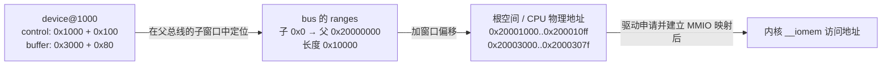
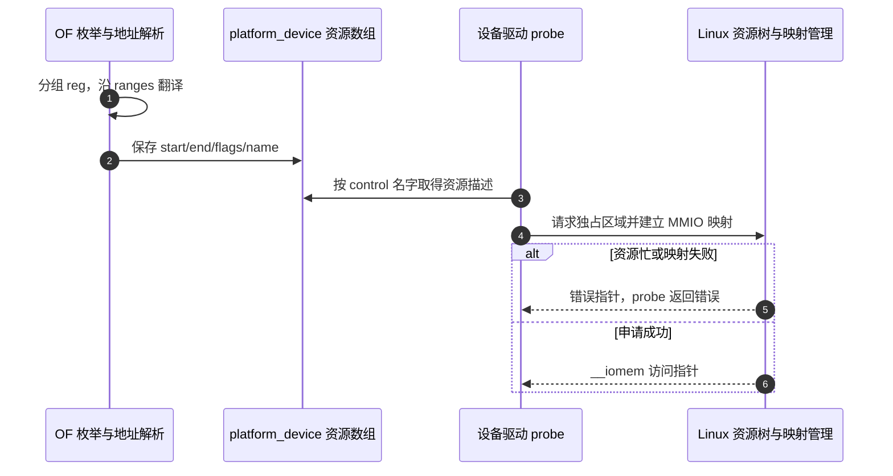

# 第4章\_地址单元与总线窗口转换

## 4.1\_读到了reg为什么还不能直接访问

**讲解层次：概念层，DTSpec v0.4 的地址描述。** 上一章已经说明 cell 是编码单位。现在看 `reg = <0x1000 0x100>`：第一个数是否就是 CPU 物理地址？如果设备接在一个桥后面，桥把本地窗口映射到另一段地址，直接按 0x1000 访问就会找错对象。

设备只需要描述它在 **父总线地址空间** 中的位置；桥描述子空间怎样对应父空间。这样，同一个外设子树可以随桥的窗口整体移动，不必逐个重写子节点地址。代价是读取 `reg` 时必须知道父总线的编码规则，并沿总线层次完成转换。

本章先建立普通 MMIO 总线模型，再讨论不表示内存窗口的 I2C/CPU 编号与 PCI 空间标记。所有虚构地址都用于计算，不授权读者向实际机器的这些位置发起访问。

## 4.2\_父节点规定一个地址和一个长度各占几格

`#address-cells` 规定子节点 `reg` 中 **一个地址** 使用多少个 32 位 cell；`#size-cells` 规定 **一个长度** 使用多少个 cell。假设分别为 2 和 1，一项资源就是“地址高 32 位、地址低 32 位、长度”三个 cell，不是“两个 cell 合起来包含地址和长度”。

| 父节点的声明 | 子节点一项 `reg` | 解码结果 |
| --- | --- | --- |
| address=1，size=1 | `<0x1000 0x100>` | 地址 0x1000，长度 0x100 |
| address=2，size=1 | `<0x1 0x2000 0x100>` | 地址 0x100002000，长度 0x100 |
| address=2，size=2 | `<0x1 0x2000 0x0 0x100>` | 地址相同，长度用两个 cell 表达 |
| address=1，size=0 | `<0x50>` | 只有一个地址或总线标识，没有长度字段 |

两个 cell 组成普通 64 位数时，高位在前：`value = (high << 32) | low`。这里的公式是数值说明；C 实现必须先把 high 扩展到 64 位，不能对 32 位变量直接左移 32 位。

这些属性 **不按 DTSpec 从祖先继承**。有子节点的节点应显式声明；规范给缺省的客户程序解释值为 address=2、size=1，但不应依靠遗漏来隐含表达意图。某个 Linux 辅助函数的历史回退搜索不能改变规范契约。

还有一个容易看反的位置：总线节点自己的 `reg` 由它的父节点决定；它写出的 `#address-cells` 则供它的孩子使用。父亲给自己定身份证规则，再给孩子定规则，是两件不同的事。

## 4.3\_用一个窗口把子地址换到父地址

假设桥把子空间 `[0, 0x10000)` 映射到 CPU 空间 `[0x20000000, 0x20010000)`，子设备位于偏移 0x1000，长 0x100。转换时先确认它属于窗口，再保留窗口内偏移：

```text
父地址 = 父窗口起点 + (子地址 - 子窗口起点)
       = 0x20000000 + (0x1000 - 0)
       = 0x20001000
资源末地址 = 0x20001000 + 0x100 - 1 = 0x200010ff
```

下面是完整的 `address_demo.dts`，可以离线编译，不能据此启动真实板。`linux-note,address-demo` 是教学节点，尚未定义上游设备 binding。

```dts
/dts-v1/;

/ {
    model = "linux-note offline address example";
    compatible = "linux-note,address-demo-board";
    #address-cells = <1>;
    #size-cells = <1>;

    bus@20000000 {
        compatible = "simple-bus";
        #address-cells = <1>;
        #size-cells = <1>;
        ranges = <0x0 0x20000000 0x10000>;

        device@1000 {
            compatible = "linux-note,address-demo";
            reg = <0x1000 0x100>, <0x3000 0x80>;
            reg-names = "control", "buffer";
        };
    };
};
```

`ranges` 写在桥上，每项由“子起点、父起点、窗口长度”组成。此例恰好各占一个 cell，但不是所有 ranges 都只有三个 cell。子设备的两项 `reg` 则分别得到 CPU 地址 0x20001000 和 0x20003000；名字数组按同一顺序给两项资源命名。



图中的 CPU 物理地址和内核映射地址仍是不同身份。DTS 不负责替驱动建立页表映射，也不保证这个教学地址在真实机器上存在。

在文件所在目录执行：

```bash
dtc -I dts -O dtb -o address_demo.dtb address_demo.dts
dtc -I dtb -O dts -o address_decoded.dts address_demo.dtb
fdtget -t x address_demo.dtb /bus@20000000/device@1000 reg
```

最后应读到 `1000 100 3000 80`。**DTB 中仍保存子地址**；DTC 没有把它自动改写成 CPU 地址。翻译由后续理解总线的读取者完成，这正是为什么只反编译 DTB 就看到 0x1000 不代表转换失效。

## 4.4\_怎样计算不同宽度和多层窗口

读取一个 `ranges` 项前，把下面三个参数写出来，便不会把字段切错：

| 项目 | cell 数来自哪里 | 本节符号 |
| --- | --- | --- |
| 子起点 | 写 ranges 的本节点 `#address-cells` | C |
| 父起点 | 本节点父节点的 `#address-cells` | P |
| 窗口长度 | 写 ranges 的本节点 `#size-cells` | S |

一项占 `C + P + S` 个 cell。节点自己的 `reg` 不参与这个分组公式。以下均为 **ranges 属性片段**；表中同时给出决定其格式的上下文，不能脱离上下文复制。

| C/P/S | 属性值 | 解释 |
| --- | --- | --- |
| 1/1/1 | `<0x0 0x20000000 0x10000>` | 单 cell 子、父起点与长度 |
| 2/1/1 | `<0x0 0x0 0x20000000 0x10000>` | 子起点为两个 cell，父起点仍一个 |
| 2/2/1 | `<0x0 0x0 0x1 0x20000000 0x10000>` | 父起点成为 0x120000000 |
| 2/2/2 | `<0x0 0x0 0x1 0x20000000 0x0 0x10000>` | 同一窗口，长度扩为两个 cell |

例如第三行的子节点若写 `reg = <0x0 0x1000 0x100>`，经该层后地址是 0x120001000。若该桥的父节点还不是根，总线转换还要继续；不能把“父地址”一律叫成最终 CPU 地址。

再考虑一层嵌套：内层桥把 0x0 映射到外层空间的 0x8000；外层把 0x0 映射到 CPU 空间的 0x20000000。设备本地 0x120 先变成 0x8120，再变成 0x20008120。只取最近一层的偏移会少算一段。

多个窗口时，应先选择覆盖设备地址的窗口。以下仍采用 C/P/S=1/1/1：

```dts
/* 片段：两个窗口，不是同一窗口的开始和结束。 */
ranges = <0x0000 0x20000000 0x10000>,
         <0x20000 0x30000000 0x10000>;
```

子地址 0x21000 属于第二个窗口，得到 0x30001000；0x18000 不属于任一窗口。描述者还应检查整段资源是否落在有效范围内，不能因为起始地址可转换就擅自让资源尾部跨过硬件窗口。

## 4.5\_空ranges和没有ranges为何不同

直接相连的普通 MMIO 层次可能不改变地址，这时写 `ranges;` 表示空值，声明父子空间按相同地址对应。它不是“没有任何含义的占位行”。

| 写法 | DTSpec 的含义 | 读者应怎样处理 |
| --- | --- | --- |
| 有一个或多个三元组 | 指定窗口翻译 | 分组、选窗口、逐层转换 |
| `ranges;` | 父子地址空间相同 | 地址数值不需要偏移转换 |
| 完全没有 ranges | 未声明子空间到父空间的映射 | 不能默认等同于空 ranges |

某些总线或平台有专门解释与历史兼容路径，所以最终还须核对所选 binding 与实现；这不是在通用教程里省略 ranges 的理由。`dma-ranges` 则描述 DMA 侧的地址可达与转换关系，不能把它当成 CPU 访问设备寄存器的 ranges 来替换。驱动拿到 CPU MMIO 地址，也不能直接把该地址当作 DMA 地址交给另一设备。

## 4.6\_reg有时表达设备选择而不是寄存器窗口

前面的模型刻意限定为 MMIO。现在换到 I2C：总线事务先发从机地址，驱动不靠把该地址映射成 CPU 内存来选中设备。因此 I2C 总线通常为孩子声明 address=1、size=0，`eeprom@50` 的 `reg = <0x50>` 表示从机地址，没有“长度为零的 MMIO 寄存器”这个含义。

```dts
/* 片段：已有 I2C 控制器节点内的子节点。控制器自身配置由其 binding 决定。 */
#address-cells = <1>;
#size-cells = <0>;

eeprom@50 {
    compatible = "atmel,24c02";
    reg = <0x50>;
};
```

这里只展示地址字段，完整 EEPROM 板级描述还要满足该型号 binding。不要把 I2C 地址 0x50 送给 `devm_ioremap_resource()`。

`/cpus` 下也采用没有长度的 CPU 标识描述。CPU 节点的 `device_type = "cpu"` 表明其类别，`reg` 编码 CPU 标识；具体如何对应处理器的硬件身份由架构 binding 决定。ARM CPU 节点可能使用 MPIDR 相关编码，它既不是 UART 的 MMIO 基址，也不能直接认作 Linux 分配的逻辑 CPU 号。

这里补齐 CPU 节点的当前用途即可：读取 `reg` 之前先问 **谁的地址空间、哪一种设备选择规则**。CPU 启动方法、拓扑、缓存和电源状态属于后续平台描述，不凭一个 `reg` 值推出全部行为。

## 4.7\_PCI的三个地址cell还携带空间类型

PCI host bridge 的子地址常用三个 cell，除了数值地址，还包含空间类型等信息。不能看到“三个 cell”就把它拼成一个普通 96 位 MMIO 数。对于 C/P/S=3/2/2 的 PCI ranges，一项占七个 cell。

```dts
/* 片段：PCI 子空间 3 cells，父地址 2 cells，长度 2 cells。 */
ranges = <0x03000000 0x0 0x80000000
          0x0 0x80000000
          0x0 0x10000000>;
```

这个例子的第一 cell 指定 **64 位 memory 空间**；后两个子地址 cell 给出 0x80000000，父起点也是 0x80000000，长度 0x10000000。第一 cell 里的地址类型与可预取标志是不同位，不能把 0x03000000 直接解释成“可预取窗口”。

| 第一 cell 的相关位 | 本例取值 | 当前解释 |
| --- | --- | --- |
| bits 25:24 | 3 | 64 位 memory 空间类型 |
| bit 30，掩码 `0x40000000` | 0 | 未设置 prefetch 标志 |
| 两者同时为上述类型且设置 prefetch | `0x43000000` 的相应位 | 64 位 memory 且可预取 |

这些是字段解释，不是一个完整可工作的 PCI host DTS。配置窗口、总线号、中断、地址容量和硬件是否支持可预取还由该 host binding 与芯片决定。把标志写上去不会给硬件增加能力。

## 4.8\_Linux怎样把描述交给MMIO驱动

**讲解层次：实现层，NXP Linux 6.12.20 固定源码。** 对前面的普通 platform MMIO 设备，OF 地址代码按总线规则把 reg 转成 `struct resource`。这个结构记录范围、类型、名字及资源树关系；它不是硬件寄存器的拷贝。



步骤 1～2 只把描述变成软件资源记录；步骤 3 读取已建立的记录；步骤 4 才申请访问权与映射。步骤 4 成功仍不能证明硬件供电、时钟或复位已准备好，那些是后续章节的条件。

下面是 `probe()` 内的资源取得片段，假设 DTS 的 binding 已规定名为 control 的 MMIO 区，驱动随后会把指针保存到私有数据。本片段不包含硬件访问，不能独立编译为模块。

```c
struct resource *res;
void __iomem *base;

/* 先取描述；返回 NULL 表示没有这项资源。 */
res = platform_get_resource_byname(pdev, IORESOURCE_MEM, "control");
if (!res)
    return dev_err_probe(&pdev->dev, -EINVAL, "缺少 control 资源\n");

/* %pR 格式化资源范围与标志，无需对临时计算结果取地址。 */
dev_info(&pdev->dev, "control 资源：%pR\n", res);
base = devm_ioremap_resource(&pdev->dev, res);
if (IS_ERR(base))
    return PTR_ERR(base);
```

`resource_size(res)` 等于 `end - start + 1`，因为 resource 的 end 是包含在内的末地址；不要写 `&resource_size(res)` 取一个计算结果的地址。若需要打印长度，先存入 `resource_size_t` 变量，或直接用上面的 `%pR`。

已有 platform_device 时优先使用平台资源辅助接口；直接解析其他节点时，`of_address_to_resource(np, index, &local_resource)` 也能生成描述，但不替调用者申请区域或建立映射。不能假定任意 pdev 都有 `resource[0]` 并把结果写进去。

多个合法描述可能重叠，例如一个父范围包含子范围；Linux 的资源登记和独占申请是不同阶段。真正驱动一个控制器时，`devm_ioremap_resource()` 会申请相应区域，冲突时返回错误。`request_mem_region()` 单独使用则只承担区域申请，手工路径还需配对映射和释放。两者都不是用电信号探测“芯片地址是否真实存在”的方法。

对于 LED 这类 GPIO consumer，申请的是某条 GPIO 线，不能为了点灯而独占整个 GPIO 控制器寄存器区。资源所有权应与驱动对象一致，见 [GPIO 与引脚连接](P06_GPIO连接引脚复用与编号空间.md)。

## 4.9\_改变窗口后预测哪些值会变化

先自行算结果，再对照每题后的解释。

1. 把主例父起点从 0x20000000 改成 0x40000000，子节点不改。**control 的 CPU 地址变成 0x40001000，DTB 中 reg 仍为 0x1000/0x100。** 改的是桥的地址对应关系。
2. 父 address=2、size=1，写 `reg = <0x1000 0x100>` 是否仍是一个窗口？**不是。** 每项需三个 cell，必须先修正分组，不能按想象补一个隐含高位。
3. 两窗口例子的子地址 0x21000、长度 0x80 映射到哪里？**0x30001000～0x3000107f。** 先选第二个窗口，再减子起点并加父起点。
4. 把 `ranges;` 整行删掉，是否仍保证直通？**不保证。** 空值和属性缺失在规范上不同。
5. 已成功取到 resource，但 devm 映射失败，是否证明 reg 语法错？**不能。** 还可能是占用冲突或映射资源失败，要结合返回值和相关日志定位阶段。

现在能够把节点里的地址编码推到 Linux 的资源范围，却仍没有得到“外设事件送给哪个处理器”的路径。下一章 [中断连接与 IRQ](P05_中断连接怎样成为驱动可用的IRQ.md) 处理另一类编号，不能把本章的地址翻译公式套到中断 specifier 上。

## 4.10\_依据与验证范围

编码与窗口规则按 [DTSpec v0.4 标准属性](https://github.com/devicetree-org/devicetree-specification/blob/v0.4/source/chapter2-devicetree-basics.rst) 的 address-cells、size-cells、reg、ranges、dma-ranges；CPU 节点边界按 [第3章设备节点要求](https://github.com/devicetree-org/devicetree-specification/blob/v0.4/source/chapter3-devicenodes.rst)。

Linux 地址翻译、资源生成及 PCI 标志按固定提交的 [drivers/of/address.c](https://github.com/nxp-imx/linux-imx/blob/dfaf2136deb2af2e60b994421281ba42f1c087e0/drivers/of/address.c)，平台资源接口按 [drivers/base/platform.c](https://github.com/nxp-imx/linux-imx/blob/dfaf2136deb2af2e60b994421281ba42f1c087e0/drivers/base/platform.c)。源码身份与取得记录见 [Linux 基线](../../../../research/source_reading/linux/SOURCE_BASELINE.md)。

本章离线 DTC 检查只验证描述可编码、原始 reg 往返保留；地址计算是给定窗口下的推演。未执行目标内核地址翻译、MMIO 映射、资源冲突或真实硬件访问实验。
