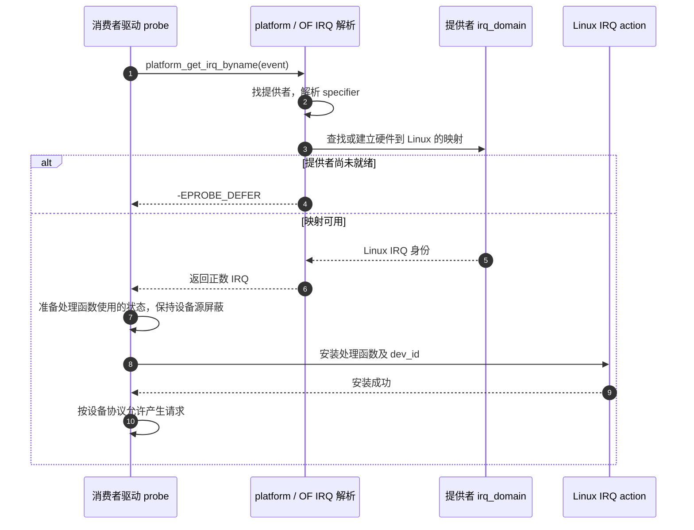

# 第5章\_中断连接怎样成为驱动可用的IRQ

## 5.1\_能访问设备还不等于知道事件从哪里来

**讲解层次：概念层，设备树中断连接。** [地址章](P04_地址单元与总线窗口转换.md#4.8_Linux怎样把描述交给MMIO驱动)已经把寄存器窗口交给驱动，但外设的事件请求走的是另一条线。CPU 的地址总线能访问设备，并不能据此推断设备连接到哪个中断控制器、哪一个输入以及怎样触发。

设备树因此同时需要表达 **中断提供者** 和 **该提供者约定的输入描述**。描述一个输入的若干 cell 称为 interrupt specifier。它不是全系统通用的中断号；只有先知道提供者，才知道每个 cell 应怎样解释。

本章沿“硬件接线 → 固件描述 → Linux IRQ 映射 → 驱动处理函数”推进。硬件中断状态、优先级与确认协议由 [GIC 专题](../../../../platforms/arm/architecture/gic/大纲.md) 负责；这里先建立驱动能够正确取得 IRQ 的条件。

## 5.2\_先确定提供者再解释那几个整数

一个中断控制器节点用 `interrupt-controller;` 声明这项角色，用 `#interrupt-cells` 声明它的输入描述占几个 cell。两个提供者都写 2，不代表两者第一个 cell 都是同一种编号；宽度相同不等于协议相同。

消费者通常通过 `interrupt-parent = <&intc>` 指向提供者，再在 `interrupts` 中写一个或多个 specifier。也可以沿父节点关系找到中断父级，但这里的中断层次不必与普通树的地址父子关系完全相同。

| 属性 | 写在谁身上 | 它解决的问题 |
| --- | --- | --- |
| `interrupt-controller;` | 提供中断输入的节点 | 声明该节点的控制器角色 |
| `#interrupt-cells` | 提供者 | 一个输入描述占几个 cell |
| `interrupt-parent` | 消费者或其可继承的上下文 | 这些描述由谁解释 |
| `interrupts` | 消费者 | 按提供者格式描述输入 |
| `interrupts-extended` | 消费者 | 每项把提供者 phandle 与其参数放在一起，支持不同父级 |
| `interrupt-names` | 消费者 | 给输入按顺序命名，供按名字获取 |

Linux 查找中断父级时，会检查显式 interrupt-parent，否则沿结构父节点继续，直到找到声明了 interrupt-cells 的节点。不能把“继承”简化成只在所有祖先中搜同名 interrupt-parent 字符串。

某些总线还使用 `interrupt-map` 将子设备的地址/中断描述组合映射到另一提供者。那是额外的 nexus 映射规则，不能只取一个 cell 跳过它。对普通驱动来说，使用框架解析接口正是为了不自行重复这些提供者规则。

## 5.3\_用GIC的SPI算一次完整编号

**讲解层次：具体 binding，Linux 6.12 的 arm,gic-v3。** 这里选择普通三 cell 的 GICv3 输入描述，不涉及扩展 SPI/PPI 或 PPI 分区。一个常见写法是：

```dts
/* 片段：gic 已由本 SoC 描述，且 #interrupt-cells = <3>。 */
interrupt-parent = <&gic>;
interrupts = <0 45 4>;
interrupt-names = "event";
```

按这一 binding，第一个 0 表示 SPI 类型；第二个 45 是 **SPI 类型内的索引**；第三个 4 表示电平触发。普通 SPI 从架构 INTID 32 开始，因此这里对应 INTID `32 + 45 = 77`。这三个数都还不是驱动最终接收到的 Linux IRQ。

| 三 cell 中的位置 | 普通 SPI 例子 | 普通 PPI 的对应规则 |
| --- | --- | --- |
| 类型 | 0，SPI | 1，PPI |
| 类型内索引 | 45，普通 SPI 允许 0～987 | 普通 PPI 允许 0～15 |
| 触发标志低位 | 4，电平；1 表示边沿 | 按 binding 与硬件支持选择 |

例如架构 INTID 30 若由普通 PPI 描述，类型内索引应是 `30 - 16 = 14`，不能写成 `<1 30 4>`。这只是编号换算，不能据此把 per-CPU timer 当作普通共享设备随意调用 `request_irq()`；它还有每 CPU 中断的安装与启停协议。

使用内核 DTS 构建时，可从相应头文件取得 `GIC_SPI`、`GIC_PPI`、`IRQ_TYPE_LEVEL_HIGH` 等宏，增强可读性。宏要经过预处理，本章数值片段是为了先把编码看清楚。GICv3 binding 还有四 cell 的 PPI affinity 形式以及扩展中断类型，只有控制器声明和硬件版本支持时才能使用，不能给三 cell 提供者随意多加一个数。

## 5.4\_GPIO控制器为何既消费中断又提供中断

按钮可能接到 GPIO 控制器的第 5 条输入线。GPIO 控制器检测边沿、记录本地状态，再用一条或多条汇聚输出通知上级中断控制器。按钮的直接提供者是 GPIO 控制器；GPIO 控制器自己的上级提供者才是 GIC。两层分别描述不同接线。


框表示硬件组件或软件执行入口，箭头区分引脚信号与软件分派。GPIO 控制器内部如何保存 pending、每条上级线覆盖哪些引脚，由芯片决定；不能假定所有 GPIO 控制器都只有一个上级 IRQ。

以 i.MX GPIO binding 为例，其子中断描述为两个 cell。本章只列一段 **已有 GPIO 提供者上下文中的消费者属性**，不把它与前节 GICv3 拼成某块实际 SoC：

```dts
/* 片段：gpio1 的 #interrupt-cells = <2>。 */
interrupt-parent = <&gpio1>;
interrupts = <5 2>;
```

这里是本控制器 line 5、下降沿。若换成 `<0 5 2>`，就错误地混进了 GIC 的类型 cell。反过来，把 interrupt-parent 改成 gic 也不会把按钮导线从 GPIO 接到 GIC；描述必须服从实际布线。

假设一个设备有两个独立事件输入，分别接到 gpio1 的 line 5 与 gpio2 的 line 8，可以在 **两者均为该两 cell 契约** 的前提下写：

```dts
interrupts-extended = <&gpio1 5 2>, <&gpio2 8 4>;
interrupt-names = "alarm", "ready";
```

每项都先选提供者，再消费该提供者要求的参数数量。两个 phandle 后面的参数个数不一定永远相同；示例相同是因为这两个提供者的契约相同。不要同时给出内容相互冲突的 interrupts 和 interrupts-extended，指望不同读取者替作者猜意图。

## 5.5\_触发方式描述的是哪一段电气行为

边沿触发识别变化，电平触发识别请求保持有效的状态。设备把中断线保持为有效电平时，软件只在控制器侧结束一次处理，仍可能再次收到请求，因为外设原因尚未解除。触发标志不能代替外设状态确认与清除。

| 通用 IRQ 类型常量 | 数值 | 描述的输入条件 |
| --- | --- | --- |
| `IRQ_TYPE_EDGE_RISING` | 1 | 上升沿 |
| `IRQ_TYPE_EDGE_FALLING` | 2 | 下降沿 |
| `IRQ_TYPE_EDGE_BOTH` | 3 | 双边沿 |
| `IRQ_TYPE_LEVEL_HIGH` | 4 | 高电平有效 |
| `IRQ_TYPE_LEVEL_LOW` | 8 | 低电平有效 |

上表是通用类型编码，不是每个控制器都支持的能力表。前述 GICv3 binding 的触发描述限定为 1 或 4；不能因为常量存在，就给它填下降沿或低电平。GPIO、外设输出与板上反相逻辑还可能使不同层看到不同极性，必须按每段连接分别核对。

`GPIO_ACTIVE_LOW` 描述 GPIO consumer 的逻辑有效电平，`IRQ_TYPE_EDGE_FALLING` 描述中断检测条件，二者数值和用途都不能互换。下一章会用一次输出动作具体说明逻辑值怎样转换成引脚电平。

## 5.6\_Linux把提供者描述转换成自己的IRQ身份

**讲解层次：实现层，NXP Linux 6.12.20。** 控制器驱动注册 irq_domain，把提供者的硬件编号空间关联到 Linux 管理对象。消费者调用 `platform_get_irq()` 或按名字获取时，OF 解析器先得到提供者及 specifier，再由相应 domain 转换并建立映射。

映射记录把硬件身份与 Linux IRQ 联系起来；IRQ action 则记录驱动处理函数、参数等运行责任。**取得映射与安装处理函数是两个步骤**，不能把前者成功理解成硬件已经能够安全触发驱动。



步骤 1～3 解决编号和提供者关系；步骤 4 是可恢复的依赖未就绪，而不是适合改成 ENODEV 的永久失败。成功分支在步骤 7 先准备状态，是因为安装处理函数后中断可能立即发生，不能等 request 返回后才初始化 handler 所需指针。

| 接口 | 返回/职责 | 当前使用边界 |
| --- | --- | --- |
| `platform_get_irq(pdev, index)` | 正数 Linux IRQ；失败为负错误 | 索引是该设备输入顺序，不是 GIC INTID |
| `platform_get_irq_byname(pdev, name)` | 按 interrupt-names 获取 | 名字必须与设备 binding 一致 |
| `of_irq_get(np, index)` | Linux IRQ；可能负错误，也可能 0 表示映射失败 | 直接使用时不能只检查 `< 0` |
| `request_irq()` / `request_threaded_irq()` | 安装 action，返回 0 或负错误 | 处理函数语义、上下文和共享条件必须正确 |
| `devm_request_irq()` / `devm_request_threaded_irq()` | 把 action 释放挂到设备资源管理 | 不替设备停止 DMA、清中断原因或取消 work |
| `free_irq(irq, dev_id)` | 移除匹配 action 并等待相关处理退出 | 只针对已成功申请的 action，不是“释放查询到的数字” |

对已经创建的 platform_device，优先使用 platform 接口。该版本 OF 平台枚举不把所有中断都预先填进资源数组；IRQ 获取路径可以延后解析与映射，故不能仅因 `platform_get_resource(..., IORESOURCE_IRQ, ...)` 没有结果就断定 DTS 没中断。

## 5.7\_错误回退和拆除要按真实依赖安排

以下是 `probe()` 中的 **IRQ 获取片段**。它只取身份，不假装提供一个不知道寄存器协议却永远返回 IRQ_HANDLED 的“完整驱动”。

```c
int irq;

/* event 是本设备 binding 规定的输入名称。 */
irq = platform_get_irq_byname(pdev, "event");
if (irq < 0)
    return dev_err_probe(&pdev->dev, irq, "无法取得 event IRQ\n");

/* 随后准备私有状态，安装匹配硬件协议的处理函数，再启用外设请求源。 */
```

`dev_err_probe()` 保留原错误并对延期探测作适当处理，不要吞掉 EPROBE_DEFER。真正 handler 必须读取本设备状态、判断是否属于自己、处理或记录事件，并按外设协议解除原因；共享线不属于自己的事件应返回 IRQ_NONE。具体寄存器与清除动作必须有设备手册依据。

拆除时先阻止新工作进入和新的设备请求，再等待在途 IRQ/线程及后续 work 完成，最后回收它们会访问的状态、MMIO 和电源。要区分“在设备侧屏蔽请求”与“删除 Linux action”：前者避免继续产生新请求，后者撤销软件回调责任，通常两者都需要。

devres 按登记顺序逆序释放资源，能减少失败分支中的重复代码，但它看不见驱动自建队列和硬件协议。例如 IRQ action 尚未释放就先切掉 handler 要访问的总线时钟，下一次 handler 访问寄存器可能失败。不能以“用了 devm”为理由省略 remove 阶段的静止化；若必须提前释放托管 action，应使用相应 devm 释放接口并保持登记一致。

普通查询函数取得 IRQ 后，不应为了“配对”随手调用 free_irq；尚未安装 action 就没有这项配对。低层显式创建/销毁 irq_domain 映射是另一项所有权协议，不能混入普通消费者的 request/free 生命周期。

## 5.8\_按四层证据定位没有中断的原因

调试前先预测应当在哪一层看到变化：描述层决定连接，映射层建立 Linux 身份，action 层安装处理函数，运行层才观察实际事件。将这些证据分开后，“没有计数”就不会立刻变成“中断号填错”。

| 观察 | 能支持的结论 | 下一步仍需检查 |
| --- | --- | --- |
| DTB/live tree 有 interrupts | 属性确实在该份描述中 | 提供者、cell 分组、实际接线 |
| `platform_get_irq()` 成功 | 已取得可用 Linux IRQ 身份 | action 是否安装成功 |
| `/proc/interrupts` 有对应 action 名 | Linux 已登记相应处理责任 | 硬件源是否启用、事件是否发生 |
| 计数增加 | 相应 IRQ 路径发生过活动 | 是否为本设备事件、数据是否正确处理 |

`/proc/interrupts` 的第一列是 Linux IRQ，不能要求它恰好等于 DTS 中的 45 或 GIC INTID 77。计数也不能证明串口数据已经读完；handler 逻辑与外设状态是另一层证据。

练习与答案：

1. GIC 普通 SPI 描述 `<0 45 4>` 对应哪个 INTID？**77。** Linux IRQ 需运行时获取，不能从这个表达式继续猜。
2. i.MX GPIO 两 cell 描述写成 `<0 5 2>` 有什么问题？**长度和语义混用了 GIC 规则。** 应按 GPIO 提供者解释，不从第三个数倒推格式。
3. 芯片只有 GPIO→GIC 的汇聚线，改 interrupt-parent 能否让按钮直达 GIC？**不能。** DTS 描述连接，不创建导线。
4. `of_irq_get()` 返回 0 能否继续 request？**不能。** 它可能表示映射失败，必须检查该接口自己的返回契约。
5. devm 请求成功后是否可直接在 remove 第一行释放 handler 状态？**不能。** 必须先停止请求及在途执行，资源管理不代替并发退出协议。

下一章 [GPIO 与引脚复用](P06_GPIO连接引脚复用与编号空间.md) 继续解释按钮和 LED 所在的引脚路径：GPIO 控制器本地偏移、pinctrl 引脚号和 Linux 描述符为什么又是不同身份。

## 5.9\_依据与验证边界

通用连接按 [DTSpec v0.4 Interrupt Mapping](https://github.com/devicetree-org/devicetree-specification/blob/v0.4/source/chapter2-devicetree-basics.rst)；GIC 例子按 NXP 固定提交的 [arm,gic-v3.yaml](https://github.com/nxp-imx/linux-imx/blob/dfaf2136deb2af2e60b994421281ba42f1c087e0/Documentation/devicetree/bindings/interrupt-controller/arm,gic-v3.yaml)；GPIO 两 cell 及上下级输入按 [fsl-imx-gpio.yaml](https://github.com/nxp-imx/linux-imx/blob/dfaf2136deb2af2e60b994421281ba42f1c087e0/Documentation/devicetree/bindings/gpio/fsl-imx-gpio.yaml)。

获取与返回值按同提交的 [drivers/of/irq.c](https://github.com/nxp-imx/linux-imx/blob/dfaf2136deb2af2e60b994421281ba42f1c087e0/drivers/of/irq.c) 和 [drivers/base/platform.c](https://github.com/nxp-imx/linux-imx/blob/dfaf2136deb2af2e60b994421281ba42f1c087e0/drivers/base/platform.c)。本文 DTS 均为明确给出提供者前提的属性片段，未冒充完整 SoC 描述；未执行板上 IRQ 映射、安装、触发或拆除实验。
