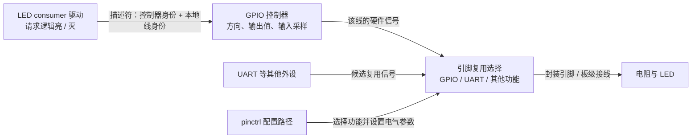
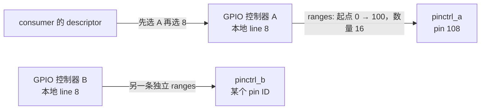

# 第6章\_GPIO连接引脚复用与编号空间

## 6.1\_控制器输出已经改变为什么灯还没亮

**讲解层次：概念到实现的映射。** 上一章沿 GPIO 输入追到上级 IRQ。现在反过来看输出：驱动要点亮一盏 LED，需要选对 GPIO 线、把它设为输出、给出有效逻辑值，还需要让芯片封装引脚实际连接到 GPIO 功能，而不是 UART 或其他外设。

这说明 GPIO 与 pinctrl 解决不同问题。**GPIO 控制器** 管理输入、输出和方向等线状态；**引脚控制器（pin controller）** 管理封装引脚的复用及电气配置，例如上下拉、驱动强度。有的芯片把这些功能放在同一块硬件里，有的分开，软件接口仍需要区分职责。



图中盒子表示功能职责，不宣称每个盒子都是独立物理 IP。若复用选择仍指向 UART，改变 GPIO 输出值也不能证明封装引脚已改变；若接线为低电平点亮，输出高也不会点亮。下面分别把这两个缺口补上。

## 6.2\_描述符从设备用途找到提供者的哪一条线

GPIO 提供者声明 `gpio-controller;` 和 `#gpio-cells`。常用的两 cell 契约把参数解释为“本控制器偏移、标志”，但最终仍以提供者 binding 为准。

```dts
/* 片段：gpio1 是已有、已核实的两 cell GPIO 提供者。 */
reset-gpios = <&gpio1 8 1>;
enable-gpios = <&gpio1 9 0>;
```

前一项选择 gpio1 的 line 8，标志 1 表示 active-low；后一项选择 line 9，标志 0 表示 active-high。内核 DTS 中宜包含 `dt-bindings/gpio/gpio.h` 后使用命名常量，这里用数字展示布局。

`reset` 与 `enable` 是消费者的用途名，驱动分别以 `"reset"`、`"enable"` 取得描述符；它们不是提供者的线名。新 binding 应为不同用途采用各自的 `<function>-gpios` 属性。裸 `gpios` 在 gpio-leds 等已有 binding 中仍然有明确用途，不能把它机械改名而不改契约。

| DTS 或 API 名称 | 角色 | 不能混同的对象 |
| --- | --- | --- |
| `&gpio1` | GPIO 提供者身份 | 不是全局 GPIO 起始号 |
| `8` | 该提供者内的线偏移 | 不是封装脚号、pinctrl pin ID 或 Linux IRQ |
| `GPIO_ACTIVE_LOW` | 消费者的有效电平语义 | 不是方向，也不是“申请时立即输出低” |
| `devm_gpiod_get(dev, "reset", ...)` | 按设备与用途查找并申请线 | 不会遍历所有孩子随意找名为 gpios 的属性 |
| `struct gpio_desc *` | 内核交给消费者的 opaque 句柄 | 不能伪造其内部字段或自行计算地址 |

descriptor 接口还可从 ACPI、软件节点或 lookup table 获得连接信息，并非只有设备树才能使用。这里的 DT 例子只是同一消费者 API 的一种固件后端。

## 6.3\_逻辑有效值怎样成为物理电平

假设板上 LED 在 GPIO 拉低时点亮。DTS 使用 ACTIVE_LOW，驱动仍以逻辑 1 表示“亮”，以逻辑 0 表示“灭”。这样更换为高电平点亮的板时，可以通过连接描述表达极性，而不让通用驱动到处写反相判断。

| 动作，使用普通逻辑接口 | ACTIVE_HIGH 的引脚电平 | ACTIVE_LOW 的引脚电平 |
| --- | --- | --- |
| `GPIOD_OUT_LOW` 取得并初始化 | 低，逻辑不活动 | 高，逻辑不活动 |
| `GPIOD_OUT_HIGH` 取得并初始化 | 高，逻辑活动 | 低，逻辑活动 |
| `gpiod_set_value_cansleep(desc, 1)` | 高 | 低 |
| `gpiod_set_value_cansleep(desc, 0)` | 低 | 高 |

此表假设普通推挽输出，且没有另行改变输出模式。开漏输出的“高”可能表示释放为高阻，由外部上拉形成实际高电平；不能把逻辑值表当作所有电气模式的驱动电压保证。板上还有反相器时，应按提供者引脚处的电平与消费者逻辑有效关系描述。

提供者采用通用 GPIO 标志布局时，还可能使用下列标志。它们只有在硬件与驱动支持时才有对应效果；复杂电气配置仍应放在 pinctrl binding 中表达。

| 标志 | 描述意图 | 需要额外核对 |
| --- | --- | --- |
| `GPIO_OPEN_DRAIN` | 开漏连接 | 高阻释放时的外部上拉与电压 |
| `GPIO_PULL_UP` / `GPIO_PULL_DOWN` | 请求简单上下拉配置 | 提供者是否支持，不能同时盲目叠加 |
| `GPIO_PERSISTENT` / `GPIO_TRANSITORY` | 低功耗时是否要求保持输出状态 | 芯片保持能力和电源管理实现 |

方向由 `GPIOD_IN`、`GPIOD_OUT_LOW/HIGH` 或后续方向接口设置。`GPIOD_ASIS` 保持原状，需要调用者已经知道后续如何建立正确方向。方向设置与初始值一起完成有助于避免先切输出、后改值造成短暂毛刺，但真实电气无毛刺保证还取决于硬件和启动阶段。

SoC MMIO GPIO 与挂在 I2C/SPI 上的扩展 GPIO，在访问代价上不同。后者可能必须等待总线事务，因而需要允许睡眠的上下文和 `_cansleep` 接口；不能在硬中断里为了“读一个位”直接调用它。`gpiod_cansleep()` 可查询提供者属性，线程化中断或普通进程上下文通常能承接可睡眠访问。

## 6.4\_pinctrl状态为整个用途选择一组引脚配置

一个设备使用的引脚可能在正常工作与休眠时需要不同配置。逐个在驱动里写 SoC 复用寄存器，会把板级选择混进通用驱动。pinctrl 把一组配置命名为状态，消费者引用状态，提供者按自己的 binding 解释具体 pad 或 pin 配置。

```dts
/* 片段：这两个标签须由实际 SoC 的 pinctrl 描述提供。 */
pinctrl-names = "default", "sleep";
pinctrl-0 = <&device_default_pins>;
pinctrl-1 = <&device_sleep_pins>;
```

名字数组的第 0 项对应 pinctrl-0，第 1 项对应 pinctrl-1。每个状态可以引用多个配置节点，也可以覆盖多个引脚控制器。`default` 是设备绑定路径常用状态；是否自动选择其他状态以及何时切换，仍要看驱动和电源管理路径，不能因为写了 sleep 就断言所有设备会自动休眠切换。

配置节点应放在真实提供者要求的位置，内容遵守该芯片 binding。i.MX 的 IOMUXC 描述与其他厂商的 `pins`/`function` 形式可能不同；不能在根下凭空新增一个 `pinctrl` 节点并填写猜测的 pad 值。

| 配置层 | 例如控制什么 | 证据来源 |
| --- | --- | --- |
| consumer 状态引用 | 哪个设备何时需要哪组 pin 配置 | consumer binding 与驱动路径 |
| pinmux | 封装引脚连接 GPIO 还是外设功能 | SoC pinctrl binding 与复用表 |
| pinconf | 上下拉、驱动强度等 | SoC binding、手册与板级电气条件 |
| GPIO 方向与值 | 已取得线的输入/输出和逻辑状态 | GPIO API 与提供者能力 |

这些配置共同决定最终信号，但并不互相替代。GPIO 方向正确，不能证明复用正确；pinctrl 已选 GPIO，也不能证明消费者已经申请并设置了线。

## 6.5\_gpio-ranges连接的是两个局部编号空间

GPIO 子系统申请 line 8 时，有时还需要通知 pinctrl：“我要使用与这条线对应的那个 pin”。两套控制器的编号未必相同，所以必须有一张对应关系。`gpio-ranges` 就表达这种关系，**不负责分配 Linux 全局 GPIO 编号**。

普通数值形式写在 GPIO 提供者节点内：

```dts
/* 片段：本 GPIO 控制器 line 0..15 对应 pinctrl_a 的 pin 100..115。 */
gpio-ranges = <&pinctrl_a 0 100 16>;
```

| 字段 | 本例 | 编号空间 |
| --- | --- | --- |
| pinctrl phandle | `&pinctrl_a` | 目标引脚控制器身份 |
| GPIO 起始偏移 | 0 | 当前 GPIO 控制器内 |
| pinctrl 起始偏移 | 100 | 指定 pinctrl 控制器内 |
| 连续数量 | 16 | line 0～15 与 pin 100～115 一一对应 |

本控制器 line 8 对应 `100 + (8 - 0) = 108`。108 是 pinctrl_a 的 pin ID，不是全 SoC 统一脚号，更不是 `/dev/gpiochipN` 中的 N 或 Linux 旧 GPIO 整数。缺少 gpio-ranges 也不自动意味着发生“全局号冲突”；可能有另一种映射建立方式，具体取决于提供者。



两个控制器都可以有 line 8，因为身份包含提供者。把这两项都放进一个只以整数 8 为 key 的全局数组，会丢掉所属控制器，正是应由现有 GPIO 框架避免的问题。

一个 GPIO 控制器也能分段对应不同 pinctrl：

```dts
gpio-ranges = <&pinctrl_a 0 20 10>,
              <&pinctrl_b 10 50 20>;
```

line 8 对应 pinctrl_a 的 pin 28；line 12 对应 pinctrl_b 的 pin 52。每段的 phandle 不能省略，不能把四字段格式写成“全局起点、局部起点、长度”三字段简写。

命名 pin group 形式使用 `gpio-ranges-group-names`，其对应项的 pinctrl 起点和数量写 0，由提供者的命名组决定引脚集合；与数值段混用时，数值段的组名项为空字符串。这里的 0 是该命名组契约的一部分，不能拿来证明普通数值段的数量可以省略。

线总数也不能直接从第一项 ranges 的数量得到。控制器可能有多段、保留洞或只映射部分线；`ngpios`、`gpio-reserved-ranges`、硬件能力及驱动注册规则承担的是另一组约束。

## 6.6\_一组输入跨多个GPIO提供者时怎样读取

现在把三根同用途的数据输入线接到两个控制器：A 的 line 8、B 的 line 3、A 的 line 12。原本容易想到自行解析 phandle、建立全局号表再换算；那会重复 gpiolib 已有工作，还容易把 pinctrl pin ID 当成 GPIO 号。

消费者只需按用途保持数组顺序。下段属于板级 DTS 的集成片段，gpio_a、gpio_b 必须在真实平台中存在，三根线须确认可作为输入且没有其他占用：

```dts
input-sampler {
    compatible = "linux-note,gpio-input-sampler";
    data-gpios = <&gpio_a 8 0>,
                 <&gpio_b 3 0>,
                 <&gpio_a 12 0>;
};
```

这是教学 binding，约定恰好三根同用途输入；不是已提交上游的硬件描述。不同用途的 reset/enable 应分开命名，不能为了凑数组把它们都叫 data。

下面的完整 `gpio_input_sampler.c` 只在 probe 中申请三根输入并采样一次，不创建字符设备，不产生异步工作。GPIO 与 pinctrl 配置仍须由平台正确提供；代码可作为目标内核的外部模块构建输入，不表示已经在本次环境中构建或运行。

```c
#include <linux/module.h>
#include <linux/platform_device.h>
#include <linux/gpio/consumer.h>
#include <linux/of.h>
#include <linux/err.h>

static int gpio_input_sampler_probe(struct platform_device *pdev)
{
    struct device *dev = &pdev->dev;
    struct gpio_descs *inputs;
    unsigned int index;
    int value;

    /* data 对应 data-gpios；框架保留每项的提供者与局部线身份。 */
    inputs = devm_gpiod_get_array(dev, "data", GPIOD_IN);
    if (IS_ERR(inputs))
        return dev_err_probe(dev, PTR_ERR(inputs), "无法取得数据输入线\n");
    if (inputs->ndescs != 3)
        return dev_err_probe(dev, -EINVAL, "教学连接必须恰好包含三根输入线\n");

    for (index = 0; index < inputs->ndescs; index++) {
        /* probe 可睡眠；也适用于需要总线事务的 GPIO 扩展器。 */
        value = gpiod_get_value_cansleep(inputs->desc[index]);
        if (value < 0)
            return dev_err_probe(dev, value, "输入采样失败\n");
        dev_info(dev, "数据输入 %u 的逻辑值为 %d\n", index, value);
    }
    return 0;
}

static const struct of_device_id gpio_input_sampler_matches[] = {
    { .compatible = "linux-note,gpio-input-sampler" },
    { }
};
MODULE_DEVICE_TABLE(of, gpio_input_sampler_matches);

static struct platform_driver gpio_input_sampler_driver = {
    .probe = gpio_input_sampler_probe,
    .driver = {
        .name = "gpio_input_sampler",
        .of_match_table = gpio_input_sampler_matches,
    },
};
module_platform_driver(gpio_input_sampler_driver);

MODULE_LICENSE("GPL");
MODULE_DESCRIPTION("按用途数组读取三根 GPIO 输入的教学模块");
```

数组句柄由 devres 随设备解除绑定或探测失败释放，不能再逐个 `gpiod_put()` 数组中的成员。若只需要第二根，可用 `devm_gpiod_get_index(dev, "data", 1, GPIOD_IN)`；索引 1 表示属性的第二项，框架会选到 B 的 line 3，无需驱动知道它的全局编号。

### 6.6.1\_构建与观察需要哪些前提

把源码与下面的 `Makefile` 放在同一模块目录。目标内核应启用所需 OF/GPIOLIB 及提供者驱动，并准备好与运行内核一致的构建树；`KERNEL_BUILD` 和 `CROSS_COMPILE` 由实际目标环境设置，不使用主机 `/lib/modules` 猜测开发板版本。

```makefile
obj-m += gpio_input_sampler.o
```

在该目录执行：

```bash
make -C "$KERNEL_BUILD" M="$PWD" ARCH=arm CROSS_COMPILE="$CROSS_COMPILE" modules
```

这条命令针对本专题 i.MX ARM 目标；换体系结构时须调整 ARCH 与工具链。构建成功后，按目标板既有方式部署模块和合并过的板级 DTB，重新确认实际 live tree。加载模块后，成功路径预期打印三条 **索引与逻辑值**，不是 GPIO 全局号或 pinctrl pin ID。实际 0/1 取决于引脚电平，不预先伪造一组“实测输出”。

卸载模块后不再保留描述符；本例没有后台回调。若扩展成周期采样、IRQ 或用户文件接口，必须先建立相应退出协议，不能沿用“无 remove 也够用”的结论。

## 6.7\_LED优先采用已有子系统并把属性放对节点

如果需求只是控制 GPIO LED，Linux 已有 gpio-leds 驱动。它把每个 LED 描述为子节点，并在该子节点读取 gpios。这与“自定义 platform 驱动在父设备上调用 devm_gpiod_get”不同，后者不会自动替你进入任意孩子。

```dts
/* 板级片段：gpio1 与 board_led_pins 均须来自已核实的平台描述。 */
leds {
    compatible = "gpio-leds";
    pinctrl-names = "default";
    pinctrl-0 = <&board_led_pins>;

    led-0 {
        gpios = <&gpio1 8 1>;
        label = "status";
        default-state = "off";
    };
};
```

此处采用现有 binding 的 `gpios` 与 `label` 写法；新产品命名还可按 LED common binding 使用 color/function。选择哪一个具体 pinctrl 配置，必须依据板上 LED 接线与 SoC 复用表，不能从 line 8 猜到一个 pad 宏。

内核需要 `CONFIG_LEDS_GPIO` 及相关 GPIO/pinctrl 驱动。部署后先查实际创建的 `/sys/class/leds/`，再操作已确认的 LED：读取 `max_brightness`，向 `brightness` 写 0 关闭、写该上限值点亮；若有 trigger 正在控制，先保存原 trigger 并切到 none，观察后恢复原设置。ACTIVE_LOW 时，“点亮”由驱动转成低电平，用户态无需再手工反相。

这条路径不创建自定义 `/dev/myled`，也不要求复制一套 cdev。若学习目标确实是字符设备文件协议与硬件生命周期，请继续 [字符设备与 LED 完整实验](../../../../labs/platforms/nxp/imx6ull/drivers/P01_LED点灯/P03_字符设备_LED与设备树完整实验.md)。那里必须另外处理旧 fd、解绑和并发访问；一份 devm GPIO 句柄不能保证打开的文件在设备移除后仍可安全使用。

## 6.8\_旧整数接口与中断转换各有什么边界

旧代码中的 `of_get_named_gpio()` 解析并返回传统 GPIO 整数，**不会替调用者完成请求和方向配置**。后续还需按旧 API 申请、检查方向设置结果，并在失败及退出路径释放。现代 consumer 应优先使用描述符，不能把“旧接口不推荐”写成“所有内核都返回 ENOSYS”。

| 需求 | 合适入口 | 失败与生命周期 |
| --- | --- | --- |
| 必须有一条用途线 | `devm_gpiod_get()` | 错误指针必须传播，包括 EPROBE_DEFER |
| binding 允许省略的用途线 | `devm_gpiod_get_optional()` | 区分 NULL 与错误指针；不能把所有错误当缺省 |
| 同用途的第 N 项 | `devm_gpiod_get_index()` | N 是消费者列表索引 |
| 同用途整组线 | `devm_gpiod_get_array()` | 用数组句柄整体释放 |
| 已持有输入描述符，取得中断身份 | `gpiod_to_irq()` | 仍需检查返回值、安装 action 和正确退出 |
| 从特定子节点读取连接 | 对应 fwnode/子节点 GPIO 接口 | 显式选择节点并遵守其引用契约 |

GPIO 输入能力不保证该线可作为 IRQ。`gpiod_to_irq()` 也不设置全部触发条件或安装 handler；若设备 binding 已直接提供 interrupts，可按 [上一章的提供者解析流程](P05_中断连接怎样成为驱动可用的IRQ.md#5.6_Linux把提供者描述转换成自己的IRQ身份) 获取。不能把 GPIO 本地偏移直接送给 `request_irq()`。

GPIO provider 驱动负责注册 `gpio_chip` 并实现方向、读写等回调，consumer 只取得描述符。不能在 consumer 教程里伪造一个只有 reg 和 ngpio、没有真实回调的“完整 GPIO 控制器”，也不能通过向 pdev->resource[0] 写入数据来假定资源数组存在。平台资源与总线绑定的完整入门流程已经在 [前两章](P02_设备树驱动开发方式.md#2.3_用一个只读属性的节点建立最小匹配例子) 建立。

## 6.9\_沿一次失败把编号和动作逐层核对

当 LED 不亮或输入一直不变，先核对 live tree 中的 consumer 节点与用途属性，再看提供者是否绑定、描述符是否申请成功、复用与电气配置、方向和极性，最后检查真实接线。启用相应调试配置并挂载 debugfs 时，GPIO/pinctrl 调试文件可辅助观察占用和配置；它们不是稳定用户 ABI，也不能代替电压测量。

练习与答案：

1. `gpio-ranges = <&pinctrl_a 0 100 16>`，line 8 对应什么？**pinctrl_a 的 pin 108。** 不能继续称它为 Linux GPIO 108。
2. ACTIVE_LOW 的 LED 以 GPIOD_OUT_LOW 初始化，会点亮吗？**在本章低电平点亮的推挽场景中不会。** 初始逻辑 0 对应物理高。
3. `data-gpios` 三项跨两个提供者，驱动要自己合成全局编号吗？**不需要。** 用描述符数组或 index 接口保留提供者身份。
4. gpios 在 LED 子节点，父设备上的普通 get 能自动找到吗？**不能作此假设。** gpio-leds 使用自己的子节点读取流程；自定义驱动须显式选择正确节点。
5. 取得 GPIO、转换 IRQ、安装 action、解除外设原因，是不是同一个动作？**不是。** 它们分别完成线所有权、身份映射、软件回调安装和设备协议处理。

现在已经能把一个逻辑动作追到具体线和 pin，但设备可能仍因没有电源而毫无反应。下一章 [供电关系与启停责任](P07_供电关系电压约束与启停责任.md) 解释为什么“连接到哪一路电源”与“谁有权关掉这路电源”还要分开描述。

## 6.10\_依据与验证范围

按 NXP Linux 6.12.20 固定提交核对 [GPIO binding](https://github.com/nxp-imx/linux-imx/blob/dfaf2136deb2af2e60b994421281ba42f1c087e0/Documentation/devicetree/bindings/gpio/gpio.txt)、[pinctrl binding](https://github.com/nxp-imx/linux-imx/blob/dfaf2136deb2af2e60b994421281ba42f1c087e0/Documentation/devicetree/bindings/pinctrl/pinctrl-bindings.txt)、[GPIO consumer API](https://github.com/nxp-imx/linux-imx/blob/dfaf2136deb2af2e60b994421281ba42f1c087e0/Documentation/driver-api/gpio/consumer.rst) 和 [gpio-leds binding](https://github.com/nxp-imx/linux-imx/blob/dfaf2136deb2af2e60b994421281ba42f1c087e0/Documentation/devicetree/bindings/leds/leds-gpio.yaml)。

本章的示例面向 consumer，控制器内部实现由 GPIO 专题承担。未完成目标 Kbuild、模块加载、GPIO/pinctrl 状态或板上电平测量，不把接口静态核对当成硬件实验成功。
