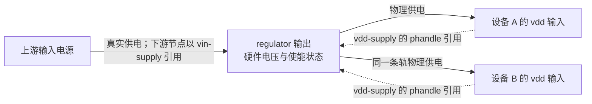
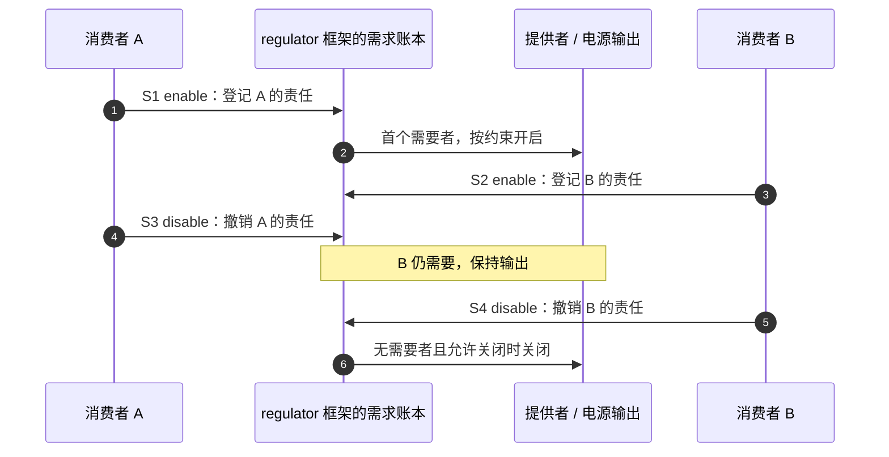

# 第7章\_供电关系电压约束与启停责任

## 7.1\_谁决定一条共享电源轨可以关闭

**讲解层次：概念层，供电提供者与消费者。** 前面已经为外设找到地址、中断和引脚。假设两个外设还共用一条 3.3 V 电源轨：设备 A 空闲时直接拉低电源使能 GPIO，会同时切断仍在工作的设备 B。仅知道电源开关在哪里，还不足以决定自己是否有权关掉它。

Linux regulator 框架把 **电源输出的控制能力** 与 **消费者对供电的需求** 分开。提供者驱动知道怎样使能、设压和查询；消费者按自己的供电用途取得句柄并提交请求。框架汇总共享需求，在板级约束与硬件能力允许时调用提供者。

regulator 可以是固定电压电源、可调电压输出、PMIC 中的一路电源，也可能由固件代理控制。描述它不要求每一路都有独立 MMIO reg；PMIC 可能通过 I2C/SPI 访问，多路输出作为其子节点，由 PMIC 驱动解释。把任意电源型号都画成根下 `regulator@某物理地址`，会把访问总线和输出身份混为一谈。

## 7.2\_连接关系先于电压参数

板上某条输出叫 `vdd_3v3`，外设把它作为自己的 `vdd` 输入。前者是源码标签，后者是 consumer binding 中的用途。驱动调用 `devm_regulator_get(dev, "vdd")` 时，DT 后端查找的是该设备的 `vdd-supply`，不是拿字符串去全树寻找相同的 regulator-name。

以下是完整离线 `supply_demo.dts`。它描述一条始终需要保持供电的固定 3.3 V 轨及一个教学消费者，不代表实际板的电源电路，也不提供可调压能力。

```dts
/dts-v1/;

/ {
    model = "linux-note offline supply example";
    compatible = "linux-note,supply-demo-board";
    #address-cells = <1>;
    #size-cells = <1>;

    vdd_3v3: regulator-3v3 {
        compatible = "regulator-fixed";
        regulator-name = "board-3v3";
        regulator-min-microvolt = <3300000>;
        regulator-max-microvolt = <3300000>;
        regulator-always-on;
    };

    supply-consumer {
        compatible = "linux-note,supply-demo";
        vdd-supply = <&vdd_3v3>;
    };
};
```

`regulator-name` 是供阅读和诊断的输出名称，phandle 才承担此处的连接引用。两个名字相同不应被用来代替显式连接，改显示名称也不应迫使消费者改自己的 `vdd` 用途。

多个供电输入应分别写清，例如 `vdd-supply`、`vddio-supply`；名字由设备 binding 决定，不能随意互换成 `vcc`。普通 consumer 也不能假定父节点有 vdd-supply 就自动继承给全部孩子，特殊查找规则须由具体 binding/实现支持。



实线是电源流向，虚线是消费者描述中的引用方向。供电树与 DT 节点父子树不必相同。`vin-supply` 用于描述某个 regulator 自己的上游输入，使框架能够处理级联依赖；它也不是给下游任意设备自动继承的属性。

## 7.3\_约束写出了允许范围并没有创造硬件能力

可调 regulator 可能只支持一组离散电压。板级约束进一步限定安全范围，消费者再提出本次可以接受的范围。只有三者存在可实现交集，调压请求才可能成功。把 max 改大不会让芯片多出一个电压档位，也可能越过板上器件的耐压。

例如硬件支持 1.8/2.5/3.3 V，板级允许 1.8～2.5 V，消费者要求 2.4～2.6 V，可选结果只有 2.5 V。若另一个共享消费者同时只接受 1.8 V，两个要求无法同时满足，不能静默任选一个让另一设备冒险工作。

| 常用属性 | 单位或类型 | 当前用途与边界 |
| --- | --- | --- |
| `regulator-min-microvolt` / `regulator-max-microvolt` | µV | 板级允许范围；固定输出常写成相同值 |
| `regulator-min-microamp` / `regulator-max-microamp` | µA | 可请求的电流限制范围，不是实测负载 |
| `regulator-name` | 字符串 | 输出描述名称，不是 supply 查找键 |
| `regulator-boot-on` | 存在性属性 | 预期固件已开启；必要时 OS 在启动时开启，仍允许后来关闭 |
| `regulator-always-on` | 存在性属性 | 约束正常管理过程不关闭该输出 |
| `regulator-ramp-delay` | **µV/µs** | 电压变化速率，不是等待多少微秒 |
| `regulator-enable-ramp-delay` | µs | 开启后达到目标容差所需的系统稳定时间 |
| `regulator-settling-time-us` | µs | 电压改变的稳定时间，适用于相应硬件模型 |
| `regulator-initial-mode` | 提供者定义的枚举 | 初始模式；不是任意通用 regulator-mode 数字 |
| `regulator-allowed-modes` | 提供者定义的枚举列表 | 允许请求的模式集合 |
| `regulator-max-step-microvolt` | µV | 单步安全变化上限，不代表硬件电压步进分辨率 |
| `regulator-system-load` | µA | 未由 consumer 请求覆盖的系统负载 |

若速率为 10000 µV/µs，变化 100000 µV 的理想爬升时间为 10 µs；实际还要考虑提供者模型与稳定时间。把 ramp-delay 的数值当微秒会得到错误时序。是否支持某项约束也要核对具体驱动，不能因为通用 Schema 有这个字段就假定所有提供者都会编程它。

固定 regulator 的 GPIO 开关使用自己的 binding：`gpio`/`gpios`、`enable-active-high`、`startup-delay-us`、`off-on-delay-us` 等。尤其 enable-active-high 有历史极性语义，不能不看 fixed-regulator 规则，就套用上一章任意 `<function>-gpios` consumer 的全部假设。真实 PMIC 的调压模式编码同样应使用其专门 binding。

## 7.4\_取得句柄使能输出和读取电压是三个动作

**讲解层次：实现层，Linux regulator consumer API。** `devm_regulator_get()` 取得的是消费者句柄，供后续请求与释放使用，不等于执行了 regulator_enable。句柄释放也不自动抵消通过普通 regulator_enable 建立的每一次启用责任。

| API | 完成的动作 | 调用者仍需承担什么 |
| --- | --- | --- |
| `devm_regulator_get(dev, "vdd")` | 取得设备用途对应的句柄，托管 put | 检查错误、后续 enable/disable 配对 |
| `regulator_set_voltage(r, min, max)` | 请求可接受的电压范围 | 检查返回值，遵守器件调压时机 |
| `regulator_enable(r)` | 为该消费者建立启用需求 | 成功后最终配对 disable |
| `regulator_disable(r)` | 释放本消费者的一次启用需求 | 检查错误；不能假定共享轨必然物理关闭 |
| `regulator_get_voltage(r)` | 查询配置/报告的电压 | 不证明输出已开启，也不等于示波器测量 |
| `regulator_is_enabled(r)` | 查询框架/提供者报告的开启状态 | 不是本消费者已持有 enable 责任的计数替代 |
| `regulator_set_load(r, load_uA)` | 提交消费者负载需求，辅助模式选择 | 根据真实工作点更新，不是设电压 |

固定输出对匹配其能力的 set_voltage 请求可能返回成功；不能一概说固定 regulator 调压调用必然 EINVAL。反过来，get 成功也未必证明 DT 连接无误：某些普通获取路径在缺少真实供电映射时会返回 dummy regulator 并打印警告。必须结合 binding、实际提供者与日志确认，不能把所有缺失情况都写成 ENOENT。

`regulator-always-on` 也不是要求驱动不再配对请求。消费者应释放自己的责任，框架再按约束决定是否真正关闭；不能预先断言 disable 一定返回 EPERM 后把错误忽略。

## 7.5\_两个消费者怎样交接共享输出的启停责任

下面限定 A、B 各启用一次，输出初始关闭、允许关闭、没有其他消费者和强制保持条件。这样才能把共享需求与物理开关清楚对应，不能把这个简化计数表推广成所有内核内部计数恒等式。

| 阶段 | 动作 | A/B 的启用责任 | 框架应维持的物理状态 |
| --- | --- | --- | --- |
| S0 | 都已 get，尚未 enable | 0 / 0 | 关闭 |
| S1 | A enable 成功 | 1 / 0 | 开启 |
| S2 | B enable 成功 | 1 / 1 | 继续开启 |
| S3 | A disable 成功 | 0 / 1 | 保持开启，B 仍依赖它 |
| S4 | B disable 成功 | 0 / 0 | 条件允许时关闭 |



步骤 1～3 建立共享需求，步骤 4 只撤销 A 的一份责任，步骤 5～6 才可能关闭输出。NXP Linux 6.12.20 中，消费者 `struct regulator` 保存自己的 enable_count，提供者 `struct regulator_dev` 汇总活动消费者等状态；这些是框架内存中的账本，硬件开关由提供者回调兑现，不能让 consumer 绕开它直接改使能 GPIO。

代价是框架查找、锁与提供者访问，以及对共享电源约束的协调。若确实是板上常供电轨，可以按其 binding 声明固定/always-on；若需要按工作负载省电，则通过平衡请求管理。强制关闭接口会影响其他消费者，只适合有明确紧急语义的路径，不能拿来修复自己遗漏的 disable。

## 7.6\_多路电源按器件顺序启用并回滚

假设某器件手册要求 core 先于 io，关闭时反序；下面只展示这个 **已给定时序** 下的驱动函数，不是所有外设的通用上电次序。private state 在 probe 中分配，两个句柄分别按 `core-supply`、`io-supply` 取得，使用前已满足器件电压与稳定时间约束。

```c
#include <linux/device.h>
#include <linux/regulator/consumer.h>

struct example_power {
    struct device *dev;
    struct regulator *core;
    struct regulator *io;
};

/* 前提：尚未启用本实例的两路责任，硬件工作还没有开始。 */
static int example_power_on(struct example_power *power)
{
    int ret;
    int rollback_ret;

    ret = regulator_enable(power->core);
    if (ret)
        return ret;
    ret = regulator_enable(power->io);
    if (!ret)
        return 0;

    /* io 失败，只回滚已经成功的 core；保留最初的失败原因。 */
    rollback_ret = regulator_disable(power->core);
    if (rollback_ret)
        dev_err(power->dev, "core 回滚失败：%d\n", rollback_ret);
    return ret;
}
```

返回 0 后，调用者才可继续解除复位、启动通信并发布用户入口。失败时不得继续工作；回滚也失败则要保留并报告“物理/框架状态未完全恢复”的事实，不能声称系统已回到 S0。若电源控制需要可恢复重试，私有状态还要跟踪各路是否仍持有责任，而不是无条件重复 enable。

正常退出先停止新请求、IRQ、DMA 和工作队列对设备的访问，再按器件规定顺序 disable 成功启用的各路，最后释放句柄。若多个电源没有顺序要求，可以考虑 bulk API；若有特殊延迟、复位依赖或回滚条件，必须在本地把完整过程写清。`devm_regulator_get_enable()` 等复合辅助接口确实可以托管启停，但也不能代替设备异步执行的停止过程。

CPU 动态调压调频还涉及电压与频率的安全关系：常见路径是升频前先满足电压，降压前先降低频率，但实际由目标 OPP、硬件及相应驱动管理，不应在普通外设 probe 中凭经验复制一套 DVFS 时序。

## 7.7\_power-domains为何不能用supply替代

regulator 描述电源输出与消费者供电连接；power-domains 引用的是电源域提供者，由其管理一组硬件的上电、隔离、保持或相关状态。一个外设可能既有 vdd-supply，又属于某个电源域：外部供电存在不意味着片内域已经打开，域打开也不意味着外部引脚供电正确。

电源域的 `#power-domain-cells` 与 specifier 由该提供者 binding 决定，不能拿 regulator 的单 phandle 格式去猜。这里先确定两条连接的职责边界，不把未解释的域状态机混进 regulator 属性表。

## 7.8\_先做离线连接检查再观察实际供电

在 supply_demo.dts 所在目录执行：

```bash
dtc -I dts -O dtb -o supply_demo.dtb supply_demo.dts
fdtget -t x supply_demo.dtb /supply-consumer vdd-supply
fdtget -t x supply_demo.dtb /regulator-3v3 phandle
fdtget -t u supply_demo.dtb /regulator-3v3 regulator-min-microvolt
```

两个引用数值应相等，电压约束应为 3300000。这只确认编码和连接；不能由离线编译得出板上输出已经是 3.3 V。目标平台部署后，还要核对 live tree、提供者绑定、consumer 的请求返回值、相关 regulator 调试信息，以及需要时的实际电压测量。调试接口依赖内核配置，读取到软件电压值也不替代电气证据。

练习与答案：

1. regulator-name 改名后必须同步把驱动 `"vdd"` 改掉吗？**不需要据此修改。** 驱动用途名对应 vdd-supply，引用通过 phandle 建立。
2. boot-on 能否保证运行期永不关闭？**不能。** 它与 always-on 表达不同约束。
3. A disable 后共享轨仍开启是否说明配对失败？**不一定。** B、always-on 或其他约束仍可能要求保持供电。
4. 把 regulator-ramp-delay 写成 200，能否解释为等待 200 µs？**不能。** 单位是 µV/µs，应结合电压变化与其他稳定时间计算。
5. devm get 成功，probe 中手工 enable，remove 中只等 devres put 是否足够？**不够。** 必须平衡启用责任并先停止依赖电源的工作。

供电条件成立后，外设还可能缺少驱动内部状态机前进的时钟。下一章 [时钟连接与使能计数](P08_时钟连接频率请求与使能计数.md) 继续区分来源连接、频率请求和启停责任。

## 7.9\_依据与验证边界

属性按 NXP 固定提交的 [regulator.yaml](https://github.com/nxp-imx/linux-imx/blob/dfaf2136deb2af2e60b994421281ba42f1c087e0/Documentation/devicetree/bindings/regulator/regulator.yaml) 与 [fixed-regulator.yaml](https://github.com/nxp-imx/linux-imx/blob/dfaf2136deb2af2e60b994421281ba42f1c087e0/Documentation/devicetree/bindings/regulator/fixed-regulator.yaml)，消费者操作按 [regulator consumer 文档](https://github.com/nxp-imx/linux-imx/blob/dfaf2136deb2af2e60b994421281ba42f1c087e0/Documentation/power/regulator/consumer.rst)。

共享计数、dummy 获取和启停行为按同提交的 [drivers/regulator/core.c](https://github.com/nxp-imx/linux-imx/blob/dfaf2136deb2af2e60b994421281ba42f1c087e0/drivers/regulator/core.c) 核对。本文不提供虚构 PMIC 寄存器地址，不声称离线 DTS 或静态 C 片段已经完成目标内核构建、上电时序或板上电压验证。
