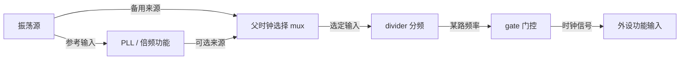
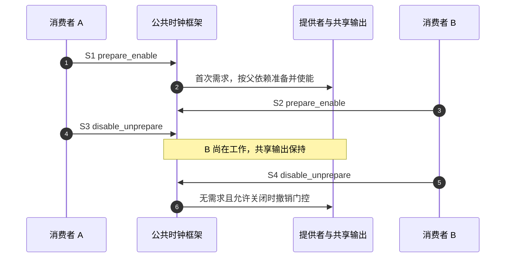

# 第8章\_时钟连接频率请求与使能计数

## 8.1\_外设有电以后还要由什么推进状态

**讲解层次：概念层，时钟来源与消费者。** [供电章](P07_供电关系电压约束与启停责任.md#7.5_两个消费者怎样交接共享输出的启停责任)已经建立共享供电的责任，但通电的 UART、SPI 控制器还需要时钟推进内部状态机。有的设备有两路输入：一路用于寄存器总线接口，另一路用于功能逻辑。只打开其中一路，寄存器可能可访问而通信仍不能进行。

时钟树的作用是把振荡源经过选择、倍频、分频和门控，送给各消费者。PLL 可以产生所需频率，mux 选择父来源，divider 调整比例，gate 决定是否传递时钟。它们是硬件功能，不要求每个功能都在 DTS 中单独成为一个节点；一个时钟控制器驱动可以在 C 中注册内部整棵树，再向 DTS 暴露编号化输出。



这是角色图，不是某个 SoC 的电路布局。真正选择哪个父时钟、分频值和门控位，需要芯片 binding 与提供者驱动兑现。DTS 负责表达连接和适当的初始配置，不会凭一个 compatible 字符串产生一套原本不存在的 PLL 电路。

## 8.2\_先把外设输入连到提供者输出

提供者用 `#clock-cells` 说明一次输出选择需要几个参数。单输出常用 0，只写 phandle；多输出常用 1，再跟一个输出 ID。这个数字是 **参数数量**，不是“该控制器只有几个时钟”，也没有一条通用规则说两个 cell 必然表示“编号与相位”。

消费者的 `clocks` 按顺序列输入连接，`clock-names` 按同顺序给这些输入命名。驱动用名字取自己的输入，不直接读取提供者的显示名称。

| 属性 | 所在角色 | 解释 |
| --- | --- | --- |
| `#clock-cells` | 提供者 | 一个输出 specifier 的参数数目 |
| `clock-output-names` | 提供者，按其 binding 使用 | 输出描述名称，不是 consumer 查找键 |
| `clock-indices` | 适用的提供者 | 将非连续输出 ID 对应到 output-names 项 |
| `clocks` | 消费者 | 提供者 phandle 与该提供者规定的参数 |
| `clock-names` | 消费者 | 驱动所用的输入名称与列表顺序 |
| `clock-ranges` | 有相应约定的总线节点 | 允许孩子继承该节点的命名时钟，不能默认所有时钟都会继承 |

例如一个 one-cell 提供者以 ID 3 和 7 暴露两个输出，消费者写 `<&clock_controller 7>` 时，7 是其输出 ID；不能无视 clock-indices，直接取 output-names 数组的第 7 项。若本设备把该输入命名为 bus，驱动仍调用 `devm_clk_get(dev, "bus")`。

## 8.3\_用固定时钟与固定比例建立可计算的小树

下面完整的 `clock_demo.dts` 只做离线描述实验。24 MHz 固定来源经过固定二分频，提供 12 MHz 输出。这里选择已有的 fixed-clock 与 fixed-factor-clock binding，避免编造厂商 PLL 寄存器。

```dts
/dts-v1/;

/ {
    model = "linux-note offline clock example";
    compatible = "linux-note,clock-demo-board";
    #address-cells = <1>;
    #size-cells = <1>;

    osc: clock-24000000 {
        compatible = "fixed-clock";
        #clock-cells = <0>;
        clock-frequency = <24000000>;
        clock-output-names = "board-osc";
    };

    half: clock-12000000 {
        compatible = "fixed-factor-clock";
        #clock-cells = <0>;
        clocks = <&osc>;
        clock-mult = <1>;
        clock-div = <2>;
    };

    clock-consumer {
        compatible = "linux-note,clock-demo";
        clocks = <&osc>, <&half>;
        clock-names = "bus", "core";
    };
};
```

零 cell 提供者的每项只有一个 phandle。输出频率按 `parent × mult / div` 得到 12 MHz；clock-div 不能为零。固定来源没有 MMIO 地址，节点也不带 `@0`。教学 consumer 只是为了观察两路连接，不声称实际某个 UART 恰好使用这组频率。

`clock-frequency` 在 fixed-clock 节点中描述该固定来源的频率；它并不是所有 clock provider 都接受的通用调频命令。真实 SoC 的输出 ID、PLL 参数和 mux 选择，应查该控制器 binding，而不是把 fixed-clock 例子改个 compatible 就当作硬件配置。

## 8.4\_初始父时钟与频率请求怎样对应

有些平台需要在设备工作以前选定某路父时钟和初始频率。`assigned-clocks` 先指出要配置的目标；`assigned-clock-parents` 与 `assigned-clock-rates` 按位置分别提供父来源和频率。没有目标列表，单独写 rates 不能知道应该改变谁。

假设真实平台的 clkctrl 与 pll 都采用 one-cell 契约，以下片段说明两项配置的对应关系，不是对上节固定时钟强行调频：

```dts
/* 片段：输出 ID 与允许频率须由目标控制器 binding 确认。 */
assigned-clocks = <&clkctrl 0>, <&pll 2>;
assigned-clock-parents = <&pll 2>, <0>;
assigned-clock-rates = <0>, <48000000>;
```

| 位置 | 目标 | 父设置 | 频率设置 |
| --- | --- | --- | --- |
| 0 | clkctrl 输出 0 | 选择 pll 输出 2 | 0 表示跳过此项频率设置 |
| 1 | pll 输出 2 | 0 表示跳过父设置 | 请求 48 MHz |

末尾全是跳过项时，可以按通用约定省略相应尾项；中间需要跳过则保留 0 以维持对应关系。0 在这里表示“不设置此项”，不是要求生成 0 Hz 时钟。

**讲解层次：实现层，NXP Linux 6.12.20。** `of_clk_set_defaults()` 解析 assigned 属性并调用父选择、频率设置路径。这发生在相应设备/提供者初始化交接中，不是 `clk_enable()` 每次被调用时重新读取 DTS。源码会报告设置失败；因此有属性、解析被调用、请求成功、硬件稳定是不同证据。

assigned-rate 是初始请求，不是永久锁定频率，也不保证请求值恰好可实现。运行期驱动仍可能改变频率；共享输出的默认父/频率应在适当的共同提供者处协调，不能让多个 consumer 分别写互相冲突的 assigned 配置。

## 8.5\_获取准备使能与调频分别改变什么

时钟句柄标识 consumer 使用的那一路连接。准备阶段可以完成可能睡眠的设置，使能阶段负责适合其约束的启用动作；常见驱动在可睡眠上下文中使用组合接口 `clk_prepare_enable()`，退出时用 `clk_disable_unprepare()` 配对。

| API | 当前作用 | 常见误解 |
| --- | --- | --- |
| `devm_clk_get(dev, "core")` | 取得并托管句柄释放 | 取得即已准备、使能 |
| `clk_prepare_enable(clk)` | 先 prepare，再 enable；失败处理组合内回退 | 只需不加前提地调用 clk_enable |
| `clk_disable_unprepare(clk)` | 平衡自己的启用与准备责任 | 一定把共享物理源立即关闭 |
| `clk_round_rate(clk, target)` | 查询该请求可能得到的频率 | 已经实际设置了频率 |
| `clk_set_rate(clk, target)` | 请求改变频率 | 任意频率都能精确实现，或不会影响其他输出 |
| `clk_get_rate(clk)` | 查询框架报告的当前频率 | 已测量了封装输出引脚波形 |
| `clk_set_parent(clk, parent)` | 请求切换父来源 | 任何两个时钟都能任意连线 |

每次成功 prepare/enable 都形成需要平衡的责任；devm_clk_get 只托管 get/put。若选择 `devm_clk_get_enabled()` 等复合接口，应按该接口的完整语义安排资源释放，不能把不同辅助函数的保证混在一起。

下面是两个可嵌入真实驱动的完整辅助函数，约定调用者持有设备生命周期锁，供电已就绪、时钟句柄已取得，私有结构初始化时将 running 置为 false；不构成独立模块。`running` 是本驱动的一份责任标志，不是硬件全局门控状态。

```c
#include <linux/clk.h>
#include <linux/types.h>

struct example_clock {
    struct clk *core;
    bool running;
};

static int example_clock_start(struct example_clock *state)
{
    int ret;

    /* 调用者串行化 start/stop，避免重复取得启用责任。 */
    if (state->running)
        return 0;
    ret = clk_prepare_enable(state->core);
    if (ret)
        return ret;
    state->running = true;
    return 0;
}

static void example_clock_stop(struct example_clock *state)
{
    /* 前提：设备、IRQ、DMA、work 均不会再访问依赖该时钟的硬件。 */
    if (!state->running)
        return;
    clk_disable_unprepare(state->core);
    state->running = false;
}
```

如果先初始化私有状态、取得句柄、准备使能，后续设备注册失败，应在释放句柄以前调用 stop。正常 remove 也必须先停止所有使用者再停钟；“内存仍在”不能保证断钟后的 MMIO 访问安全。

## 8.6\_共享门控与父时钟怎样影响另一个设备

假设 A、B 使用同一可门控输出，各自取得句柄且初始无需求。A 开始工作使能，B 随后使能，A 停止只撤回自己的责任，B 仍要求保持时钟。框架通过共享时钟核心状态汇总准备/使能需求，再调用提供者；消费者不能通过直接写门控位绕开这份账本。



步骤 1～3 累计需求，步骤 4 不得破坏 B 的工作，步骤 5～6 才进入可能关闭的路径。critical 时钟、父子依赖、固件约束和其他消费者还可能要求保持时钟，因此最后一次调用返回不等于所有上游振荡源都停振。

启停共享只是一个维度。若 A 调频会修改共同父 PLL，B 的输入频率也可能受到影响；enable 计数不能自动解决所有频率冲突。应根据提供者能力、共享关系与相应排他/频率约束接口协调，不能假定“我只拿到自己的 struct clk，所以只会改我”。

## 8.7\_总线时钟不是外部通信速率

UART 的功能输入经过内部波特率分频才形成串行位时间；寄存器总线时钟又可能是另一条输入。SPI 控制器也常把输入时钟再分频成线上的 SCLK。把 clocks 指向 24 MHz，不能据此说 UART 波特率或 SPI 总线速率就是 24 MHz。

改变连接或请求频率时，至少同时核对：控制器输出是否支持、设备所需输入名称是否正确、父子共享是否受影响、驱动是否随后重新设频，以及外设自己的分频规则。仅修改 DTS 而忽略驱动和实际时钟树，不足以保证通信速率改变。

频率选择的代价也具体存在：更高频率可能增加功耗，切父或改 PLL 可能需要停用/稳定时间，某些分频组合无法精确到达目标。应先列设备可接受范围和共享约束，再选择来源，不能把“更快”当作普遍正确的配置方向。

## 8.8\_用离线连接和运行时观察分别取证

在 clock_demo.dts 所在目录执行：

```bash
dtc -I dts -O dtb -o clock_demo.dtb clock_demo.dts
fdtget -t u clock_demo.dtb /clock-24000000 clock-frequency
fdtget -t u clock_demo.dtb /clock-12000000 clock-div
fdtget -t s clock_demo.dtb /clock-consumer clock-names
fdtget -t x clock_demo.dtb /clock-consumer clocks
```

应得到 24000000、2、`bus core`，以及两个不同输出对应的 phandle。由这些参数可推算 12 MHz，但离线工具没有运行 Linux 时钟驱动，更没有测量波形。

实际平台上应按“live tree 连接 → 提供者注册 → consumer get 返回 → 请求返回值 → 框架报告频率/计数 → 必要时硬件测量”取证。启用相应 debugfs 与时钟调试支持时，clk_summary 可查看框架视图；它不是独立频率计，也不能仅靠一列 enable_count 判断所有电气状态。

练习与答案：

1. `#clock-cells = <1>` 能否说明该控制器只有一个输出？**不能。** 它说明每次选择输出需一个参数。
2. 提供者 output-names 叫 pll-main，消费者 clock-names 叫 core，驱动用哪个名字 get？**core。** 它在自己的输入列表中查找。
3. assigned-clock-rates 中的 0 要求关掉时钟吗？**不要求。** 它跳过对应项的频率设置。
4. devm_clk_get 后能否直接在任意路径调用 clk_enable？**不能据此得出。** 必须满足 prepare、上下文与配对要求。
5. clk_get_rate 返回 24 MHz，能否证明 SPI SCLK 已是 24 MHz？**不能。** 还需控制器分频与实际通信配置。

到这里，各类提供者连接已能分别解释。最后一章 [OF 属性与节点生命周期](P09_OF属性读取与节点引用生命周期.md) 回到驱动代码，解决取得节点、读取属性及错误退出时，哪些指针可以保存、哪些引用必须交还。

## 8.9\_依据与验证边界

通用连接和 assigned 对应关系按 [dt-schema clock.yaml](https://github.com/devicetree-org/dt-schema/blob/5687115902ba74c1cd80bdab4772cc2cdfa75778/dtschema/schemas/clock/clock.yaml) 的上述公共属性核对。这里固定该文件提交，不把其中更晚新增的所有属性都当作 Linux 6.12 已实现；实际默认配置解析按 NXP 固定提交的 [drivers/clk/clk-conf.c](https://github.com/nxp-imx/linux-imx/blob/dfaf2136deb2af2e60b994421281ba42f1c087e0/drivers/clk/clk-conf.c)。

固定来源与比例按同一 NXP 提交的 [fixed-clock.yaml](https://github.com/nxp-imx/linux-imx/blob/dfaf2136deb2af2e60b994421281ba42f1c087e0/Documentation/devicetree/bindings/clock/fixed-clock.yaml)、[fixed-factor-clock.yaml](https://github.com/nxp-imx/linux-imx/blob/dfaf2136deb2af2e60b994421281ba42f1c087e0/Documentation/devicetree/bindings/clock/fixed-factor-clock.yaml)，API 按 [include/linux/clk.h](https://github.com/nxp-imx/linux-imx/blob/dfaf2136deb2af2e60b994421281ba42f1c087e0/include/linux/clk.h)。本章未执行目标内核构建、调频、门控或板上波形测量。
