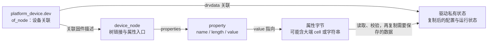
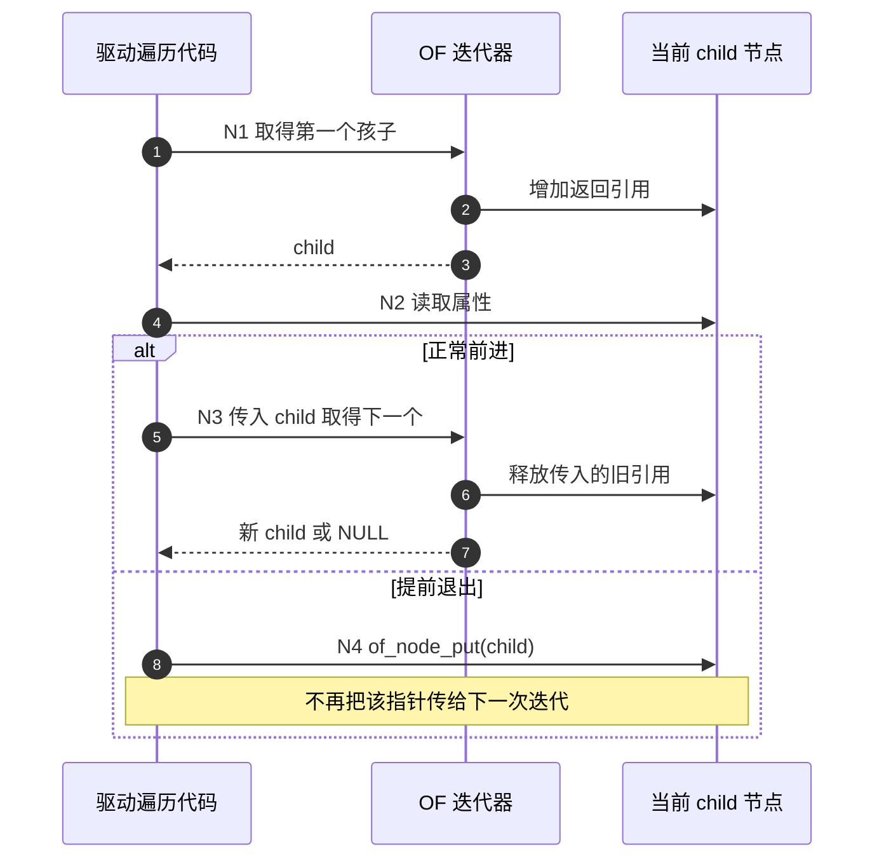

# 第9章\_OF属性读取与节点引用生命周期

## 9.1\_找到属性以后谁保证指针仍然有效

**讲解层次：实现层，NXP Linux 6.12.20 的 OF 接口。** 前几章已经分别解释地址、IRQ、GPIO、电源和时钟的契约。驱动现在可以调用框架取得资源，但读取自己的配置属性时，还会遇到 `struct device_node *` 与字符串指针。它们指向内核管理的数据，不是每次读取都分配一份属于驱动的新拷贝。

因此有两条独立的正确性要求：**按 binding 解释数据**，以及 **按 API 约定持有和交还对象**。读对一次整数不能证明之后保存的指针一直有效；反过来，节点引用平衡也不能修复把 GPIO 编号当 IRQ 的语义错误。

本章先定位节点与属性的存储，再沿一个完整子节点遍历周期检查正常前进、读失败和提前退出。运行期修改或删除设备树还需要相应动态更新协议；普通节点引用不是把整棵树冻结成快照的锁。

## 9.2\_节点属性与驱动私有数据分别放在哪里

Linux 把 FDT 展开成节点对象，节点通过 parent、child、sibling 连接，属性通过 property 链表保存。下面只列本章所需成员，**不是可复制的完整结构体定义**；配置相关成员按固定源码存在条件处理。

| 载体与成员 | 内容 | 谁拥有/当前怎样使用 |
| --- | --- | --- |
| `device_node.parent/child/sibling` | 树的相邻节点关系 | OF 核心维护，驱动用查询接口遍历 |
| `device_node.properties` | 属性链表入口 | OF 核心管理，读取者不能直接改链 |
| `device_node.phandle` | 树内数值身份 | 供跨节点引用解析，不是指针地址 |
| `device_node.fwnode` | 通用固件节点接口载体 | 用于 OF 与通用 device property 接口衔接 |
| `property.name` | 属性名 | 如 sample-count |
| `property.length` | 属性值字节数 | 字符串通常含 NUL；整数和字节数组没有额外终止符 |
| `property.value` | 原始字节数据指针 | 类型由 binding 决定，不能直接当本机整数 |
| `property.next` | 下一属性 | 供核心管理链表 |

固定版本的 `device_node` 没有 `type` 字段。设备类型应通过 device_type 属性及相应接口判断。`full_name` 也不能不加版本前提就当成已拼好的全路径：该版本 FDT 展开路径保存节点名成分，通过父链重建路径；打印节点应优先使用 `%pOF`。`name` 与 unit address 也不应靠手工拼接猜测。

驱动自己的配置和运行状态应放在私有结构中，通过 `platform_set_drvdata()` / `platform_get_drvdata()` 与设备实例关联。不要把 `device_node.data` 当成所有驱动随意占用的私有槽，也不要手工构造假的 device_node/property 指针初始化来模仿内核展开。



图中的两条数据关联不能互换：of_node 连接描述，drvdata 连接驱动状态。把字符串复制进私有状态，可以解除对该字符串存储的直接借用，但私有状态本身仍要遵守设备、异步工作和旧文件句柄的生命周期。

## 9.3\_每种节点查找都有自己的引用转移规则

普通 platform 驱动通常从 `pdev->dev.of_node` 取得关联节点，没必要按全局路径再搜索一遍。这个指针是设备关联提供的借用；如果要额外保存一个需要独立释放的节点引用，应显式 get 并在对应路径 put，不能把借来的引用直接交还。

| 接口或取得方式 | 查找范围/返回 | 引用责任 |
| --- | --- | --- |
| `dev->of_node` | 本设备关联节点，可能为空 | 借用，不能凭空 put 一次 |
| `of_find_node_by_path(path)` | 指定路径的节点，未找到为 NULL | 成功结果需要 put |
| `of_find_compatible_node(from, type, compat)` | 全树遍历顺序中 from 之后的匹配节点 | 消耗 from 的引用，成功返回新引用 |
| `of_get_parent(np)` | 父节点 | 返回结果需 put，不消耗传入 np |
| `of_get_next_parent(np)` | 沿父链前进 | 消耗传入 np 的引用，返回父引用 |
| `of_get_child_by_name(np, name)` | 指定直接孩子 | 成功返回引用需 put |
| `of_get_next_child(parent, prev)` | 下一个直接孩子，不递归 | 消耗 prev 的引用，返回新引用 |
| `of_get_next_available_child(parent, prev)` | 跳过不可用直接孩子 | 同样转移 prev → next 的责任 |
| `of_parse_phandle(np, property, index)` | 引用列表中的目标节点 | 成功返回引用需 put |

`from` 不是“搜索这个节点的全部孩子”的参数。需要限定子树时，应选择对应遍历方式，不能用全局 compatible 搜索后假定结果属于自己的设备。普通 consumer 也不宜为了省事在全局树中抓第一个同型号节点，系统上可能有多个实例。

在不启用动态 OF 的某些配置中，get/put 可能被实现为空操作；仍应按接口契约写配对代码。否则同一驱动在支持动态节点的配置中会暴露泄漏或过早释放，不能把一次静态板上的“没崩溃”当成所有权证明。

## 9.4\_循环前进已经交还了上一个孩子

先看正常循环的责任：第一次取 child 时取得一份引用；读完后，把 child 作为 prev 传给下一次调用，**下一次调用会替你 put 上一个 child**。所以不能在循环体尾部再 put(child)，随后又把这个失效指针交给迭代器。

| 阶段 | 当前动作 | 本函数持有的责任 | 退出条件 |
| --- | --- | --- | --- |
| N0 | 验证借用的 parent 非空 | 尚无 child 引用 | 可以开始遍历 |
| N1 | next_child(parent, NULL) | 成功时持有第一个 child | 无孩子则结束 |
| N2 | 读取并校验 child 的属性 | 继续持有当前 child | 校验通过或进入错误退出 |
| N3 | next_child(parent, child) | 旧引用由接口释放，新结果另取得引用 | 返回新孩子或 NULL |
| N4 | 循环体内 break/return/goto | 当前 child 还没有交给迭代器 | 必须显式 put 后退出 |
| N5 | 正常遍历到 NULL | 最后一个 child 已由 N3 释放 | 没有 child 责任遗留 |



步骤 5～7 与步骤 8 是两种互斥退出方式，不能两种都执行。普通 `for_each_child_of_node()`、`for_each_available_child_of_node()` 封装了正常前进，提前 break 仍须释放当前孩子。该版本也提供 `_scoped` 变体，利用作用域清理处理退出；采用它时不要再重复手工 put，也不要把其局部 child 指针直接逃逸到作用域外。

节点引用保护与动态 overlay 的删除规则也不是同一件事。若消费者要长期保存动态属性内容，必须核对更新/删除协议，必要时复制所需值；不能仅加一次 of_node_get 就宣称任何属性指针永远安全。

## 9.5\_读取接口检查了编码还需要检查约束

`of_property_read_u32()` 负责解码一个大端 u32，但不会知道 sample-count 应当在 1～16。它也不保证该属性恰好只有一个 cell；要拒绝多余项，应先检查元素数量，再读值和验证范围。

| 接口 | 返回值与结果 | 本地还需检查 |
| --- | --- | --- |
| `of_property_read_bool()` | 属性存在性 | `<0>` 仍表示存在，不是 false |
| `of_property_read_u32()` | 0 成功，负错误失败；复制数值 | 数量、允许范围与单位 |
| `of_property_read_u32_array(..., n)` | 读取 n 个数值，成功为 0 | 属性可能更长；精确数量另检查 |
| `of_property_count_u32_elems()` | 非负数量或负错误 | 与 binding 的项数约束比较 |
| `of_property_read_string()` | 0 成功，返回属性内字符串指针 | 不是新分配副本，只取第一项 |
| `of_property_count_strings()` | 字符串项数或负错误 | 是否允许列表及列表长度 |
| `of_property_read_string_index()` | 按索引取得借用字符串 | 索引范围和生命周期 |
| `of_property_match_string()` | 匹配项索引或负错误 | 成功可能返回 0，不能用真假代替错误判断 |
| `of_get_property()` | 借用的原始值及字节数 | 自己承担类型、长度和字节序解释，优先用专门接口 |

整数属性缺失、无值、长度不足会有不同错误；字符串缺少边界内 NUL 还可能返回 EILSEQ。失败时不能继续打印未初始化输出变量。空字符串 `""` 含一个 NUL，与没有值的布尔属性不同。

对于 reg、interrupts、gpios、clocks 等带提供者契约的属性，不应为了“演示 of_xxx”而一律读成 u32 数组再自己拼。前几章已经建立的地址、IRQ、GPIO、clock 和 regulator API 会同时处理对应映射、申请及生命周期，直接读原始字节会绕过这些保证。

## 9.6\_完整例子按自己的节点读取两个有效通道

下面的教学节点在父设备下列三个通道，其中第三个 disabled。约定每个可用孩子具有恰好一个 0～7 的 channel-id 和一个 channel-name，ID 不得重复。它不是硬件 MMIO 控制器，不使用 reg，也没有私造 GPIO 控制器回调。

```dts
/* 集成片段：放在会被平台枚举的适当位置，具体板的其他节点保持不变。 */
channel-reader {
    compatible = "linux-note,channel-reader";

    channel-0 {
        channel-id = <0>;
        channel-name = "first";
    };
    channel-1 {
        channel-id = <1>;
        channel-name = "second";
    };
    channel-2 {
        channel-id = <2>;
        channel-name = "disabled-example";
        status = "disabled";
    };
};
```

完整模块 `channel_reader.c` 如下。正常读取只立即打印借用字符串，数值复制进局部变量；它没有保存跨 probe 的属性指针，没有后台执行者，因此不需要自定义 remove 清理。

```c
#include <linux/module.h>
#include <linux/platform_device.h>
#include <linux/of.h>
#include <linux/bitops.h>

static int channel_reader_probe(struct platform_device *pdev)
{
    struct device *dev = &pdev->dev;
    struct device_node *parent = dev->of_node;
    struct device_node *child;
    const char *name;
    u32 id;
    unsigned long seen = 0;
    unsigned int count = 0;
    int ret;

    if (!parent)
        return -ENODEV;

    for_each_available_child_of_node(parent, child) {
        ret = of_property_count_u32_elems(child, "channel-id");
        if (ret != 1) {
            ret = ret < 0 ? ret : -EINVAL;
            goto out_child;
        }
        ret = of_property_read_u32(child, "channel-id", &id);
        if (ret)
            goto out_child;
        if (id > 7 || (seen & BIT(id))) {
            ret = -EINVAL;
            goto out_child;
        }
        ret = of_property_count_strings(child, "channel-name");
        if (ret != 1) {
            ret = ret < 0 ? ret : -EINVAL;
            goto out_child;
        }
        ret = of_property_read_string(child, "channel-name", &name);
        if (ret)
            goto out_child;

        /* 当前 child 引用仍由本次循环持有，立即使用属性。 */
        dev_info(dev, "%pOF：通道 %u，名称 %s\n", child, id, name);
        seen |= BIT(id);
        count++;
        /* 不在这里 put：循环增量会消费当前 child。 */
    }

    if (!count)
        return dev_err_probe(dev, -EINVAL, "没有可用通道\n");
    dev_info(dev, "读取 %u 个可用通道\n", count);
    return 0;

out_child:
    /* 提前退出跳过了循环增量，必须交还仍持有的 child。 */
    dev_err(dev, "%pOF：通道描述无效，错误 %d\n", child, ret);
    of_node_put(child);
    return ret;
}

static const struct of_device_id channel_reader_matches[] = {
    { .compatible = "linux-note,channel-reader" },
    { }
};
MODULE_DEVICE_TABLE(of, channel_reader_matches);

static struct platform_driver channel_reader_driver = {
    .probe = channel_reader_probe,
    .driver = {
        .name = "channel_reader",
        .of_match_table = channel_reader_matches,
    },
};
module_platform_driver(channel_reader_driver);

MODULE_LICENSE("GPL");
MODULE_DESCRIPTION("OF 子节点读取与引用平衡教学模块");
```

这里 parent 是借用指针，所以没有 of_node_put(parent)。错误路径则对应 N4，明确释放 child；正常路径走 N3→N5。若把父节点取得方式改成 of_find_node_by_path，必须额外在所有出口释放自己找到的父引用，不能只改查找那一行。

`of_match_table` 直接指向匹配表是合法用法。`of_match_ptr()` 是 CONFIG_OF 条件选择宏，不是自动匹配或自动加载模块的算法；`MODULE_DEVICE_TABLE` 参与构建别名，运行匹配与自动装入的区别见 [设备绑定与模块加载](P02_设备树驱动开发方式.md#2.4_匹配成功与模块自动装入之间还有一条通信链)。

### 9.6.1\_预测正常和错误路径再构建运行

外部模块目录的 Makefile 内容为：

```makefile
obj-m += channel_reader.o
```

在已准备匹配目标内核的构建环境中执行：

```bash
make -C "$KERNEL_BUILD" M="$PWD" ARCH=arm CROSS_COMPILE="$CROSS_COMPILE" modules
```

KERNEL_BUILD、工具链、板级 DTB 部署与模块加载条件沿用 [前面的目标构建说明](P06_GPIO连接引脚复用与编号空间.md#6.6.1_构建与观察需要哪些前提)。该命令为本专题 ARM 目标；只有确认目标构建和部署后才能做运行观察，本次未执行这些步骤。

正常路径预期只打印 first、second 和“2 个可用通道”。把第二个 ID 改成 0，应在重复检查处失败并走 N4；把 channel-id 改成 `<1 2>`，应在精确数量检查处失败；删除两个有效孩子后，应报告没有可用通道。每次修改都需按平台方式重新编译并部署实际使用的描述，不能只编辑主机 DTS 后等待板上结果自动改变。

这些输出是代码推导的预期，不是本轮实测日志。没有通用 `/sys/kernel/debug/kref` 文件可以自动证明本例引用正确；应审查各出口的所有权，必要时结合目标内核调试配置与动态节点测试。

## 9.7\_按返回值类型选择错误处理

节点查找常返回 NULL，资源获取可能返回错误指针，属性读取通常返回负 errno，字符串匹配成功可能返回索引 0。把所有接口都写成 `if (!result)`，会把合法结果或错误漏掉。

| 当前操作 | 正确的判断方向 | 常见错误 |
| --- | --- | --- |
| 节点查找 | 检查 NULL | 对 NULL 直接访问字段 |
| devm_gpiod_get / devm_clk_get 等 | IS_ERR 与 PTR_ERR，optional 另看 NULL 契约 | 当普通指针使用错误编码 |
| 属性 read 接口 | 检查负错误/非零失败，再使用输出 | 失败后打印未初始化变量 |
| of_property_match_string | `< 0` 为失败，0 是第一项 | 把第一项当成“不匹配” |
| of_device_is_compatible | 返回非零匹配分数或 0 | 把它描述成只有 0/1 的 bool 返回值 |
| of_irq_get | `<= 0` 都需处理，保留 EPROBE_DEFER | 漏掉 0 表示的映射失败 |

dev_err_probe 适合保留 probe 失败原因并处理延期探测日志；它不是应当把所有负值统一改成 ENODEV 的理由。动态调试也只能显示代码里已有的 dev_dbg 调用：要核对目标配置和控制文件，不能捏造一个一定存在的 trace 事件来“验证 OF”。

## 9.8\_把编码资源与生命周期放回同一条链

现在回看整个专题：DTS 先声明真实硬件契约，DTC 编码，固件交付，内核建立节点与设备，各框架把描述变成带所有权的资源对象，驱动才开始硬件工作。每一层都有自己的身份和责任，不能越过中间步骤用一个相似的数字或指针替代。

| 问题 | 应回到哪一篇 |
| --- | --- |
| 为什么还没进入 probe | [节点枚举与匹配](P02_设备树驱动开发方式.md#2.5_按状态交接排查为什么没有probe) |
| 属性字节怎样编码、标签怎样引用 | [语法与离线实验](P03_设备树语法与标准示例.md#3.6_编译后亲手检查修改是否进入二进制) |
| reg 为什么不是最终 MMIO 地址 | [地址转换](P04_地址单元与总线窗口转换.md#4.4_怎样计算不同宽度和多层窗口) |
| 中断描述为什么不是 Linux IRQ | [IRQ 映射](P05_中断连接怎样成为驱动可用的IRQ.md#5.6_Linux把提供者描述转换成自己的IRQ身份) |
| GPIO 和 pinctrl 的编号怎样连接 | [局部编号映射](P06_GPIO连接引脚复用与编号空间.md#6.5_gpio-ranges连接的是两个局部编号空间) |
| get 成功后为什么还要 enable | [电源责任](P07_供电关系电压约束与启停责任.md#7.4_取得句柄使能输出和读取电压是三个动作)、[时钟责任](P08_时钟连接频率请求与使能计数.md#8.5_获取准备使能与调频分别改变什么) |

最后做三道所有权练习：

1. 循环体尾部 put(child)，再让 for_each 宏前进是否正确？**不正确。** 迭代器会再消费旧引用，可能重复释放。
2. `break` 后省略 put(child) 是否正确？**对普通非 scoped 宏不正确。** 提前退出跳过了释放旧 child 的增量动作。
3. read_string 得到的名字要长期放到驱动状态里，可以直接永久保存指针吗？**不能作这种保证。** 它是借用存储，应遵守动态更新/删除条件，按用途复制并管理自己的数据生命周期。

## 9.9\_依据与验证边界

节点结构、引用接口与遍历宏按固定 NXP 提交的 [include/linux/of.h](https://github.com/nxp-imx/linux-imx/blob/dfaf2136deb2af2e60b994421281ba42f1c087e0/include/linux/of.h)、[drivers/of/base.c](https://github.com/nxp-imx/linux-imx/blob/dfaf2136deb2af2e60b994421281ba42f1c087e0/drivers/of/base.c)；FDT 展开及名称存储按 [drivers/of/fdt.c](https://github.com/nxp-imx/linux-imx/blob/dfaf2136deb2af2e60b994421281ba42f1c087e0/drivers/of/fdt.c)。

属性读取按 [drivers/of/property.c](https://github.com/nxp-imx/linux-imx/blob/dfaf2136deb2af2e60b994421281ba42f1c087e0/drivers/of/property.c)，IRQ 特殊返回值按 [drivers/of/irq.c](https://github.com/nxp-imx/linux-imx/blob/dfaf2136deb2af2e60b994421281ba42f1c087e0/drivers/of/irq.c)。固定源码静态核对不等于当前外部工作树配置已确认；本次未执行目标模块编译、加载、动态 overlay 删除或引用计数运行测试。
