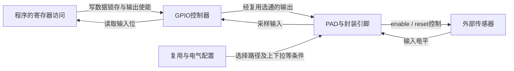
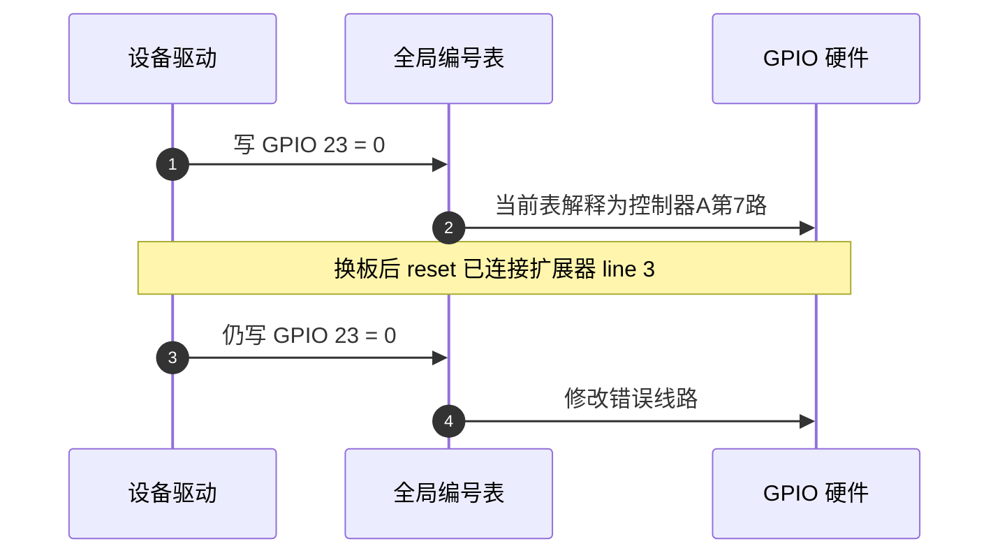
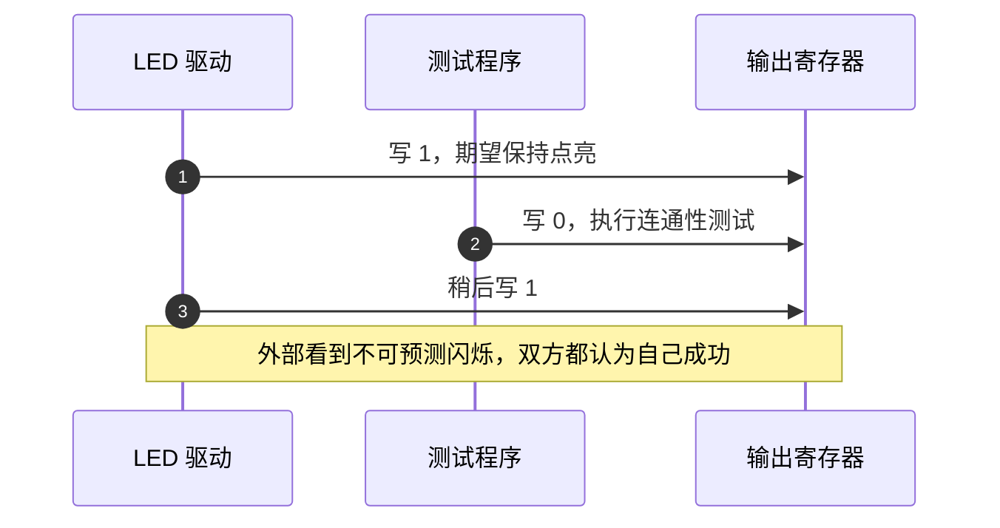
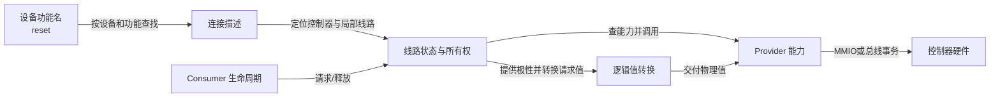

# 第1章\_从寄存器位到\_GPIO\_连接抽象

一颗传感器需要一根enable线接通供电、一根reset线进入或退出复位，还用alert线通知处理器发生了事件。它们传送的不是完整总线数据，而是高低电平所表达的控制或状态。**通用输入输出（General-Purpose Input/Output，GPIO）** 就是处理器或扩展芯片提供的这类数字线路能力；读写数据通常只涉及一位，但控制权、接线和时序并不因此简单。

本专题以这个教学设备贯穿，读者只需C语言和基本硬件读写概念。先从单程序控制固定接线的方案出发，逐步增加多控制器、多驱动和生命周期约束，再进入Linux。enable暂定高有效、reset低有效、alert低有效；这些是教学电路的约定，真实器件必须查自己的协议。

## 1.1\_裸机方案为什么成立

**PAD** 是芯片与封装引脚相连的输入输出电路位置，一处PAD可能通过复用选择器接到GPIO，也可能接到UART等专用外设。先选通GPIO路径，再谈输入方向、输出使能和数据锁存，写入才能作用于目标引脚。此处先区分职责，具体复用与电气配置留给pinctrl。

在硬件固定、只有一个程序控制外设时，程序掌握PAD、寄存器布局和唯一控制权，可以直接配置复用、按硬件顺序设置方向与初值，再读写数据。下图是功能关系，不是某款SoC的寄存器布局：

程序写输出锁存并不自动证明PAD选通正确，读到输入位也不意味着外部设备已完成复位协议。不过在接线、配置和执行者都固定时，这几层知识可以由同一段板级程序统一掌握。

这种方案的正确性价值不能忽略：路径短、状态少、故障容易对应到寄存器。在 bootloader 早期点亮状态灯或拉住复位线时，直接寄存器方案仍可能是正确选择。Linux 引入抽象不是因为寄存器方案“落后”，而是运行约束发生了变化。

## 1.2\_连接变化怎样击穿全局编号

假设旧软件把 `reset` 写成全局编号23，在当前编号表里它恰好对应控制器A的第7路。这里23只是人为例子，不是某款SoC的GPIO2_7换算公式。第二块板把reset改接到I²C扩展器的第3路，驱动继续写23就可能修改无关线路。“reset这个功能”“控制器内第几路”和“本次全局表里的号码”原本是三种身份，却被一个整数粘在了一起。

I²C扩展器是挂在串行总线上的外部GPIO芯片，读写它的电平要先通过总线传命令；SoC内GPIO则常用处理器内存映射I/O访问。先认识这个位置变化，后面才有理由讨论等待和可睡眠上下文。

步骤1、2在旧板上满足需求；步骤3、4在换板后沿用了旧映射。驱动自己保存一个整数，并不能知道它的语义已经改变。继续给不同控制器分配全局编号可以解决当前表内的编号冲突，却不能稳定表达板级连接；动态注册顺序、热插拔或配置变化还可能改变该表。固定平台也可以人为维持一套编号契约，但每次换板都需同时维护它。

由此得到第一个需求：**驱动应请求“本设备的 reset 连接”，板级描述再决定它落到哪个控制器的哪根线。**

## 1.3\_多个参与者怎样产生所有权问题

如果 LED 驱动和测试程序都能直接写同一编号，最后电平取决于两次写入的时间顺序。任何一方都不知道另一方存在，局部代码没有错误，组合后却失去确定性。

步骤1～3即使完全串行，LED仍然被另一方关掉，所以“每次写入都正确”不足以建立持续控制权。单纯给寄存器访问加锁只能防止两次访问交错，不能表达谁在一段生命周期内拥有这根线。需要一个可被所有请求者看到的每线状态，在请求时登记占用，在释放时撤销；冲突应在使用前返回错误，而不是在硬件上表现为偶发波形。

另有一种不同问题：两个合法使用者分别控制同一寄存器的bit0和bit1，双方都先读到0，各自改一位再写回，后写者可能覆盖另一位。它需要控制器层保护读改写或使用硬件set/clear寄存器。**单线所有权与共享寄存器同步分别解决不同冲突**，不能用其中一个替代另一个。

## 1.4\_物理电平为什么不能等同业务语义

第一块板的 `reset` 低有效，第二块板通过反相器变成高有效。如果业务代码把“进入复位”写成输出 0，板级极性会渗入驱动。更稳定的契约是：业务写逻辑 1 表示 **断言 reset**，连接描述保存 active-low，公共层在访问硬件前换算物理值。

代价是系统中必须区分逻辑值和raw物理值。对于本例普通推挽输出，低有效时逻辑1转为物理低，逻辑0转为物理高；高有效时不反相。控制器不会从“reset”这个英文名字推断极性，必须有连接描述提供它。普通驱动使用逻辑值；硬件诊断或协议明确要求时才绕过极性转换。若驱动先手工反相、公共层又依据active-low反相，就会产生双重反相。

## 1.5\_控制器差异为什么必须成为能力契约

SoC 内部 GPIO 通常通过 MMIO 访问，CPU 在很短路径内完成读写。I²C 扩展器需要提交总线事务并等待完成，可能发生调度。若上层只看到“写 GPIO”，便可能在中断顶半部或持有自旋锁时调用会睡眠的操作。

因此抽象不能只统一函数名，还必须传播控制器的访问能力。把提供线路操作的一方称为 **Provider（提供者）**，把为设备功能请求线路的一方称为 **Consumer（使用者）**。前者知道怎样访问硬件，后者知道何时需要复位或供电。前者必须说明访问能否睡眠、支持哪些方向和配置；后者必须在允许的上下文调用，不能要求同名函数消除总线等待。

统一接口的收益是连接变化无需修改业务语义，代价是保留并遵守能力边界。对必须以严格时序访问的功能，可能应继续选用片内硬件、定时器或专用总线控制器，不能为了“接口统一”把它移到不能满足时序的扩展器上。

## 1.6\_生命周期为什么属于正确性

设备 `probe()` 请求 enable 后，可能在申请时钟时失败；驱动也可能解绑，I²C 扩展器还可能被移除。如果请求状态不随设备生命周期回滚，线路会永久显示忙；如果描述符仍指向已注销控制器，后续访问可能触及失效对象。

需要把“获得连接”设计成一个周期，而不是一次查询：解析、请求、初始化、使用、特殊事件、释放都必须有明确触发者和逆向清理路径。

## 1.7\_从问题推出的最小抽象

到这里还不需要Linux字段名，也能推出六项职责及相应状态：

| 约束 | 必要角色或状态 |
| --- | --- |
| 控制器硬件不同 | Provider 能力对象 |
| 板级连接会变化 | 独立连接描述 |
| 多参与者竞争 | 每线共享所有权状态 |
| 物理极性会变化 | 逻辑属性及转换层 |
| 快慢访问路径不同 | 可睡眠能力契约 |
| probe、解绑和热移除 | 完整请求与释放周期 |

把图中的连接描述换成另一控制器，只要能力仍满足要求，Consumer的“断言reset”意图可以保持不变；所有权则保证另一个遵守同一框架的请求者不能偷偷取得同一根独占线。它们分别隔离接线变化和控制冲突。

练习：两条不同GPIO已经分别被A和B独占，同一个数据寄存器还需不需要同步？需要，因为所有权只排除了同一线的冲突，没有保护跨线的读改写。若复位极性换了而功能不变，应修改板级连接属性；若换成慢速扩展器后原硬中断路径不再合法，则还要调整执行上下文，不能只改连接就宣布迁移完成。

这些结论尚未决定Linux字段和API。下一篇先从约束推导角色、状态和完整周期：[GPIO 角色、状态与完整操作周期](P02_GPIO_角色_状态与完整操作周期.md)。
