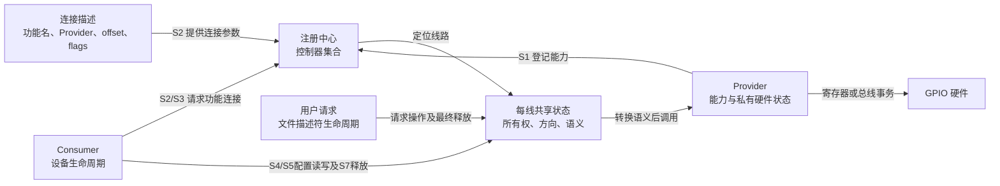
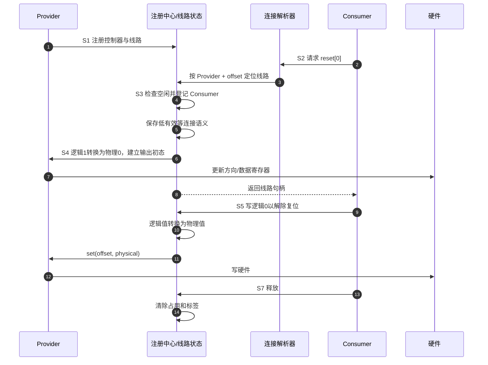
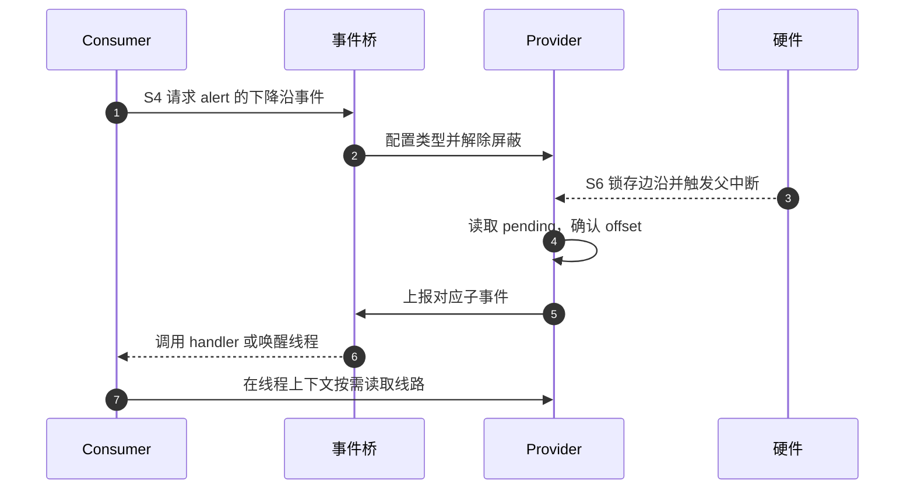

# 第2章\_GPIO\_角色\_状态与完整操作周期

上一章已经得到功能连接、每线所有权和控制器能力的必要性。现在让那根低有效reset走完一次请求、使用和释放：哪些状态在软件里，哪些在硬件里，失败时应撤销什么？本章先建立可执行的教学模型，不把模型字段冒充Linux内部结构；第四章才映射到gpiolib。

## 2.1\_这不是一个单一状态机

取得reset以后，Consumer可以多次切换电平，线路仍由它占用；释放以后，软件占用消失，硬件却可能保持最后一次输出。仅凭这个反例，就知道“空闲/使用中”不能同时代表方向、电平和控制权。GPIO应理解为 **多组各自变化、又受协议约束的状态共同组成的机制**，而不是一个取值覆盖所有事实的单一状态机。

下面用控制器登记、连接、所有权、配置、语义、事件和电源分别观察。它们在模型中正交，不意味着可任意组合：例如在断电控制器上执行普通读写不一定合法，把已启用IRQ的输入改为输出也需要限制。

| 状态组 | 典型状态 | 所有者 |
| --- | --- | --- |
| 控制器 | 未登记、可用、挂起、注销中 | Provider 与注册中心 |
| 连接 | 未解析、已解析、等待 Provider、无连接 | 固件描述与解析器 |
| 所有权 | 空闲、内核持有、用户请求持有 | 每线共享状态 |
| 配置 | 未知、输入、输出低、输出高 | 每线状态与硬件 |
| 语义 | 高有效、低有效、open-drain 等 | 连接描述与每线状态 |
| 事件 | 未映射、已映射、已屏蔽、待处理 | Provider、事件桥和 IRQ 核心 |
| 电源 | 活动、保存中、断电、恢复中 | Provider PM 路径 |

这些状态不会总是同时变化。例如将输出逻辑值从 0 改为 1，不改变所有权；系统挂起可能改变硬件可访问性，却不释放 Consumer 的逻辑所有权。

## 2.2\_角色和通信载体

Consumer发起请求时先读取连接描述，注册中心根据提供者身份找到那一组线路，再到对应线路状态中尝试登记占用。只有取得了控制权，才能按请求方向与初值调用Provider。正常值操作可复用已取得的句柄，不必每次重新查找设备树；因此低频请求和高频读写承担不同成本。



图中集中画请求、操作与释放，事件的反向传播在2.5节单独展开。连接描述是被读取的数据，不会主动通知驱动。Consumer请求时读取它；Provider尚未出现时，请求不能靠这份描述自行完成，必须把“依赖暂未就绪”交回绑定框架。用户请求通过文件句柄持有；如果句柄被复制，关掉其中一个不一定释放请求，最终文件引用才是对应完成点，第八章再展开。

抽象模型中的状态地址也应具体：控制器集合保存Provider条目，每线记录保存owner与极性，Provider自己的寄存器或缓存保存数据和方向。事件配置属于中断桥和控制器；业务等待队列属于需要等待结果的消费者或用户接口。单独一个“GPIO对象”不足以同时容纳这些不同所有者。

## 2.3\_统一的\_S0～S7\_周期

| 阶段 | 进入触发 | 修改前后状态 | 写入者与存储位置 | 后续读取者 | 退出条件 |
| --- | --- | --- | --- | --- | --- |
| S0 | 上电或设备枚举 | 控制器未登记 | 固件保存连接，硬件保存复位状态 | Provider probe | 驱动开始初始化 |
| S1 | Provider 注册 | 未登记 → 可查找 | 注册中心建立控制器与线路集合 | 连接解析器、用户接口 | 注册成功 |
| S2 | Consumer 请求功能 | 未解析 → 描述符候选或等待 | 解析器读取连接描述和 Provider 集合 | 请求路径 | 找到 line 或返回错误 |
| S3 | 所有权检查 | 空闲 → 被请求 | 请求路径写每线共享状态和标签 | 其他请求者、调试接口 | 占用成功或冲突 |
| S4 | 初始化参数生效 | 未知方向 → 输入/安全输出 | 公共层写语义状态，Provider 写硬件 | Consumer、事件路径 | 配置成功或回滚 |
| S5 | 正常操作 | 值、配置或等待状态改变 | Consumer 经公共层访问 Provider | 硬件、Consumer | 操作结束或特殊事件 |
| S6 | IRQ、PM、移除或故障 | 活动状态发生分支变化 | Provider/事件/PM 路径写各自状态 | Consumer、恢复或注销路径 | 恢复正常或进入释放 |
| S7 | Consumer释放或用户请求最终引用归还 | 已请求 → 可再次请求 | 使用者先停用事件/异步访问，释放路径撤销线路占用 | 后续请求者 | 本次使用者不再访问且占用已交还；不承诺硬件恢复旧值 |

## 2.4\_正常输出周期

把本次需求固定为“先断言低有效reset，再按外设协议解除”。S4初始逻辑1因此应对应物理低；S5逻辑0对应物理高。这只是本电路的安全起点，不是所有名为reset的线路都必须按同样上电次序操作。



步骤1建立提供者，2～8尝试获得一份可使用句柄，9～12才是使用期间的值操作，13～14交还控制权。S3与S4需要协调失败：若配置失败而请求不能交付，应撤销本次软件占用，避免留下无人负责的请求。但硬件写入是否已经发生、能否恢复，必须看失败位置与Provider协议；解除占用不等于把先前写入从硬件上擦掉。

释放前若必须保持复位或关闭供电，Consumer应先按设备协议执行该动作、处理在途活动，再交还线路。释放后仍测到某个电平，只是当前硬件及外部电路的结果，不能继续把它视作已释放Consumer拥有的保证。

## 2.5\_输入事件周期

输入方向只能提供电平采样能力，还不自动产生事件回调。要在变化时通知使用者，S4还需建立事件配置与处理者关系。先假设控制器具有独立的pending锁存位：S6中它记录边沿并发出父中断，Provider读取该位，事件桥把局部线路身份转换为系统事件，再进入处理者。这里的offset表示控制器内部的局部线路编号。



步骤1、2建立订阅，3～5传递这次变化，6、7才是消费者响应。硬中断处理函数可以直接执行有限工作，线程化处理者可以被唤醒后执行可睡眠工作；不能把所有handler都说成睡眠等待方。用户空间事件接口还会将事件存入队列，再唤醒read/poll等待者，不能仅有一条抽象箭头而没有事件承载状态。

本图的pending寄存器是假定的一种控制器能力。有些扩展器需比较新旧输入样本来推导变化，读采样寄存器还可能清除通知条件。它们必须使用自己的事件模型，第七章再比较；不能把图中的寄存器强行补到所有芯片上。

## 2.6\_所有权保证和边界

所有权状态保证通过公共请求路径的参与者不会同时独占同一线路。它不能阻止 bootloader、固件、调试器或绕过框架的寄存器写入，也不能代替外部电路的多主仲裁。因而“请求成功”说明软件登记没有冲突，不等于线路物理上只受本驱动影响。

## 2.7\_在宿主程序中分开占用状态和硬件状态

下面的C11程序只在内存中模拟一根reset线，不访问GPIO、不调用Linux API，也不模拟电气时序。它把owner、逻辑极性与模拟的输出状态放在同一结构体的不同字段中，方便直接观察两组状态怎样分离；真实系统的存储位置在第四章展开。函数调用串行执行，请求检查不是并发算法，第三章会补它缺少的同步。

owner的0表示空闲，1和2分别表示模型内部的A、B；函数只由下面main中的这些合法身份调用。hw_raw表示模拟输出锁存值，hw_output表示是否启用输出，输出尚未启用时不能把锁存值当作引脚实测值。configured则只表示本次使用者的配置是否完成，与硬件输出保留是两个字段。

保存为`line_cycle_model.c`，也可取用 [配套源码](../../../labs/kernel/gpio/materials/line_cycle_model.c)。先预测：B请求一根已由A持有的线会不会改变电平？A释放以后电平是否必定复原？模拟配置已改变输出后报错，能否只凭owner为空推断硬件未动？

<!-- GPIO_MODEL_BEGIN -->
```c
#include <stdbool.h>
#include <stdio.h>

/* 宿主教学状态，不是gpio_desc，也不访问真实硬件。 */
struct line_state {
    bool provider_ready;
    unsigned int owner;
    bool active_low;
    bool configured;
    bool hw_output;
    bool hw_raw;
};

enum model_result { MODEL_OK, MODEL_WAIT, MODEL_BUSY, MODEL_CONFIG_ERROR };

static void show_state(const char *stage, const struct line_state *line)
{
    const char *owner = line->owner == 1 ? "A" :
                        line->owner == 2 ? "B" : "none";
    printf("%s owner=%s configured=%d output=%d raw=%d\n", stage, owner,
           line->configured, line->hw_output, line->hw_raw);
}

static enum model_result request_line(struct line_state *line,
                                       unsigned int owner, bool active_low,
                                       bool initial, bool fail_after_write)
{
    /* S2：此模型只支持已经确定的一根线，ready代表提供者是否可用。 */
    if (!line->provider_ready)
        return MODEL_WAIT;
    if (line->owner != 0)
        return MODEL_BUSY;
    /* S3：串行模型的占用登记；此普通赋值不能充当并发请求协议。 */
    line->owner = owner;
    line->active_low = active_low;
    /* S4：先形成物理值，再启用模拟输出。 */
    line->hw_raw = initial != active_low;
    line->hw_output = true;
    if (fail_after_write) {
        /* 仅回滚本次软件占用，刻意保留已发生的模拟硬件变化。 */
        line->owner = 0;
        line->active_low = false;
        line->configured = false;
        return MODEL_CONFIG_ERROR;
    }
    line->configured = true;
    return MODEL_OK;
}

static bool set_line(struct line_state *line, unsigned int owner, bool logical)
{
    if (owner == 0 || line->owner != owner || !line->configured)
        return false;
    line->hw_raw = logical != line->active_low;
    return true;
}

static bool release_line(struct line_state *line, unsigned int owner)
{
    if (owner == 0 || line->owner != owner)
        return false;
    /* 本模型无IRQ/工作队列；真实使用者须先停止这些在途访问。 */
    line->owner = 0;
    line->active_low = false;
    line->configured = false;
    return true;
}

#define CHECK(condition) do { \
    if (!(condition)) { \
        fprintf(stderr, "check failed at line %d: %s\n", __LINE__, #condition); \
        return 1; \
    } \
} while (0)

int main(void)
{
    struct line_state line = { .hw_raw = true };

    CHECK(request_line(&line, 1, true, true, false) == MODEL_WAIT);
    CHECK(line.owner == 0 && !line.hw_output && line.hw_raw);
    show_state("S0 waiting", &line);

    line.provider_ready = true; /* S1：模拟登记完成。 */
    CHECK(request_line(&line, 1, true, true, false) == MODEL_OK);
    CHECK(line.owner == 1 && line.configured && !line.hw_raw);
    show_state("S4 reset asserted", &line);

    CHECK(request_line(&line, 2, false, true, false) == MODEL_BUSY);
    CHECK(line.owner == 1 && !line.hw_raw);
    CHECK(!set_line(&line, 2, true));
    show_state("S3 B rejected", &line);

    CHECK(set_line(&line, 1, false));
    CHECK(line.hw_raw);
    show_state("S5 reset deasserted", &line);
    CHECK(!release_line(&line, 2));
    CHECK(release_line(&line, 1));
    CHECK(line.owner == 0 && line.hw_output && line.hw_raw);
    CHECK(!set_line(&line, 1, true));
    show_state("S7 released", &line);

    CHECK(request_line(&line, 2, true, true, true) == MODEL_CONFIG_ERROR);
    CHECK(line.owner == 0 && !line.configured && line.hw_output && !line.hw_raw);
    show_state("S4 failure after write", &line);
    CHECK(request_line(&line, 2, false, true, false) == MODEL_OK);
    CHECK(line.owner == 2 && line.hw_raw);
    CHECK(release_line(&line, 2));
    puts("all model checks passed");
    return 0;
}
```
<!-- GPIO_MODEL_END -->

在保存源码的实验目录，用支持C11的宿主编译器构建并运行：

```bash
cc -std=c11 -Wall -Wextra -Werror line_cycle_model.c -o line_cycle_model
./line_cycle_model
```

Windows使用MinGW GCC时同样编译，产物是`line_cycle_model.exe`，在PowerShell用`.\line_cycle_model.exe`运行。程序不需要管理员权限或目标板，任一预测检查失败都会返回非零；它使用显式检查而非只依赖可能被编译选项关闭的assert。

预期输出包含：S4时owner=A、raw=0，S5解除复位后raw=1；B冲突不会改变A的状态；S7后owner=none但raw仍为1。最后一组故障注入先把输出改成0，再返回配置失败，此时owner已经回滚为none，raw仍是0。这个结果刻意证明 **软件失败回滚不必然等于物理状态复原**，不是建议真实驱动忽略故障后的安全状态。

## 2.8\_改变一个条件检验模型的保证

把正常请求的active_low从true改为false，先预测S4/S5的物理值，再同步修改受影响的物理值检查期望值；此时逻辑意图不变，物理值应反过来。把B请求放到A释放以后，B应可以占用，但需要为B明确选择新的初值，不能继承“上一个使用者必定留下安全状态”的假设。

若去掉owner忙检查，现有冲突测试会失败，说明长期所有权确实由这一步维护。但即使所有测试通过，也不能宣布并发安全：两个CPU可能同时读到owner为空，分别写入自己的身份。下一篇正从这个缺口出发，检验并发、慢总线、失败和电源变化：[从朴素模型到可用 GPIO 机制](P03_从朴素模型到可用_GPIO_机制.md)。

上一篇：[从寄存器位到GPIO连接抽象](P01_从寄存器位到_GPIO_连接抽象.md)。
