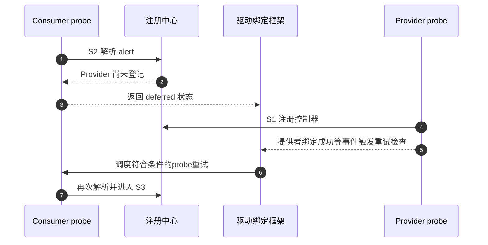
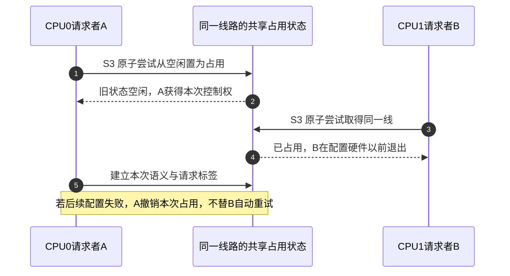

# 第3章\_从朴素模型到可用\_GPIO\_机制

上一章的串行程序已经区分线路占用和模拟硬件输出，也能拒绝第二个请求者。但它假定执行者不会交错、调用可以立即完成、控制器不会断电。这些前提在Linux中经常不成立。本章逐个撤掉假设，每次只增加解决当前缺口所需的同步、通信或生命周期约束，继续沿用S0～S7观察阶段。

## 3.1\_Provider\_尚未出现\_连接存在不等于资源可用

朴素模型认为连接描述能够直接得到线路。但设备枚举顺序可能让 Consumer 先于 GPIO 扩展器 probe。此时连接中的 Provider 身份是有效的，只是注册中心尚无对应对象。

把这种情况当作“属性不存在”会永久放弃设备；在 Consumer 内循环轮询又会占用线程并制造任意超时。成熟机制返回可区分的延迟状态，由设备绑定框架在依赖条件变化后重新执行 probe。移除主动轮询的成本由 **失败返回、依赖登记和后续重试** 承担。

步骤1～3退出本次尝试；4～6由提供者进展和绑定框架推进，7才重新解析。这里只画一种正常的重试触发，不保证每次GPIO注册都直接回调所有消费者。驱动须把延迟结果向上传递，并清理本次已经取得的资源；不能在等待期间保留一半初始化的设备，期待下一次probe替自己补齐。

错误分类仍有边界：不存在这根必需连接、连接引用非法、提供者暂未就绪是不同条件。延迟不是“所有失败都稍后再试”的万能返回值；永久错误继续重试只会掩盖配置问题。

## 3.2\_并发请求\_锁住寄存器仍不能表达长期所有权

两个线程在 S3 同时请求同一 line。若只在写寄存器时加锁，它们都可能得到“成功”，之后轮流修改硬件。需要在每线共享状态上执行原子检查与登记，使一个请求成功，另一个在进入 S4 前获得忙错误。

把上一章owner字段的普通检查拆开，就能重建错误：A读到0，B也读到0，A写1，B写2；两者都越过检查，而最终字段只留下B。需要的是“检查并取得控制权”不可被另一请求穿过的协议，例如原子测试并置位，再配合标签与初始化的发布规则；不是简单给owner加volatile。

步骤1～4决定谁能继续，5才补充本次请求的状态。实际实现还需处理标签分配失败、提供者移除等情况，第四章再核对具体同步。跨CPU写共享占用位可能需要缓存一致性协议转移该缓存行的写权限；它是请求期成本，不应被压缩成“加锁性能差”。请求通常低频，S5读写复用句柄可避免每次重复完整查找与占用。

即使不同线路各自独占，控制器的数据寄存器仍可能共享，第一章的跨线读改写问题仍需Provider解决。所有权、寄存器同步和业务线程对同一句柄的协调是三种不同责任。

## 3.3\_低有效\_连接属性必须进入线路语义

如果解析器只返回 Provider 和 offset，Consumer 仍需知道电路极性。成熟模型在 S2 读取 active-low，在 S3/S4 把它关联到线路状态。S5 的普通接口接收逻辑值，再在公共层转换成 Provider 所需物理值；raw 接口显式绕过转换。

| Consumer 意图 | 连接属性 | 逻辑值 | 物理输出 |
| --- | --- | --- | --- |
| 断言 reset | active-high | 1 | 高 |
| 断言 reset | active-low | 1 | 低 |
| 解除 reset | active-low | 0 | 高 |

这使驱动可跨板复用，但要求连接描述正确。错误的 active-low 不会触发软件异常，只会稳定地产生相反电平，因此验证必须同时观察逻辑配置和物理波形。

## 3.4\_方向与初值\_拆成两步会出现毛刺窗口

朴素流程先设为输出，再写初值。假设低有效reset的输出锁存旧值为1，而现在希望断言复位：先开输出就会先送出物理高，稍后写0才变低，外设可能短暂退出复位。第二章模型先设置raw再打开output，正是为了表达这段因果关系。

更可靠的Provider回调应按硬件支持的次序准备数据与方向；Consumer请求时同时给出所需初态。Linux中的`GPIOD_OUT_LOW/HIGH`分别表示逻辑0/1，当前低有效reset若要初始断言，应选择逻辑HIGH。`GPIOD_ASIS`用于明确保留现有配置的场合，不是无条件更安全的默认值，具体接口在第五章展开。

该保证仍受硬件限制：某些控制器无法原子更新方向和值。Provider 必须按硬件推荐顺序缩短窗口，关键线路还需借助上拉/下拉或外部保持电路。软件抽象不能凭空创造硬件原子性。

## 3.5\_慢速总线\_统一接口不代表统一执行上下文

I²C/SPI Provider 的 S5 操作可能等待总线，不能在硬中断、关闭抢占或持有自旋锁的路径调用。成熟模型把 `can_sleep` 作为 Provider 能力传播给 Consumer，并提供可睡眠调用契约。

正常路径在进程或线程化中断上下文等待；特殊事件若从硬中断开始，顶半部只能做它能合法完成的工作，必要时唤醒线程，由线程执行总线访问。控制器能力不会把非法调用自动搬到线程上。所谓“无需忙等”并未消除成本，而是用调度睡眠、唤醒和总线完成通知替代CPU轮询。

也不能承诺所有错误都经返回值到达Consumer。读值和某些配置接口能返回负错误码，但本专题固定6.12.20的单线setter及Provider的set回调返回void，底层失败可能只能记录日志或通过后续设备状态发现。是否需要额外读回、设备响应或故障处理，取决于功能协议；一次void调用返回绝不是电气成功证明。证据是固定版本 [Consumer接口说明](https://github.com/nxp-imx/linux-imx/blob/dfaf2136deb2af2e60b994421281ba42f1c087e0/Documentation/driver-api/gpio/consumer.rst) 的可睡眠访问签名与 [`include/linux/gpio/driver.h`](https://github.com/nxp-imx/linux-imx/blob/dfaf2136deb2af2e60b994421281ba42f1c087e0/include/linux/gpio/driver.h) 的set回调定义。

## 3.6\_失败回滚与设备解绑

S3成功后，S4仍可能失败。第二章故障注入已经演示：软件占用可回滚，硬件却可能已被改写。请求路径应释放本次取得的资源与占用，不能向调用者交付半初始化句柄；是否需要以及能够恢复硬件，须由Provider与设备安全协议明确处理。某次总线写入已到达设备，随后的返回报错，并不会使设备自动回到此前状态。

解绑还要处理S5留下的执行者。例如工作队列持有reset句柄、IRQ线程会读取alert，若先交还线路再等待线程退出，另一个使用者可能已取得这根线，旧线程又在其上操作。正确撤销须先阻止新的业务请求，关闭相应事件来源，等待已有回调/工作满足结束条件，再交还它们依赖的线路。具体IRQ停用、工作取消与硬件关机先后由设备协议决定，不能把一个通用gpiod_put当成全部停机。

资源管理器可以把S7动作挂到device生命周期，减少每个probe错误分支的重复代码。Linux的devres记录释放回调与资源，失败或detach时按其规则执行；它没有删除释放成本，也不会自行推断上述业务停止关系。提前释放应使用与取得方式相配的接口，跨设备共享应先设计引用和控制权协议，不应随意再调用一次普通释放造成重复归还。

## 3.7\_挂起\_恢复和唤醒

系统挂起时，Consumer的逻辑所有权通常继续存在，但Provider的时钟或电源域可能关闭。于是“已请求”与“可访问”是两组不同状态。若reset句柄还在而控制器掉电，继续写GPIO并不能因为owner未变就变成合法访问。

S6应按平台需要停止普通访问、保存必要状态并安排唤醒配置；存在相应pinctrl sleep状态时，也要由实际PM路径选择。恢复时先让提供者可访问并恢复必要方向/电平，再允许Consumer进入S5。寄存器是否会丢失、是否由硬件保留、哪个回调负责恢复，需要具体实现证据，不能规定所有控制器都重复保存同一套数据。

如果 alert 是唤醒源，硬件、父中断控制器和电源管理都必须保留相应能力。仅在 Consumer 调用启用唤醒，不能补偿板级线路未接到可唤醒域。

## 3.8\_Provider\_注销和失效句柄

热移除使控制器从可用变为注销中。成熟实现要阻止新 S2/S3，注销用户可见接口，并处理仍存活的线路引用。Consumer 不能假定描述符永久有效；设备依赖和注销顺序必须确保在 Provider 消失前停止使用。

还有另一层生命周期：请求对象或描述符所在的内存可能因引用尚存而继续存在，但它指向的硬件能力已经被切断。“指针尚可访问”和“能继续读写GPIO”不能合并判断。实现可以通过引用延长元数据生命，通过同步等待完成在途访问，再拒绝后续硬件操作；它不能让被拔走的扩展器继续响应。第四章会把这几项保证放到不同Linux对象上。

## 3.9\_完善后的成本表

| 新机制 | 改变的因果链 | 付出的成本 |
| --- | --- | --- |
| 延迟探测 | 顺序依赖不再变成永久失败 | probe 可能多次执行，错误路径必须可重入 |
| 共享所有权 | 冲突在硬件写入前暴露 | 请求路径同步和状态存储 |
| 逻辑值转换 | 板级极性不进入业务代码 | raw/逻辑接口边界需要严格维护 |
| `can_sleep` 契约 | 慢速访问不再非法出现在原子上下文 | 调度和线程化延迟 |
| 自动生命周期 | probe 失败和解绑能够进入 S7 | 释放顺序受 device 生命周期约束 |
| PM 分层状态 | 已请求与硬件可访问不再混淆 | 保存、恢复及唤醒配置复杂度 |

进入下一章前再判断三个场景：B看到busy是否应直接写寄存器绕过？不应，冲突说明它没有取得控制权。配置返回失败、线路已释放，是否可断言无复位脉冲？不能，需要失败位置与波形证据。扩展器改接以后使用相同功能名，是否保证硬中断回调仍可读它？不能，连接可替换与执行上下文可替换是不同条件。

下一篇把完善后的抽象映射到Linux 6.12.20的实际对象与路径：[Linux gpiolib核心实现](P04_Linux_gpiolib_核心实现.md)。上一篇：[角色、状态与完整周期](P02_GPIO_角色_状态与完整操作周期.md)。
