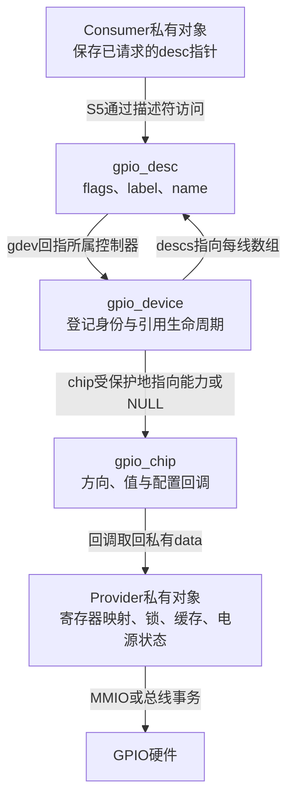
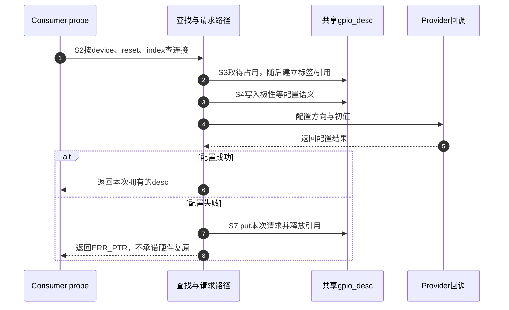
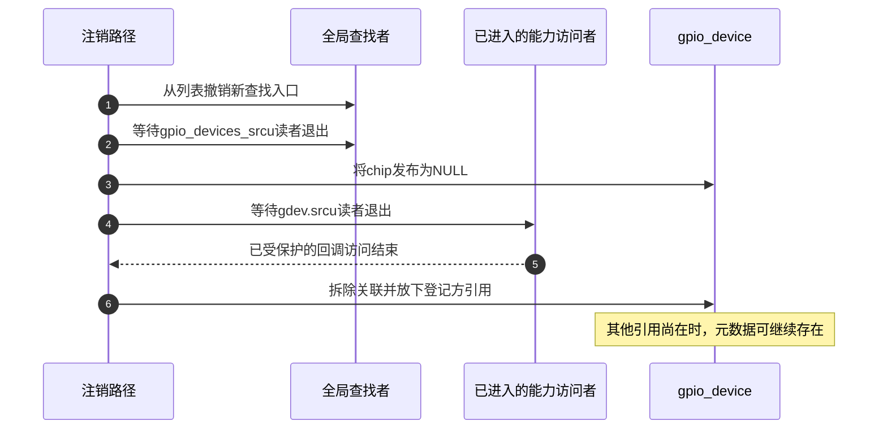

# 第4章\_Linux\_gpiolib的对象与状态交接

上一章已经把“这根线归谁使用”“它现在如何驱动”和“硬件是否还可访问”分开了。现在把同一个传感器场景交给 Linux：reset 被一个驱动请求后，另一个请求者怎样发现冲突？控制器退出以后，尚未关闭的用户句柄为什么不能继续调用它？只画 Consumer 指向 Provider，无法回答这两个问题。

**讲解层次：实现层。** 本章把前文 S0～S7 落到 NXP Linux 6.12.20 的公共 gpiolib 对象与访问路径，先建立整体关系。固定证据是官方 `linux-imx` 提交 `dfaf2136deb2af2e60b994421281ba42f1c087e0`；[源码阅读索引](../../../research/source_reading/gpiolib/navigation/P01_Linux_6.12_GPIO源码阅读索引.md#1.1_版本身份与阅读路线) 提供配置边界与逐段实现。当前核对使用固定源码快照，没有把本机或目标板运行结果混入结论。

## 4.1\_为什么能力表以外还需要控制器对象和线路对象

Provider 知道怎样访问自己的控制器，会提供读值、设方向等回调。若 Consumer 只保存这些函数地址，它仍不知道 line 7 是否已被别人占用，也不能判断这些地址所属的驱动是否正在退出。让每个 Consumer 各存一份“我已申请”的布尔值也不行：两个私有副本互相看不到。

因此，框架需要一个所有请求者都会找到的 **每线状态对象**。同一个控制器的同一个 offset 最终指向同一份 `gpio_desc`，占用位、逻辑极性和请求标签放在那里。请求者竞争的是这份共享对象上的占用状态，并不通过扫描所有驱动的私有指针判断所有者。

还要解决退出后的句柄。假如把描述符数组直接当作 Provider 私有内存一起释放，用户文件仍保存的指针就会悬空。Linux 用 `gpio_device` 保存框架登记身份、描述符数组和可持有的设备引用，用 `gpio_chip` 表示仍能调用的 Provider 能力。控制器可以先撤销能力指针，框架对象则留到引用释放后再销毁。**对象尚在和硬件可用是两个判断。**

从 Consumer 沿访问箭头向下看，最终还要经过 `gdev->chip` 才能进入硬件操作；不能因为最上面的指针非空就跳过这一步。`gdev` 与 `desc` 的两条箭头是数组归属和回指关系，不是中断流或两次硬件访问。

| 已建立的职责 | 具体载体 | 谁写、谁读；不能据此推出什么 |
| --- | --- | --- |
| 提供方向、值和配置能力 | `gpio_chip` 回调及 `ngpio`、`can_sleep` | Provider 初始化，公共调用路径读取；回调存在不代表当前硬件已上电 |
| 统一登记一组线路 | `gpio_device` 的 `dev`、`id`、`descs`、`chip` | 核心注册/撤销，查找与操作路径读取；`id` 是 gpiochip 身份，不是 GPIO 全局 base |
| 保存每线使用状态 | `gpio_desc.flags` 和请求 `label` | 请求、配置、释放路径更新；请求者与查询路径读取；label 是诊断字符串，不是访问权限令牌 |
| 保存板级连接 | 设备 firmware node 中的属性，或 lookup table | 固件/平台提供，S2 解析；不是把引脚电平放进设备树 |
| 承担真实访问与同步 | Provider 私有 `data` 及硬件 | Provider 回调读写；公共层的占用位不会替代共享寄存器锁 |

此处都是软件字段，不是内存映射寄存器，因而不存在一张通用 GPIO 寄存器偏移表。实际寄存器由具体 Provider 对应的芯片决定。[对象字段与受保护访问](../../../research/source_reading/gpiolib/source_explanations/P01_控制器登记与能力撤销.md#1.1_框架对象怎样把描述符和硬件能力分开) 给出本版本的字段定义。

## 4.2\_S1把Provider能力变成可查找的线路集合

设 Provider 提供八根线。注册时，框架不能仅记住“有八根线”，还要让以后查到的 line 0 和 line 7 有各自的占用状态。因此 `gpiochip_add_data_with_key()` 分配 `gpio_device` 和长度为 `ngpio` 的描述符数组，关联父设备/固件节点，把每个描述符的 `gdev` 指回该控制器，并建立查找、通知和可选 IRQ、字符设备等关联。

Provider 的寄存器映射、总线对象、缓存和锁仍在它自己的私有结构中。注册传入的 `data` 只建立关联，回调可取回它；框架不会复制一份寄存器驱动逻辑。这样，S2 的查找依赖统一登记，S5 的实际操作仍由拥有硬件知识的 Provider 完成。

注册内部是多个可能失败的阶段。固定版本先把登记对象加入全局列表，再继续初始化部分状态和固件/IRQ 关联，字符设备建立还受 gpiolib 初始化阶段影响。不能把“函数返回成功”倒推成“所有入口在同一条赋值上同时发布”，也不能只看到列表项就认定每种子功能已就绪。失败路径按已经完成的阶段撤销登记和资源；[登记与错误退出实现](../../../research/source_reading/gpiolib/source_explanations/P01_控制器登记与能力撤销.md#1.2_登记怎样建立数组身份并处理阶段失败) 展开其实际顺序。

## 4.3\_S2至S4把私有需求写成公共占用和配置

Consumer 以自己的 device、功能名 `reset` 和 index 0 查找连接。设备树、ACPI、software node 等解析入口负责找到 Provider 和 offset，并带回 active-low 等连接语义。固件查找无结果时是否继续查平台 lookup table，还要满足该调用允许 fallback 的条件；`-EPROBE_DEFER` 不能被随意当成“无连接”吞掉。

查到描述符只完成 S2。S3 的普通独占请求通过 `test_and_set_bit()` 尝试置 `FLAG_REQUESTED`：若旧值已为 1，返回 `-EBUSY`；若旧值为 0，本次取得占用，继续 Provider 的可选 request 回调和标签设置。成功路径还持有模块与 `gpio_device` 引用。这里原子化的是同一占用位的竞争，不是把全部后续配置变成不可失败的大事务。

S4 才把连接 flags 和调用者要求合起来，例如 active-low 的 reset 请求逻辑 1，应交给硬件物理低电平。若 S4 失败，外层放下已取得的描述符；但此前回调可能已经改过方向或电平，放下占用没有通用的“恢复旧寄存器快照”功能。

步骤 2 成功是步骤 3～5 的前提；占用冲突会提前退出，根本不会为本次请求执行配置。步骤 7 是配置失败以后的清理，不适用于“已经被别人占用”的分支，否则会错误释放别人的线路。具体分支及特殊非独占 flag 见 [查找、请求和配置边界](../../../research/source_reading/gpiolib/source_explanations/P02_描述符请求与托管释放.md#2.1_查找为何必须交接到请求后才能返回)。

## 4.4\_S5的软件方向不总是当前输出驱动开关

普通值接口把“断言 reset”这样的逻辑值交给公共层，公共层依据 `FLAG_ACTIVE_LOW` 转成物理高低，再让 Provider 操作硬件。raw 接口跳过逻辑极性解释，且 raw 输出路径不会代替普通路径完成开漏/开源模拟；它不是应用驱动可以随意混用的另一种拼写。

开漏恰好能检验“方向 flag 等于寄存器位”这个错误模型。开漏输出只能主动拉低，需要高电平时应释放驱动，由上拉形成高电平。硬件不支持相应配置时，公共层可以把引脚切成输入来模拟释放。此时硬件处于输入方向，但本次 Consumer 仍把它当作一个可以继续输出 0/1 的开漏功能，`FLAG_IS_OUT` 因而仍记录输出用途。

| 状态字段 | 本版本承担的意义 | 观察时的限制 |
| --- | --- | --- |
| `FLAG_REQUESTED` | 普通请求已占用 | 不能证明方向配置或业务初始化成功 |
| `FLAG_ACTIVE_LOW` | 普通值接口需要反相 | 不代表底层回调接收逻辑值 |
| `FLAG_IS_OUT` | 框架记录的输出用途 | 开漏/开源模拟可与硬件当前方向不同 |
| `FLAG_OPEN_DRAIN` / `FLAG_OPEN_SOURCE` | 请求的单向驱动语义 | 可能由硬件实现，也可能由方向切换模拟 |
| `FLAG_USED_AS_IRQ` / `FLAG_IRQ_IS_ENABLED` | IRQ 占用及启用状态 | 不等于某次事件已经发生 |

字段与动作的先后顺序也很重要。例如输入方向回调成功后，源码先清 `FLAG_IS_OUT`，再配置 bias；后一步仍可能失败。一个负返回值不能证明之前的硬件和软件状态都未变。沿 [方向与电平实现](../../../research/source_reading/gpiolib/source_explanations/P03_逻辑值怎样变成方向与电平.md#3.1_输入方向成功以后为什么仍可能返回失败) 可以逐句核对这些边界。

如果 Provider 通过 I²C/SPI 访问，事务可能等待总线并发生调度。`can_sleep` 把这一约束交给调用者；`_cansleep` 接口允许这样的路径，**不会替调用者自动切换到线程**。本版本单线 setter 返回 `void`，也不能据一次函数返回证明总线写入成功。读取和方向接口的错误返回与 setter 的限制，下一章按使用场景分别处理。

## 4.5\_S6的事件和电源状态继续保存在各自的承载者中

线路已可读写，并不意味着驱动已经订阅 IRQ。`gpio_chip.irq` 的可选集成及 Provider 的 `to_irq` 能力，把 line 接到 IRQ 子系统的映射、屏蔽和 handler 生命周期。`gpiod_to_irq()` 可以取得或经 Provider 建立映射结果，却不会代替 Consumer 配置输入、选择触发条件和申请处理函数。[第7章](P07_GPIO_中断桥接与事件传播.md) 会从 alert 事件把这些交接连起来。

用户空间请求则由 `gpiolib-cdev.c` 的请求对象和文件引用承载。事件先进入请求的缓冲区，再由等待队列唤醒 `read/poll` 的进程；这和每次读引脚当前值是两种操作。多个文件描述符可引用同一个请求文件，释放以最后一个引用离开为边界，[第8章](P08_用户空间_ABI_迁移与方案选择.md) 再展开。

电源管理也没有一份藏在 `gpio_desc` 中的全能硬件备份。寄存器保存、缓存同步、唤醒掩码和供电约束分别由具体驱动与 PM/IRQ 层负责。描述符仍被占用，只能说明软件生命周期尚未结束，不能证明深度睡眠后引脚电平继续有效。

## 4.6\_S7先结束使用再撤销能力和对象

Consumer 释放线路时，普通路径调用 Provider 的可选 free 回调，清除请求、极性和若干配置标记及标签，发出 released 通知，再放下模块和控制器对象引用。公共层没有无条件切输入或写 0 的动作。退出时先阻止新的业务访问，排空工作项、IRQ 等可能继续访问线路的使用者，再在仍有所有权且硬件可访问时按设备协议设置安全电平，最后释放。若停机本身需要 IRQ 协作，应先完成该协议，再撤销其处理路径；devres 只是帮助登记释放动作。

控制器整体退出还要阻止新查找并排空已有访问。这个版本把 `gpio_device` 从全局列表移除，等待全局查找侧的 SRCU 读者；随后把 `gdev->chip` 设为 NULL，再等待该控制器能力访问侧的 SRCU 读者。SRCU 是允许读侧睡眠的读者保护机制，这里的等待保证已进入受保护区的路径退出，**不是等待若干 GPIO 时钟**。

步骤 2 和步骤 4 等待的是不同读者集合，不能合成一句“加了 RCU 所以安全”。这里的箭头表示对读者集合的等待关系，不表示向每个 Consumer 发送 GPIO 消息。步骤 3 以后的新能力访问看到 NULL 后应走不可用分支，旧访问则由步骤 4 排空。尚有引用的登记对象不再授予已移除硬件的使用权。源码同时要求 Provider 不应在 GPIO 仍被请求时正常移除；这些防护不是鼓励驱动绕过 Consumer 停机顺序。[撤销实现](../../../research/source_reading/gpiolib/source_explanations/P01_控制器登记与能力撤销.md#1.3_撤销为何分两次等待和最后一次放引用) 给出可核对的调用次序。

## 4.7\_用三个现象检查对象模型

先独立判断：①第二个驱动取得同一 offset 时报 busy，是否说明硬件无法被两个 CPU 写？②开漏线路的 `FLAG_IS_OUT` 为 1，但硬件方向为输入，是否一定损坏？③旧用户句柄还在，但控制器访问返回不可用，是否说明引用计数失效？

① busy 首先证明普通独占协议拒绝第二个请求，不能替代寄存器级并发分析；绕过框架仍可能造成电气或状态冲突。②不一定，软件模拟开漏释放正需要暂时停止输出驱动。③不说明失效：引用保护元数据生存，能力指针则独立表示能否调用 Provider。

现在能把前文阶段落到 Linux 的真实状态承载者中，而不把“拿到指针”误当作硬件已经配置好。下一章从 Consumer 出发选择请求形式、初值、错误处理和退出动作：[GPIO Consumer 请求与使用](P05_GPIO_Consumer_请求与使用.md)。
