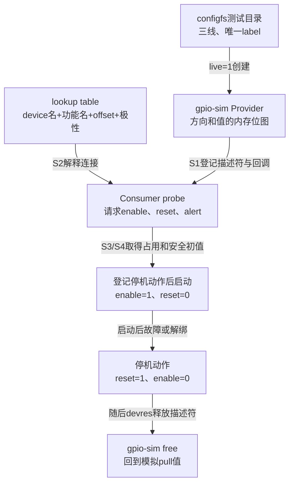

# 第5章\_GPIO\_Consumer\_请求与使用

上一章已经知道，请求成功会取得共享线路状态和引用，方向配置失败与释放却不保证硬件复原。现在让传感器驱动真正使用三根线：enable 控制是否启动，reset 决定是否保持复位，alert 返回状态。驱动必须先取得哪些线、选择什么初值，才不会在准备尚未完成时让设备开始运行？

**讲解层次：Linux Consumer 接口及固定实现。** 本篇按 NXP Linux 6.12.20 的描述符接口解释 S2～S7，仍以 [gpiolib源码索引](../../../research/source_reading/gpiolib/navigation/P01_Linux_6.12_GPIO源码阅读索引.md#1.1_版本身份与阅读路线) 中的官方固定提交为依据。后半提供仅连接 GPIO 模拟器的完整模块实验，用来观察请求、逻辑值和退出，不能证明真实传感器的电气或时序。

## 5.1\_先给设备功能命名再决定线路连接

驱动需要表达“这个设备的 reset”，而不是“系统第 71 根 GPIO”。若把全局整数写死，另一个控制器先注册就可能改变编号；即便编号没变，换板把 reset 改接扩展器也要改业务代码。描述符请求把设备、功能名 `con_id` 和同功能内的 index 交给框架，具体连线由固件或平台连接表提供。

下面是设备树 **消费者片段**，三个 Provider 标签均须在真实板级树中定义；`vendor,my-device` 是教学占位，不能据此期望内核自动出现驱动。节点没有地址资源，因此没有随意添加 `@0` 单元地址。

```dts
my-device {
    compatible = "vendor,my-device";
    enable-gpios = <&gpio1 5 GPIO_ACTIVE_HIGH>;
    reset-gpios = <&gpio2 7 GPIO_ACTIVE_LOW>;
    alert-gpios = <&gpio_expander 3 GPIO_ACTIVE_LOW>;
};
```

`devm_gpiod_get(dev, "reset", GPIOD_OUT_HIGH)` 请求 `reset-gpios` 的第 0 项。若 `data-gpios` 有多项，`devm_gpiod_get_index(dev, "data", 1, ...)` 请求其中第 1 项；这个 index 与 Provider 内的 offset 是不同坐标。驱动只保存取得的 `gpio_desc *`，不把板级 phandle、offset 或 gpiochip 编号当成下一次值操作的参数。

连接换到慢总线扩展器以后，名字和逻辑用途可以保持，但访问上下文和时序成本仍可能改变。本章后面要检查 `_cansleep`，而不能只凭“源码没改”认定换板已经成功。

## 5.2\_取得指针以前先处理缺失和占用

reset 若是设备运行的必要条件，缺失时继续 probe 会让后面所有“复位已经完成”的判断失去依据；可选的状态指示线则可以有明确的无此功能分支。两者在请求时就应区分，而不是在运行过程中遇到 NULL 才临时猜测。

| 需求 | 接口 | 成功结果与缺失语义 |
| --- | --- | --- |
| 必需单线 | `devm_gpiod_get()` | 有效desc；未分配该功能或其他错误为错误指针 |
| 必需同功能的一项 | `devm_gpiod_get_index()` | index从0计数；越界/缺失按查找路径报错 |
| 可选单线/一项 | `devm_gpiod_get_optional()` / `devm_gpiod_get_index_optional()` | 正常启用gpiolib时，未分配功能返回NULL，其他失败仍为错误指针 |
| 同功能多线 | `devm_gpiod_get_array()` | `struct gpio_descs *`，其中有数量和描述符集合；不能当作单个desc |

正常启用路径下，optional 只将“未分配功能”的 `-ENOENT` 转为 NULL，不能吞掉 busy、Provider 未就绪或配置错误。先 `IS_ERR()` 再区分 NULL，才能保留真正失败的原因。另有配置边界：关闭 `CONFIG_GPIOLIB` 时 optional 头文件桩也返回 NULL，所以依赖 GPIO 的驱动必须正确声明配置依赖，不能把每个 NULL 都当成实际板上没接线。

```c
/* 请求阶段片段：alert允许省略；其他初始化仍由所属驱动完成。 */
alert = devm_gpiod_get_optional(dev, "alert", GPIOD_IN);
if (IS_ERR(alert))
    return dev_err_probe(dev, PTR_ERR(alert), "alert request failed\n");
if (!alert)
    dev_info(dev, "本设备不提供alert状态输入\n");
```

这里 `dev_err_probe()` 保留错误码和延迟探测语义；它不会轮询 GPIO 等 Provider 出现。对于必需功能，错误必须返回驱动核心，不能先把错误指针存进运行状态再继续读写。具体请求和托管交接见 [查找向请求交接](../../../research/source_reading/gpiolib/source_explanations/P02_描述符请求与托管释放.md#2.1_查找为何必须交接到请求后才能返回) 与 [devres登记](../../../research/source_reading/gpiolib/source_explanations/P02_描述符请求与托管释放.md#2.3_托管请求怎样补上设备退出动作)。

## 5.3\_初值必须由设备协议推出

给本篇教学设备约定一个明确协议：准备期间 enable 为逻辑 0，reset 为逻辑 1；准备完成后打开 enable，再释放 reset。enable 高有效，reset 低有效。于是请求 enable 应选 `GPIOD_OUT_LOW`，请求 reset 应选 `GPIOD_OUT_HIGH`。后者的 HIGH 指 **逻辑断言**，到推挽低有效引脚才变成物理低。

如果反过来以 OUT_LOW 请求 reset，得到的是逻辑不复位。某些真实设备可能就需要这种接管策略，但必须由它们的协议决定，不能把 OUT_LOW 本身称作普遍安全初值。

| 请求flags | 本次请求的方向和逻辑初值 | 使用前提 |
| --- | --- | --- |
| `GPIOD_IN` | 输入，不主动输出 | 用作输入且外部电气条件成立 |
| `GPIOD_OUT_LOW` | 输出逻辑0 | 初始不激活符合当前功能协议 |
| `GPIOD_OUT_HIGH` | 输出逻辑1 | 初始激活符合当前功能协议 |
| `GPIOD_ASIS` | 不要求本次请求建立方向与初值 | 已明确当前配置和接管协议；不等于获得了可任意set的输出 |
| `GPIOD_OUT_LOW_OPEN_DRAIN` / `GPIOD_OUT_HIGH_OPEN_DRAIN` | 开漏输出逻辑0/1 | 电路与Provider/模拟路径允许开漏 |

这些初始化枚举应选定一种，不能将 `GPIOD_IN | GPIOD_OUT_HIGH` 当作“先输入再输出”。按本设备的协议，三根线都取得并准备好后才启动；若第二根请求失败，第一根虽然会被 devres 释放，但整个设备还没有执行 enable=1 的启动动作。

方向和初值一起交给 Provider，减少“已经打开输出但还是旧锁存值”的窗口；具体控制器能否避免毛刺仍要看其实现。方向软件标志也不是无条件复制寄存器：开漏模拟释放时可暂切输入但仍记录输出用途，输入方向完成后 bias 失败也可能返回错误。上一章的 [方向与电平实现](../../../research/source_reading/gpiolib/source_explanations/P03_逻辑值怎样变成方向与电平.md#3.1_输入方向成功以后为什么仍可能返回失败) 保留这些具体边界。

## 5.4\_一次值访问同时受逻辑语义和上下文约束

设备已启动，驱动现在读取 alert。低有效连接下物理低代表逻辑 1；正常描述符 getter 会完成这次转换，所以业务代码应判断返回值是否为正，而不是再手工反相一次。先检查负值再判断 0/1，否则总线错误也会被 C 的非零条件误判为“告警有效”。

```c
/* 运行阶段片段：当前在线程上下文，且持有必需alert描述符。 */
int value = gpiod_get_value_cansleep(alert);
if (value < 0)
    return value;
if (value)
    dev_info(dev, "alert当前处于逻辑激活状态\n");
```

如果控制器在 I²C/SPI 上，这次读取可能等待总线完成，甚至让出 CPU。因此必须在允许睡眠的上下文使用 `_cansleep`；函数后缀不会替硬中断创建线程。`gpiod_cansleep(desc)` 可查询 Provider 约束，若业务必需硬中断直接读取，就要限制 Provider 类型或改成线程化处理，不能只改函数名。

| 操作 | 本版本返回契约 | 调用者要做的判断 |
| --- | --- | --- |
| `gpiod_get_value()` / `gpiod_get_value_cansleep()` | int，逻辑0/1或负错误 | 必需描述符先取得；负值不能当成真 |
| `gpiod_set_value()` / `gpiod_set_value_cansleep()` | void | 不能接收ret，也不能视为设备协议确认 |
| `gpiod_direction_input()` / `gpiod_direction_output()` | int，0或负错误 | 检查结果；失败可能已有部分状态变化 |
| `gpiod_cansleep()` | 是否可能睡眠 | 约束调用上下文，不测量这次实际耗时 |
| `gpiod_get_direction()` | 0输出、1输入或负错误 | 这是方向编码，不能与普通getter的逻辑值混淆 |

`can_sleep=false` 的线路可在适合的原子路径用普通接口，也可在线程中用 `_cansleep`；`can_sleep=true` 的线路不能在硬中断、关中断区或自旋锁临界区作可能睡眠的访问。这个表只解释 GPIO 回调约束，不替驱动证明其他代码也满足当前上下文。

raw 接口用于明确需要物理语义的路径。它不做 active-low 换算，raw 输出还绕过普通路径的开漏/开源模拟选择，不能把 raw 当作“同样结果但更直接”的替代品。开漏释放还需要有效上拉：代码请求物理高不等于电路一定已经建立高电压。

## 5.5\_把错误返回和资源释放分开处理

同样是 probe 失败，可能发生在没找到连接、被别人占用，或已经改过硬件之后。下一步如何处理取决于失败位置，而不是把所有错误都改成 `-EINVAL`。

| 典型错误 | 先回到哪个阶段 | 合理解释 |
| --- | --- | --- |
| `-ENOENT` | S2 | 未分配该功能；只有真正可选功能才转为无此能力分支 |
| `-EPROBE_DEFER` | S2/S3 | 依赖未就绪，交驱动核心重试；不是忙等几毫秒 |
| `-EBUSY` | S3 | 已有不兼容占用；不释放别人的请求 |
| `-ENODEV` | 能报告错误的访问路径 | Provider不可用；不能据void setter期待同样返回码 |
| `-EIO`等回调错误 | S4或getter | 检查能力组合、总线与Provider；已经执行的配置不保证复原 |

普通 `gpiod_get()` 成功后由调用者安排一次对应 put；托管 get 由设备资源清理安排。托管资源若需要提前交还，应使用对应 `devm_gpiod_put()`，不能普通 put 后又让 devres 再释放一次。GPIO 数组也要用数组对应的释放接口。

更深一层的问题是业务状态。描述符释放不会知道“这个设备还在采样”，也不会先取消驱动私有工作项。正确顺序是阻止新业务、完成必要停机协议并排空异步使用者，在硬件仍可访问且仍持有线路时设定退出状态，再释放。若停机本身依赖中断应答，先保留该处理路径完成握手，随后再撤销。下一节实验没有异步使用者，故可以把停机动作放在最后登记的 devres 回调中。

## 5.6\_用模拟Provider观察完整请求周期

只给一段 probe 看不到设备从哪里来、失败后谁清理。本实验提供完整模块，自己创建一个测试 platform device，并用 **平台 GPIO lookup table** 给它描述三根连接。真实驱动通常由总线/固件枚举，这里的自建对象只为隔离实验，不是建议把所有板级描述写回驱动。

Provider 选 Linux 的 `gpio-sim`。它把方向和值放在内核内存，使用 mutex 并声明 `can_sleep=true`，所以无需接真实引脚，也能检查调用上下文契约。configfs 是一个通过创建目录和写属性来配置内核对象的文件系统；本例用它创建一个专用三线模拟 chip，再由驱动按唯一 chip label 找到它。`gpiochipN` 的 N 仍动态产生，绝不写死。



图中连接表负责查找，模拟器负责线路状态，两者不会因为都在测试模块附近就变成同一种资源。停机动作必须在 GPIO 资源之后登记，devres 逆序释放时才能先执行它；此时三个描述符和 `state` 都还活着。若动作记录分配失败，`devm_add_action_or_reset()` 当场调用停机动作，再返回失败，之后已有资源继续正常清理。

实验仅适用于隔离的 Linux 6.12.20 测试环境：需要匹配运行内核的可用构建树、模块装载权限、`CONFIG_GPIOLIB=y`、`CONFIG_GPIO_SIM` 及其 configfs/IRQ_SIM 依赖。本例还用 libgpiod 2.3.1 的 `gpiodetect` 查询 chip 身份，因此启用 `CONFIG_GPIO_CDEV` 并准备对应工具。本次文档整理没有在目标内核构建或运行下列模块，后面的结果是按固定实现给出的 **预期观察**。

## 5.7\_为请求周期建立三根模拟线

在测试 Linux 的同一个 root shell 中执行，后续继续使用这里得到的变量。先装入模拟驱动并确认 configfs 挂载类型：

```bash
# 位置：测试Linux；工具需要mountpoint、findmnt和readlink。
set -eu
test ! -d /sys/module/gpio_consumer_demo || exit 1
modprobe gpio-sim
if ! mountpoint -q /sys/kernel/config; then
    mount -t configfs configfs /sys/kernel/config
fi
test "$(findmnt -n -o FSTYPE --target /sys/kernel/config)" = configfs || exit 1
test -d /sys/kernel/config/gpio-sim || exit 1
gpiodetect --version
```

`set -eu` 使未处理的命令错误或未设置变量立即停止当前测试shell，避免准备失败后继续后续步骤。若驱动已内建，确认 configfs 的 gpio-sim 目录存在即可；模块不可用时先检查内核配置，不改用任意真实 gpiochip。这里只在未挂载时挂载，最后也不卸载别人可能使用的整个 configfs。

```bash
# 仍在同一测试shell；拒绝重用已有同名目录或chip label。
demo_root=/sys/kernel/config/gpio-sim/linux_note_consumer
test ! -e "$demo_root" || exit 1
chip_list=$(LC_ALL=C gpiodetect) || exit 1
case "$chip_list" in
    *"[linux-note-consumer-sim]"*) exit 1 ;;
esac
mkdir "$demo_root"
mkdir "$demo_root/bank0"
printf '%s\n' 3 > "$demo_root/bank0/num_lines"
printf '%s\n' linux-note-consumer-sim > "$demo_root/bank0/label"
printf '%s\n' 1 > "$demo_root/live"
chip_name=$(cat "$demo_root/bank0/chip_name")
chip_dir=$(readlink -f "/sys/bus/gpio/devices/$chip_name")
sim_device=$(cat "$demo_root/dev_name")
test "$(basename "$(dirname "$chip_dir")")" = "$sim_device" || exit 1
chip_list=$(LC_ALL=C gpiodetect) || exit 1
printf '%s\n' "$chip_list" | grep -F -x "$chip_name [linux-note-consumer-sim] (3 lines)" || exit 1
test -d "$chip_dir/sim_gpio2" || exit 1
printf '%s\n' pull-up > "$chip_dir/sim_gpio1/pull"
printf '%s\n' pull-up > "$chip_dir/sim_gpio2/pull"
```

`live=1` 要等模拟设备成功 probe 才完成；`chip_name` 给出实际 gpiochip 身份，`dev_name` 用于检查它确实属于本次创建的模拟 platform device。`gpiodetect` 通过字符设备查询 label 与线路数，`grep -F -x` 要求完整匹配本 chip 的那一行；不依赖并不存在于所有 gpiochip 设备目录中的 `label` 文件。工具输出形式见 [libgpiod 2.3.1官方示例](https://libgpiod.readthedocs.io/en/v2.3.1/gpio_tools.html)。

两次 pull-up 分别设 reset 的释放后参考电平、alert 的当前物理输入。alert 低有效，因此物理高应读作逻辑 0。模拟器的 `label` configfs 属性在这个固定版本的 `gpio_sim_bank_config_attrs` 中存在，这里写的是模拟器创建参数，和前面查询 chip 身份是不同接口。

## 5.8\_完整模块把启动和退出写在同一个生命周期内

新建空实验目录，将以下代码保存为 `gpio_consumer_demo.c`。同内容材料见 [模块源码](../../../labs/kernel/gpio/materials/gpio_consumer_demo.c)，但当前正文已给出全部实现。`demo_lookup.dev_id` 必须与创建的 platform device 名称一致，`GPIO_LOOKUP` 的第一个字符串必须匹配刚建立的 chip label；宏为单线功能填入 index 0，末尾空项终止表。

```c
// SPDX-License-Identifier: GPL-2.0
/* 仅连接本章创建的 gpio-sim；不用于真实设备的供电或复位。 */
#include <linux/delay.h>
#include <linux/device.h>
#include <linux/err.h>
#include <linux/gpio/consumer.h>
#include <linux/gpio/machine.h>
#include <linux/module.h>
#include <linux/platform_device.h>
#include <linux/slab.h>

struct gpio_demo_state {
    struct device *dev;
    struct gpio_desc *enable;
    struct gpio_desc *reset;
    struct gpio_desc *alert;
};

static bool fail_after_start;
module_param(fail_after_start, bool, 0444);
MODULE_PARM_DESC(fail_after_start, "启动后注入probe失败，检查托管停机");

static struct platform_device *demo_device;

/* 测试连接表：key是唯一的chip label，不是动态gpiochipN。 */
static struct gpiod_lookup_table demo_lookup = {
    .dev_id = "gpio_consumer_demo",
    .table = {
        GPIO_LOOKUP("linux-note-consumer-sim", 0, "enable", GPIO_ACTIVE_HIGH),
        GPIO_LOOKUP("linux-note-consumer-sim", 1, "reset", GPIO_ACTIVE_LOW),
        GPIO_LOOKUP("linux-note-consumer-sim", 2, "alert", GPIO_ACTIVE_LOW),
        { }
    }
};

static void gpio_demo_stop(void *data)
{
    struct gpio_demo_state *state = data;

    /* 没有异步使用者；按教学协议先断言复位，再关闭使能。 */
    gpiod_set_value_cansleep(state->reset, 1);
    gpiod_set_value_cansleep(state->enable, 0);
    dev_info(state->dev, "stop requested: reset=1 enable=0 (logical)\n");
}

static int gpio_demo_probe(struct platform_device *pdev)
{
    struct device *dev = &pdev->dev;
    struct gpio_demo_state *state;
    int ret;

    state = devm_kzalloc(dev, sizeof(*state), GFP_KERNEL);
    if (!state)
        return -ENOMEM;
    state->dev = dev;

    state->enable = devm_gpiod_get(dev, "enable", GPIOD_OUT_LOW);
    if (IS_ERR(state->enable))
        return dev_err_probe(dev, PTR_ERR(state->enable), "enable request failed\n");
    state->reset = devm_gpiod_get(dev, "reset", GPIOD_OUT_HIGH);
    if (IS_ERR(state->reset))
        return dev_err_probe(dev, PTR_ERR(state->reset), "reset request failed\n");
    state->alert = devm_gpiod_get(dev, "alert", GPIOD_IN);
    if (IS_ERR(state->alert))
        return dev_err_probe(dev, PTR_ERR(state->alert), "alert request failed\n");

    /* 在全部描述符之后登记，资源清理时先停机，再释放这些描述符。 */
    ret = devm_add_action_or_reset(dev, gpio_demo_stop, state);
    if (ret)
        return ret;

    gpiod_set_value_cansleep(state->enable, 1);
    /* 1ms仅是教学时序，不是任何真实传感器的参数。 */
    usleep_range(1000, 1500);
    gpiod_set_value_cansleep(state->reset, 0);
    ret = gpiod_get_value_cansleep(state->alert);
    if (ret < 0)
        return dev_err_probe(dev, ret, "alert read failed\n");
    dev_info(dev, "started: alert=%d (logical)\n", ret);

    if (fail_after_start)
        return dev_err_probe(dev, -EIO, "injected failure after start\n");
    platform_set_drvdata(pdev, state);
    return 0;
}

static void gpio_demo_shutdown(struct platform_device *pdev)
{
    struct gpio_demo_state *state = platform_get_drvdata(pdev);

    /* 系统关机不依赖devres解绑；动作在本例中可重复执行。 */
    if (state)
        gpio_demo_stop(state);
}

static struct platform_driver demo_driver = {
    .probe = gpio_demo_probe,
    .shutdown = gpio_demo_shutdown,
    .driver = {
        .name = "gpio_consumer_demo",
    },
};

static int __init gpio_demo_init(void)
{
    int ret;

    /* 本实验自己枚举模拟消费者；真实设备由对应总线/固件枚举。 */
    gpiod_add_lookup_table(&demo_lookup);
    ret = platform_driver_register(&demo_driver);
    if (ret)
        goto remove_lookup;
    demo_device = platform_device_register_simple("gpio_consumer_demo", -1, NULL, 0);
    if (IS_ERR(demo_device)) {
        ret = PTR_ERR(demo_device);
        platform_driver_unregister(&demo_driver);
        goto remove_lookup;
    }
    return 0;

remove_lookup:
    gpiod_remove_lookup_table(&demo_lookup);
    return ret;
}

static void __exit gpio_demo_exit(void)
{
    /* 先撤销消费者并完成devres清理，最后撤销它使用的连接表。 */
    platform_device_unregister(demo_device);
    platform_driver_unregister(&demo_driver);
    gpiod_remove_lookup_table(&demo_lookup);
}

module_init(gpio_demo_init);
module_exit(gpio_demo_exit);
MODULE_LICENSE("GPL");
MODULE_DESCRIPTION("GPIO consumer lifecycle lesson using gpio-sim only");
```

`gpio_demo_probe()` 取得三根线后才登记停机和执行启动，读取 alert 的负返回值会原样结束 probe；`fail_after_start` 则在正常启动以后故意返回 `-EIO`。这两种失败都发生在停机动作登记之后，所以 devres 先停机，再释放 alert、reset、enable，最后释放 state。代码没有工作项、用户入口或已请求 IRQ，不存在被省略的异步停止步骤；增加这些功能时必须重新设计退出。

模块退出先注销测试 device，使其解除绑定和资源持有，再注销 driver，最后撤销 lookup table。系统 shutdown 另有回调，因为关机不应靠设备解绑时机猜测停机动作会执行。模块的 init 注册成功与设备 probe 成功是两个结果：后面必须检查实际绑定，不能只看 insmod 返回 0。

## 5.9\_用匹配运行内核的构建树生成模块

同目录保存 `Makefile`：

```makefile
# 在匹配目标内核的构建树中用 M=本目录 构建此教学模块。
obj-m += gpio_consumer_demo.o
```

在该目录执行原生目标构建；下面默认运行内核的 build 链接已经准备完整：

```bash
# 位置：包含gpio_consumer_demo.c与Makefile的实验目录。
kernel_build=/lib/modules/$(uname -r)/build
test -d "$kernel_build" || exit 1
make -C "$kernel_build" M="$PWD" modules
```

`-C` 进入内核构建树，`M` 指回实验目录，产物应包含 `gpio_consumer_demo.ko`。若只拿到未准备的源码树，必须先完成目标配置和所需构建产物，不能用另一版本头文件凑出模块。交叉构建还需匹配目标 ARCH、工具链及最终运行内核；本实验不把本机 C 编译成功冒充 Kbuild/MODPOST 验证。

## 5.10\_分别观察正常退出和启动后失败

模块已经生成，模拟Provider也已就绪。先验证成功启动与卸载的完整周期，再用同一个输入环境注入失败；两次只改变模块参数，才知道清理行为的差别来自哪个分支。

### 5.10.1\_先预测逻辑值与模拟物理值

当前 reset 与 alert 的模拟 pull 都为高。装入默认模块后，enable 变逻辑1，reset 变逻辑0；对应物理值均为1，alert物理1应报告逻辑0。先写下这个预测，再读取模拟器的 value 属性。

```bash
# 位置：同一root测试shell及模块目录，沿用chip_dir。
insmod ./gpio_consumer_demo.ko
test -L /sys/bus/platform/devices/gpio_consumer_demo/driver || exit 1
cat "$chip_dir/sim_gpio0/value"
cat "$chip_dir/sim_gpio1/value"
cat "$chip_dir/sim_gpio2/value"
dmesg | tail -n 20
```

预期三个 value 依次为1、1、1，日志含 `started: alert=0 (logical)`。`sim_gpioN/value` 是该模拟器的状态观察口，没有像第二次 GPIO 请求那样抢占已持有线路。它不能测量真实电压，也没有模拟真实传感器内部响应。

卸载时先观察停机请求，再观察 Provider 释放后的值：

```bash
# 位置：同一测试shell；先退出Consumer，保持模拟Provider可用。
rmmod gpio_consumer_demo
dmesg | tail -n 20
cat "$chip_dir/sim_gpio0/value"
cat "$chip_dir/sim_gpio1/value"
```

预期日志出现 `stop requested: reset=1 enable=0 (logical)`，它表示驱动发出了停机写请求；随后读到 enable=0、reset=1。reset 为何不是停机时请求的物理0？因为 `gpio_sim_free()` 在释放时把 value 改回 pull_map，实验给 reset 设置了 pull-up。**安全状态请求发生在持有期间，释放后的状态另受 Provider 影响。** 真实器件的释放行为必须查真实 Provider，不能把模拟器结果推广成所有 GPIO 必然拉高。

### 5.10.2\_再让probe在启动后故意失败

上一轮已卸载消费者，保留同一个模拟 chip，再装入故障参数：

```bash
# 位置：同一测试shell及模块目录。
insmod ./gpio_consumer_demo.ko fail_after_start=1
test ! -L /sys/bus/platform/devices/gpio_consumer_demo/driver || exit 1
dmesg | tail -n 20
cat "$chip_dir/sim_gpio0/value"
cat "$chip_dir/sim_gpio1/value"
rmmod gpio_consumer_demo
```

模块仍可能装入成功，但测试设备不应绑定该 driver。预期日志依次表明启动、注入失败、执行 stop requested；资源释放后模拟输出仍回到 enable=0、reset=1。这个结果检验的是“启动后的错误出口也有停机动作”，而不是只有正常 rmmod 才清理。驱动核心的其他日志可能穿插其间，不要求整段 dmesg 完全相同。

若观察不符合预期，先保存构建版本、绑定链接、错误码与本次日志，再按请求/配置/动作登记定位；不要先替换 chip_name 猜另一个控制器。完成测试后只撤销本实验的对象：

```bash
# 位置：同一测试shell；消费者模块必须已经卸载。
test ! -d /sys/module/gpio_consumer_demo || exit 1
printf '%s\n' 0 > "$demo_root/live"
rmdir "$demo_root/bank0"
rmdir "$demo_root"
```

没有递归清理其他模拟器或卸载整个 configfs。若准备阶段失败留下部分目录，先确认本实验模块未加载，再对这里实际创建的目录按同样先live=0、后bank、后device顺序处理，不删除系统中其他 chip。

## 5.11\_用变化条件判断自己是否掌握接口契约

第一问：把 reset 的连接极性改成高有效，但仍要求初始保持复位，应把 OUT_HIGH 改成 OUT_LOW 吗？不应。逻辑断言仍是1，改变的是连接到物理电平的映射。是否允许这样的换板首先由真实电路决定。

第二问：将返回值写成 `if (gpiod_get_value_cansleep(alert))` 有什么问题？负错误也是真，可能被当成告警。先判断负值，再解释逻辑0/1。

第三问：把模拟器换成不可睡眠的 MMIO Provider，是否必须删掉所有 `_cansleep`？不必。线程上下文仍可使用它；只有明确要进入原子路径，才应同时检查 Provider 和本段其他操作的上下文约束。

第四问：删掉停机 action，保留全部 devm get，是否仍保证启动后失败时设备被正确停止？不保证。描述符清理不会替 Consumer 执行业务停机，更不会保证释放后的电平。若加入工作项，原 action 还须先确保工作项不会继续访问，不能只多写一次 reset。

接口依据为固定版本 [consumer.h](https://github.com/nxp-imx/linux-imx/blob/dfaf2136deb2af2e60b994421281ba42f1c087e0/include/linux/gpio/consumer.h)、[Consumer文档](https://github.com/nxp-imx/linux-imx/blob/dfaf2136deb2af2e60b994421281ba42f1c087e0/Documentation/driver-api/gpio/consumer.rst)；实验连接与状态依据为 [machine.h](https://github.com/nxp-imx/linux-imx/blob/dfaf2136deb2af2e60b994421281ba42f1c087e0/include/linux/gpio/machine.h)、[GPIO模拟器说明](https://github.com/nxp-imx/linux-imx/blob/dfaf2136deb2af2e60b994421281ba42f1c087e0/Documentation/admin-guide/gpio/gpio-sim.rst) 及 [gpio-sim.c](https://github.com/nxp-imx/linux-imx/blob/dfaf2136deb2af2e60b994421281ba42f1c087e0/drivers/gpio/gpio-sim.c)。这些链接用于追溯；请求、实验和观察含义均已在正文中给出。

现在可以把 GPIO 请求放进一个有成功、失败和退出的 Consumer 生命周期。尚未回答的是 Provider 怎样锁住共享寄存器、完成初值切换和兑现模拟/真实硬件能力；下一篇继续 [GPIO Provider 控制器实现](P06_GPIO_Provider_控制器实现.md)。
