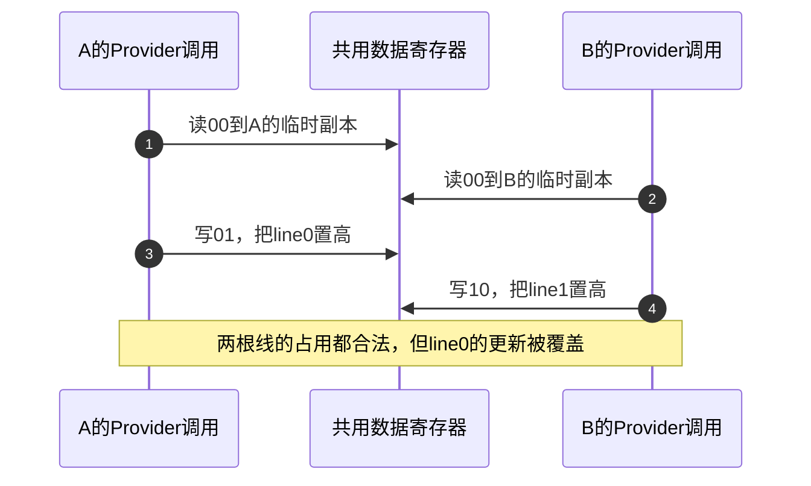

# 第6章\_GPIO\_Provider\_控制器实现

上一章的 Consumer 已经能取得 enable、reset、alert，并区分启动、运行和退出。现在沿一次 `gpiod_set_value_cansleep()` 再向下追问：公共层完成了极性转换，谁真正改变线路？同一组线路由不同设备分别占用时，为什么仍然可能互相覆盖？本章从这些缺口解释 Provider 的状态、回调与生命周期；输入事件如何送入 IRQ 核心留给下一章。

## 6.1\_线路各有主人为什么仍会丢更新

设 A 独占控制器的 line0，B 独占 line1，两者都要把自己的输出置为物理高。若这两位共用一个数据寄存器，Provider 采用“读整个字、改一位、写整个字”，A 与 B 就会访问同一个状态地址。初值为二进制 `00` 时，可能出现下面的合法调用交错。



步骤1、2读到了同一旧值；步骤4并不知道步骤3已经更新 line0。最终 `10` 不是 A、B 期望的 `11`。**每线所有权保护的是“谁可以操作这根线”，寄存器事务保护的是“多个合法操作怎样共同修改一个存储单元”。** 前者不能替代后者。

Provider 因此要把读、修改、写组成受保护的事务。若该路径可能在硬中断上下文执行，锁和访问本身都必须适合该上下文；若硬件提供真正独立的置位/清位命令，可按硬件契约避免这一整字覆盖。后一种方法仍不能自动解决方向寄存器、软件影子值或多寄存器协议的竞争。硬件是否提供这些能力，要查具体控制器，不能从 `gpio_chip` 推断出来。

这里开始涉及固定 Linux 实现，版本、配置和源码入口统一见 [GPIO源码阅读索引](../../../research/source_reading/gpiolib/navigation/P01_Linux_6.12_GPIO源码阅读索引.md#1.1_版本身份与阅读路线)：NXP 官方 Linux 6.12.20 的固定提交。下文的 `gpio-sim` 是该版本的模拟控制器驱动，不是某块 SoC 的寄存器模型。

## 6.2\_Provider在公共层下面保存什么

公共层把控制器和 offset 交给 Provider。offset 是控制器内 `0..ngpio-1` 的局部编号；“reset 属于谁、低有效逻辑1意味着什么”已经由连接和公共层处理。Provider 的方向输出和值回调接到的是物理取值意义上的 0/1，不能再因为业务名字叫 reset 就私自反转一次。

具体状态留在 Provider 私有对象里：MMIO 控制器需要寄存器映射和并发保护，总线扩展器可能需要 regmap、缓存和电源状态，模拟控制器则使用内存位图。`gpio_chip` 保存公共层能调用的能力和描述；注册时的私有 data 让回调通过 `gpiochip_get_data()` 找回所属实例。因此同一个回调函数可以服务多个控制器实例，而不是依赖一个全局硬件地址。


图的两条末端是不同实现选择，不能把模拟器位图当成真实控制器必备的电路。gpiolib 的 desc 保存请求语义，Provider 私有状态保存具体实现，pad 还受 pinmux、电源和外部电路影响。只读其中一层，不能证明其他层已经到达同一状态。

## 6.3\_先确定操作语义再填写回调

实现新 Provider 之前，应先回答三件事：它有多少根有效线路，方向和数据怎样改变，操作能否睡眠。随后才有依据填写 `gpio_chip`。例如某芯片只有输入，就不应编造输出能力；总线写入需要等待传输，便不能把 `can_sleep` 填成 false 来迎合调用者。

下面是本章需要的接口契约摘要，实际定义位于固定版本 `include/linux/gpio/driver.h`。回调不是硬件寄存器，表中参数也不是寄存器地址。

| 成员或回调 | 交接内容 | 返回或边界 |
| --- | --- | --- |
| `label`、`parent`、`fwnode`、`owner` | 功能标签、所属设备、固件身份和模块归属 | 标签不是固定 gpiochip 编号；模块引用也不等于禁止所有设备解绑 |
| `base = -1`、`ngpio` | 动态全局 base 与线路数量 | 固定非负 base 已被该版本标为弃用；稳定连接使用 Provider 身份和局部 offset |
| `request(gc, offset)` / `free(gc, offset)` | 可选的每线激活/退出动作 | request 返回0或负错误；free无返回值，可涉及电源或pin控制，不保证恢复旧电平 |
| `get_direction()` | 查询当前方向 | 0输出、1输入或负错误；建议实现，不能按“1就是输出”猜测 |
| `direction_input()` / `direction_output(..., value)` | 建立输入，或同时交接输出方向和初值 | 0或负错误；固定方向芯片可按核心契约省略不需要的回调 |
| `get()` / `set(..., value)` | 读取或改变物理取值意义上的电平 | get为0/1或负错误；set为void，无法向这一层调用者同步返回写错误 |
| `get_multiple(..., mask, bits)` / `set_multiple(...)` | mask选择线路，bits承载对应值 | get返回0或负错误；set为void；批量不等于物理同时切换 |
| `set_config(..., config)` | 接收打包的pinconf参数，例如bias | 只实现真实支持的配置；不支持不能伪报成功 |
| `can_sleep` | get/set是否可能睡眠 | 反映实现的执行约束，不负责把调用自动搬进线程 |
| `to_irq()`、可选的 `gpio_chip.irq` | 把线路接入IRQ映射与控制能力 | `to_irq`回调不得睡眠；不等于已经请求handler或配置输入方向 |

上表把输出初值放在 `direction_output` 里，是有原因的。如果公共层只能先启用输出再写数据，旧锁存值可能短暂被主动驱到引脚；把方向与初值交给同一个 Provider 操作，具体驱动才有机会按照硬件允许的顺序实施。

依据：[固定版本 gpio_chip 定义与成员契约](https://github.com/nxp-imx/linux-imx/blob/dfaf2136deb2af2e60b994421281ba42f1c087e0/include/linux/gpio/driver.h#L323)。公共层如何转换逻辑极性及选择开漏模拟，已经展开在 [方向与电平实现](../../../research/source_reading/gpiolib/source_explanations/P03_逻辑值怎样变成方向与电平.md#3.2_逻辑输出怎样选择主动驱动或释放线路)，这里继续追踪交给 Provider 以后的责任。

## 6.4\_输出初值必须和输出使能一起推理

考虑一种明确的教学硬件模型：有输出锁存值和输出使能两个独立状态，允许在输出关闭时改锁存值。当前锁存值为1，目标是输出0。如果先打开输出再写0，中间会主动输出1。若先准备锁存0再启用输出，中间保持不主动驱动，启用时直接输出0。

这个顺序只对上述硬件条件成立。真实控制器可能有合并写接口、写屏障要求、专门的输出使能规则或由外部上拉维持的输入电平；需要按其手册选择实现。软件锁解决本驱动的交错，不会自动保证两次 MMIO 的设备可见顺序，更不保证 bootloader 交接以来从未出现过脉冲。

下面用一个不访问硬件的 C11 程序，同时观察丢更新和初值顺序。程序把两个调用的步骤手工交错，保证每次运行都能看到反例；没有启动线程，不把 C 数据竞争当作演示工具。`data` 是教学存储单元，`latch` 是模拟输出锁存值，`output_enabled` 表示是否主动驱动；它们没有芯片地址或固定寄存器位号。

保存为 `provider_transaction_model.c`，也可取用 [配套源码](../../../labs/kernel/gpio/materials/provider_transaction_model.c)。预测第二次整字写入会留下什么，以及哪一步出现了错误的主动输出。

<!-- GPIO_PROVIDER_MODEL_BEGIN -->
```c
#include <stdbool.h>
#include <stdio.h>

/* 教学内存单元：不是MMIO地址，不访问任何GPIO。 */
struct output_cell {
    bool latch;
    bool output_enabled;
};

static void show_output(const char *stage, const struct output_cell *cell)
{
    /* 这里只观察主动输出；高阻输入的实际电平另由外部电路决定。 */
    printf("%s latch=%d driven=%s\n", stage, cell->latch,
           !cell->output_enabled ? "off" : cell->latch ? "1" : "0");
}

#define CHECK(condition) do { \
    if (!(condition)) { \
        fprintf(stderr, "check failed: %s\n", #condition); \
        return 1; \
    } \
} while (0)

int main(void)
{
    unsigned int data = 0;
    unsigned int snapshot_a, snapshot_b;
    struct output_cell cell = { .latch = true, .output_enabled = false };

    /* A独占line0，B独占line1；合法所有权没有阻止共享字的交错。 */
    snapshot_a = data;
    snapshot_b = data;
    data = snapshot_a | 1u;
    data = snapshot_b | 2u;
    printf("interleaved data=%u (wanted 3)\n", data);
    CHECK(data == 2u);

    /* 模拟锁保护下的完整事务序列；这里没有实现真正的并发锁。 */
    data = 0;
    snapshot_a = data;
    data = snapshot_a | 1u;
    snapshot_b = data;
    data = snapshot_b | 2u;
    printf("serialized data=%u\n", data);
    CHECK(data == 3u);

    /* 模拟两个硬件置位命令的契约；|=本身不是C并发原子操作。 */
    data = 0;
    data |= 1u;
    data |= 2u;
    printf("set-bit commands data=%u\n", data);
    CHECK(data == 3u);

    /* 假定硬件允许在输出关闭时准备锁存值，目标输出是0。 */
    show_output("wrong before", &cell);
    cell.output_enabled = true;
    show_output("wrong enable first", &cell);
    CHECK(cell.output_enabled && cell.latch);
    cell.latch = false;
    show_output("wrong finally", &cell);

    cell = (struct output_cell){ .latch = true, .output_enabled = false };
    cell.latch = false;
    show_output("right prepare first", &cell);
    CHECK(!cell.output_enabled && !cell.latch);
    cell.output_enabled = true;
    show_output("right enable", &cell);
    CHECK(cell.output_enabled && !cell.latch);

    puts("all transaction model checks passed");
    return 0;
}
```
<!-- GPIO_PROVIDER_MODEL_END -->

在保存该文件的实验目录执行；这是宿主程序，不使用上一章模块的 Kbuild Makefile：

```bash
cc -std=c11 -Wall -Wextra -Werror provider_transaction_model.c -o provider_transaction_model
./provider_transaction_model
```

Windows 的 MinGW GCC 可用相同选项构建，在 PowerShell 执行 `.\provider_transaction_model.exe`。预期先得到 `interleaved data=2 (wanted 3)`，随后两个正确模型都得到3。`wrong enable first` 显示 `driven=1`；`right prepare first` 显示 `driven=off`，随后 `right enable` 直接为0。所有检查通过时输出最后一行，否则返回非零。

把 B 的快照读取移到 A 写入以后，并把第一项检查的预期同步改为3，反例就消失了；这说明故障依赖交错，不说明原始无保护算法安全。程序验证状态模型和操作顺序，不验证真实锁、MMIO屏障、总线时延或物理毛刺宽度。

## 6.5\_gpio-sim怎样把这些职责落在真实状态上

上一章使用的 gpio-sim 没有焊盘和寄存器。它仍是一个真实 Linux Provider：公共层照常请求线路、执行回调和释放，因此可以观察软件协议。它把一个 bank 的状态保存在 `struct gpio_sim_chip`，其中嵌入 `gc`，并给每根线分配位图位置。

例如上一章的低有效 reset 位于 offset1。请求后 `request_map` 的bit1被置位；输出初值先在公共层转换为物理值，再交给模拟器，模拟器在 mutex 保护下更新方向和 `value_map` 的bit1。普通 setter 只改值，不重新取得线路占用。释放时模拟器把该位改成 `pull_map` 中相应位的值并清请求位，这正是上一章卸载后值可能与停机时不同的原因。这里说的是位图中的bit1，不是 `unsigned long` 数组的第二个元素。

| 私有状态 | 保存什么 | 谁写、谁读 |
| --- | --- | --- |
| `gc` | 公共能力与身份 | 登记前填写；gpiolib调用其回调 |
| `request_map` | 模拟器看到的线路请求状态 | request/free写；模拟pull变化时读取；不替代公共desc的排他占用 |
| `direction_map` | 1输入、0输出 | 方向回调写；查询方向与模拟输入变化路径读 |
| `value_map` | 当前模拟物理值 | set、方向输出、pull传播和free写；get及观察接口读 |
| `pull_map` | 模拟外部pull选择 | pull配置写；free时用它决定释放后的值 |
| `lock` | 以上相关操作的mutex | 回调和模拟输入注入路径共用；保护位图事务 |

位图不是一套统一的“GPIO状态码”：方向、请求和值仍分别变化。模拟器的方向输出实现先改方向位再改值，但在同一个 mutex 区间内完成；受同一锁保护的读者看不到中间步骤。这里没有真实引脚，不能因此推导真实 MMIO 控制器也应先开输出再写初值。

这一实现用 mutex，所以即使只操作内存，也设置 `can_sleep = true`。这说明“是不是片上硬件”与“API是否可能睡眠”不是同一个分类轴。字段和回调的唯一实现展开见 [模拟控制器状态与回调](../../../research/source_reading/gpiolib/source_explanations/P04_模拟控制器的状态与回调.md#4.1_位图怎样承接每线状态)，函数之间如何交接见 [模拟器模块导读](../../../research/source_reading/gpiolib/navigation/P03_GPIO模拟器如何兑现控制器能力.md#3.1_从Consumer的三根线追到一个bank)。

## 6.6\_注册必须发布已经能工作的能力

Provider 的 S1 对应 [统一周期中的登记阶段](P02_GPIO_角色_状态与完整操作周期.md#2.3_统一的_S0～S7_周期)。登记以后公共层可能调用回调，所以私有对象、锁、回调依赖的硬件或模拟状态必须先准备好。`ngpio = 32` 也不是通用模板：它必须来自真实硬件能力或被校验的实例配置。

gpio-sim 的 bank 建立路径先读取 `ngpios` 和标签，分配请求、方向、值、pull位图，设置默认输入，建立模拟 IRQ domain 和 mutex；随后填写 `gc` 的能力、`base = -1` 和所属固件节点，再调用 `devm_gpiochip_add_data(dev, gc, chip)`。这里最后一个 `chip` 是模拟器私有对象，后续回调用它找回位图和锁。登记成功后才补充用于实验观察的设备引用与 sysfs 接口。

这条路径有多个可能失败的位置。位图分配失败时还没发布 gpiochip；观察接口失败时 gpiochip 已经登记，probe失败后的 devres 清理需要撤销已经取得的资源。**devm提供的是与设备生命周期绑定的清理记录，不是让整个probe从未发生过的事务。** 自定义Provider若在注册前启动了工作队列、时钟或DMA，也必须把对应停止动作纳入自己的退出协议。

完整登记函数与逐段解释见 [模拟bank的准备与发布](../../../research/source_reading/gpiolib/source_explanations/P04_模拟控制器的状态与回调.md#4.4_怎样在发布回调前准备好它们依赖的状态)。公共层建立desc数组及发布身份的过程保持唯一展开在 [gpiolib登记实现](../../../research/source_reading/gpiolib/source_explanations/P01_控制器登记与能力撤销.md#1.2_登记怎样建立数组身份并处理阶段失败)。

## 6.7\_换成慢总线以后成本移到了哪里

现在把 reset 接到 I²C 扩展器。一次 set 可能要取得总线锁、提交消息、等待控制器完成，再处理超时；调用线程在等待期间可能睡眠。原来保护 MMIO 的短临界区不能直接包住这个完整流程，否则会在不允许睡眠的上下文中等待。Provider 需要能睡眠的互斥或总线/缓存协议，Consumer 则必须选择允许睡眠的路径。

| 观察轴 | 可在原子上下文访问的MMIO实现 | 需要睡眠的总线实现 | gpio-sim本章实例 |
| --- | --- | --- | --- |
| 真正状态 | 数据/方向等寄存器 | 外设寄存器及可能的缓存 | 内存位图 |
| 共享修改保护 | 适合该上下文的锁或硬件原子写机制 | mutex、regmap及总线访问协议 | mutex |
| `can_sleep` | 在get/set确实不睡眠时为false | get/set可能睡眠时必须true | true |
| 操作完成的含义 | 按寄存器和访问顺序契约推进 | 还受传输结果、供电和缓存策略约束 | 相应内存状态已改变 |
| 事件来源 | 可能是锁存状态或其他硬件机制 | 可能比较输入样本，也可能有专用锁存 | 模拟输入变化与IRQ domain |

比较的是具体实现约束，不是给所有 MMIO 或所有 SPI 控制器贴同一性能标签。硬实时脉冲不能只凭功能连接可替换，就从 MMIO 改接慢总线。

缓存减少读取或让部分修改可合并，但也多了一份必须与硬件协调的状态。断电后“缓存里是1”不能证明外设寄存器仍是1；写失败后是保留期望值等待重试，还是保留已知硬件值，取决于驱动的缓存策略。应按实际实现区分已提交、待同步和未知状态，不能把 `gpio_desc.flags` 当作寄存器缓存。

能返回错误的回调要按契约传播错误；`set` 和 `set_multiple` 为void，使某些传输失败只能由驱动记录或由更高层另行发现。这个限制在 Consumer 侧同样存在，调用返回并不能作为外设已响应的证明。

## 6.8\_批量接口减少了什么又没有保证什么

如果一个扩展器用一次总线事务就能写一组输出，逐线 set 会重复取得锁和提交消息。批量接口让 mask 指定哪些线路需要改变，bits 保存它们的目标值；Provider 有机会合并访问。gpio-sim 的批量回调也在一次 mutex 保护区里替换选中的位。

合并能减少软件调用、锁和总线事务，但同时切换仍取决于硬件。多根线若跨 gpiochip，公共层需要按控制器分组；同一chip内部若分多个寄存器或必须逐位更新，也可能产生中间状态。要求数据与选通信号满足严格时序的接口，应选择真正提供该时序保证的控制器功能，不能靠一次GPIO批量调用猜测。

模拟器的批量更新以及mask对未选中位的保留方式见 [受锁保护的回调](../../../research/source_reading/gpiolib/source_explanations/P04_模拟控制器的状态与回调.md#4.2_锁怎样保护读写方向与批量更新)。

## 6.9\_GPIO能力还要经过pin控制和电源边界

真实硬件中，同一个pad可能被UART等外设复用。GPIO数据锁存值已经改变，却没有接到pad上，示波器就看不到对应变化。pinctrl负责复用与电气状态；GPIO Provider负责自己的方向、值和能力，二者需要按平台协议衔接。

`gpio-ranges` 描述GPIO offset与pinctrl pin之间的映射，本身不是自动切换复用的命令。实际请求能否进入pin控制路径，还要看Provider使用的request/free等hook和已选择的pinctrl状态。请求成功不能独自证明pad复用、bias、供电和外部接线都正确。相关映射与动作的区别见 [引脚配置与GPIO交界](../device_tree/P02_引脚配置怎样连接外设与焊盘.md)。

电源管理也不能只保存“当前Consumer是谁”。挂起期间所有权可能保留，控制器寄存器却可能失电；恢复时需要在允许访问硬件的条件下恢复必要配置。具体哪些值保留、哪些缓存需要同步、哪根线能唤醒系统，分别由硬件电源域和驱动PM协议决定，本章的模拟位图不能证明板上低功耗行为。

## 6.10\_撤销能力不等于立即销毁所有对象

Provider正常退出前要处理仍在使用线路的Consumer；固定版本 `gpiochip_remove()` 的注释明确要求不存在仍被请求的GPIO。不能把框架对残留引用的防御处理，当作可随意拔掉正在工作的控制器的承诺。

实际公共层还要防止查找者和在途回调访问已释放的Provider。它先撤销全局查找可达性并等待读者，再把 `gdev->chip` 清为空并等待受保护的访问完成，随后拆除IRQ、固件关联、pin ranges等能力与私有data。最后放下登记方的gdev引用；残留文件引用可能让gdev对象继续存在，却不能恢复已经撤销的硬件能力。

这一顺序保护的是公共层协议覆盖的访问。Provider自己的工作项、独立中断处理、硬件传输或供电动作还需要各自排空；清 `chip` 不会强行中止所有硬件状态机。私有对象和寄存器映射必须活到所有合法访问已经结束。完整实现见 [撤销的两次等待与引用释放](../../../research/source_reading/gpiolib/source_explanations/P01_控制器登记与能力撤销.md#1.3_撤销为何分两次等待和最后一次放引用)。

## 6.11\_用已有实验区分实现能力与观察结果

上一章已经提供完整Consumer模块和gpio-sim准备、运行、失败与清理流程。沿 [三根模拟线的准备](P05_GPIO_Consumer_请求与使用.md#5.7_为请求周期建立三根模拟线) 重新执行时，本章增加三个预测：

1. 模块已装入并成功probe时，enable由输出回调驱动。改变它的模拟pull，是否立即改变当前value？
2. 退出模块以后，为何value可能改用pull值？
3. 这组实验能否证明真实reset不会出现纳秒级毛刺？

答案分别是：对仍被请求且配置为输出的模拟线，pull变化保存在pull_map，当前value仍由输出决定；free会用pull_map重新设置value并清请求位；整个模拟器没有真实pad，不能证明物理毛刺。输入方向、请求状态和值的交互按 [模拟pull与释放实现](../../../research/source_reading/gpiolib/source_explanations/P04_模拟控制器的状态与回调.md#4.3_为什么释放后读到的值可能改变) 核对。实验结束仍按上一章顺序先卸载Consumer，再删除自己创建的模拟器，不能用强行移除Provider代替清理。

再检查一个改动：若把gpio-sim的 `can_sleep` 改为false，却继续使用mutex，会不会更快？不会。它只隐瞒了执行约束，可能让调用者从不允许睡眠的路径进入。正确性来自实现与契约一致，而不是这个布尔值替实现做了调度。

现在已经能解释合法线路请求之下为什么仍需要Provider级同步，以及模拟器、MMIO和慢总线怎样兑现相同接口。还未解释的是 alert 的一次变化怎样成为可处理事件。下一篇继续 [GPIO中断桥接与事件传播](P07_GPIO_中断桥接与事件传播.md)。

上一篇：[GPIO Consumer请求与使用](P05_GPIO_Consumer_请求与使用.md)。本章宿主模型用于验证状态推理；目标Kbuild、gpio-sim运行和板上测量不由这次文档核对代替。
