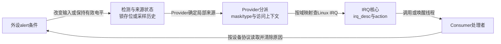
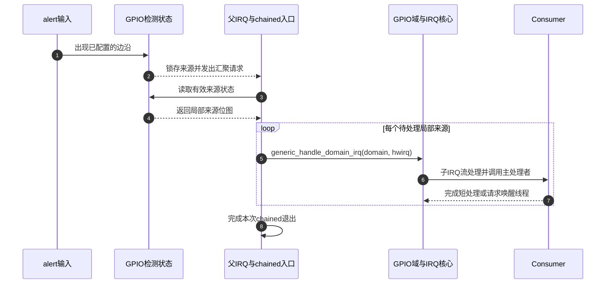
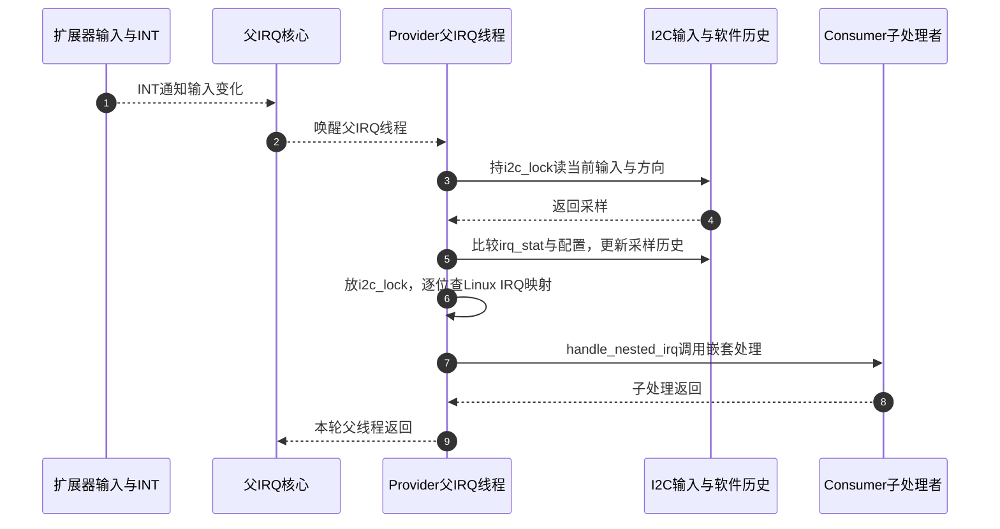

# 第7章\_GPIO\_中断桥接与事件传播

上一章已经能解释Provider如何改变方向和值。现在仍用低有效alert：线程读取它时可以知道“此刻是否有效”，却不知道下一次何时变化。如果一直轮询，空闲时也要重复访问；若希望变化时再处理，就要增加事件检测、通知和处理者状态。本章沿这条需求建立GPIO与IRQ的交接，再用完整模拟模块观察请求、通知、失败与退出。

## 7.1\_从读一个值到接收一次通知还缺什么

输入值是一份当前状态，事件是“某种变化或有效条件需要被处理”。两次读取之间alert可能先变低再变高，最后读到高不能证明中间没有发生过变化。能够记录变化的检测硬件可以减轻轮询压力；但一个锁存位不是无限深的计数器，多个变化仍可能合并。另一类实现只比较新旧输入样本，能保留的历史又更少。

通知还必须找到使用者。GPIO控制器知道自己的局部来源，Linux IRQ核心知道全局注册的处理函数；二者需要一份身份映射。处理函数可能只做短工作，也可能唤醒线程去读慢速外设。**检测来源、映射身份和处理业务是不同职责，状态分别保存在相应硬件、Provider和IRQ对象中。**



最后一条箭头闭合业务回路：IRQ核心并不知道外设FIFO是否已经读完，GPIO确认动作也不能替驱动清外设状态。图中的irq_domain是软件映射关系，不是电信号经过的一块电路。固定Linux 6.12.20的配置、函数和状态入口见 [GPIO源码阅读索引](../../../research/source_reading/gpiolib/navigation/P01_Linux_6.12_GPIO源码阅读索引.md#1.1_版本身份与阅读路线)。

## 7.2\_为什么GPIO线号不能直接交给request\_irq

同一个系统的两个控制器都可以有offset3。若只把数字3交给全局处理者注册接口，内核无法知道是哪一个控制器。因此身份必须先带上所属控制器或域，再映射为Linux IRQ。

| 身份 | 所属空间 | 当前用途 |
| --- | --- | --- |
| 物理pin或pad | 封装、芯片与板级连线 | 判断外设真实接在哪里，不能直接作为Linux编号 |
| GPIO offset | 单个gpio_chip | 请求或读写某根局部线路 |
| hwirq | 单个irq_domain | 标识该域的局部事件来源；GPIO helper常按offset一一对应，具体规则由Provider决定 |
| Linux IRQ | Linux IRQ核心 | 申请、处理和释放IRQ使用的编号 |

GPIO Provider可以通过 `to_irq` 提供映射能力；启用 `CONFIG_GPIOLIB_IRQCHIP` 的公共集成还可使用 `gpio_chip.irq`。其中 `gpio_irq_chip` 关联IRQ chip操作、domain、父IRQ或父处理入口、子流处理方式和默认类型。`irq_chip`负责mask、unmask、ack、set_type等控制动作；业务handler属于action，二者名称相近但职责不同。

`gpiod_to_irq()` 在gdev的SRCU保护下取得仍有效的chip，计算offset并调用to_irq。描述符无效返回 `-EINVAL`，Provider撤销返回 `-ENODEV`，没有可用映射可能返回 `-ENXIO`；IRQ能力仍在建立时可保留 `-EPROBE_DEFER`。映射回调可能创建映射，所以不能称作无副作用的纯查询。唯一实现见 [GPIO取得IRQ映射](../../../research/source_reading/gpiolib/source_explanations/P05_GPIO映射与模拟事件怎样交接.md#5.1_取得IRQ为何仍需保护可撤销的Provider)。

返回一个正IRQ只回答“该用哪个Linux身份”。它没有替Consumer设置输入方向、安装handler、确定触发边沿或建立唤醒通路。这些动作仍须按本设备的协议完成。

## 7.3\_快速级联怎样从汇聚请求找到子来源

先选择一种明确模型：GPIO控制器有逐线锁存状态和mask配置，多条输入汇聚为一个父中断；CPU可在硬中断上下文直接读取它们。父IRQ只表示“这组线中有来源”，没有携带全部线号，因此Provider必须读本控制器的状态来拆分。



步骤2把多线状态压缩为一条汇聚通知，步骤3、4再读取具体来源，步骤5才完成局部身份到Linux处理路径的交接。ack、mask与unmask的具体时机由该控制器和IRQ流处理协议决定，不能把图简化为“任意时候清所有状态”。一个bank也可能有多个父IRQ，图只固定单个汇聚入口，不声明所有GPIO硬件拓扑相同。

这种chained路径不能为了读取I²C寄存器而睡眠，也不能认为PREEMPT_RT会自动把所有chained入口搬到线程。固定官方GPIO驱动文档的 *Cascaded GPIO irqchips* 区分了chained、普通IRQ处理入口和nested threaded等实现。具体MMIO实例可继续读 [i.MX6UL的来源状态与寄存器表](../device_tree/P05_GPIO输入怎样成为中断与按键事件.md#5.4.2_硬件级联不等于软件域对象必有父指针)，那里给出了真实基址、字段与访问效果；本图只表达上述锁存与汇聚模型。

## 7.4\_慢总线为什么改变来源检测和子分派

若控制器位于I²C总线另一侧，读取输入可能等待总线完成。硬中断路径不能在这里睡眠，于是父IRQ先唤醒线程，线程再取得访问锁、读取和判断来源。这个改变把成本移到线程调度与总线等待，并没有让输入检测变得无延迟。

普通PCA9539的固定驱动分支还提供另一个反例：它比较当前输入与 `chip->irq_stat` 里的上次输入，再结合方向、mask和上升/下降配置计算本次待分派位。变量名 `pending` 是软件计算结果，不证明器件有同名锁存寄存器。



步骤3可以睡眠；步骤6先释放I²C访问锁，步骤7的子处理才可以再次访问GPIO而不重复取得同一把已持有的锁。该路径使用 `handle_nested_irq()`，不能把上一节的通用domain分派调用直接搬到任意可睡眠线程里。也不要把每个子处理者都画成另起一个独立线程：嵌套处理可在父线程上下文中执行相应子线程函数。

如果输入在两次采样之间从1变0又回1，新旧样本相同就不能重建中间边沿。需要可靠记录短脉冲时，应检查硬件锁存或计数能力，不能仅靠提高软件优先级保证。固定PCA分支的寄存器模型、比较公式和异常边界见 [已有唯一实现](../../../research/source_reading/peripheral_integration/source_explanations/P03_PCA953x怎样比较输入并分派嵌套中断.md#3.2_用新旧输入推导哪些局部线需要处理)。

依据：[固定GPIO驱动文档的IRQ模型](https://github.com/nxp-imx/linux-imx/blob/dfaf2136deb2af2e60b994421281ba42f1c087e0/Documentation/driver-api/gpio/driver.rst)。选择快速或线程化路径的依据是硬件访问与IRQ模型，不能只按“这是GPIO”决定。

## 7.5\_逻辑有效与触发边沿必须分别确定

低有效alert在物理高时逻辑0，变低时逻辑1。读取描述符时gpiolib按active-low反相；但Consumer向IRQ核心申请 `IRQF_TRIGGER_FALLING`，描述的是该通知输入的下降沿，不会因为描述符低有效就自动换成上升沿。

| 本例变化 | GPIO逻辑含义 | 直接申请IRQ时对应的物理边 |
| --- | --- | --- |
| 高→低 | alert从无效到有效，0→1 | FALLING |
| 低→高 | alert从有效到无效，1→0 | RISING |

若设备要求处理“有效期间有数据”，电平型通知可能更合适：只要外设原因未解除、输入仍有效，解除IRQ屏蔽后就可能再次通知。若只记录变化，边沿型检测按其锁存或采样能力记录变化，两者不能用一个统一的“清GPIO就好了”操作收尾。

`IRQF_ONESHOT`用于协调线程化IRQ处理期间的屏蔽与完成，具体动作还取决于IRQ流处理和irqchip能力。它不读取外设FIFO、不清设备内部原因，也不保证屏蔽期间每个边沿都被保存。出现“一直来”，应检查有效电平和外设清因；出现“只来一次”，还要检查类型、mask/ack、输入激励与处理者退出，不能仅凭症状认定某一项必错。

## 7.6\_一个Consumer怎样完整持有输入和IRQ

下面在第五章建立、上一章解释实现的gpio-sim上，只申请offset2作为alert。它是一个完整教学模块：连接表、设备枚举、输入请求、IRQ映射、处理者申请和卸载都在本地给出。没有真实外设寄存器，也没有额外work或timer；线程只采样当前逻辑值并记录日志，因此不能用它测边沿精确时刻或可靠计数。

资源按state、输入描述符、IRQ的顺序登记。处理者依赖的state必须在IRQ申请之前准备好，因为申请期间就可能收到事件；设备退出时devres先释放IRQ并等在途处理结束，再释放GPIO和state。`fail_after_irq`用于在申请成功后注入probe失败，检验同一条清理链。

保存下面内容为 `gpio_irq_demo.c`，也可取用 [完整材料](../../../labs/kernel/gpio/materials/gpio_irq_demo/gpio_irq_demo.c)。不要把它和第五章Consumer模块同时装入，因为两者要独占同一根alert。

<!-- GPIO_IRQ_MODEL_BEGIN -->
```c
// SPDX-License-Identifier: GPL-2.0
/* 只连接教学gpio-sim，观察输入IRQ；不控制真实外设。 */
#include <linux/device.h>
#include <linux/err.h>
#include <linux/gpio/consumer.h>
#include <linux/gpio/machine.h>
#include <linux/interrupt.h>
#include <linux/module.h>
#include <linux/platform_device.h>
#include <linux/slab.h>

struct gpio_irq_state {
    struct device *dev;
    struct gpio_desc *alert;
};

static bool fail_after_irq;
module_param(fail_after_irq, bool, 0444);
MODULE_PARM_DESC(fail_after_irq, "申请IRQ后故意让probe失败");

static struct platform_device *demo_device;
static struct gpiod_lookup_table demo_lookup = {
    .dev_id = "gpio_irq_demo",
    .table = {
        GPIO_LOOKUP("linux-note-consumer-sim", 2, "alert", GPIO_ACTIVE_LOW),
        { }
    }
};

static irqreturn_t gpio_irq_thread(int irq, void *data)
{
    struct gpio_irq_state *state = data;
    int value = gpiod_get_value_cansleep(state->alert);

    /* 这里是线程上下文；采到的是当前逻辑值，不是边沿历史。 */
    if (value < 0)
        dev_err_ratelimited(state->dev, "alert read failed: %d\n", value);
    else
        dev_info(state->dev, "irq=%d alert=%d (logical sample)\n", irq, value);
    /* 返回处理过本次通知，不把读取失败伪装成有效电平。 */
    return IRQ_HANDLED;
}

static int gpio_irq_probe(struct platform_device *pdev)
{
    struct device *dev = &pdev->dev;
    struct gpio_irq_state *state;
    int irq, ret;

    state = devm_kzalloc(dev, sizeof(*state), GFP_KERNEL);
    if (!state)
        return -ENOMEM;
    state->dev = dev;
    state->alert = devm_gpiod_get(dev, "alert", GPIOD_IN);
    if (IS_ERR(state->alert))
        return dev_err_probe(dev, PTR_ERR(state->alert), "alert request failed\n");

    irq = gpiod_to_irq(state->alert);
    if (irq < 0)
        return dev_err_probe(dev, irq, "alert mapping failed\n");

    /* 处理者可能在申请返回前执行，依赖的state和输入必须先就绪。 */
    ret = devm_request_threaded_irq(dev, irq, NULL, gpio_irq_thread,
                                  IRQF_ONESHOT | IRQF_TRIGGER_RISING |
                                  IRQF_TRIGGER_FALLING, dev_name(dev), state);
    if (ret)
        return dev_err_probe(dev, ret, "alert IRQ request failed\n");
    if (fail_after_irq)
        return dev_err_probe(dev, -EIO, "injected failure after IRQ request\n");

    dev_info(dev, "ready: irq=%d, both physical edges\n", irq);
    return 0;
}

static struct platform_driver demo_driver = {
    .probe = gpio_irq_probe,
    .driver = { .name = "gpio_irq_demo" },
};

static int __init gpio_irq_init(void)
{
    int ret;

    gpiod_add_lookup_table(&demo_lookup);
    ret = platform_driver_register(&demo_driver);
    if (ret)
        goto remove_lookup;
    demo_device = platform_device_register_simple("gpio_irq_demo", -1, NULL, 0);
    if (IS_ERR(demo_device)) {
        ret = PTR_ERR(demo_device);
        platform_driver_unregister(&demo_driver);
        goto remove_lookup;
    }
    return 0;
remove_lookup:
    gpiod_remove_lookup_table(&demo_lookup);
    return ret;
}

static void __exit gpio_irq_exit(void)
{
    /* devres先释放并等IRQ处理结束，再放描述符，最后释放state。 */
    platform_device_unregister(demo_device);
    platform_driver_unregister(&demo_driver);
    gpiod_remove_lookup_table(&demo_lookup);
}

module_init(gpio_irq_init);
module_exit(gpio_irq_exit);
MODULE_LICENSE("GPL");
MODULE_DESCRIPTION("GPIO IRQ lifecycle lesson using gpio-sim only");
```
<!-- GPIO_IRQ_MODEL_END -->

NULL主处理函数使用IRQ核心的默认唤醒线程行为；`state`作为dev_id传入线程，不能提前释放。线程读取失败时只报告错误，返回IRQ_HANDLED表示已处理这次通知，不把负错误当成“电平为真”。双边沿用于同时观察拉低与拉高，不是从active-low推导出来的自动配置。

## 7.7\_准备模拟输入并构建模块

继续使用 [第五章的模拟器准备流程](P05_GPIO_Consumer_请求与使用.md#5.7_为请求周期建立三根模拟线)：同一固定内核、GPIO_SIM配置、configfs挂载和唯一标签 `linux-note-consumer-sim`。该节会建立三根线并得到 `demo_root`、`chip_name`、`chip_dir`。只完成准备，不装入第五章Consumer；若之前已经装入，先 `rmmod gpio_consumer_demo`，暂时保留模拟器供本章使用。不要新建第二个同标签实例。

在同一个root实验shell确认输入初值；若换过shell，应按第五章从真实configfs目录重新取得并核对变量，不能假定gpiochip编号不变：

```bash
# 执行于已完成模拟器准备的目标Linux shell；变量来自第五章身份核对。
set -eu
test ! -d /sys/module/gpio_consumer_demo
test ! -d /sys/module/gpio_irq_demo
test -n "${chip_dir:-}"
test -d "$chip_dir/sim_gpio2"
printf '%s\n' pull-up > "$chip_dir/sim_gpio2/pull"
cat "$chip_dir/sim_gpio2/value"
```

预期值为1。这里先设模拟环境，模块随后以输入方向请求线路。模拟IRQ实现只支持上升/下降沿，本实验不使用电平类型验证；真实电平IRQ的清因协议已在前节解释。

把C文件放到新的空实验目录，旁边保存如下Makefile，也可取用 [材料Makefile](../../../labs/kernel/gpio/materials/gpio_irq_demo/Makefile)：

```make
obj-m += gpio_irq_demo.o
```

在该目录用与目标运行内核匹配的构建树生成模块：

```bash
# 在目标Linux模块源码目录执行；要求匹配内核头文件、配置和构建工具。
kernel_build=/lib/modules/$(uname -r)/build
test -d "$kernel_build"
make -C "$kernel_build" M="$PWD" modules
insmod ./gpio_irq_demo.ko
test -L /sys/bus/platform/devices/gpio_irq_demo/driver
```

驱动绑定链接和内核 `ready: irq=...` 日志才说明probe成功；insmod成功也可能只有设备/驱动登记成功而probe失败。这个IRQ是运行时身份，不应预先写成2。

## 7.8\_逐次注入再检查失败退出

先只改变一次输入，观察到日志以后再继续下一次，避免把调度和位图合并混入最小实验：

```bash
# 同一目标shell，已成功绑定本章模块。
printf '%s\n' pull-down > "$chip_dir/sim_gpio2/pull"
cat "$chip_dir/sim_gpio2/value"
```

模拟物理值应为0，等待内核出现本模块 `alert=1 (logical sample)` 后，再执行：

```bash
printf '%s\n' pull-up > "$chip_dir/sim_gpio2/pull"
cat "$chip_dir/sim_gpio2/value"
```

预期物理值1，对应线程采样逻辑0。通过目标系统允许的内核日志接口观察；可用 `dmesg`，权限限制时用系统提供的日志入口。若没有事件，检查绑定、ready日志、输入值、IRQ配置和相关计数，不连续快速重复写入来掩盖问题。

该模拟器先把通知放到irq_sim的pending位，再由irq_work分派，Consumer线程稍后取锁读取当前值。快速连续写入可能合并或错过变化，线程采到的也不一定是最初触发时的值。具体载体和顺序见 [事件模块导读](../../../research/source_reading/gpiolib/navigation/P04_GPIO事件怎样从线路到达处理者.md#4.3_模拟事件怎样完成通知闭环)。

正常卸载后再做故障注入：

```bash
rmmod gpio_irq_demo
test ! -L /sys/bus/platform/devices/gpio_irq_demo/driver
insmod ./gpio_irq_demo.ko fail_after_irq=1
test ! -L /sys/bus/platform/devices/gpio_irq_demo/driver
```

第二次应出现 `injected failure after IRQ request`，但没有ready日志和成功绑定。失败路径已经释放本次IRQ请求与GPIO占用；模块本身仍可能装载成功，所以还要卸载它。之后再正常装入，能重新申请并处理输入，才为资源未被失败请求遗留占用提供有限证据：

```bash
rmmod gpio_irq_demo
insmod ./gpio_irq_demo.ko
test -L /sys/bus/platform/devices/gpio_irq_demo/driver
```

重复一次下降/上升观察，再卸载模块。最后确认两个教学Consumer模块均已退出，再按第五章流程向自己创建的模拟设备写live=0并删除bank和设备目录。不要先拆Provider来逼迫Consumer退出。这里只给出预期，当前文档核对未在目标Linux执行Kbuild或装载运行。

## 7.9\_去抖与唤醒分别增加哪一种保证

机械开关可能在一次操作中快速跳变，IRQ检测会把这些变化交给软件。硬件去抖由控制器能力决定；软件去抖可在延时后重采样、重新安排工作或采用其他策略，并不都需要“首次IRQ就屏蔽”。延迟采样以响应时间换取过滤，也不能单凭一份最终样本证明整个时间窗连续稳定。参数要从输入特性和驱动算法确定，不能把固定10ms当作所有设备的正确答案。

系统唤醒还增加供电与信号路径条件。运行时能收到IRQ，只证明当前供电和配置下可用；深睡眠时GPIO检测器、上游中断路径或pad复用可能改变。Consumer设置wake意图，IRQ/PM与Provider再配置对应能力；如果硬件断电且没有常开检测路径，一个软件标志不能创造它。需要按目标睡眠状态验证，不用本章模拟器替代。

## 7.10\_把本章模型用于选择和排障

如果需求就是按键、LED、电源使能等标准功能，应优先核对gpio-keys、gpio-leds、regulator等现成绑定和生命周期。自定义Consumer适合还有专有寄存器协议、复合状态机或标准驱动无法表达时序的设备，不能因为本章能打印IRQ日志就另造一套用户ABI。具体选择见 [标准GPIO Consumer专题](../gpio_consumers/大纲.md)。

练习一：alert读值正确但gpiod_to_irq失败，是否说明输入方向错误？不一定，读值能力和事件映射能力不同，应保留具体错误并核对Provider IRQ支持。

练习二：PCA9539两次采样相同，是否能证明期间没有边沿？不能，中间往返可能没有保存在采样历史中；要满足计数要求需更合适的硬件能力。

练习三：申请IRQ时返回错误，能否继续probe并把irq整数保存起来？不能，身份存在不等于action申请成功，必须按返回值处理失败。

练习四：模块退出后再有输入变化，为什么不能继续调用已释放state？因为释放IRQ会解除本次action并等待在途IRQ处理，本例再释放GPIO与state；如果自行追加工作队列，就必须补对应排空协议，不能只依赖这条IRQ保证。

现在能从来源状态、身份映射和执行上下文解释GPIO事件，也知道模拟器验证的限度。下一篇改变使用者：用户进程通过文件请求持有线路，事件还需要缓冲和read/poll，继续 [用户空间ABI、迁移与方案选择](P08_用户空间_ABI_迁移与方案选择.md)。上一篇：[GPIO Provider控制器实现](P06_GPIO_Provider_控制器实现.md)。
