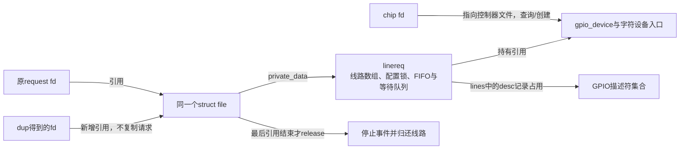
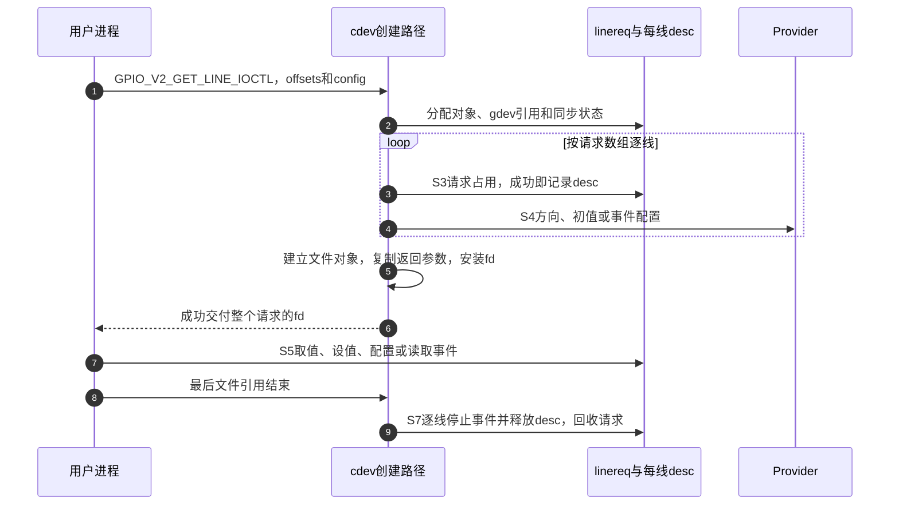
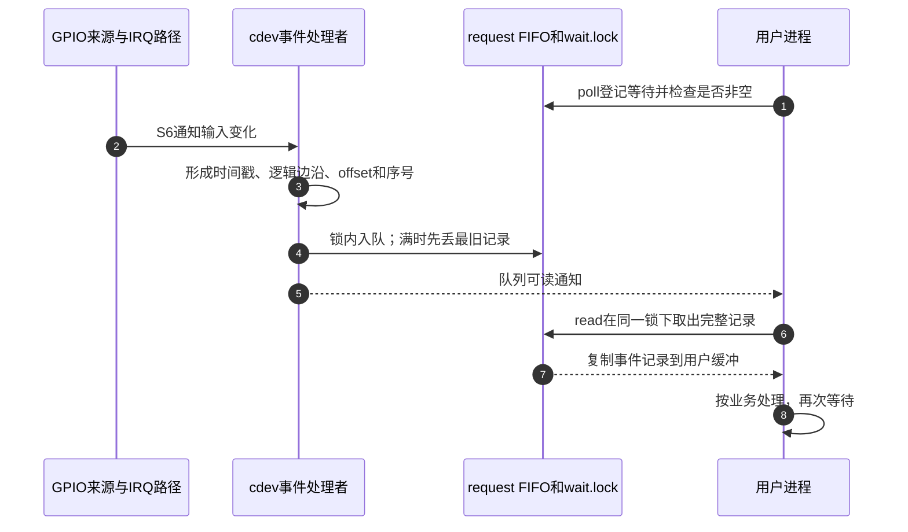
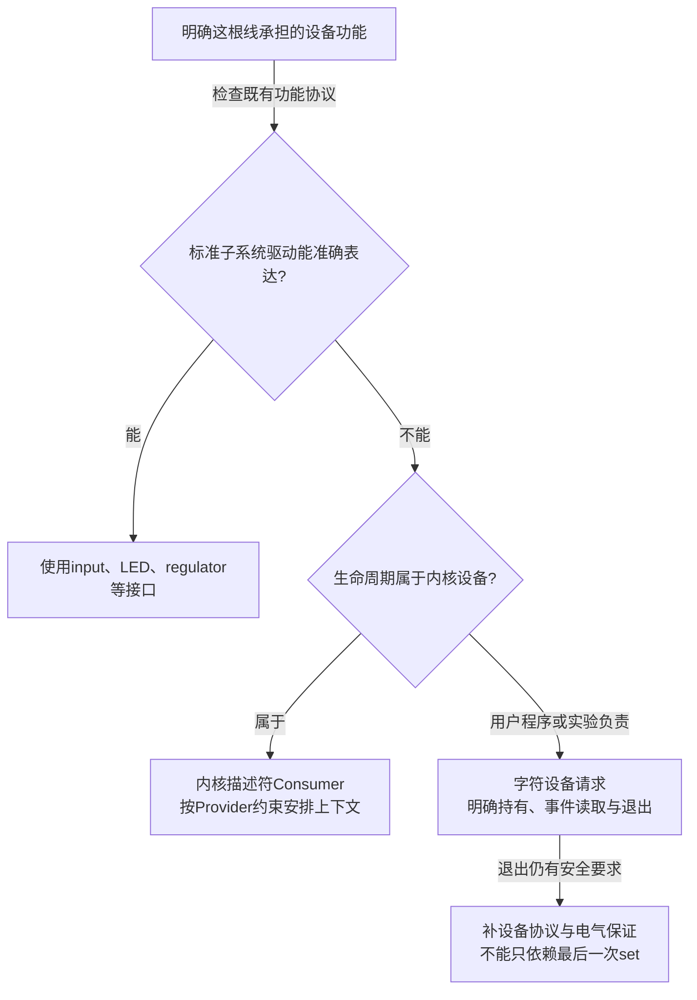

# 第8章\_用户空间\_ABI\_迁移与方案选择

上一章已经把输入变化接到内核处理者。但有些工作属于用户进程：实验程序要观察一根输入，管理程序要在一段运行期间控制一组输出。把寄存器直接映射给它们，会绕过已有的线路占用、极性转换和Provider访问约束；把内核回调指针交给进程也不可行，进程可能阻塞、退出，甚至来不及读取事件。

本章沿用enable高有效、alert低有效的场景，解决两件相连的事：**用什么对象持有线路，用什么状态保存进程还没来得及处理的事件。** 字符设备ABI是内核与用户程序之间的二进制接口，规定ioctl参数和事件记录的布局。下面以Linux 6.12.20的GPIO ABI v2为证据边界；用户库libgpiod可以包装这些操作，但不是ABI本身。

## 8.1\_为什么打开控制器还不等于取得线路

`/dev/gpiochipN` 表示一个控制器的字符设备。打开它只取得查询和创建请求的入口；如果一次open就独占整个控制器，观察alert的程序会无端阻止另一设备使用完全无关的线。因而接口把控制器入口和线路使用权分开：进程提供控制器内的offset集合与配置，内核逐线申请，成功后另交付一个 **request fd**，即线路请求的文件描述符。

fd只是进程文件表中的整数槽位。request fd指向的内核 `struct file` 才持有请求对象；请求对象再持有描述符集合、控制器对象引用以及事件缓冲。复制fd会多出一个指向同一file的入口，不会复制线路和事件队列。由此得到三个可以直接检验的结论：关掉chip fd仍能使用已有request；关掉一个有副本的request fd仍未释放线路；只有最后一个文件引用消失，释放回调才回收请求。fork继承、fd传递也必须按引用理解，不能只数当前进程里某一个整数。



图中的引用保护对象寿命，不保证控制器永远提供硬件能力。工程上仍应先退出所有使用者再撤销Provider。chip或request fd也不是寄存器基地址；普通read读取事件记录，取当前值需要专用ioctl。

在 [S0～S7模型](P02_GPIO_角色_状态与完整操作周期.md#2.3_统一的_S0～S7_周期) 中，用户程序改变的是S2的定位方式和S7的退出触发：它选择chip与局部offset，而非内核设备的con_id；请求文件释放触发归还，而非设备解绑的devres。S3占用、S4配置及Provider约束仍然存在。

## 8.2\_一组请求中为什么还需要槽位编号

设本次只申请offset 0和offset 2，分别接enable与alert。请求数组是 `offsets={0,2}`：数组槽位0对应offset 0，槽位1对应offset 2。设置某个槽位的配置或数值时，mask按数组位置选成员，所以alert的mask是二进制10，即2，而不是 `1 << 2`。事件记录反过来给出真实chip offset；收到offset 2的事件，不能拿2直接当这个两元素数组的下标。

请求先给所有成员一组默认flags，再用带mask的属性覆盖选中成员。这样可以一次表达“alert是低有效输入、监听两种逻辑边沿；enable是高有效输出、初值0”。FLAGS属性是替换选中成员的整组默认flags，不能误写成在INPUT上再叠加OUTPUT。

| 本章使用的结构/字段 | 放在哪里或作用于谁 | 当前需要的准确含义 |
| --- | --- | --- |
| `gpio_v2_line_request.offsets[] / num_lines` | 向chip fd发请求 | 控制器内线路集合与数量；本版本最多64根 |
| `consumer` | 请求的诊断名称 | 帮助观察占用者，不是权限凭据或线路身份 |
| `config.flags` | 全部请求成员的默认配置 | 方向、active-low、边沿、驱动/偏置等；组合必须合法 |
| `config.attrs[].attr.id / mask` | 选中请求槽位 | FLAGS、OUTPUT_VALUES或DEBOUNCE；mask位对应数组下标 |
| `event_buffer_size` | 本请求共享的事件队列 | 建议容量；0取默认值，本固定实现为线路数×16 |
| 返回的 `fd` | 成功创建的请求文件 | 后续读写、配置与事件入口；不依赖原chip fd仍打开 |
| `gpio_v2_line_values.bits / mask` | request fd的取值/设值 | bits为逻辑值，mask仍按请求槽位选择 |
| `gpio_v2_line_event.offset` | 从request fd读出的记录 | chip局部offset，和上述mask的坐标不同 |

这张表只列当前过程所需字段，完整程序会把结构清零，使保留padding为0。ABI结构来源为固定版本 [include/uapi/linux/gpio.h](https://github.com/nxp-imx/linux-imx/blob/dfaf2136deb2af2e60b994421281ba42f1c087e0/include/uapi/linux/gpio.h) 的v2 request/config/values/event定义。它们是内核接口数据，不是硬件寄存器布局。

低有效还影响事件语义：v2的RISING表示逻辑不活动变为活动，FALLING表示逻辑活动变为不活动。alert从物理高变低，是逻辑上升；内核按active-low把请求的逻辑边沿转换为Provider使用的物理IRQ触发条件。上一章内核Consumer直接给IRQ API传物理触发标志，本章的GPIO字符设备边沿flags多了一层转换，不能照抄数值。

## 8.3\_创建成功保证了什么而没有保证什么

调用者需要一个清楚的结果：要么取得所申请的整组线路，要么得到错误。内核因此先准备请求对象，逐线取得占用并配置，最后才发布request fd。较早的线路已经配置、较晚的线路却busy时，失败路径会放下已取得的占用。但已经发到控制器的输出动作可能发生过，释放也没有一份旧寄存器快照可供恢复。



步骤3与4对每条线顺序执行，步骤5才发布文件。因此“一个ioctl”不能推出“多个引脚同一时刻翻转”。失败时不会交付半个可用request，但不保证物理作用从未出现；外设若对短脉冲敏感，应从初值、电气约束、控制器能力和设备协议设计上解决。运行期间的SET_CONFIG同样逐线进行，某条配置失败前的其他线路可能已经改变，不能把失败解释为整组保持原状。

固定实现 `linereq_free()` 按数组 **正向** 遍历已记录的desc，先停该线事件，再归还该线；这里不能套用devres的逆序登记模型。INIT_KFIFO只初始化队列元数据，真正存储在需要边沿事件的设置路径中分配。完整源码阅读从 [用户请求模块导读](../../../research/source_reading/gpiolib/navigation/P05_用户请求怎样持有线路与事件.md#5.1_先从两个文件对象区分入口和持有者) 进入；发布与失败出口见 [请求创建](../../../research/source_reading/gpiolib/source_explanations/P06_用户请求的发布与回收.md#6.2_为什么先配置线路再发布文件)。

## 8.4\_事件为什么需要队列而不只需要唤醒

假设alert变化时，进程正在处理上一条消息。只把进程唤醒没有地方保存“哪根线、何种边沿、什么时候”，等它得到CPU时输入也可能已经恢复。cdev因此把事件制成记录，写入该request的FIFO，即先进先出的缓冲，再唤醒等待读取的人。进程先问poll是否可读，再用read搬走记录；等待期间不必反复读取GPIO寄存器，代价转移到IRQ处理、记录入队、队列锁和唤醒调度。



步骤4才改变可读状态，步骤5只通知它可能已变化；队列满时本来已经可读，此固定实现不为该次覆盖再发唤醒。步骤6先从内核队列移除记录，再复制到用户地址；复制失败也不能假设该记录仍在队列里。dup共享队列，两个读者会竞争消费，不会各收到一份广播；因此poll返回后另一个读者可能先把记录拿走，非阻塞read仍须处理EAGAIN。

| 记录或接口 | 可以据此知道什么 | 不能据此推出什么 |
| --- | --- | --- |
| `timestamp_ns` | 所选时钟下记录的时间；默认CLOCK_MONOTONIC | 默认软件时间戳就是焊盘翻转的精确硬件时刻 |
| `id` | 逻辑RISING=1或FALLING=2 | 低有效线的id与物理边沿名称一致 |
| `seqno / line_seqno` | 本请求范围与单根线范围的序号，可辅助发现已编号记录缺失 | 序号连续就证明检测硬件没有合并、采样遗漏或IRQ前端损失 |
| FIFO容量 | 进程短时未运行仍有一定缓冲空间 | 任意高输入速率下永远不丢事件 |
| `poll / read` | 队列就绪与记录读取 | read返回一个GPIO当前值，或每个读者都得到全部事件 |

队列满时这里丢最旧记录，保留新记录。序号还涉及32位回绕、多个读者和多线IRQ并发，应按读取模型解释，不能把任意一次全局序号不相邻直接等同于硬件丢边沿。主实验只让一个进程顺次读取一根输入，以减少这些干扰。双边沿路径可能通过线程里的当前值判断方向；快速往返变化在到达FIFO以前就可能失真，加大FIFO不能修复这个前端缺口。

时间戳也有不同生成点：通常hardirq先记时间，线程继续包装；nested threaded IRQ可能直接在线程中补记。选择REALTIME会改用墙上时钟，HTE则要求相应硬件与配置，不能把一个flag当成所有板都具备的硬件授时。固定实现见 [事件生成与缓冲](../../../research/source_reading/gpiolib/source_explanations/P07_事件缓冲与读取.md#7.2_时间与边沿怎样变成一条记录)。

## 8.5\_在模拟器中准备一组受控的线路

下面用一个用户C程序观察完整生命周期。它只允许label为 `linux-note-abi-sim` 的三线模拟bank，申请offset 0和2，offset 1闲置。enable初值0，启动后设1，退出前请求设0；alert从物理高开始。程序会复制request fd、关闭原fd，验证第二个申请者得到EBUSY，再关闭chip fd并继续收事件，最后释放并重新申请两条线。

运行条件是测试Linux启用GPIOLIB、GPIO_CDEV、GPIO_SIM、IRQ_SIM、CONFIGFS_FS及相关依赖，具备本地C编译器、含v2定义的Linux用户头文件，以及mountpoint、findmnt、readlink等系统工具。GPIO_SIM内建时无需加载模块。应有访问configfs、模拟sysfs和gpiochip设备的权限；以下准备和注入命令在测试机管理员shell执行。**本轮没有执行目标Linux编译或模拟器运行，下面的输出是待复现的预期。** 不把此实验移到真实供电、复位线路。

```bash
# 终端A：测试Linux，同一shell保留这些变量。
set -eu
if ! mountpoint -q /sys/kernel/config; then
    mount -t configfs configfs /sys/kernel/config
fi
test "$(findmnt -n -o FSTYPE --target /sys/kernel/config)" = configfs || exit 1
if ! test -d /sys/kernel/config/gpio-sim; then
    modprobe gpio-sim
fi
demo_root=/sys/kernel/config/gpio-sim/linux_note_abi
test -d /sys/kernel/config/gpio-sim || exit 1
test ! -e "$demo_root" || exit 1
mkdir "$demo_root"
mkdir "$demo_root/bank0"
printf '%s\n' 3 > "$demo_root/bank0/num_lines"
printf '%s\n' linux-note-abi-sim > "$demo_root/bank0/label"
printf '%s\n' 1 > "$demo_root/live"
chip_name=$(cat "$demo_root/bank0/chip_name")
chip_dir=$(readlink -f "/sys/bus/gpio/devices/$chip_name")
sim_device=$(cat "$demo_root/dev_name")
test "$(basename "$(dirname "$chip_dir")")" = "$sim_device" || exit 1
test -d "$chip_dir/sim_gpio2" || exit 1
printf '%s\n' pull-down > "$chip_dir/sim_gpio0/pull"
printf '%s\n' pull-up > "$chip_dir/sim_gpio2/pull"
printf 'chip=/dev/%s\ninput=%s/sim_gpio2/pull\n' "$chip_name" "$chip_dir"
```

这里从新创建bank的chip_name取得实际编号，再核对sysfs父设备；不猜测gpiochip0。程序还会用GET_CHIPINFO核对label与线路数。设置pull发生在尚未申请时，为模拟输入建立初值，不是对真实板上电阻的描述。准备命令失败就先定位配置或权限问题；不能随手换一个能打开的真实chip继续。

## 8.6\_完整程序把持有与清理写在一起

在测试Linux中新建实验目录，把以下内容保存为 `gpio_abi_demo.c`；同内容 [材料文件](../../../labs/kernel/gpio/materials/gpio_abi_demo.c) 便于取用。程序直接使用UAPI，目的是让request、mask和文件生命周期可见；业务项目可用匹配版本的libgpiod减少结构配置工作。

读代码时沿四个阶段看：`open_simulator()` 只核对控制器身份，`request_lines()` 建立带初值的两线请求；main随后复制引用并验证占用，进入poll/read循环；out统一停输出和关闭引用；正常结束后再次申请来检查占用已归还。把这几段放在同一个程序里，才能检查错误出口是否仍持有资源，以及清理动作发生时请求是否还可用。

<!-- GPIO_ABI_MODEL_BEGIN -->
```c
// SPDX-License-Identifier: GPL-2.0-only
#define _GNU_SOURCE
#include <errno.h>
#include <fcntl.h>
#include <inttypes.h>
#include <linux/gpio.h>
#include <poll.h>
#include <signal.h>
#include <stdint.h>
#include <stdio.h>
#include <stdlib.h>
#include <string.h>
#include <sys/ioctl.h>
#include <unistd.h>

static volatile sig_atomic_t stop_requested;

static void stop_handler(int signal_number)
{
    (void)signal_number;
    stop_requested = 1;
}

static int open_simulator(const char *path)
{
    struct gpiochip_info info = {0};
    int chip_fd = open(path, O_RDONLY | O_CLOEXEC);

    if (chip_fd < 0)
        return -1;
    if (ioctl(chip_fd, GPIO_GET_CHIPINFO_IOCTL, &info) < 0) {
        int saved_errno = errno;
        close(chip_fd);
        errno = saved_errno;
        return -1;
    }
    /* 本程序只允许操作本章建立的模拟bank。 */
    if (strncmp(info.label, "linux-note-abi-sim", sizeof(info.label)) ||
        info.lines != 3) {
        close(chip_fd);
        errno = ENODEV;
        return -1;
    }
    return chip_fd;
}

static int request_lines(int chip_fd, struct gpio_v2_line_request *request)
{
    memset(request, 0, sizeof(*request));
    request->offsets[0] = 0;  /* 槽位0：高有效enable输出。 */
    request->offsets[1] = 2;  /* 槽位1：低有效alert输入。 */
    request->num_lines = 2;
    snprintf(request->consumer, sizeof(request->consumer), "gpio-abi-demo");
    request->config.flags = GPIO_V2_LINE_FLAG_INPUT |
        GPIO_V2_LINE_FLAG_ACTIVE_LOW | GPIO_V2_LINE_FLAG_EDGE_RISING |
        GPIO_V2_LINE_FLAG_EDGE_FALLING;
    request->config.num_attrs = 2;
    /* FLAGS属性替换槽位0的默认flags，不是向默认值再加OUTPUT。 */
    request->config.attrs[0].attr.id = GPIO_V2_LINE_ATTR_ID_FLAGS;
    request->config.attrs[0].attr.flags = GPIO_V2_LINE_FLAG_OUTPUT;
    request->config.attrs[0].mask = UINT64_C(1);
    request->config.attrs[1].attr.id = GPIO_V2_LINE_ATTR_ID_OUTPUT_VALUES;
    request->config.attrs[1].attr.values = 0;
    request->config.attrs[1].mask = UINT64_C(1);
    return ioctl(chip_fd, GPIO_V2_GET_LINE_IOCTL, request);
}

static int set_enable(int request_fd, int enabled)
{
    struct gpio_v2_line_values values = {
        .bits = enabled ? UINT64_C(1) : 0,
        .mask = UINT64_C(1)
    };

    return ioctl(request_fd, GPIO_V2_LINE_SET_VALUES_IOCTL, &values);
}

int main(int argc, char **argv)
{
    struct sigaction action = {0};
    struct gpio_v2_line_request request, competing = {0};
    struct gpio_v2_line_values values = {.mask = UINT64_C(3)};
    int chip_fd = -1, request_fd = -1, held_fd = -1;
    int result = EXIT_FAILURE, event_count = 0, live_fd;

    if (argc != 2) {
        fprintf(stderr, "usage: %s /dev/gpiochipN\n", argv[0]);
        return EXIT_FAILURE;
    }
    action.sa_handler = stop_handler;
    sigemptyset(&action.sa_mask);
    if (sigaction(SIGINT, &action, NULL) < 0 ||
        sigaction(SIGTERM, &action, NULL) < 0) {
        perror("sigaction");
        return EXIT_FAILURE;
    }
    setvbuf(stdout, NULL, _IOLBF, 0);
    chip_fd = open_simulator(argv[1]);
    if (chip_fd < 0) { perror("open simulator"); goto out; }
    if (request_lines(chip_fd, &request) < 0) {
        perror("request lines"); goto out;
    }
    request_fd = request.fd;
    held_fd = fcntl(request_fd, F_DUPFD_CLOEXEC, 0);
    if (held_fd < 0) { perror("duplicate request"); goto out; }
    /* Linux close出错也不重试，避免误关被复用的fd号码。 */
    if (close(request_fd) < 0) {
        request_fd = -1; perror("close original request"); goto out;
    }
    request_fd = -1;

    competing.offsets[0] = 0;
    competing.num_lines = 1;
    competing.config.flags = GPIO_V2_LINE_FLAG_INPUT;
    if (ioctl(chip_fd, GPIO_V2_GET_LINE_IOCTL, &competing) == 0) {
        close(competing.fd);
        fprintf(stderr, "unexpected second owner\n"); goto out;
    }
    if (errno != EBUSY) { perror("expected EBUSY"); goto out; }
    puts("EBUSY: duplicated request still owns offset 0");
    if (close(chip_fd) < 0) {
        chip_fd = -1; perror("close chip"); goto out;
    }
    chip_fd = -1;
    if (set_enable(held_fd, 1) < 0 ||
        ioctl(held_fd, GPIO_V2_LINE_GET_VALUES_IOCTL, &values) < 0) {
        perror("request values"); goto out;
    }
    printf("chip fd closed; enable=%u alert=%u (logical)\n",
           (unsigned)(values.bits & 1), (unsigned)((values.bits >> 1) & 1));
    int status_flags = fcntl(held_fd, F_GETFL);
    if (status_flags < 0 || fcntl(held_fd, F_SETFL, status_flags | O_NONBLOCK) < 0) {
        perror("nonblocking request"); goto out;
    }
    puts("ready: inject pull-down; after event 1 inject pull-up");
    while (!stop_requested && event_count < 2) {
        struct pollfd waiter = {.fd = held_fd, .events = POLLIN};
        struct gpio_v2_line_event event;
        int ready = poll(&waiter, 1, 60000);
        ssize_t count;

        if (ready < 0 && errno == EINTR)
            continue;
        if (ready < 0) { perror("poll"); goto out; }
        if (!ready) { fprintf(stderr, "event wait timed out\n"); goto out; }
        if (waiter.revents & (POLLERR | POLLHUP | POLLNVAL)) {
            fprintf(stderr, "request no longer usable\n"); goto out;
        }
        if (!(waiter.revents & POLLIN))
            continue;
        count = read(held_fd, &event, sizeof(event));
        if (count < 0 && (errno == EAGAIN || errno == EINTR))
            continue;
        if (count < 0) { perror("read event"); goto out; }
        if (count != (ssize_t)sizeof(event)) {
            fprintf(stderr, "unexpected event size\n"); goto out;
        }
        printf("event %d: offset=%" PRIu32 " id=%" PRIu32
               " seq=%" PRIu32 " line_seq=%" PRIu32 " ns=%" PRIu64 "\n",
               ++event_count, (uint32_t)event.offset, (uint32_t)event.id,
               (uint32_t)event.seqno, (uint32_t)event.line_seqno,
               (uint64_t)event.timestamp_ns);
    }
    if (!stop_requested)
        result = EXIT_SUCCESS;

out:
    /* 先请求安全输出，再关闭最后持有引用；这不是掉电安全保证。 */
    live_fd = held_fd >= 0 ? held_fd : request_fd;
    if (live_fd >= 0 && set_enable(live_fd, 0) < 0) {
        perror("disable enable"); result = EXIT_FAILURE;
    }
    if (held_fd >= 0 && close(held_fd) < 0) {
        perror("close held request"); result = EXIT_FAILURE;
    }
    if (request_fd >= 0 && close(request_fd) < 0) {
        perror("close request"); result = EXIT_FAILURE;
    }
    if (chip_fd >= 0)
        close(chip_fd);
    if (result != EXIT_SUCCESS)
        return result;

    chip_fd = open_simulator(argv[1]);
    if (chip_fd < 0) { perror("reopen simulator"); return EXIT_FAILURE; }
    if (request_lines(chip_fd, &request) < 0) {
        perror("request again"); close(chip_fd); return EXIT_FAILURE;
    }
    puts("last request reference closed: both lines can be requested again");
    result = close(request.fd) == 0 ? EXIT_SUCCESS : EXIT_FAILURE;
    close(chip_fd);
    return result;
}
```

`request_lines()` 先把所有保留字段清零，再给槽位1保留低有效双边沿输入的默认配置，给槽位0覆盖为高有效输出。`set_enable()` 的mask始终为1，所以不会把alert误写为输出。第一次GET_VALUES的mask为3，表示取两个槽位；返回bits中的bit1是alert，而事件的offset会是2。

chip入口以O_RDONLY打开，内核交付的request文件也按这个模式创建，但线路配置和设值走其专用ioctl，不是write系统调用。是否允许这些操作由GPIO ioctl契约及设备访问权限决定，不能把普通文件的字节写入模型套到这里。

程序设置非阻塞read并用poll等待，每次最长60秒，处理EINTR、EAGAIN、错误就绪和记录大小。SIGINT/SIGTERM只设置退出标志，真正ioctl与close在主流程完成；SIGKILL、崩溃或掉电没有机会执行“先设enable为0”的业务动作。即使close最终释放文件，释放后电平仍由Provider及电路决定，不能依赖进程析构充当硬件安全电路。

## 8.7\_先观察引用再逐个注入边沿

```bash
# 终端A：进入保存源码的实验目录，变量沿用8.5节。
cc -std=c11 -O2 -Wall -Wextra -Werror gpio_abi_demo.c -o gpio_abi_demo
./gpio_abi_demo "/dev/$chip_name"
```

预期先看到 `EBUSY: duplicated request still owns offset 0`，说明关闭原fd没有归还占用；再看到 `chip fd closed; enable=1 alert=0 (logical)`，说明请求不靠原chip fd存活。程序显示ready后才开始注入。编译找不到v2结构应核对用户头文件；ioctl返回ENOTTY等错误应核对内核接口配置和设备身份，不通过删除检查强行跑通。

另开终端B，重新从相同configfs对象定位输入，避免把终端A的shell变量当作跨终端共享状态：

```bash
# 终端B：测试Linux管理员shell；程序必须已显示ready。
set -eu
demo_root=/sys/kernel/config/gpio-sim/linux_note_abi
chip_name=$(cat "$demo_root/bank0/chip_name")
chip_dir=$(readlink -f "/sys/bus/gpio/devices/$chip_name")
sim_device=$(cat "$demo_root/dev_name")
test "$(basename "$(dirname "$chip_dir")")" = "$sim_device" || exit 1
printf '%s\n' pull-down > "$chip_dir/sim_gpio2/pull"
```

回看终端A，等第一条事件实际打印后再执行下一块。第一条预期offset=2、id=1，两个seq均从1开始：物理下降对应低有效逻辑上升。时间戳数值依运行时钟而变，不能复制本文某个固定值作判定。

```bash
# 终端B：确认终端A已经打印event 1后再执行。
printf '%s\n' pull-up > "$chip_dir/sim_gpio2/pull"
```

第二条预期offset=2、id=2、两个seq为2。随后程序先请求关闭enable，再关最后request引用，重新申请两条线并打印成功信息，最后释放新请求。这个重新申请验证的是占用已归还，不能证明旧输出从未变化。若没有事件，先看输入是否改变、程序是否ready、IRQ能力是否启用；不要用紧密循环反复写pull来“提高成功率”，那会引入前端合并和线程采样问题。

```bash
# 测试Linux管理员shell：程序已退出且没有其他进程持有本bank。
set -eu
demo_root=/sys/kernel/config/gpio-sim/linux_note_abi
test -d "$demo_root" || exit 1
printf '%s\n' 0 > "$demo_root/live"
rmdir "$demo_root/bank0"
rmdir "$demo_root"
```

只移除本次创建的目录，不卸载别人正在使用的configfs。程序失败或被中断时先确认其已退出、复制的fd没有传给其他进程，再进行同样清理；清理块重新指定目录，即使set -e使原shell退出，也可在新的管理员shell执行。不要在请求仍存活时以撤销Provider代替Consumer退出。

## 8.8\_从sysfs迁移时真正改变的是持有模型

旧 `/sys/class/gpio` 通过export创建可操作线路的sysfs状态，再分开写direction、value或edge。关闭某一次写value所打开的文件，并不自动撤销export；另一进程也可能继续访问导出的属性。字符设备把占用绑定到请求文件，因而一个短命命令退出就可能结束整个持有期。

若原脚本先写输出再退出，不能机械改成“运行一次gpioset”。必须决定输出应由谁持续持有、何时释放、异常退出后要求什么电平。需要服务运行期间保持状态，就让持有请求的服务承担整个周期；需要进程死亡仍保持安全状态，就靠设备协议、默认电气状态或合适的内核功能驱动落实，而不是猜命令退出后最后值恰好保留。

| 比较轴 | 遗留sysfs GPIO | 字符设备ABI v2 |
| --- | --- | --- |
| 建立状态 | export后分散操作属性 | 请求携带线路集合与配置，成功返回request fd |
| 持有结束 | unexport或相关设备退出等路径 | 最后请求文件引用释放；dup/fork必须计入 |
| 多线含义 | 多次独立操作 | 同一请求表达集合，仍不保证物理同时动作或配置失败全回滚 |
| 变化通知 | edge/poll能力有限 | 事件记录、时钟选择、缓冲与序号；仍有检测与容量边界 |
| 新程序选择 | 维护已有系统时识别旧约束 | 新用户空间线路控制的接口基础 |

libgpiod的主版本、工具语法与内核ABI版本是三件事。库可以包装内核结构，工具又决定默认持有和退出方式；迁移先记录目标库/工具版本，再核对其API和持有选项。本章直接使用固定UAPI，没有把某一版gpioset命令行当作内核保证。需要工具版本实操时可沿第五章所用的 [libgpiod 2.3.1工具说明](https://libgpiod.readthedocs.io/en/v2.3.1/gpio_tools.html) 查证。

## 8.9\_内核整数接口迁移也要重新检查语义

用户ABI之外，旧内核驱动也可能保存全局GPIO整数。迁移到描述符不是给函数名添一个d：旧代码常手工反相，换成带active-low的连接后再反相会产生两次转换；旧代码在硬中断里读取本地寄存器，换到可睡眠扩展器后原上下文不再成立。

| 旧代码中的假设 | 新模型要落实的动作 | 必须观察的结果 |
| --- | --- | --- |
| 固定全局GPIO号就是板上功能 | 设备、con_id、index解析连接 | 换板连接改变但功能语义不改 |
| 先request，再随意改方向/电平 | 明确请求时安全初值与设备时序 | 启动、中途失败和退出不产生不允许的动作 |
| 0/1直接代表焊盘电平 | 普通描述符接口按逻辑值，清理旧手工反相 | 高低有效两种板级配置得到相同业务结果 |
| 所有Provider都可在原上下文访问 | 核对can_sleep和回调环境 | 慢总线不进入禁止睡眠的路径 |
| 自动释放等于自动停机 | 停止业务、排空异步用户，再put/devres | 故障和解绑时无过期访问，设备按协议停机 |
| GPIO号就是中断号 | desc取得IRQ后继续申请和配置处理者 | 输入方向、触发、使能及来源解除都成立 |

因此“能够编译”只排除了部分接口错误。还应覆盖连接缺失与延迟探测、线路busy、probe中途失败、快速与慢速Provider、正常解绑，以及设备实际支持的挂起/唤醒路径。没有对应硬件能力的情形应验证拒绝或降级，不能把所有设备都要求成同一组测试结果。

## 8.10\_按设备职责选择方案并解释实验

回到my-device：若enable实际属于一个供电资源，应先看regulator语义是否匹配；按键优先进入input，指示灯优先进入LED。这些子系统不仅替你写GPIO，还规定电源依赖、输入上报或亮度控制。用户空间裸线路请求适合测试和确有用户态控制职责的程序，不能自动替代系统对设备的管理。



沿图选择后，再用本章实验回答四个问题：

1. 为什么复制后关闭原request fd，第二次申请仍EBUSY？两个fd指向同一file，剩余引用仍持有linereq及线路。
2. 为什么alert在values中用bit1、事件里却写offset 2？前者按请求数组槽位，后者按chip局部线路身份。
3. 把两次pull写入放到紧密循环，预期还能收到严格两条记录吗？不能。输入检测、IRQ pending合并、线程采样和FIFO都可能限制历史，实验特意等待第一条后才注入第二条。
4. 一组请求失败，能否断言enable没有产生过输出？不能。未发布fd只说明没有成功交付整组占用；较早成员的配置可能已经到达Provider。

现在可以把GPIO选择落到所有权、逻辑语义、访问上下文和退出责任，而不是追逐一个“更新”的API。工程上继续按 [GPIO调试、迁移与工程模板](../../../engineering/driver_development/gpio/GPIO_调试迁移与工程模板.md) 整理板级证据；标准设备的具体接法进入 [标准GPIO Consumer专题](../gpio_consumers/大纲.md)。
