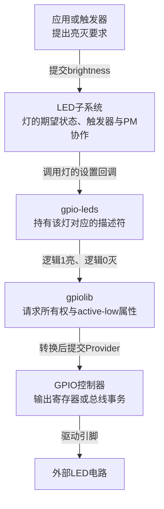
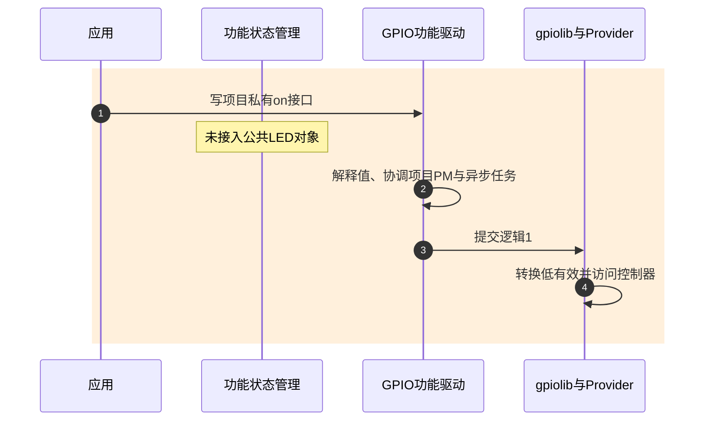
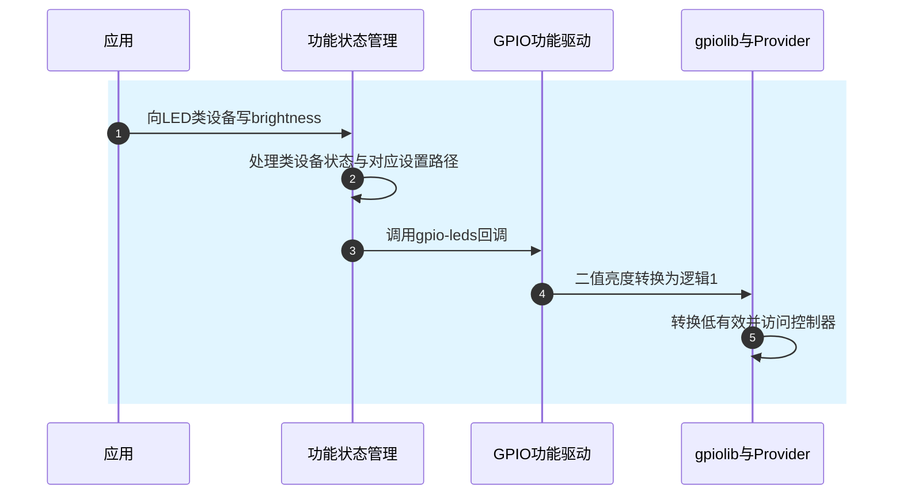

# 第1章\_为什么优先使用标准\_GPIO\_Consumer

GPIO 主线已经解决了一个底层问题：驱动怎样取得线路、设置方向、按逻辑值读写，并在退出时停止使用。现在把一根低有效 GPIO 接到状态灯上。我们已经能让灯亮灭，但应用还得知道“写0表示亮”，第二个程序也可能来改它，休眠时要不要熄灯又需要另作决定。线路访问正确，设备功能仍未组织起来。

本章沿这盏灯比较两种安排，回答为什么 Linux 已经有 gpiolib，还要有 `gpio-leds` 这样的驱动。这里的 **Consumer** 是使用 GPIO 的驱动角色；“标准 Consumer”指内核已有的功能驱动，不是一种新的 GPIO 电气标准。

## 1.1\_控制了一根线还没有定义一盏灯

**讲解层次：概念层。** 已有前提是 GPIO 的逻辑值、排他请求与生命周期，见 [GPIO专题](../gpio/大纲.md)。本章新增设备功能的状态与使用接口。

最朴素的方案是让板级驱动请求这根线，再导出一个私有 `on` 属性。驱动把用户写入的1解释为“亮”，用描述符转换低有效极性。这完全可以正确工作：驱动持有线路，应用不直接操作寄存器，解绑时也能撤销入口和请求。如果设备只有一次实验、接口不对外长期承诺，这个办法已经有价值。

问题在于产品随后增加了三项需求：程序A报告运行状态，程序B报告故障，系统休眠时还要熄灯。原来的 `on` 属性没有回答“故障期间运行状态能不能把灯熄灭”，也没有保存“休眠前希望的亮度”。如果再加私有闪烁接口，项目还要维护定时任务、解绑时的取消以及应用使用说明。GPIO 的 requested 标志只能防止另一个驱动拿走同一根线，不能替这三个使用者决定业务优先级。

这时需要在 GPIO 之上增加一个 **灯对象**：保存期望亮度，给应用一个灯的接口，并把系统电源变化和闪烁等动作交给明确的管理者。Linux 的 LED 子系统提供这种共同组织；GPIO 功能驱动只负责把灯的亮灭翻译为线路操作。这里移交的是通用设备职责，故障优先于运行指示这样的产品策略仍需由产品定义。

## 1.2\_功能驱动连接的是两份不同的状态

应用写“亮度”以后，LED 子系统保存和处理灯状态，`gpio-leds` 收到设置请求，将非零亮度转换为逻辑1，gpiolib 再根据 active-low 转换物理电平，Provider 最后访问控制器。休眠与恢复还要进入电源管理（Power Management，PM）路径。每层都有自己的状态，不能用一个“GPIO值”统称。

图中从期望状态到外部灯的箭头是执行路径，不是硬件成功的反向证明。GPIO setter 可能不返回写入错误，软件显示的期望亮度不能代替对电源、接线或波形的检查。标准接口并没有使坏线缆变好。

**讲解层次：概念到实现的映射，NXP Linux 6.12.20 固定版本。** `gpio-leds` 使用 `gpio_led_data` 连接 `led_classdev` 和 `gpio_desc`。前者是 LED 子系统登记的灯对象，后者标识请求到的 GPIO；驱动据 Provider 是否会睡眠选择适合的设置回调。其二值实现的 `max_brightness` 为1，不能据“brightness”这个名字推导出 PWM 调光。版本身份从 [GPIO源码阅读索引](../../../research/source_reading/gpiolib/navigation/P01_Linux_6.12_GPIO源码阅读索引.md#1.1_版本身份与阅读路线) 进入；这一对象交接在本专题后续的指示与背光章节继续展开。

## 1.3\_同一盏灯换了接口以后省掉什么

先看一次普通点亮。私有方案中，应用找到项目自定义入口，按项目约定写值，板级驱动调用 gpiolib。标准方案中，应用找到 LED 类设备，写 `brightness`，LED core 调用 `gpio-leds`，再调用相同的底层机制。末端仍然要执行 GPIO 事务；增加通用层的收益在于复用设备语义和接口维护。

两条时间线使用相同参与者。第一条没有共同的灯状态管理者，业务和PM规则集中在项目驱动；第二条把通用灯职责交给 LED core，但仍由应用决定产品策略。

私有路径第2步必须由项目实现，第3～4步才是已有 GPIO 基础。若驱动没有实现PM或异步停止，不能因为最后一次写线正确就认为完整设备生命周期正确。

标准路径第2～3步把通用设备协议固定下来；第4～5步仍保留原来的访问成本。`brightness` 与触发器也不是任意多写者的仲裁协议：例如故障程序和心跳触发器同时控制一盏灯时，需要约定谁取得控制、何时恢复。LED core 管理类设备状态，不自动知道“故障”的业务优先级。

| 要解决的事情 | 自定义功能驱动 | 标准功能驱动带来的变化 |
| --- | --- | --- |
| 描述接线和极性 | 也可以正确使用gpiod描述符 | 使用现有binding，避免另造板级属性语义 |
| 对外接口 | 项目定义并长期维护ABI | 应用面对已有LED等子系统接口 |
| PM与闪烁 | 项目建立状态、恢复与取消协议 | 复用对应子系统已有路径，但仍核对支持的属性与硬件条件 |
| 多写者策略 | 项目决定谁优先 | 通用核心提供机制；产品优先级依然要定义 |
| 实际写线 | GPIO访问、锁或总线事务 | 这些成本仍然存在 |
| 失败与退出 | 项目保证入口撤销、任务停止和资源释放 | 复用已实现的生命周期；不能跳过Provider可用性核对 |

## 1.4\_复用的前提是设备职责真正吻合

到这里，“先找标准驱动”已经有了具体含义：先写出使用者需要什么保证，再核对现有驱动是否提供它。不能只因为接了一根 GPIO，就把所有功能装进 `gpio-leds`。

例如两个设备共享一条电源使能线。它们需要的是“只要还有设备使用电源就保持供电”，直接用灯的亮灭接口没有建立使用计数。又如外部多路选择器，需要从选通到传输结束持续保持通道，写完两根选择线就返回并不能保护后续传输。这些问题分别需要电源管理和事务期间的通道所有权，后续章节逐个推导。

因此选择时依次核对四件事：设备功能是否与绑定相符；调用者是否需要该子系统提供的接口；GPIO之外是否还有必须共同推进的寄存器或时序状态；现有实现的PM、去抖、延时和失败处理是否满足要求。若需求只是开关状态灯，优先复用LED模型；若某根线必须与专有寄存器交易组成不可拆分协议，应把它纳入那个设备驱动，而不是为了套标准模型把完整协议拆散。

标准驱动也不全都以同一种方式取得GPIO。例如固定稳压器会把可选使能描述符交给 regulator core 管理生命周期，不能把“标准Consumer”概括成“统一调用devm获取”。这些差别来自功能对象的所有者，后文会沿交接说明。

## 1.5\_用两项需求检验选择理由

先独立判断，再核对答案。

1. 一根低有效线只负责状态灯亮灭，项目准备新增私有字符设备，让应用写物理0或1。应先改进哪一层？
2. 一根复位线必须在设备寄存器设置之后拉低，延时后释放，并在失败时保持复位。能因为它也是二值输出就直接改成LED吗？

第一题应先把“灯亮灭”作为设备语义，核对 `gpio-leds` 的绑定和LED接口。应用不应承担板级极性；即使最终保留私有驱动，也应该让描述符处理逻辑值。标准方案减少的是重复ABI和设备状态管理，不是免除接线验证。

第二题不能只按电平形状选择。复位与寄存器属于同一个设备操作周期，失败出口也依赖这个周期。若现有设备驱动能持有并控制复位描述符，应在该驱动内保持顺序；LED接口没有提供这组协议保证。

现在可以解释功能驱动为什么位于 gpiolib 之上，也能说清标准化没有消除的成本。接下来回到 [实现选择总览](P02_按设备功能选择GPIO实现.md)，按设备职责进入具体过程。
