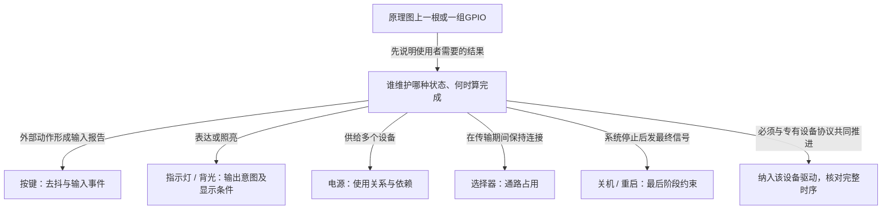

# 第2章\_按设备功能选择GPIO实现

上一章已经比较过自定义状态灯与标准LED对象：gpiolib负责线路，功能驱动把线路动作放进设备协议。接下来要回答更具体的问题——看到原理图上一根GPIO，怎样判断应该由哪个功能对象持有它？

单看输入或输出还不够。状态灯、背光、电源使能和复位都可能只用一根输出线，但使用者对它们的完成条件完全不同。本章作为进入后续正文的选择桥梁，先辨认这些职责，再给出各章入口。读者此时不需要记住全部内部字段。

## 2.1\_先问使用者要完成什么事

设想应用提出“把这根线拉高”。若这是低有效状态灯，拉高反而熄灭；若这是共享电源使能，还要知道有没有其他设备继续用电；若这是复位请求，还要知道它必须与哪些寄存器步骤保持顺序。物理动作相同，不代表协议可以互换。

因此先把需求改写成一句设备语言：报告一次按下、显示状态、照亮屏幕、开始使用电源、占用某条数据通道，或者执行整机关机。然后问谁维护动作前后的状态，以及什么条件才允许下一步。这个问题会把候选驱动缩小到正确的层。

标准功能驱动是这些领域与GPIO之间的适配者。input管理输入报告，LED管理指示状态，backlight管理显示照明，regulator管理供电关系，mux管理通路选择的使用期，sys-off管理整机最后动作的处理者。它们都是使用GPIO的一方，但不是同一种对象的不同版本，也不能按“更高级”排成一条升级路线。

图的分支依据是协议责任，不是GPIO电平形状。最后一支也不是“标准驱动不好用就另写一个”，而是已有模型确实无法表达不可分割的设备协议时，才由相应设备驱动完整承担。

## 2.2\_从一条线路逐步增加设备语义

先看输入。机械按键一次按下可能引起多个边沿，IRQ只通知发生了变化，不能直接证明稳定按下。gpio-keys在每键对象里连接描述符、IRQ、去抖时机与input报告。后续要问的不是“用哪个get函数”，而是在哪个时刻采样、谁记录输入状态，以及退出前如何停止报告。由 [按键的抖动问题](P03_GPIO按键怎样接入输入事件.md#3.1_一次机械按下为何可能产生多次中断) 进入。

再把方向反过来看输出。指示灯表达状态，屏幕背光提供照明；用户仍希望有亮度，不代表屏幕关闭时应该继续点亮。LED与backlight因此保存不同的领域状态，驱动把最后决定转换为GPIO逻辑值。GPIO二值能力不会凭空变成多级PWM，慢总线访问也不会消失。由 [同是点亮为何需要两种对象](P04_GPIO指示与背光怎样接入亮度接口.md#4.1_都是点亮为什么需要两种对象) 继续。

输出又可能成为别的设备工作的前提。A结束时B仍在使用同一电源，管理者不能只服从A最后一次“关”命令；fixed regulator把固定电压来源登记为供电对象，让消费者的开始/结束使用汇总为使能条件。上游供电与稳定时间也属于这个协议，详见 [共享供电的误关闭](P05_GPIO供电怎样进入电源依赖.md#5.1_最后一次写线不能代表最后一个使用者)。

选择器同样有多个使用者，却不能让大家同时拥有不同通道。它需要轮流占用，并把保持时间延长到数据传输结束。gpio-mux把状态编号编码成选择位，mux core维护使用期；软件独占与多个引脚是否同时变化仍是两份保证，详见 [选择后的通道保持](P06_GPIO选择线怎样保护一段事务.md#6.1_选择以后为什么还需要保留通道)。

最后改变发生时机：整机已经逐步停止设备服务，仍要发出断电或重启请求。gpio-poweroff/restart把GPIO动作登记为sys-off最终回调，需要按末期上下文、Provider依赖和电路条件核对。函数在正常运行时可调用，并不能证明此时仍可用，详见 [最后阶段的依赖变化](P07_GPIO关机与重启为何要核对最后阶段.md#7.1_白天能写的GPIO为什么在关机末期可能失效)。

这些章节逐个增加约束，不能把一个章节的结论直接借给另一个：去抖不解决共享电源计数，引用计数不保证传输期间独占，事务锁也不保证系统末期总线仍能工作。

## 2.3\_把候选方案与缺失保证放在一起比较

已辨认设备职责以后，再用下面的表核对候选。它总结的是进入各章的选择理由，不代替各章对属性和实现的展开。

| 实际需求 | 候选GPIO功能驱动 | 需要保留的关键状态 | 不能从此推导的能力 |
| --- | --- | --- | --- |
| 人机按键或开关 | gpio-keys | 去抖/采样及输入事件状态 | 任意高速数据流、每边沿都必定变成事件 |
| 二值状态指示 | gpio-leds | 亮度意图、触发/闪烁及退出 | 任意多写者业务仲裁、任意亮度等级 |
| 屏幕背光开关 | gpio-backlight | 亮度与显示电源/空白状态 | PWM多级调光、软件亮度即物理反馈 |
| 固定电压来源的使能 | regulator-fixed | 消费关系、上游依赖和时间约束 | 可编程PMIC完整协议、电压已被测量 |
| GPIO编码的外部通道 | gpio-mux | 选择到传输完成的独占期 | 任意阵列硬件同时翻转、通用断接门控 |
| 整机末期断电/复位 | gpio-poweroff/restart | 回调模式、私有参数及执行阶段 | 慢总线必定可访问、返回即物理成功 |

两种情况下应暂时离开表格：一是功能名字匹配但硬件能力不匹配，例如背光要求稳定多级亮度，只有开关的GPIO模型不够；二是功能本身属于另一个完整协议，例如某器件复位必须和私有寄存器交易一起回滚。前者继续寻找相应领域驱动，后者让器件驱动共同管理，不能为了套用表格拆散正确性条件。

反过来，已有模型满足设备语义、上下文和生命周期要求时，另造字符设备并不会自动获得更好的保证，还要自行承担ABI、停止异步工作、PM和失败路径。应比较的成本是整个操作周期，而不是把两行GPIO调用与一个功能子系统的代码总量作表面比较。

## 2.4\_源码证据证明具体版本的哪一段

本专题映射到NXP Linux 6.12.20，固定提交 `dfaf2136deb2af2e60b994421281ba42f1c087e0`。先从 [GPIO源码阅读索引](../../../research/source_reading/gpiolib/navigation/P01_Linux_6.12_GPIO源码阅读索引.md#1.1_版本身份与阅读路线) 确认来源，再沿 [标准功能模块导读](../../../research/source_reading/gpiolib/navigation/P06_标准功能驱动怎样承接GPIO状态.md#6.1_从一根线路走到领域对象) 看对象与阶段；具体函数只在对应唯一实现页展开。

| 功能适配 | 上游位置 | 应结合的接收层 |
| --- | --- | --- |
| 按键 | drivers/input/keyboard/gpio_keys.c | input core维护输入状态与报告 |
| LED | drivers/leds/leds-gpio.c | LED core处理亮度、触发器和工作交接 |
| 背光 | drivers/video/backlight/gpio_backlight.c | backlight核心合成显示条件 |
| 固定电源 | drivers/regulator/fixed.c | regulator core汇总消费及依赖 |
| 选择器 | drivers/mux/gpio.c | mux core维护选择占用与空闲策略 |
| 关机/重启 | drivers/power/reset/gpio-poweroff.c、gpio-restart.c | kernel/reboot.c登记模式，架构末期路径执行 |

一份适配驱动只能证明这一层做了什么，不能单独证明应用已收到事件、真实电压稳定或整个系统已复位。各章因此同时列出状态、交接、错误出口与观察边界。DTS离线编译证明输入可解析，源码证明版本行为，目标测量才提供具体板的运行证据，三者不能互相冒充。

## 2.5\_先做选择预测再进入具体过程

现在判断四项需求：按钮经扩展器接入；应用仍希望亮屏但显示器已blank；两个设备共享电源；数据传输期间不能切换输入通道。依次需要保留什么状态？

按钮需要按键语义及适合可睡眠Provider的采样路径，还要单独核对IRQ与去抖能力；背光需要把期望亮度与当前显示条件分开；共享供电需要每个使用者的成对需求；通道需要从选择到真正传输停止的占用。只有最后一项主要依赖互斥使用期，不能给前面所有问题都套一把“GPIO锁”。

继续阅读时，不要求预先熟悉input、regulator等子系统全貌。先在每章建立当前需要的功能对象和状态周期，再进入实现证据；遇到超出本章职责的核心算法，沿准确入口深入。下一章从最容易观察的 [一次机械按下](P03_GPIO按键怎样接入输入事件.md#3.1_一次机械按下为何可能产生多次中断) 开始。
