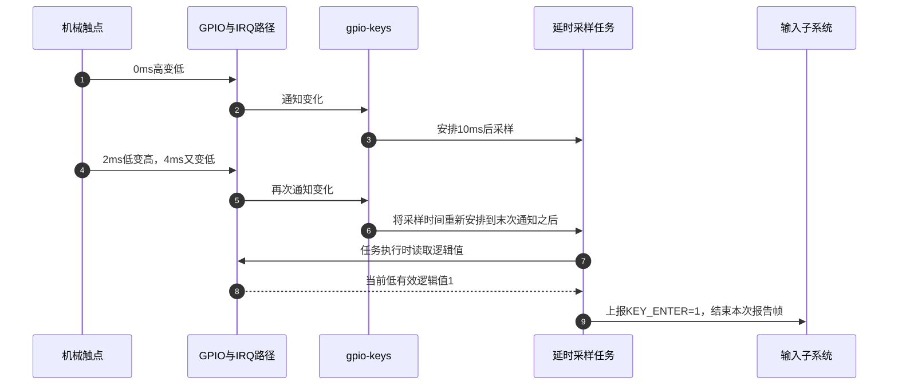
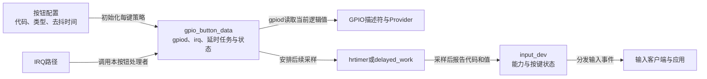

# 第3章\_GPIO按键怎样接入输入事件

前两章把 GPIO 功能驱动与线路访问分开。现在选一个最常见的输入：低有效确认键。按下把引脚接地，松开由电路上拉。GPIO中断能够告诉软件线路发生了变化，可应用想知道的是“确认键按下和松开”，并不想处理引脚offset、触点抖动和IRQ号。

本章只建立这段转换：接线怎样变成按键配置，一次变化怎样经过采样进入输入事件，解绑怎样停止未完成的报告。完整输入子系统的客户端、事件缓冲与多点触控另见 [输入专题](../input/大纲.md)。这里不要求读者事先掌握那些内部实现。

## 3.1\_一次机械按下为何可能产生多次中断

**讲解层次：概念层。** 从外部按键电路到软件输入事件。

先采用最直接的规则：下降沿报告按下，上升沿报告松开。它对理想开关很自然，也能及时响应。但是机械触点接合时可能反复弹跳：在一次人的按下动作中，引脚经历高、低、高、低，若每个边沿都变成按键动作，应用会收到一次短按再加一次按下。提高CPU速度只会更快地报告错误含义。

缺少的是一个判定规则：线路开始变化后，给触点一段安定时间，再采样当前状态。控制器如果支持硬件去抖，可以在事件进入驱动之前完成过滤；否则驱动保存“待采样”的延时任务，每次新边沿重新安排时间。这个安排增加响应延迟，并可能忽略比窗口更短的真实按压，不能同时许诺过滤所有抖动和保留所有短脉冲。

下面固定一个教学时间线：窗口10ms，边沿出现在0ms、2ms、4ms，之后一直低。假设各次IRQ及时送达，软件重新安排后的目标采样点约为14ms，读取低有效逻辑1并报告按下。这个14ms是演算值；IRQ传递、定时器精度和调度会影响实测时刻。若用户在采样前已经松开，读到的可能只有逻辑0，该次短按不会因“曾有下降沿”自动保存在GPIO值中。



第3与第6步保存的是未来动作，第7步读取的才是当时的电平。第9步的按键事件因此不等于第2步的IRQ通知。这里描述软件去抖分支，不能把同一延时额外套到已经成功配置硬件去抖的路径。

## 3.2\_输入对象保存按键含义而GPIO描述符保存接线

**讲解层次：概念到实现的映射，NXP Linux 6.12.20。** 本章核对的驱动是 `drivers/input/keyboard/gpio_keys.c`，配置项为 `CONFIG_KEYBOARD_GPIO`。固定版本身份见 [源码阅读索引](../../../research/source_reading/gpiolib/navigation/P01_Linux_6.12_GPIO源码阅读索引.md#1.1_版本身份与阅读路线)，功能适配关系见 [标准Consumer模块导读](../../../research/source_reading/gpiolib/navigation/P06_标准功能驱动怎样承接GPIO状态.md#6.1_从一根线路走到领域对象)。

驱动为整个按键设备建立 `input_dev`，向输入核心登记能报告哪些事件代码；每个按钮再有一份 `gpio_button_data`，把按钮配置、GPIO描述符、IRQ及延时任务连接起来。这样，输入核心能接收“确认键状态”，驱动仍能沿描述符找到实际线路。事件代码28表示 `KEY_ENTER`，既不是GPIO offset，也不是Linux IRQ号。



沿图可以找到三类状态：引脚当前电平由硬件决定；是否还有延时采样由每键任务保存；输入核心登记的按下状态位于输入设备。它们不是一份状态的三个别名。多次IRQ可能最终只形成一个状态变化，输入核心也会过滤普通按键的同状态重复报告；自动重复值2是另一个输入语义，不能当成又一次物理按下。

| 对象或字段 | 保存什么 | 谁写、谁读 |
| --- | --- | --- |
| 按钮配置 `gpio_keys_button` | 事件代码、类型、去抖与唤醒策略 | 固件解析/平台数据建立，setup和事件路径读取 |
| `gpio_button_data.gpiod`、`irq` | 取样线路与通知身份 | setup取得，事件路径使用 |
| `software_debounce`、`debounce_use_hrtimer` | 软件等待长度和采样执行方式 | setup按硬件去抖结果与访问属性确定，ISR安排任务时读取 |
| `work`、`debounce_timer` | GPIO型按钮的待执行采样 | ISR重新安排，回调采样，quiesce取消 |
| `input_dev` 的能力与按键状态 | 可以报告什么、核心当前认为哪些键按下 | 初始化登记能力，输入核心处理报告更新状态 |
| `release_timer`、`key_pressed` | IRQ-only按钮的合成释放状态 | 仅无GPIO分支使用，不能套到前面的真实取样路径 |

字段与分支的唯一展开见 [每键状态及初始化](../../../research/source_reading/gpiolib/source_explanations/P08_按键取样与输入报告.md#8.1_每键状态怎样决定采样路径)。本章后面再引入最后一行的特殊输入。

## 3.3\_延时结束以后仍要选对读取上下文

GPIO可以来自片内寄存器，也可以来自经I²C等总线访问的扩展器。延时结束不等于任何位置都允许睡眠。若在不能睡眠的定时器回调里调用需要等待总线的读取，去抖时间再合理也不能修正上下文错误。

这个版本先尝试 `gpiod_set_debounce()`。非零去抖时间会从毫秒换算为微秒传入；失败时才把时间记入软件去抖字段。它同时检查 `gpiod_cansleep()`：不需要睡眠的线路可走高精度定时器（hrtimer）采样，需要睡眠的线路走延迟工作（delayed work），由工作队列提供可睡眠执行环境。中断处理函数（ISR）主要负责安排任务，不在这里等待10ms。

还要保留一个实现细节：设置 `debounce_use_hrtimer` 的代码位于“去抖时间非零”分支内。当时间明确配置为0时，该字段保持初值false，即使是快速Provider也走work路径；不能把选择规则简写成无条件的“片内GPIO一定用hrtimer”。硬件去抖成功时，软件等待字段可保持0，但后续读取路径仍然存在。

| 情况 | 软件等待 | 采样路径 |
| --- | --- | --- |
| 时间非零，硬件去抖成功 | 0 | 按能否睡眠选hrtimer或work |
| 时间非零，硬件去抖失败，读取不睡眠 | 配置的毫秒数 | hrtimer回调普通读取 |
| 时间非零，硬件去抖失败，读取可能睡眠 | 配置的毫秒数 | delayed work中可睡眠读取 |
| 时间为0 | 0 | 当前实现保留work分支，不据此保证立即执行 |

采样返回负错误码时，驱动记录错误并结束本次GPIO值报告，不能把负数当作“按下”。普通按键把逻辑值作为 `EV_KEY` 的值提交，随后 `input_sync()` 标记这次输入报告的帧边界。帧边界表示一组输入报告完成，不表示应用已经读取，也不证明机械触点绝对稳定。具体分支见 [去抖调度与采样](../../../research/source_reading/gpiolib/source_explanations/P08_按键取样与输入报告.md#8.2_ISR怎样安排采样并结束输入报告)。

## 3.4\_把一个确认键描述完整再检查编号

现在可以写出接线之外所需的全部最小信息：控制器和线路、有效极性、输入事件代码以及去抖时间。下面是完整 **离线教学DTS**，用于练习描述与解析。它故意使用没有匹配硬件驱动的教学Provider，不可直接当成板级设备树装机；真实板还必须提供pinmux、上拉、IRQ能力和对应控制器节点。

把以下内容保存为 `gpio_key_teaching.dts`，也可直接取用 [同内容材料](../../../labs/kernel/gpio/materials/gpio_key_teaching.dts)：

```dts
/dts-v1/;

/ {
    compatible = "linux-note,gpio-key-teaching";

    teaching_gpio: gpio-controller {
        /* 仅供离线解析：没有与此compatible匹配的硬件驱动。 */
        compatible = "linux-note,teaching-gpio";
        gpio-controller;
        #gpio-cells = <2>;
    };

    keys {
        compatible = "gpio-keys";
        label = "teaching-confirm-key";

        key-confirm {
            label = "confirm";
            /* 两个参数依次为控制器内offset=2、低有效flag=1。 */
            gpios = <&teaching_gpio 2 1>;
            linux,code = <28>; /* KEY_ENTER，Linux输入事件代码。 */
            debounce-interval = <10>; /* 毫秒。 */
        };
    };
};
```

教学Provider约定两个GPIO参数，所以上面的 `gpios` 是“phandle、offset、flags”三项。这里直接写数值是为了让离线文件不依赖内核头文件搜索路径；真实内核DTS通常用 `GPIO_ACTIVE_LOW` 和 `KEY_ENTER` 宏表达相同值。

| 属性 | 本例值 | 当前用途与边界 |
| --- | --- | --- |
| 父节点 `compatible` | `gpio-keys` | 选择中断型按键驱动；轮询型是另一驱动 |
| 子节点 `gpios` | 控制器引用、2、1 | offset2，低有效；1不是IRQ触发类型 |
| `linux,code` | 28 | 输入代码 `KEY_ENTER`，不参与GPIO寻址 |
| `linux,input-type` | 本例省略 | 默认1，即 `EV_KEY`；不是默认所有事件都是轴 |
| `debounce-interval` | 10 | 毫秒；绑定缺省为5，配置0改变去抖分支 |
| `wakeup-source` | 本例省略 | 声明可唤醒还需实际电源与IRQ路径支持 |
| `wakeup-event-action` | 本例省略 | 0/1/2表示两侧/有效/无效动作，依赖wakeup-source |

在安装了 `dtc` 和 `fdtget` 的终端中，进入保存文件的目录，执行：

```sh
# 执行位置：教学DTS所在目录；只生成和读取本地文件。
dtc -I dts -O dtb -o gpio_key_teaching.dtb gpio_key_teaching.dts
fdtget -t u gpio_key_teaching.dtb /keys/key-confirm gpios
fdtget -t u gpio_key_teaching.dtb /keys/key-confirm linux,code
fdtget -t u gpio_key_teaching.dtb /keys/key-confirm debounce-interval
```

第一条查询输出三个整数，首项是编译器分配的phandle，不应硬编码期待它永远为某数；后两项应为 `2 1`。其余两次查询分别得到28与10。这个结果只证明文件能解析且数据保留，尚未执行内核binding Schema校验，也未证明驱动匹配或板上有中断。

试着仅把最后一个GPIO参数改为0后重新编译。预测变化应是“同一offset改为高有效”，不是按键代码改变，也不是中断从下降沿变上升沿。GPIO型正常按键路径请求双边沿，驱动在采样时用描述符解释逻辑值；唤醒时可能另按策略配置触发类型，不能混为一次属性修改。

编译失败时先修复语法或路径，不能继续使用上一次遗留的DTB作为本次结果。确认查询完成后，生成的 `gpio_key_teaching.dtb` 可以删除，保留DTS作为输入。绑定依据为固定版本 `Documentation/devicetree/bindings/input/gpio-keys.yaml`；事件代码来自 `include/uapi/linux/input-event-codes.h`，在 [初始化证据](../../../research/source_reading/gpiolib/source_explanations/P08_按键取样与输入报告.md#8.1_每键状态怎样决定采样路径) 附有精确来源。

## 3.5\_没有GPIO电平可读时释放事件从哪里来

前面的模型依赖“通知以后再读当前电平”。有些设备只给出一次按键IRQ，没有可读取的GPIO，也没有松开通知。若继续套同一模型，软件根本没有地方读出“已松开”。这个版本因此允许IRQ-only按钮：必须有IRQ，事件类型限于 `EV_KEY`；按IRQ报告按下，再按配置的时间合成释放。

这条分支把 `debounce_interval` 用作 `release_delay`。它不再证明触点稳定，而是在缺少释放信号时定义软件可用的按键周期。延时为0时同次处理直接报告按下和释放；非零时用release timer安排释放，并用 `key_pressed` 记录合成状态。不能拿它量出真实按住时长，更不能把长按策略建立在不存在的物理松开证据上。唯一实现见 [IRQ-only合成释放](../../../research/source_reading/gpiolib/source_explanations/P08_按键取样与输入报告.md#8.3_缺少松开信号时怎样合成释放)。

另一个不同问题是GPIO根本不支持中断。此时可核对 `gpio-keys-polled` 与 `CONFIG_KEYBOARD_GPIO_POLLED`，由周期轮询取得状态，绑定要求 `poll-interval`。轮询引入周期性访问和延迟，不等于前述IRQ-only。不要只看到名字都带keys，就把两个模型的计时参数互换。

## 3.6\_退出与唤醒会改变事件能够成立的条件

运行时已经安排的work或timer可能在unbind之后继续执行。若直接释放描述符和每键状态，稍后的采样就会访问失效对象。驱动的devres顺序为这件事建立了具体收尾：描述符先取得，quiesce取消动作先登记，IRQ随后申请；逆序释放先停止IRQ来源，再同步取消对应timer/work，最后才归还先前取得的线路与状态。只写“使用devm所以安全”会漏掉这个关键顺序。

部分初始化失败也沿已经登记的资源逆序退出。取消动作尚未登记成功时还没有开放该按钮的IRQ，不能凭空假设已有事件在等待；IRQ申请成功以后若后续步骤失败，已登记的取消动作才有责任终止遗留任务。具体路径见 [事件停止与资源回收](../../../research/source_reading/gpiolib/source_explanations/P08_按键取样与输入报告.md#8.4_为何先停IRQ再取消延时报告)。

系统休眠则不是释放设备。唤醒按钮要求中断路径及相关电源域在目标睡眠状态仍然工作；低有效按下对应物理下降沿，软件不能不看极性就把“asserted”解释为上升沿。此版本还对休眠中的可唤醒普通按键先合成一次按下，防止处理者运行时短按已经释放，再经后续采样恢复实际状态。这是特定唤醒分支，前面正常运行的去抖图不包括它。

调试时按层对照：IRQ计数增加只说明通知发生；去抖回调成功读取才能支持采样判断；输入事件显示代码和值才证明领域转换；应用是否消费还要看客户端。不能用某一层的“看到了”替其他层验收。本轮教学DTS仅做离线检查，未执行目标内核编译、按键硬件操作或系统唤醒实验。

## 3.7\_从时间线预测结果

1. 软件窗口10ms，0/2/4ms分别出现边沿，随后保持按下，为什么不能承诺0ms立即收到一次最终按下？
2. 已报告按下后又收到IRQ，取样仍为逻辑1，是否必然向应用多发一次新按下？
3. 扩展器取样要等待I²C，能否仅把软件窗口加长就改用hrtimer读取？
4. IRQ-only按钮释放时间设成20ms，能否据此判断用户只按住了20ms？

第一题的窗口要随新边沿重新安排，正常演算约在最后通知之后10ms采样，实际还受执行延迟影响。第二题不能保证；通知、采样和输入状态变化分开，输入核心会处理同状态重复的普通按键报告。第三题不能；时间长短不改变执行上下文，仍需允许睡眠的工作路径。第四题不能；20ms是合成释放策略，不是来自物理释放的测量。

现在能够沿一根输入线解释领域事件的形成与消失。输出侧也有类似问题：同样只有亮灭的指示灯与背光，为什么需要不同对象？下一步沿 [标准Consumer总览](P02_输入_指示_电源与控制类_GPIO_Consumer.md) 转向指示与显示用途。
