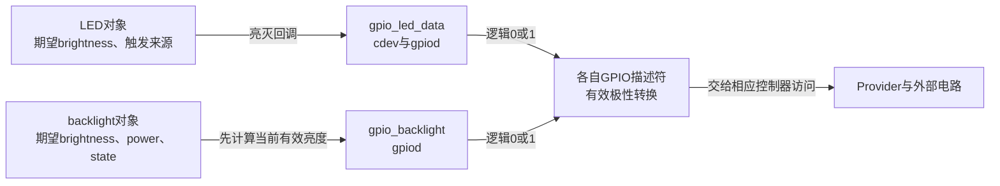
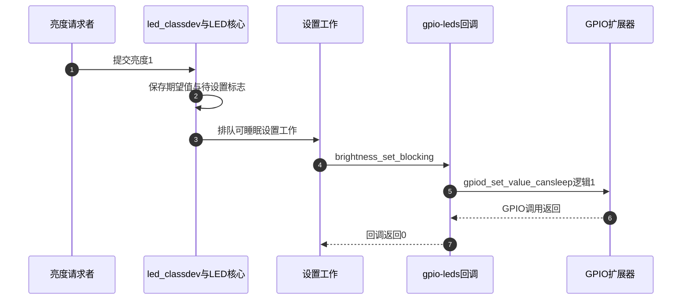
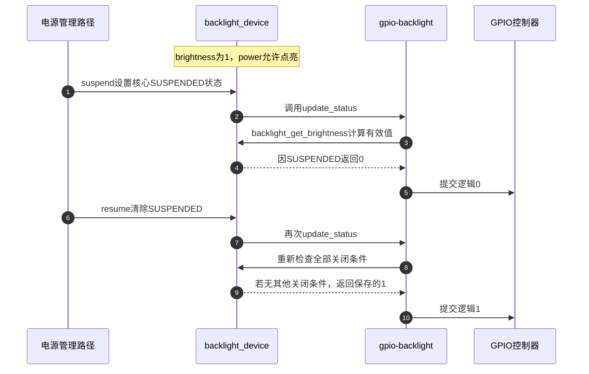

# 第4章\_GPIO指示与背光怎样接入亮度接口

按键章节说明了为什么线路变化还要转换成输入语义。输出侧也一样：一根线可以点亮状态指示灯，另一根线可以使能屏幕背光。两者电气上都是开关，应用却对它们提出不同要求。设备可能要在屏幕关闭后继续用指示灯报告充电；背光则应随显示状态关闭，并在显示恢复后使用原来的亮度意图。

本章从这两个使用者推导LED与backlight对象，再回到 `gpio-leds` 和 `gpio-backlight` 的实现。范围限于GPIO二值输出，不把亮度接口的名称当作多级调光能力。

## 4.1\_都是点亮为什么需要两种对象

**讲解层次：概念层。** 状态指示与显示照明的用途不同，领域对象因此保存不同的约束。

先用一个统一的 `on` 属性控制所有灯。应用写1就输出有效电平，这能满足最简单的亮灭。但是显示管理器准备关屏时，它若不知道背光在哪里，就只能额外维护一份“哪根GPIO属于屏幕”的板级表；恢复时还得记住关屏前的请求。每块板都复制这份关联，显示状态与GPIO控制便容易脱节。

背光对象把“用户期望的亮度”和“当前是否允许点亮”放在同一个显示照明管理接口里。关屏、休眠等条件可以暂时压低实际提交的输出，而不擦掉期望值。恢复以后再次根据条件计算输出，就不必要求应用重发它原来的亮度。

状态指示灯则围绕灯的亮度和触发来源组织。例如应用直接点亮，或由触发器根据计时、设备活动等事件改变亮度。触发器是自动提交灯控制请求的内核机制，不是灯内自带的一颗“业务CPU”；它也不知道项目中故障、充电、心跳哪个应该优先。标准LED接口提供机制，具体优先策略仍需明确。

所以不能按“灯由LED制成”选择子系统。背光本身也可能是LED，但它承载显示照明的状态；独立指示灯承载状态提示。模型选择依据是使用关系，而不是半导体材料。

## 4.2\_GPIO把亮度等级压缩为开和关

**讲解层次：概念到实现的映射，NXP Linux 6.12.20。** 固定源码身份见 [GPIO源码阅读索引](../../../research/source_reading/gpiolib/navigation/P01_Linux_6.12_GPIO源码阅读索引.md#1.1_版本身份与阅读路线)，本章交接见 [功能适配导读](../../../research/source_reading/gpiolib/navigation/P06_标准功能驱动怎样承接GPIO状态.md#6.3_灯与背光把期望值交给不同的状态管理者)。

`gpio-leds` 为每盏灯用 `gpio_led_data` 连接 `led_classdev` 与GPIO描述符。类设备保存灯的期望亮度，描述符保存线路和极性，GPIO回调将熄灭转成逻辑0、其余亮度转成逻辑1。该实现向LED核心声明 `max_brightness=1`，因此对外有效范围就是0和1。

低有效指示灯的brightness1经过描述符转换后输出物理低；高有效背光的有效亮度1输出物理高。应用都使用设备语义，无须随板级接线重新定义“亮”。Provider仍要执行实际寄存器或总线事务，类设备并没有绕过GPIO层。



图中两条路径各自持有不同线路，不表示两个驱动可以同时请求同一个GPIO。需要PWM多级调光时，应核对PWM背光或相应LED驱动；用户进程高频交替写GPIO不能提供稳定周期、占空比和调度保证。实现边界见 [亮度回调选择](../../../research/source_reading/gpiolib/source_explanations/P09_指示灯与背光的GPIO适配.md#9.1_灯对象怎样选择可睡眠或普通回调)。

## 4.3\_慢总线上的灯由谁等待

假设指示灯接到I²C扩展器。调用设置函数可能要等待总线完成，如果触发器在不可睡眠的执行位置提出亮度请求，就不能在那里直接等待。GPIO驱动先用 `gpiod_cansleep()` 确认Provider约束，再向LED核心登记不同回调：普通 `brightness_set` 必须不睡眠；`brightness_set_blocking` 允许核心在合适上下文调用。

这不是在同一个函数名末尾加几个字就获得了调度能力。LED核心保存待设置值与工作标志，将需要睡眠的设置交给工作队列；GPIO驱动回调最终才调用 `_cansleep` setter。代价转移到了排队、调度和总线访问，不能许诺每次写亮度都立刻改变引脚。



第2～3步保证请求可以跨执行上下文交接，不保证每次请求都成为独立物理脉冲；连续改变可能由核心保存和合并处理。第7步也不证明外部灯已亮：这个GPIO setter没有返回写错误，blocking包装调用后直接返回0。软件状态、调用返回与电气结果必须分别观察。

标准sysfs写 `brightness` 的路径还会等待设置work结束，但这不是任意内核调用者都拥有的同步契约。写0会移除当前触发器；写非零不能笼统当作“停止一切自动控制”。若应用要接管一盏已有触发器的灯，应先按LED接口明确控制来源，不能让两个程序互相覆盖后再把它归咎于GPIO速度。对应源码见 [请求、排队与触发器边界](../../../research/source_reading/gpiolib/source_explanations/P09_指示灯与背光的GPIO适配.md#9.2_亮度请求如何经过工作队列与GPIO回调)。

闪烁也需要分层。LED核心可以用软件计时改变输出；平台若提供特定硬件blink回调，可以把闪烁交给硬件。当前 `gpio-leds` 的固件子节点创建路径没有传入该平台blink回调，不能因为驱动源码里存在 `gpio_blink_set`，就宣称任意DTS中的GPIO灯都支持硬件闪烁。

## 4.4\_背光为何在brightness为1时仍应输出0

对背光来说，“希望亮”和“现在可以亮”本来就是两个条件。设用户期望brightness1，显示管理器随后关屏。若把brightness直接写成0，就丢掉了恢复时需要的原值；若仍把1直接交给GPIO，屏幕关闭后背光还亮着。

`backlight_device.props` 因此分开保存 `brightness`、`power` 与核心 `state`。`backlight_get_brightness()` 先检查电源是否允许点亮，或核心是否标记休眠/显示空白；只要需要关闭就返回0，否则返回期望brightness。`gpio_backlight_update_status()` 使用这个合成结果，不是无条件把props.brightness写到引脚。

| 请求/条件 | 保存的brightness | 提交给GPIO的逻辑值 |
| --- | --- | --- |
| 用户请求亮，电源允许且无blank/suspend | 1 | 1 |
| 随后系统休眠 | 仍可为1 | 0 |
| 恢复且其他关闭条件也解除 | 1 | 1 |
| 用户期望就是关闭 | 0 | 0，即使恢复也不主动点亮 |



第6步只清除休眠条件，不能替第8步跳过电源或显示blank条件。驱动设置 `BL_CORE_SUSPENDRESUME`，核心才按对应PM路径更新；这些都需要实际配置与设备电源关系支持。实现中的属性字段、运算与回调见 [背光有效值](../../../research/source_reading/gpiolib/source_explanations/P09_指示灯与背光的GPIO适配.md#9.4_背光怎样把亮度意图与显示状态合成)。

还有一个观察陷阱：`gpio-backlight` 没有实现硬件 `get_brightness` 回调。此版本的sysfs `actual_brightness` 在无回调时回退返回props.brightness，不能据其名字断言它读回了GPIO，甚至不能据它断言当前合成输出一定相同。要证明物理亮灭仍需线路或光学观察。

## 4.5\_初始值与保留状态分别承诺什么

运行时模型成立后，再回到probe。固件也许已经把背光打开，驱动接管时若先随意拉低再拉高，读者会看到闪一下。两种驱动都先以 `GPIOD_ASIS` 取得描述符，在确定初值以后设置输出方向；但它们确定初值的规则不同。

LED的 `default-state` 可取off、on、keep。keep读取当前逻辑值，读失败就返回错误；on/off直接给出目标值。随后创建LED类对象、设置max_brightness并请求输出初值。keep描述的是接管时沿用读到的状态，不保证以后任何休眠或断电都自动保持。

背光有 `default-on`，但固定版本还检查设备树节点是否拥有非零phandle：无OF节点或无phandle时按default-on决定初始power；有phandle时根据读到的GPIO值决定power。读为0取OFF，其余取ON，源码没有单独把负读取错误作为失败返回。不能将它重述成“读失败安全关闭”，也不能把default-on当作任何集成方式下都优先的开关。

| 项目 | LED适配 | GPIO背光适配 |
| --- | --- | --- |
| 初值来源 | default-state；keep读取并检查错误 | default-on或有phandle时读取GPIO的分支 |
| 最大亮度 | 1 | 1 |
| 休眠 | 未声明retain-state-suspended时，LED核心按标志熄灭并恢复期望值 | 核心SUSPENDED参与有效值计算 |
| 保留状态属性 | suspend与shutdown是不同条件 | 不能套用LED属性名 |
| 退出 | 撤销LED入口、停止闪烁/设置任务，再释放描述符 | 撤销backlight回调能力，再释放描述符 |

`retain-state-suspended` 只是避免LED核心采取其默认休眠熄灯动作，`retain-state-shutdown` 影响关机保留策略；硬件若失去供电或pinmux被其他路径改写，属性无法替它维持电平。解绑也应按真实注销实现分析，不能把shutdown属性扩写成“所有退出都保证物理保留”。源码中的接管、PM和注销边界见 [初始值与退出](../../../research/source_reading/gpiolib/source_explanations/P09_指示灯与背光的GPIO适配.md#9.7_接管初值与撤销入口怎样影响最后输出)。

## 4.6\_用一份离线描述看出两种连接

下面沿用按键章的教学Provider，两根独立线路分别接低有效LED与高有效背光。display节点仅用phandle表达“它使用哪一个背光对象”，没有模拟真实显示硬件。该文件只能做离线解析，不能安装到实际开发板。

保存为 `gpio_light_teaching.dts`，或取用 [完整材料](../../../labs/kernel/gpio/materials/gpio_light_teaching.dts)：

```dts
/dts-v1/;

/ {
    compatible = "linux-note,gpio-light-teaching";

    teaching_gpio: gpio-controller {
        /* 离线教学Provider，无匹配的真实硬件驱动。 */
        compatible = "linux-note,teaching-gpio";
        gpio-controller;
        #gpio-cells = <2>;
    };

    leds {
        compatible = "gpio-leds";
        led-0 {
            gpios = <&teaching_gpio 0 1>; /* offset0，低有效。 */
            default-state = "off";
        };
    };

    teaching_backlight: backlight {
        compatible = "gpio-backlight";
        gpios = <&teaching_gpio 1 0>; /* offset1，高有效。 */
        default-on;
    };

    display {
        /* 只练习phandle引用，不模拟真实显示控制器或面板。 */
        compatible = "linux-note,teaching-display";
        backlight = <&teaching_backlight>;
    };
};
```

LED的gpios位于每灯子节点，背光的gpios就在背光节点；这是两个不同binding的结构。display引用背光对象，不重复写其GPIO。用相同格式硬套两个节点会把描述放错层。

```sh
# 执行位置：上述DTS目录；需要dtc与fdtget，只读写本地文件。
dtc -I dts -O dtb -o gpio_light_teaching.dtb gpio_light_teaching.dts
fdtget -t u gpio_light_teaching.dtb /leds/led-0 gpios
fdtget -t s gpio_light_teaching.dtb /leds/led-0 default-state
fdtget -t u gpio_light_teaching.dtb /backlight gpios
fdtget -t u gpio_light_teaching.dtb /display backlight
fdtget -t u gpio_light_teaching.dtb /backlight phandle
```

两次gpios查询的末两项应分别为 `0 1` 与 `1 0`，default-state为off。最后两次查询应得到同一整数，证明display引用了此背光节点；具体phandle数值不是稳定接口。由于此节点有引用，dtc会为它生成phandle，这正好提醒我们：若对应真实节点进入前述Linux probe，它属于“有phandle”的初值分支，不能只看文件中有default-on就断言无条件点亮。

把LED的default-state改成keep再编译，查询应返回keep；离线工具无法给出keep最终读取到0还是1，因为文件里没有运行时引脚状态。若编译失败，应停止并修复输入，不使用旧DTB冒充新结果。实验结束可删除生成的DTB，保留DTS。这里未进行dtbs_check、内核匹配或电气试验。

属性来源为固定版本 [leds-gpio.yaml](https://github.com/nxp-imx/linux-imx/blob/dfaf2136deb2af2e60b994421281ba42f1c087e0/Documentation/devicetree/bindings/leds/leds-gpio.yaml)、[LED公共属性](https://github.com/nxp-imx/linux-imx/blob/dfaf2136deb2af2e60b994421281ba42f1c087e0/Documentation/devicetree/bindings/leds/common.yaml) 与 [gpio-backlight.yaml](https://github.com/nxp-imx/linux-imx/blob/dfaf2136deb2af2e60b994421281ba42f1c087e0/Documentation/devicetree/bindings/leds/backlight/gpio-backlight.yaml)。

## 4.7\_从观察值判断而不是从名字猜测

在真实Linux系统中，LED对象通常从 `/sys/class/leds` 查询，背光对象从 `/sys/class/backlight` 查询。先按设备与固件关系确认对象身份，再查看brightness、max_brightness及相应状态；类设备名字不应从本例节点名机械拼出。GPIO驱动未绑定或相关配置未启用时，不应预期这些类设备必然存在。

本章不提供向任意系统灯写值的盲测命令。选择有明确用途、允许测试的目标后，应同时记录控制来源、软件请求、PM/blank条件和实际电气结果；仅把brightness从0写成1不能测出全链路延迟或验证休眠保留。

试回答三个问题：背光brightness1而屏幕休眠，为什么逻辑输出可以为0？GPIO LED声明max_brightness1时，写更大的值为何不能创造中间亮度？DTS背光已有phandle且default-on存在，为什么仍要检查probe读值分支？

第一题中期望值被保留，当前关闭条件压低有效输出。第二题中硬件适配只有二值语义，参数的数字大小不会增加PWM能力。第三题中default-on不是该版本所有路径的最高优先规则，实际分支可能读取GPIO，且负读取也没有被独立报错；配置解释必须落到实现。

现在能够解释两类“灯”共享GPIO访问，却为何管理不同状态。下一类输出是供电使能：它不只是开关，还要回答多个设备谁仍在使用这条电源，继续从 [标准Consumer总览](P02_按设备功能选择GPIO实现.md) 进入电源依赖。
