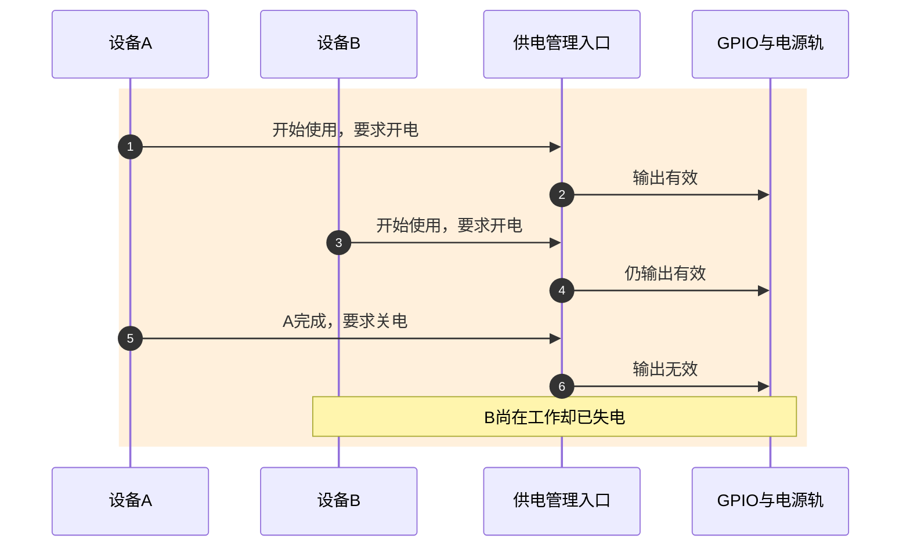
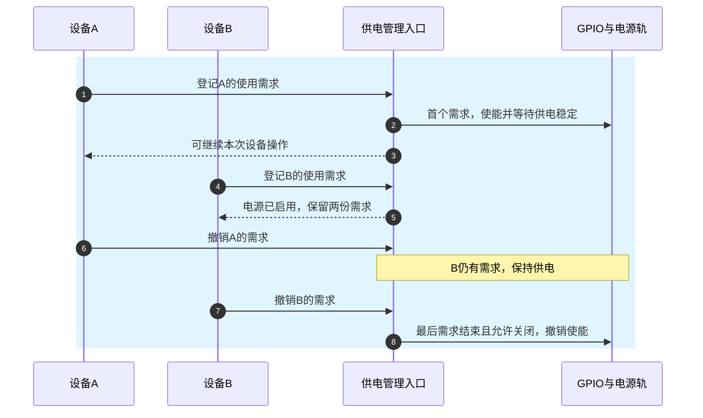
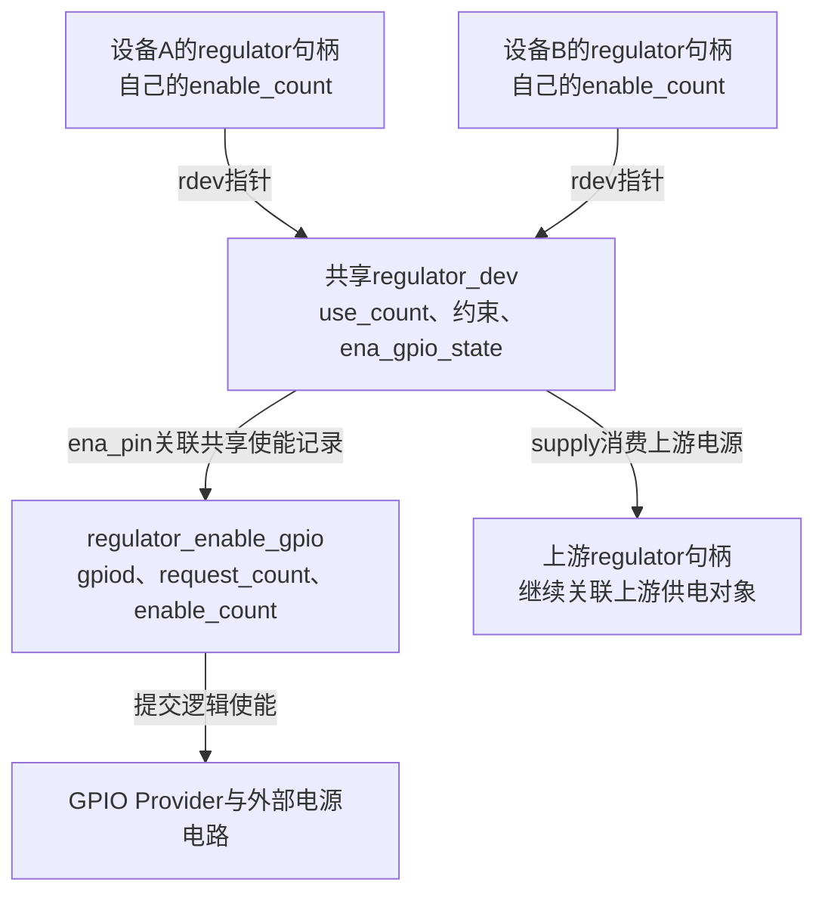
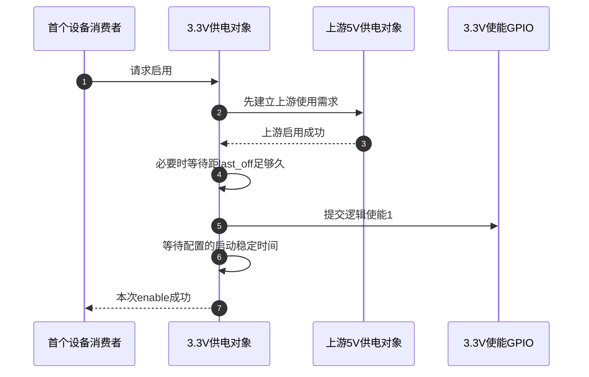

# 第5章\_GPIO供电怎样进入电源依赖

上一章用LED与背光区分期望值和当前输出。一根电源使能线也不能只按最后写入的0或1理解：设备A结束工作时，设备B可能仍在使用同一条3.3V电源。A退出自己的工作，不应使B突然失电。

本章先从这次失电交错推出共同的供电管理者，再映射到固定稳压器与GPIO。范围是固定电压、可选使能线和消费者使用关系，不展开可编程PMIC的完整电压调节算法。固定电压表示正常输出值不由本驱动连续调节，不表示电源永远不能关闭。

## 5.1\_最后一次写线不能代表最后一个使用者

**讲解层次：概念层。** 两个设备共享一条电源轨，电源轨指实际向它们供电的同一电气网络。

先考虑只服务设备A的板级电源函数。它持有GPIO，开始工作时拉有效，结束后拉无效。这能减少空闲耗电，顺序也很容易检查。后来设备B接到同一电源，项目复用这份函数，让B也在开始和结束时调用。问题并非GPIO写入本身不可靠，而是函数没有记住仍在使用电源的人。

这里特意假设板级函数只请求一次线路，两设备经这个共同入口发命令。若两个普通Consumer各自独占请求同一GPIO，第二个请求通常会失败；不能把“两个驱动都随便取得线路”当成正常前提。



第6步遵守了A的命令，却违反了B继续工作的条件。给写GPIO加一把锁只会让这些写入依次发生，不能让管理入口凭空知道B仍需要电。缺少的不是更快的写事务，而是与各使用者关联、直到结束才清偿的使用记录。

新入口不再接受“直接输出什么”，而是接受“我开始使用/我结束使用”。它把每个使用者的需求汇总，只在第一次需求到来时打开，在最后一份需求撤销且允许关闭时关闭。



第6步现在只改变A的使用关系；第8步才具备关闭的必要条件。新方案需要句柄、计数、同步与成对释放，也增加统一管理的成本。若硬件本来就是某个设备内部不可共享的复位/电源时序，应由那个设备的完整协议管理；只有确实存在独立供电对象及依赖时，才能得到这里的共享收益。

## 5.2\_Linux怎样区分设备句柄与供电对象

**讲解层次：概念到实现的映射，NXP Linux 6.12.20。** regulator子系统管理供电对象及消费者关系；fixed regulator驱动把固定电压电源登记进去，可选的GPIO仅是它的使能执行方式。

设备A取得的 `struct regulator` 是A持有的消费句柄，设备B有自己的句柄。两个句柄可以指向同一个 `struct regulator_dev`，后者代表共享电源提供者，保存约束、操作能力与总体使用状态。名称相似但对象数量不同：两个消费句柄不意味着两条电源轨。

来源身份见 [GPIO源码阅读索引](../../../research/source_reading/gpiolib/navigation/P01_Linux_6.12_GPIO源码阅读索引.md#1.1_版本身份与阅读路线)，对象交接见 [固定电源模块导读](../../../research/source_reading/gpiolib/navigation/P06_标准功能驱动怎样承接GPIO状态.md#6.4_固定供电把多个使用关系汇总到一个使能出口)。下面只使用当前推导需要的计数。



每个句柄的enable_count允许同一使用者嵌套启用；rdev的use_count在该句柄从未使用变成使用时增加，而不是每次嵌套调用都增加。为避免把特殊平台约束混入最小模型，下表限定：可正常关闭、无always-on、无额外内部引用，各操作成功，初始无使用需求。

| 操作 | A的enable_count | B的enable_count | rdev的use_count | 是否仍需供电 |
| --- | --- | --- | --- | --- |
| 初始 | 0 | 0 | 0 | 否 |
| A启用 | 1 | 0 | 1 | 是，首次建立 |
| A嵌套再启用 | 2 | 0 | 1 | 是，没有多出第二个消费句柄 |
| B启用 | 2 | 1 | 2 | 是，两份有效消费关系 |
| A释放一次 | 1 | 1 | 2 | 是，A还欠一次释放 |
| A再释放一次 | 0 | 1 | 1 | 是，B仍在使用 |
| B释放 | 0 | 0 | 0 | 允许关闭时撤销使能 |

句柄取得和使能也要分开：拿到regulator句柄不等于已使能电源；成功enable与disable应配对，put句柄不能替代未完成的disable。发生enable错误时，不能把失败调用记作已经持有一份成功需求；错误处理也不承诺此前发生的所有硬件变化被原样逆转。

同一rdev的enable/disable在核心依赖锁协议下修改状态，不能由驱动直接增减这些字段。其唯一实现和锁前提见 [消费计数与共享对象](../../../research/source_reading/gpiolib/source_explanations/P10_固定电源的使能计数与GPIO交接.md#10.1_消费句柄与电源对象分别记录什么)。

## 5.3\_使能以后为什么还不能马上访问设备

汇总使用需求解决了误关电，但“拉起使能”与“电压稳定”仍不是同一时刻。若设备在电源爬升期间就收到总线命令，它可能无响应或处于不确定状态。电源管理者因此还需要知道启动等待，并在成功enable返回前完成适用的稳定时间要求。

这个固定驱动把 `startup-delay-us` 保存为enable_time；`off-on-delay-us` 则约束关闭后到再次开启的最小间隔。前者发生在启用之后，后者在再次启用之前检查上次关闭时间。把两者都解释成“sleep一下”会丢失起算点。

电源本身还可能依赖上游。例如5V输入经过固定3.3V转换器再供两个设备。`vin-supply` 描述上游，核心在需要启用下游时先建立上游需求，关闭下游后再撤销对应的上游需求。A、B不需要各自另写一套“先开5V再开3.3V”的板级脚本，依赖关系由供电对象统一组织。



第4步和第6步分别对应两种时间约束；第7步是软件遵守配置的完成条件。对于本章简单GPIO固定电源，并没有据此测量真实输出电压，参数填写错误仍可能过早使用设备。核心其他驱动可以提供状态反馈，不能把其能力自动加到本例。定时及上游失败收尾见 [启停与时间](../../../research/source_reading/gpiolib/source_explanations/P10_固定电源的使能计数与GPIO交接.md#10.2_首次启用与最后释放怎样连接GPIO和上游供电)。

## 5.4\_一条电源多人使用与两条电源共用使能不是一回事

前面的A、B共享同一个rdev，只有一个供电提供者需要控制GPIO。还有一种硬件：两个独立电源输出由同一根使能线共同控制。Linux可能将两个输出登记为两个rdev，它们再指向同一份 `regulator_enable_gpio`。只有在进入这种集成差量时，图中的第三组计数才需要单独展开。

`request_count` 记录有多少rdev登记使用这一使能记录，决定最后何时归还GPIO描述符；`enable_count` 记录当前启用该引脚的需求，决定何时保持有效电平。每个rdev还有 `ena_gpio_state`，避免该rdev重复把同一次启用计入共享线。它不是实际电压采样值。

| 计数所在对象 | 在本章回答什么问题 | 不能混同的量 |
| --- | --- | --- |
| 消费句柄enable_count | A自己还有几次成功enable未配对 | 使用这条电源的设备总数 |
| rdev use_count | 当前有多少有效消费关系及约束相关使用状态 | GPIO请求次数、每次嵌套调用总数 |
| ena_pin enable_count | 共享使能出口还有几份启用需求 | A、B的直接句柄数 |
| ena_pin request_count | 多少rdev仍登记使用这个GPIO记录 | 电源当前是否真的输出电压 |

fixed驱动使用非独占获取标志是为了后一种特殊共享：首个获取者初始化方向、极性等，后续使用者假定这些属性一致。它不是鼓励任意GPIO用户绕开排他请求；两份配置若对有效极性各执一词，共享计数并不会帮硬件作选择。

还应分开功能意图与并发证明：这个版本共享记录的登记/释放使用全局列表锁，运行时 `regulator_ena_gpio_ctrl()` 自身不取得那把锁。不能把“存在共享结构”直接外推成任意两个独立rdev的所有并发启停都由列表锁保护。本文完整并发场景限定A、B消费同一rdev；多rdev共享引脚需要继续核对实际依赖锁与板级拓扑。具体特殊路径见 [共享使能记录](../../../research/source_reading/gpiolib/source_explanations/P10_固定电源的使能计数与GPIO交接.md#10.3_共享使能线的登记计数与运行计数如何分开)。

## 5.5\_谁取得GPIO谁就必须说清最后交给了谁

普通Consumer常用devm取得GPIO，让本设备退出时归还。fixed驱动这里却调用 `gpiod_get_optional()`，把描述符放进 `regulator_config.ena_gpiod`，交给regulator core管理。原因已经能从上一节推出：同一引脚可能仍被另一个供电对象登记，固定驱动本身的单份devres不能替共享管理者判断最后释放时刻。

optional表示绑定没有描述这根线时可以返回NULL，例如一个不可切换的固定供电来源；它不把错误指针变成成功。存在GPIO但查找、请求或依赖失败时，驱动仍应传播错误。

交接也不是一句“core接管”就从此没有失败窗口。固定版本的 `regulator_register()` 对尚未转入共享记录的描述符设置临时归属标志，成功交接后清除，错误时按所属阶段归还。可是外面的 `devm_regulator_register()` 先分配托管记录；若这一步失败，它直接返回ENOMEM，尚未进入core接管代码，而fixed probe的对应返回路径没有额外put。由这条已核对路径不能宣称“所有注册失败都会自动归还GPIO”；这是静态源码边界，本轮没有做内存分配失败注入，也未改动外部内核。

这一例子说明，理解资源归属要追到交接前、交接中和交接后的失败出口，而不是看见devm前缀便停止。具体标志和返回分支见 [注册交接与失败窗口](../../../research/source_reading/gpiolib/source_explanations/P10_固定电源的使能计数与GPIO交接.md#10.4_描述符交接成功前后怎样选择释放责任)。

## 5.6\_用完整DTS检查电源关系和极性例外

下面以一条5V上游、一条GPIO控制的3.3V电源和两个消费设备表达同一场景。Provider与消费设备的 `linux-note,*` compatible只是离线教学名称，没有匹配硬件驱动；不要把文件装到实际板上。实际电源电压、启动时间和引脚属性必须由电路与器件决定。

保存为 `gpio_power_teaching.dts`，或取用 [完整材料](../../../labs/kernel/gpio/materials/gpio_power_teaching.dts)：

```dts
/dts-v1/;

/ {
    compatible = "linux-note,gpio-power-teaching";

    teaching_gpio: gpio-controller {
        compatible = "linux-note,teaching-gpio";
        gpio-controller;
        #gpio-cells = <2>;
    };

    input_5v: regulator-5v0 {
        compatible = "regulator-fixed";
        regulator-name = "teaching-input-5v";
        regulator-min-microvolt = <5000000>;
        regulator-max-microvolt = <5000000>;
        regulator-always-on;
    };

    shared_3v3: regulator-3v3 {
        compatible = "regulator-fixed";
        regulator-name = "teaching-shared-3v3";
        regulator-min-microvolt = <3300000>;
        regulator-max-microvolt = <3300000>;
        vin-supply = <&input_5v>;
        gpios = <&teaching_gpio 2 0>; /* offset2，保持与高有效属性一致。 */
        enable-active-high;
        startup-delay-us = <1000>; /* 教学时间，真实值由电源器件确定。 */
        off-on-delay-us = <5000>;
    };

    device-a {
        compatible = "linux-note,teaching-power-client";
        vdd-supply = <&shared_3v3>;
    };

    device-b {
        compatible = "linux-note,teaching-power-client";
        vdd-supply = <&shared_3v3>;
    };
};
```

两个vdd-supply都指向shared_3v3；vin-supply再指向input_5v。电源提供者的GPIO位于regulator节点，不能复制到两个消费节点让它们分别拉线。固定电压的min和max应相等；这个驱动检查不等时返回EINVAL，不能用一对范围值让固定转换器凭空可编程。

此处还有一个必须本地解释的绑定例外。在本版本的OF固定稳压器路径中，`enable-active-high` 是否存在决定有效极性，覆盖GPIO描述中的active-low位；缺省按低有效。于是不能只机械地读gpios最后一个参数。本例让flags=0与enable-active-high保持一致，避免自相矛盾；该历史规则不能推广到gpio-leds、gpio-keys或所有供电驱动。

| 属性 | 本例作用 | 与相邻属性的区别 |
| --- | --- | --- |
| regulator-min/max-microvolt | 都为3300000微伏 | 固定值，不是可动态调节范围 |
| gpios、enable-active-high | offset2，高有效使能 | OF fixed有极性覆盖规则，按匹配实现核对 |
| vin-supply | 上游5V提供者 | 下游设备用自己的vdd-supply关联3.3V |
| startup-delay-us | 使能后等待1000微秒 | off-on-delay-us约束上次关闭到再开启 |
| regulator-boot-on | 本例3.3V未指定 | 表示启动供电预期，允许以后按需求关闭 |
| regulator-always-on | 仅上游5V指定 | 表示不应被关闭，不能与boot-on当同义词 |

```sh
# 执行位置：教学DTS所在目录；只进行本地编译与查询。
dtc -I dts -O dtb -o gpio_power_teaching.dtb gpio_power_teaching.dts
fdtget -t u gpio_power_teaching.dtb /device-a vdd-supply
fdtget -t u gpio_power_teaching.dtb /device-b vdd-supply
fdtget -t u gpio_power_teaching.dtb /regulator-3v3 phandle
fdtget -t u gpio_power_teaching.dtb /regulator-3v3 regulator-min-microvolt
fdtget -t u gpio_power_teaching.dtb /regulator-3v3 regulator-max-microvolt
fdtget -p gpio_power_teaching.dtb /regulator-3v3
```

前三项查询应指向同一phandle整数，电压查询均为3300000；属性列表应包含enable-active-high。编译成功只说明描述语法能被dtc接受。把max改为3400000再编译，dtc仍可能成功，因为它没有运行fixed驱动的等值判断；查询能看到不等值，恰好说明“生成DTB”和“驱动接受配置”是两种证据。

恢复max为3300000后再生成正式练习产物；若编译失败，停止并修复，避免读取旧DTB。结束时可删除生成的DTB。此实验没有执行dtbs_check、内核驱动匹配、电源启停或电压测量。精确绑定与OF特殊处理见 [属性与极性](../../../research/source_reading/gpiolib/source_explanations/P10_固定电源的使能计数与GPIO交接.md#10.5_固定电压与OF极性怎样进入配置)。

## 5.7\_最后释放的完成条件与练习

设备结束使用之前，要先停止依赖该电源的IRQ、DMA、工作队列或总线事务，再撤销自己的供电需求；否则即使core计数完全正确，设备自己仍可能在断电后访问。最后一个消费者disable也不是无条件“拔掉电源”：always-on约束、其他使用关系、关闭能力和通知路径都可能改变结果。

退出供电提供者时，还需要确保消费者生命周期已经结束，撤销登记并释放共享使能记录；最后一次request_count归零才put引脚。注销供电对象不等于已经测量所有节点电压为0，资源释放也不承诺GPIO复原。

试回答：A启用两次、B启用一次，A关闭一次后能关电吗？boot-on能否替代always-on保护关键供电？读取到ena_gpio_state=1能证明输出达到3.3V吗？

第一题不能，A还有一次嵌套需求，B也仍在使用；普通场景rdev use_count仍为2。第二题不能，boot-on是启动状态预期，允许后续关闭，always-on才表达不应关闭的约束。第三题不能，它是核心跟踪的使能状态，普通GPIO固定电源没有由此完成电压反馈测量。

现在可以从消费需求解释何时应该保持一条电源。下一类GPIO输出不是保持供电，而是保持某条数据通道的选择：即使选择位写对，传输结束前也不能让别人切走，继续沿 [标准Consumer总览](P02_按设备功能选择GPIO实现.md) 进入多路选择器。
