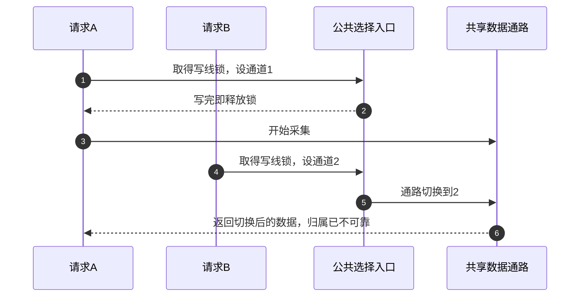
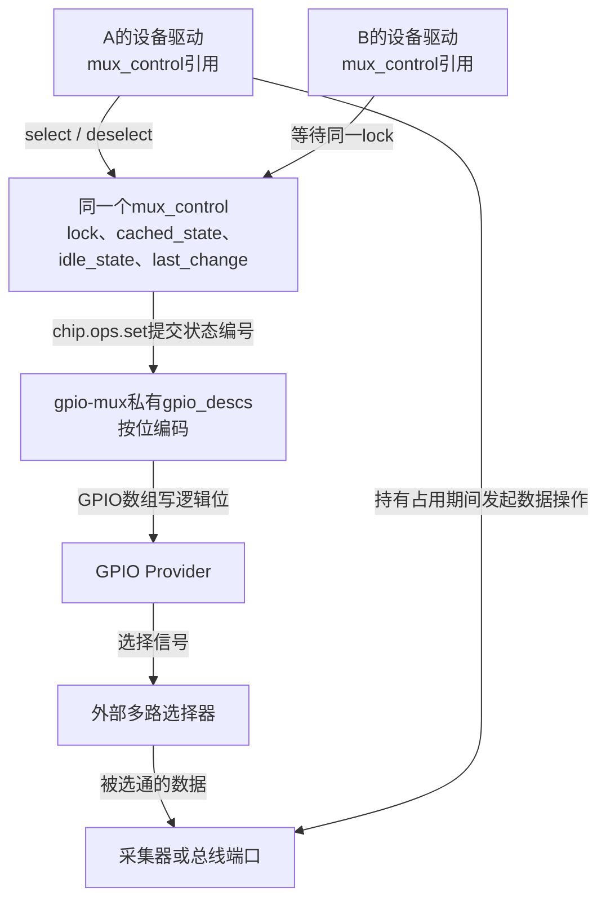
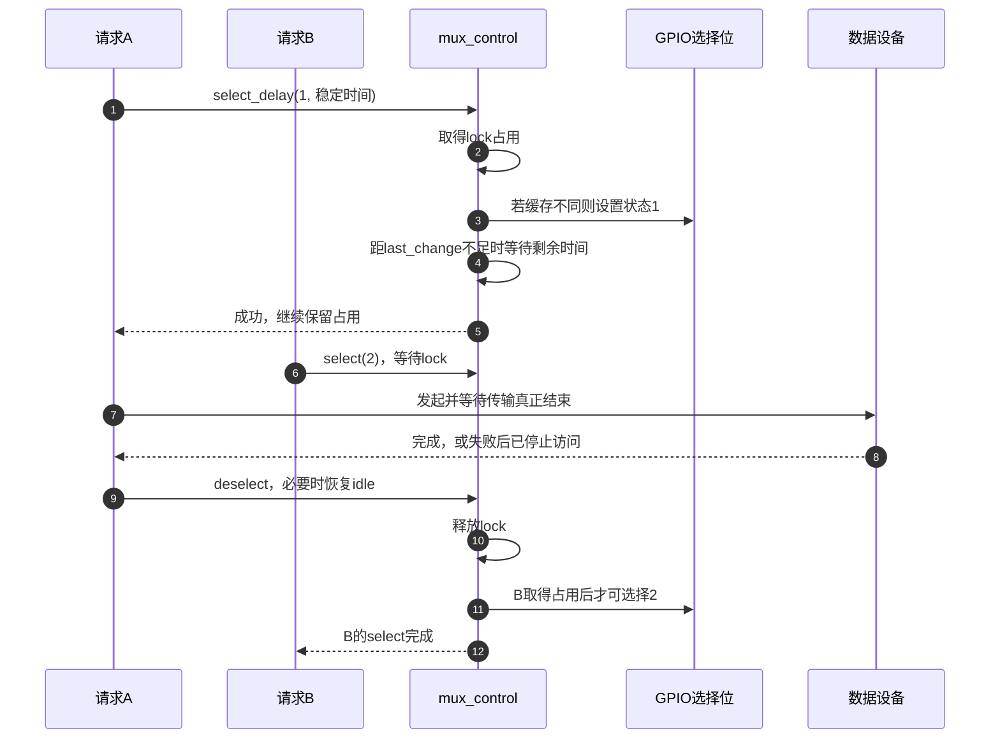

# 第6章\_GPIO选择线怎样保护一段事务

上一章让共享电源保持到最后一个使用者退出。现在把共同资源换成一条数据通路：采集器只有一个输入口，外部开关可把不同传感器接到这个口上。GPIO只负责选择接哪一路，采集数据仍由采集器完成。

这个外部开关称为多路选择器（multiplexer，mux）。本章先解释为什么正确写入选择位仍可能读错设备，再用Linux的mux控制器把“选择—使用—释放”连成一个操作周期。范围是由GPIO编码控制的外部选择器，不是处理器引脚的pinctrl复用，也不把整个I2C或模拟采集子系统合并进来。

## 6.1\_选择以后为什么还需要保留通道

**讲解层次：概念层。** 假设两个工作请求共享同一个采集口，A需要通道1，B需要通道2。板级函数统一持有选择GPIO，避免重复独占请求，但每次只在写选择位时加锁。

A先锁住函数，把选择设成1，随后解锁并开始采集；B此时把选择改成2。A得到的数据可能来自通道2，甚至跨越切换过程。每次写GPIO都可以完全正确，错误来自受保护范围太短。



第2步释放写线锁时，第3步的数据使用还没有结束，于是第4～5步可以切走A的通道。只要所有访问本来都在一个更大的串行操作里，这种简单选择函数仍有价值；额外建一套锁只会增加成本。可一旦允许独立请求交错，管理者就必须把占用延长到真正使用结束。选择位是配置，采集期间“不能被别人改”的关系也是状态。

新协议分为取得使用权、选通并等待稳定、执行传输、释放使用权。B不能因为A已经写完选择位便插入。代价是慢请求、失败后未收尾的请求都会阻挡后续使用者，因此错误出口和超时后的停止传输同样属于协议。

## 6.2\_Linux用哪个对象保存这段占用

**讲解层次：映射到NXP Linux 6.12.20。** mux core管理选择器的使用关系，gpio-mux驱动将状态编号转换为GPIO数组。`mux_chip` 表示提供者，包含一个或多个 `mux_control`；本驱动只分配一个控制器，一组选择位共同控制它。

每个mux_control保存信号量lock、可用状态数states、软件缓存cached_state、空闲策略idle_state和最近一次成功设置时间last_change。使用者取得的是指向它的引用；多个使用者找到同一控制器，才会进入同一套占用协议。提供者私有 `gpio_descs` 保存描述符数组，具体GPIO对象和控制器驱动仍由gpiolib管理。



图中特意把数据箭头与控制箭头分开：mux core不传输采样数据，它只维护使用通路的条件。设备驱动仍须等待实际DMA、总线事务或采集完成，再释放选择器；“已经提交DMA”不是完成。

固定版本与公共GPIO实现入口见 [源码总索引](../../../research/source_reading/gpiolib/navigation/P01_Linux_6.12_GPIO源码阅读索引.md#1.1_版本身份与阅读路线)，本地M0～M5周期见 [选择器模块导读](../../../research/source_reading/gpiolib/navigation/P06_标准功能驱动怎样承接GPIO状态.md#6.5_选择器把占用从设置时延长到传输完成)。对象字段与写入者在 [唯一实现](../../../research/source_reading/gpiolib/source_explanations/P11_选择器占用与GPIO编码.md#11.1_控制器状态由谁保存和修改) 中对应到源码。

## 6.3\_成功选择和失败选择怎样走不同出口

取得句柄只是找到控制器；成功select才取得本次占用。普通 `mux_control_select()` 通过信号量等待，设置成功后保持占用，直到一次配对的deselect。`try_select` 在忙时返回EBUSY，但它仍可能执行会睡眠的设置路径，不能被理解成允许在硬中断里调用。



第5步返回时没有解锁，第9～10步才结束这次使用权。若第3步报错，select内部释放占用，调用者不能再deselect；若传输在第7步失败，选择本身仍成功过，调用者停止传输后仍必须配对deselect。两类错误不能共用一个无条件“再解锁”分支。

| 接口与结果 | 本次占用是否成立 | 调用者下一步 |
| --- | --- | --- |
| mux_control_select成功 | 是 | 执行传输并在完成后deselect |
| select失败或等待被中断 | 否 | 处理错误，不deselect |
| try_select返回EBUSY | 否 | 延后或放弃，不忙循环假装无成本 |
| select成功但数据操作失败 | 仍成立 | 停止数据访问后deselect |
| deselect返回错误 | 已释放 | 报告恢复idle失败，不重复释放 |

`mux_control_select_delay()` 的时间参数按最近成功设置时刻计算剩余稳定时间；缓存命中没有重新写GPIO，也不重置这个时刻。它不等于每次调用固定睡满同一时长。普通select传入0，驱动不会因DTS中出现一个自创延时属性就自动等待。

缓存只记录设置回调报告的状态。本版本gpio-mux的set回调忽略GPIO数组setter返回值，最后返回0，因此core可能把一次未被下层错误反馈确认的设置记为成功；没有GPIO或外部通道回读。软件互斥、回调返回和真实选通成功是不同证据。详见 [选择与延时](../../../research/source_reading/gpiolib/source_explanations/P11_选择器占用与GPIO编码.md#11.3_选择如何持有信号量并等待稳定) 与 [释放出口](../../../research/source_reading/gpiolib/source_explanations/P11_选择器占用与GPIO编码.md#11.4_空闲恢复失败为何仍要释放占用)。

## 6.4\_软件独占为什么仍不能保证选择位同时变化

现在A、B已经不会互相切走通道。但假设外部器件有两根选择位，当前编号1写作二进制01，下一次需要编号2，即10。两根线都要改变，即使只有一个软件请求也可能出现先后。

绑定规定数组第一根GPIO是最低有效位，逻辑有效为1、无效为0。下表写成“高位、低位”，是数值的常见书写顺序，正好与数组的低位优先顺序相反。

| 编号 | 高位GPIO1 | 低位GPIO0 | 连接 |
| --- | --- | --- | --- |
| 0 | 0 | 0 | 通道0 |
| 1 | 0 | 1 | 通道1 |
| 2 | 1 | 0 | 通道2 |
| 3 | 1 | 1 | 通道3 |

01变10时，若先把低位清0，会短暂经过00；若先把高位置1，会短暂经过11。逻辑active-low还会影响实际引脚电平，所以这里比较的是逻辑编码，不是示波器高低的无条件解释。

GPIO数组API可以把同一控制器上的操作合并，也可能因跨控制器、批量能力不足或底层实现而拆开。就算一次寄存器写完成，也不能跳过芯片手册中引脚传播与外部器件切换特性的证明。等待最终状态稳定只能延后数据使用，不能撤销中间已经产生的外部副作用。

若中间连接可接受，传输期间的占用和正确稳定等待已能解决主要问题；若会造成短路、错误触发或不可逆操作，就要有器件真实提供的断接、门控或锁存协议，并由匹配驱动实现。这个gpio-mux绑定没有通用enable/gate属性，不能向DTS凭空添加一个属性便宣称实现了无毛刺切换。位图转换和返回值边界见 [GPIO编码实现](../../../research/source_reading/gpiolib/source_explanations/P11_选择器占用与GPIO编码.md#11.2_状态编号怎样成为GPIO数组的逻辑位)。

## 6.5\_用完整描述确认控制器身份与空闲策略

下面仍使用离线教学Provider与两个教学客户。`linux-note,*` 不对应真实驱动，本文件只用来检查属性、引用和位序，不能直接加载到板上。保存为 `gpio_mux_teaching.dts`，或取用 [完整材料](../../../labs/kernel/gpio/materials/gpio_mux_teaching.dts)。

```dts
/dts-v1/;

/ {
    compatible = "linux-note,gpio-mux-teaching";

    teaching_gpio: gpio-controller {
        compatible = "linux-note,teaching-gpio";
        gpio-controller;
        #gpio-cells = <2>;
    };

    route_mux: mux-controller {
        compatible = "gpio-mux";
        #mux-control-cells = <0>; /* 仅一个控制器，引用不带索引。 */
        mux-gpios = <&teaching_gpio 4 0>, /* 第一根是逻辑最低位。 */
                    <&teaching_gpio 5 0>;
        idle-state = <0>; /* 空闲选择通道0，不表示全部断开。 */
    };

    client-a {
        compatible = "linux-note,teaching-mux-client";
        mux-controls = <&route_mux>;
    };

    client-b {
        compatible = "linux-note,teaching-mux-client";
        mux-controls = <&route_mux>;
    };
};
```

两个客户端指向同一route_mux，因而其驱动若按公共接口取得控制器，才会协调同一通道。`#mux-control-cells = <0>` 表示引用后不带控制器索引，不表示“没有选择位”。选择编号由驱动每次select传入；另一套mux-states接口可把固定状态放进固件引用，不能把那套参数直接拼到本例mux-controls后。

`idle-state = <0>` 表示释放时选择通道0，并非断开所有通道。省略idle-state时采用MUX_IDLE_AS_IS，即释放时保留当前选择；但该驱动最初请求GPIO数组使用OUT_LOW，初始化仍会输出逻辑0，不能将“空闲保持”误解成启动时保留固件电平。这个gpio-mux实现不接受负的DISCONNECT状态，不能用它替代硬件缺失的断接能力。

| 字段 | 本例含义 | 核对位置 |
| --- | --- | --- |
| mux-gpios | offset4为位0，offset5为位1，均高有效 | binding的低位优先规则与gpio-mux位图转换 |
| #mux-control-cells | 单控制器引用不带额外索引 | mux core的控制器查找 |
| idle-state | 释放时选0，状态范围0～3 | gpio-mux probe与deselect |
| MUX_GPIO | GPIO控制器驱动配置 | 位于MULTIPLEXER菜单，依赖GPIOLIB或COMPILE_TEST |

```sh
# 执行位置：教学DTS目录；需要dtc和fdtget，只操作本地文件。
dtc -I dts -O dtb -o gpio_mux_teaching.dtb gpio_mux_teaching.dts
fdtget -t u gpio_mux_teaching.dtb /client-a mux-controls
fdtget -t u gpio_mux_teaching.dtb /client-b mux-controls
fdtget -t u gpio_mux_teaching.dtb /mux-controller phandle
fdtget -t u gpio_mux_teaching.dtb /mux-controller mux-gpios
fdtget -t u gpio_mux_teaching.dtb /mux-controller idle-state
```

前三个查询结果应为同一phandle。GPIO数组包含两组“Provider phandle、offset、flags”，offset顺序应为4、5，flags均为0；最后一项应为0。phandle具体数字由编译分配，不应在代码中硬编码。

再把idle-state改为3重新编译，查询得到3；它仍是合法的两位状态，只是释放时选通道3。若改为4，DTC仍可解析整数，但gpio-mux probe的状态范围检查会拒绝；编译器不会替驱动运行这些判断。练习完成后恢复0，再生成产物；编译失败先修复，避免读旧DTB。无须为了验证描述就启停真实设备，DTB可在结束后删除。

这组离线检查没有执行dtbs_check、驱动匹配、实际选通或稳定时间测量。初值与资源撤销的源码见 [接管与退出](../../../research/source_reading/gpiolib/source_explanations/P11_选择器占用与GPIO编码.md#11.5_初始输出与提供者退出怎样影响通路)。

## 6.6\_把保持通道与保持对象生命期分开

deselect结束本次使用权，put结束持有控制器引用，这两者不能互相替代。devm取得的句柄可以自动put，但不会知道某次传输是否仍在进行，也不能补上调用者漏掉的deselect。提供者退出之前仍须结束客户事务，不能靠注销类设备强行取消外部DMA。

现在试判断三个变化：把deselect移到DMA提交后能减少等待吗？把idle设成0是否就隔离全部通道？01变10后等待足够久能否证明中间从未接通过通道0？

第一种改变可能让后续请求提前切走正在传输的通道；必须等待完成或确认已停止。第二题取决于电路，本文0就是通道0，没有断接含义。第三题不能，最终稳定与切换过程是两种保证；若中间连接有危害，必须补足硬件与驱动协议。

一根输出线的含义已经从“保持电源”转为“保持通路”。系统最终关机或重启又会改变控制器能否访问的前提，接下来沿 [标准Consumer总览](P02_输入_指示_电源与控制类_GPIO_Consumer.md#2.7_gpio-poweroff_和_gpio-restart) 检查最后阶段。
