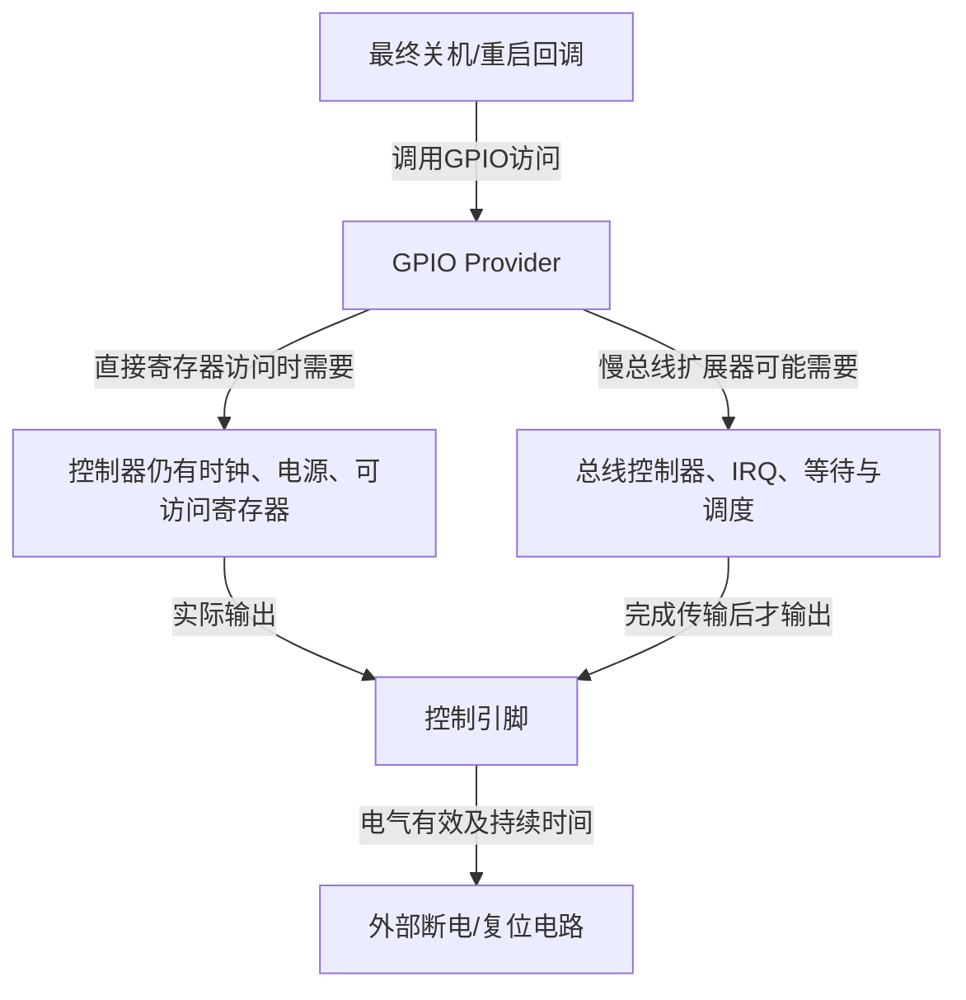
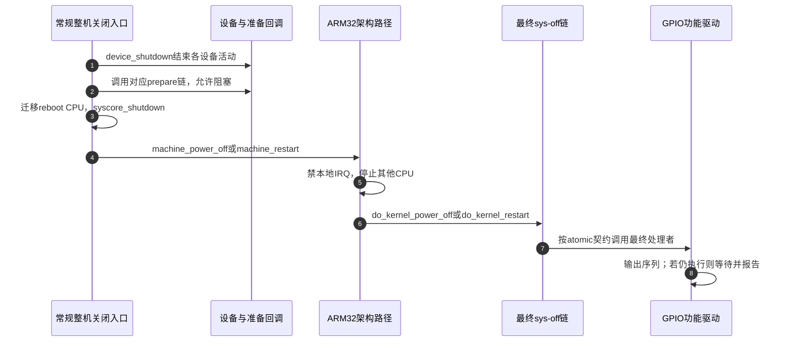
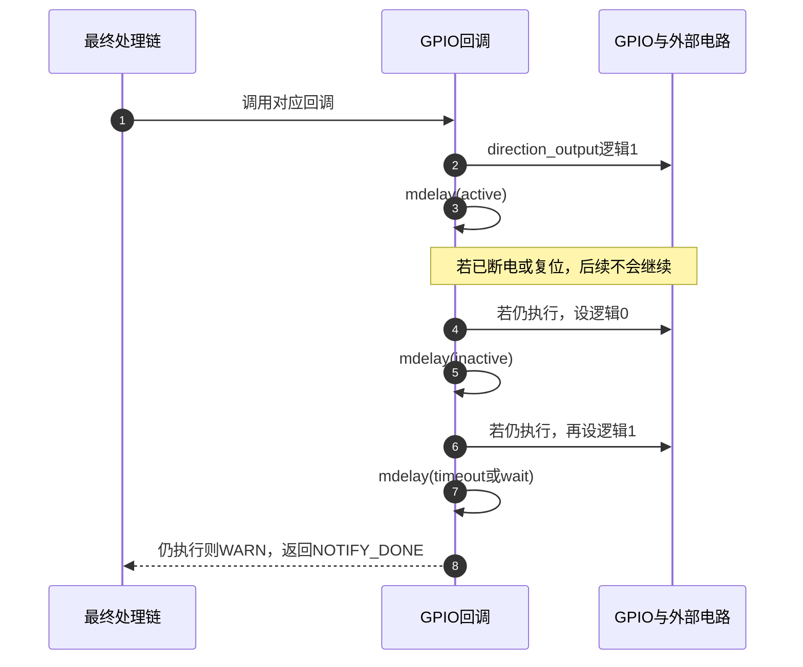

# 第7章\_GPIO关机与重启为何要核对最后阶段

上一章让选择器保持到数据操作停止。关机也要求先结束设备活动，但随后要做的一次GPIO操作有点特殊：系统正逐步停下其他服务，它还必须能发出最后的断电或复位信号。

本章讨论整机的gpio-poweroff与gpio-restart。前者请求外部电源控制电路切断整机供电，后者请求复位电路重新启动系统；它们不是上一章的通道释放，也不是普通设备的一次局部reset。先从控制路径为什么可能在最后失效讲起，再核对两个驱动实际登记的阶段和电平序列。

## 7.1\_白天能写的GPIO为什么在关机末期可能失效

**讲解层次：概念层。** 设想外部电源控制器通过GPIO请求关电。正常运行时，设备驱动调用GPIO接口，Provider完成寄存器写或总线传输，电路收到请求。这个方案能复用已有GPIO，成本低，且便于按板级极性配置。

现在把该GPIO放到需要I2C传输的扩展器上。写线要等待总线控制器发出数据，可能还要由IRQ报告完成、调度器唤醒等待者。若这些设施在最终动作前已经停止，函数名字没有变化，完成写入所需的条件却已经不存在。甚至GPIO控制器本身还在，供电或时钟也可能被前面的关闭流程撤掉。



因此要证明的不是“运行时写过一次”，而是最后阶段整条依赖仍成立。即使换成MMIO Provider，也仍需核对其时钟、电源域、访问属性和方向切换能力，不能仅凭MMIO三个字给出结论。

如果实际平台允许把需要睡眠的准备动作提前完成，可以把它安排在适当准备阶段，把最后动作留给仍可访问的控制路径。这会增加阶段交接和资源保持要求，也可能与电路“写了就立即断电”的行为冲突，不能无条件把最终回调挪早。若现有硬件路径无法满足最后阶段约束，就应选择适合平台的固件、专用复位或电源控制机制，而非在原路径加几个延时碰运气。

## 7.2\_sys-off怎样区分准备与最终动作

**讲解层次：映射到NXP Linux 6.12.20。** sys-off框架保存整机关机和重启的处理者。驱动在probe时取得GPIO，登记回调及私有对象；真正关机时框架才调用。GPIO不是因为注册回调就立即执行整套关机序列，但请求时的初始方向可能已改变。

sys-off把模式分成power-off、restart以及两者的prepare。prepare链允许阻塞，最终链按atomic notifier契约执行，回调不得阻塞。atomic指调用上下文约束，不表示GPIO动作原子完成，也不表示多个选择位同时翻转。

| 注册模式 | 链类型与允许行为 | 本章驱动是否使用 |
| --- | --- | --- |
| POWER_OFF_PREPARE | blocking，允许阻塞，但依赖仍需核对 | gpio-poweroff不使用 |
| POWER_OFF | atomic，不能依赖睡眠等待 | gpio-poweroff使用 |
| RESTART_PREPARE | blocking，允许阻塞，但依赖仍需核对 | gpio-restart不使用 |
| RESTART | atomic，不能依赖睡眠等待 | gpio-restart使用 |

以下顺序限定固定版本的常规ARM32路径。公共kernel_power_off/restart完成设备shutdown，再调用sys-off prepare，迁移到reboot CPU并执行syscore_shutdown；ARM machine_*随后禁止本地IRQ、停止其他CPU，进入最终处理链。不能用这张图替代ARM64或所有平台的架构路径核对。



第2步已经在device_shutdown之后，所以“prepare允许睡眠”也不意味着所有设备还像正常运行时一样可用。第7步更加不能临时安排依赖已停IRQ或调度的工作来完成关键写线。

固定源码身份见 [GPIO源码总索引](../../../research/source_reading/gpiolib/navigation/P01_Linux_6.12_GPIO源码阅读索引.md#1.1_版本身份与阅读路线)，F0～F5状态落点见 [系统末期模块导读](../../../research/source_reading/gpiolib/navigation/P06_标准功能驱动怎样承接GPIO状态.md#6.6_系统末期控制先核对执行阶段再看电平)。阶段与ARM路径的唯一实现见 [模式与调用链](../../../research/source_reading/gpiolib/source_explanations/P12_系统末期GPIO回调与通知链.md#12.1_注册模式怎样决定回调上下文)。

## 7.3\_两种驱动实际输出怎样的电平序列

两者在最终回调里都先把GPIO配置为输出并提交逻辑1，等待active时间；再提交逻辑0，等待inactive时间；最后再次提交逻辑1，等待最终超时。如果外部电路在第一阶段就完成断电或复位，CPU可能根本不会执行后续步骤。不能把整段代码都画成一定发生的硬件波形。

| 仍在执行时的阶段 | GPIO逻辑动作 | 普通高有效线 | 普通低有效线 |
| --- | --- | --- | --- |
| T0 | 切输出并设1，等待active | 高 | 低 |
| T1 | 设0，等待inactive | 低 | 高 |
| T2 | 再设1，等待最终超时 | 高 | 低 |
| T3 | 仍在运行则WARN并返回NOTIFY_DONE | 不在此自动恢复初值 | 不在此自动恢复初值 |

该序列给电平触发和不同边沿触发电路提供了机会，但是否正确还取决于器件要求、外部上下拉、驱动方式与脉冲宽度。表中物理高低只限定普通可驱动的推挽示例，开漏/开源电路还要结合释放和外部电阻分析。



第3、5、7步的mdelay是忙等，不能将它说成“主动睡眠让出CPU”。第8步表示这个处理者执行后系统仍继续运行，NOTIFY_DONE允许通知链继续尝试后续处理者，不是“关机已成功”的返回码。驱动忽略direction_output的返回，后续setter也没有可供它判断成功的同步错误返回，因而输出意图不能替代引脚测量。

poweroff的setter使用 `_cansleep`，restart使用普通setter。**两者仍登记在最终atomic链中。** 后缀不会创建线程，也不会把当前回调改成可睡眠上下文；可睡眠入口还有might_sleep诊断。因此，这份poweroff实现中的调用与atomic契约存在需要平台审查的上下文问题，不能以“上游这样写了”证明慢总线Provider适用，也不能宣称所有MMIO配置都没有上下文诊断。源码原样与边界见 [最终电平回调](../../../research/source_reading/gpiolib/source_explanations/P12_系统末期GPIO回调与通知链.md#12.3_最终回调的逻辑序列与返回证明了什么)。

## 7.4\_相似属性名为什么不能直接复制

两个驱动有共同的1→0→1意图，却沿用不同属性名。poweroff采用active-delay-ms、inactive-delay-ms和timeout-ms；restart采用active-delay、inactive-delay和wait-delay，单位仍都是毫秒。错用另一驱动的名字不会自动转换，驱动可能继续使用缺省值。

| 项目 | gpio-poweroff | gpio-restart |
| --- | --- | --- |
| 初始方向选项 | input存在时请求输入，否则逻辑0输出 | open-source存在时请求输入，否则逻辑0输出 |
| 第一次有效等待 | active-delay-ms，C默认100ms | active-delay，C默认100ms |
| 中间无效等待 | inactive-delay-ms，C默认100ms | inactive-delay，C默认100ms |
| 最后等待 | timeout-ms，C默认3000ms | wait-delay，C默认3000ms |
| 默认priority | 0 | 129 |
| 对普通大于255的priority输入 | 返回EINVAL | 记录错误，保留默认129继续 |

这里的open-source是该restart绑定的历史属性：代码据它选择初始GPIOD_IN。它没有在这一步显式请求GPIOD_OUT_HIGH_OPEN_DRAIN之类电气模式，也不能仅凭名字证明全程由硬件开源驱动。若硬件需要特定电气模式，应分别核对GPIO描述标志、Provider能力和电路。

priority是同一通知链内的调用优先级，较大值排在前面，不是中断优先级。同一非默认优先级只允许一个sys-off处理者，默认级别允许多个；登记冲突应处理，不能把两个驱动的默认值当成“系统只可能有两个回调”。

还要保留一个原件内部差异：本固定版本gpio-restart binding的wait-delay文字说默认3000，Schema的default字段却为100，而驱动初始化为3000。普通DTC不会把Schema default自动写进缺失的DTS属性，驱动读不到属性时保留自己的3000。本文显式写wait-delay=3000，以免读者依赖相互冲突的省略规则；追溯时保留三个字段，不替原件静默改成一致。详见 [两份probe与配置](../../../research/source_reading/gpiolib/source_explanations/P12_系统末期GPIO回调与通知链.md#12.4_poweroff怎样取得线路并登记最终模式) 和 [restart差量](../../../research/source_reading/gpiolib/source_explanations/P12_系统末期GPIO回调与通知链.md#12.5_restart怎样处理初值优先级和默认时间)。

## 7.5\_在离线描述中检查极性和时间单位

下面用不同GPIO展示两个绑定，教学Provider无真实匹配驱动。只在本地编译和读取，**不加载到板上，不调用关机或重启命令**。它们是完整配置练习，不能证明末期硬件可访问。保存为 `gpio_sysoff_teaching.dts`，或取用 [完整材料](../../../labs/kernel/gpio/materials/gpio_sysoff_teaching.dts)。

```dts
/dts-v1/;

/ {
    compatible = "linux-note,gpio-sys-off-teaching";

    teaching_gpio: gpio-controller {
        compatible = "linux-note,teaching-gpio";
        gpio-controller;
        #gpio-cells = <2>;
    };

    poweroff {
        compatible = "gpio-poweroff";
        gpios = <&teaching_gpio 6 0>; /* 逻辑有效对应物理高。 */
        input; /* 请求时输入，到最终动作才切输出。 */
        active-delay-ms = <100>;
        inactive-delay-ms = <100>;
        timeout-ms = <3000>;
        priority = <0>;
    };

    restart {
        compatible = "gpio-restart";
        gpios = <&teaching_gpio 7 1>; /* 逻辑有效对应物理低。 */
        open-source; /* 此驱动用它选择初始输入。 */
        active-delay = <100>;
        inactive-delay = <100>;
        wait-delay = <3000>;
        priority = <129>;
    };
};
```

```sh
# 执行位置：教学DTS目录；仅需dtc与fdtget。
dtc -I dts -O dtb -o gpio_sysoff_teaching.dtb gpio_sysoff_teaching.dts
fdtget -t u gpio_sysoff_teaching.dtb /poweroff gpios
fdtget -t u gpio_sysoff_teaching.dtb /restart gpios
fdtget -t u gpio_sysoff_teaching.dtb /poweroff timeout-ms
fdtget -t u gpio_sysoff_teaching.dtb /restart wait-delay
fdtget -p gpio_sysoff_teaching.dtb /poweroff
fdtget -p gpio_sysoff_teaching.dtb /restart
```

前两条查询的offset应分别为6、7，flags分别0、1；两种最终等待都应为3000。属性列表应分别出现input和open-source，不要期待它们被编译成同一个通用属性。结合T0～T2，poweroff的普通推挽物理序列为高→低→高，restart为低→高→低。

把restart flags从1改成0再编译，逻辑序列不变，预测物理序列反转。随后恢复1。再暂时删去wait-delay，DTC仍可成功，属性查询会提示不存在；这只证明DTB没有值，运行时的3000结论来自已核对C初始化，不能从不存在的字段读出。恢复显式属性后再生成练习产物。编译失败时先修复，不读取旧DTB；结束可删除生成文件。

本实验没有执行dtbs_check、内核匹配、通知链调用或物理脉冲测量。真实板级验证还需核对引脚连接、末期供电/时钟、方向切换与访问上下文，并准备可恢复的测试环境；运行期sysfs或GPIO工具写通，不能替代这些证据。

## 7.6\_注册成功不等于最后一定关得掉

登记时，框架把callback、私有对象和优先级保存在handler里；GPIO描述符保持请求，直到驱动退出。普通卸载时，托管注销动作先撤下通知链处理者，再由更早登记的GPIO资源释放归还线路。这个资源生命周期与整机最终动作是两个过程：进入关机不等于所有devres先自动释放。

卸载清理也不会生成一次1→0→1关机序列，更不保证恢复固件电平。撤销处理者与正在执行的通知调用如何同步，见 [登记与撤销责任](../../../research/source_reading/gpiolib/source_explanations/P12_系统末期GPIO回调与通知链.md#12.6_托管注销怎样先撤下回调再释放GPIO)。

试判断：prepare允许睡眠，是否意味着扩展器一定能访问？poweroff使用_cansleep，是否允许最终回调睡眠？日志显示WARN_ON，能否证明引脚没变？

第一题不能，prepare在device_shutdown之后，实际总线和Provider状态仍要查。第二题不能，上下文由注册模式和调用链确定，接口后缀没有转移执行位置。第三题不能，WARN只说明执行流仍走到了超时后；引脚可能已变化但电路、极性或时间不满足要求，也可能访问失败。排查应把软件调用、物理信号和外部电路响应分别观察。

到这里，按键、灯、背光、供电、选择器和整机末期控制已经各自有了功能对象与操作周期。回到 [标准Consumer总览](P02_输入_指示_电源与控制类_GPIO_Consumer.md)，选择依据应是设备需要谁维护什么状态、在什么阶段完成什么保证，而不是哪份驱动恰好出现了gpiod函数。
