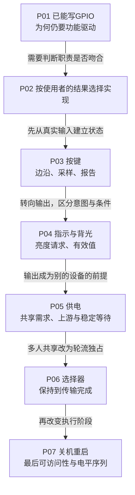

# 第1章\_标准\_GPIO\_Consumer\_专题大纲

GPIO描述符能够表达线路请求、极性和访问能力，却不知道线路上的“1”意味着按下、亮灯、供电还是复位。本专题解释标准功能驱动怎样把线路放进设备协议，让读者能依据状态责任、完成条件和硬件约束选择实现。

读者应已掌握 [GPIO专题](../gpio/大纲.md) 的请求、逻辑值、可睡眠访问和事件桥接；不要求预先学完整input、LED或regulator框架。这里就地建立每章需要的领域对象，公共gpiolib机制仍以原专题为准。

## 1.1\_沿新的约束逐步认识功能对象

先用状态灯看标准接口减少哪些重复责任，再辨认不同设备语言。按键首先增加输入状态，灯与背光区分意图和有效输出，供电增加共享需求，选择器增加互斥使用期，最后把同样的GPIO访问放到系统服务逐步停止的阶段。

箭头表示本专题增加问题的阅读顺序，不表示这些子系统彼此必须依赖。已有明确任务时，可先读P01、P02，再进入对应功能章；各章都保留当前问题的最小背景及完整配置练习。

## 1.2\_章节任务与尚未解决的问题

| 正文 | 接住的前置结论 | 本章解决什么 | 留给后续或平台的边界 |
| --- | --- | --- | --- |
| [P01 为什么优先使用标准Consumer](P01_为什么优先使用标准_GPIO_Consumer.md) | GPIO已能正确请求与访问 | 从同一状态灯比较接口、领域状态和维护成本 | 哪个领域对象匹配需求 |
| [P02 按设备功能选择实现](P02_按设备功能选择GPIO实现.md) | 标准化必须匹配协议 | 用使用者结果与完成条件定位功能驱动 | 每类状态如何真正推进 |
| [P03 按键怎样进入输入事件](P03_GPIO按键怎样接入输入事件.md) | 线路变化还没有设备含义 | 抖动、采样、输入报告、IRQ-only及停止顺序 | 目标IRQ/唤醒能力和输入核心分发 |
| [P04 指示与背光怎样接入亮度](P04_GPIO指示与背光怎样接入亮度接口.md) | 设备状态与电平不同层 | LED意图、背光有效值、慢访问、初值与退出 | 物理亮度和硬件保持能力 |
| [P05 供电怎样进入依赖](P05_GPIO供电怎样进入电源依赖.md) | 一次输出可能受多种条件约束 | 消费计数、上游、时间与描述符交接 | 真实电压及特殊跨rdev并发集成 |
| [P06 选择线怎样保护事务](P06_GPIO选择线怎样保护一段事务.md) | 多使用者需要统一协议 | 选择至传输完成的占用、失败与空闲恢复 | 数组物理同时性和无毛刺硬件 |
| [P07 末期关机重启控制](P07_GPIO关机与重启为何要核对最后阶段.md) | 完成条件必须覆盖依赖 | sys-off阶段、atomic契约、电平序列与默认值 | 最后可访问性及真实电路响应 |

P03～P07各自提供完整离线DTS、命令解释、预测与答案。教学Provider用于读取描述，不宣称有真实驱动；DTC成功不等于目标功能已执行。真正上板前仍要结合平台电路、Provider和配置核对，不能把练习文件直接当板级实现。

## 1.3\_从功能理解走向固定源码和相邻专题

功能对象、状态归属与操作周期先读 [标准功能模块导读](../../../research/source_reading/gpiolib/navigation/P06_标准功能驱动怎样承接GPIO状态.md#6.1_从一根线路走到领域对象)，源码树身份由 [总索引](../../../research/source_reading/gpiolib/navigation/P01_Linux_6.12_GPIO源码阅读索引.md#1.1_版本身份与阅读路线) 统一说明。每个模块再精确链接唯一函数讲解，避免在本专题重复维护gpiolib公共实现。

GPIO专题回答线路能力与生命周期；本专题回答它怎样承担设备功能。输入核心、设备电源管理及各总线还管理更深的分发或传输协议，各章在交接处说明当下所需的最小关系并提供入口。标准驱动减少重复机制，但不自动决定产品多写者策略，也不替板级集成证明电气结果。
