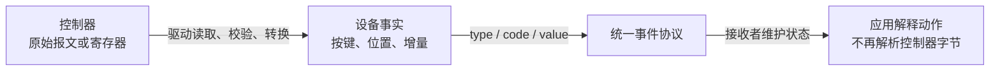
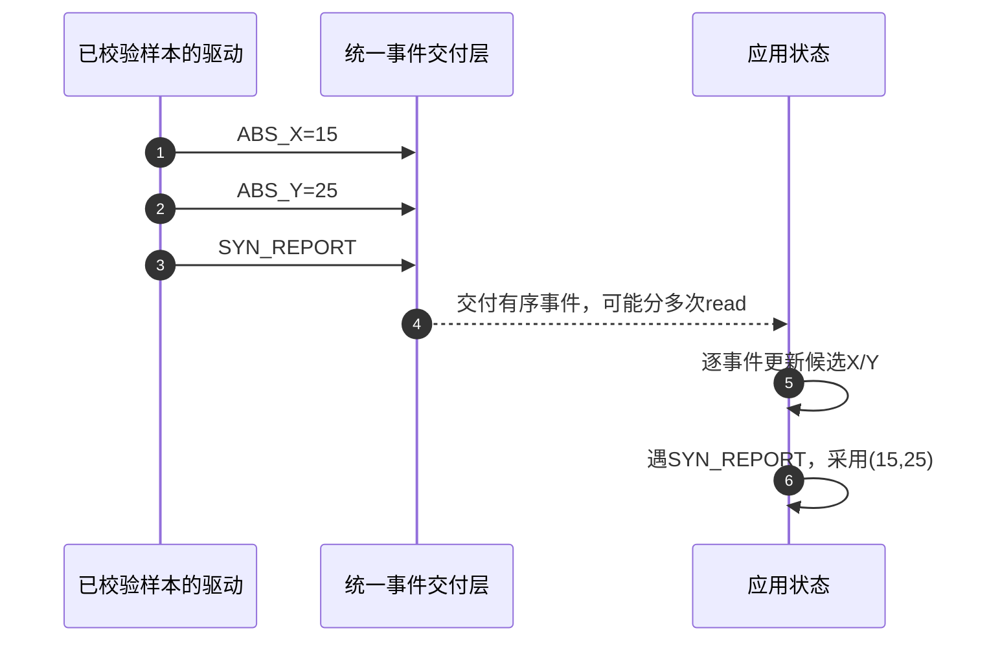
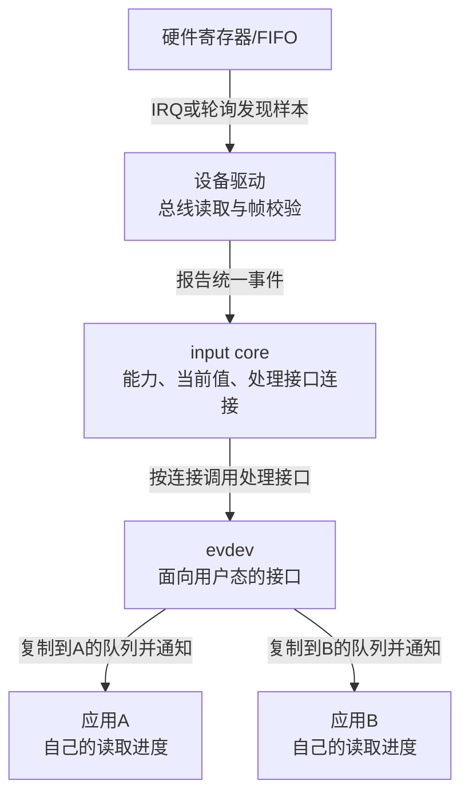

# 第1章\_从硬件样本到统一输入事件

按下一次按钮，应用通常只想知道“确认键按下了”，并不想知道它接在GPIO哪一位。鼠标和触摸屏也一样：应用关心移动与接触，硬件却提供不同的寄存器、报文和量程。本章先从这种差别推出统一事件层，再用一个完整C练习理解事件与帧。

这里先不要求读者掌握input_dev或evdev内部字段。完成后应能区分硬件样本、事件变化、帧边界和应用状态；下一章才回答这些状态在Linux中由谁保存、怎样传递。

## 1.1\_直接读取硬件的价值与边界

在单设备、单应用的原型中，应用通过一个专用驱动读取原始按键值或触摸点数组很有价值：协议短，硬件信息完整，调试时能逐项对照手册。所谓直接读取仍应经过合法的驱动访问，不能把它理解为普通应用任意操作内核寄存器。

问题在设备和使用者增加以后显现。假设一个触摸控制器把完整点集放进FIFO，读出会消费记录。桌面、录制器和测试程序都需要同一次接触；若专用接口只暴露一个共同消费队列，桌面读走以后，录制器可能再也看不到那份记录。给read加锁只能防止同时损坏队列，不能为每个观察者补出一份历史。

再换一款控制器：点数所在字节、坐标位宽和硬件ID都不同。若应用认识这些格式，各应用都得修改解析、错误恢复和量程转换。原方案在紧耦合原型中的简洁，变成多设备、多应用场景中的重复职责。

可以给私有接口补独立队列和通用格式，这并非做不到；只是项目随后还要维护能力查询、帧、热拔插和长期ABI。Linux Input把适合人机输入的共同协议集中起来，让硬件差异停在设备驱动，应用沿稳定的事件含义理解动作。

## 1.2\_统一的是设备事实而不是原始字节

Input用type、code、value描述一个数据项。type说明类别，code说明这一类别内的具体含义，value给出新值或变化量。分成type与code，是因为“按键编号0”和“绝对轴编号0”不能脱离类别解释；value也不总是一个物理高低电平。

以一个单点位置设备为例，驱动已经把控制器报文解析为X=10、Y=20。它可报告EV_ABS/ABS_X/10和EV_ABS/ABS_Y/20。EV_ABS表示绝对轴，ABS_X与ABS_Y分别选轴；这些名字属于Linux事件协议，原始报文不需要恰好按这个布局存放。

下一次位置变成X=15、Y=20，只需报告X变成15，Y仍保留20。接收者要保存当前状态，而不是把没有出现的Y当0。鼠标的EV_REL则不同：REL_X=5表示相对移动5个单位，不能覆盖成“当前位置5”。统一格式保留了物理量不同的更新规则。



图中转换不会替硬件制造不存在的数据。若控制器只有触点面积，不能为满足“压力”字段随意填一个数；若按键语义不匹配某个标准code，即使工具显示有事件，应用也可能按错误含义处理。

## 1.3\_坐标都到达以后怎样知道它们属于同一帧

X与Y是同一次采样的两个结果，却通过两条事件表达。假设旧位置是(10,20)，新位置是(15,25)。接收者若每读一条就绘图，先处理X后会短暂画出(15,20)，这个位置并不属于两次采样中的任何一次。

EV_SYN类别中的SYN_REPORT给一组变化划定逻辑边界。接收者先更新候选状态，到这个边界再把组合状态用于当前帧；下一帧未变化的项继续沿用。它表达驱动提交的分组，不能修复驱动从硬件读到的半帧，也不能让多个未协调上报者自动合成正确帧。



第4步没有承诺一次read等于一帧：一次读取可能装不下整帧，也可能包含多帧。程序必须按事件中的SYN_REPORT识别边界，而不能把一次系统调用返回当作采样完成。底层何时批量分发、何时唤醒，下一章再映射到具体对象。

这种设计增加接收者保存状态和等待边界的责任，也使设备替换更容易：只要统一协议和能力保持，应用不必重新理解新的总线报文。遇到客户端队列溢出时，状态镜像可能失步，需要后续的重同步协议；此刻先建立无丢失的基本过程。

## 1.4\_用完整C程序观察读取块与事件帧

下面程序不访问任何设备，不需要Linux内核头文件。它用本地demo_event数组模拟已经收到的逻辑记录，按不同大小分块交给同一个解析器；这不是Linux struct input_event的二进制布局，也没有模拟IRQ、内核队列或SYN_DROPPED。

第一帧明确提供X/Y，后两帧分别只改X和Y。reader_state跨分块保存候选值、初值是否已知、是否有未提交变化和已提交帧数。真实新打开的Input客户端不能假定首帧一定给出全部当前轴；本例故意约定完整初始帧，真实状态查询放到后续章节。

保存为input_frame_reader.c，或取用 [完整材料](../../../labs/kernel/input/materials/input_frame_reader.c)：

```c
#include <errno.h>
#include <stdbool.h>
#include <stdio.h>
#include <stdlib.h>

/* 教学对象：只演示逻辑记录，不是Linux input_event二进制布局。 */
enum demo_type { DEMO_SYN = 0, DEMO_ABS = 3 };
enum demo_code { DEMO_X = 0, DEMO_Y = 1, DEMO_REPORT = 0 };

struct demo_event {
    unsigned int type;
    unsigned int code;
    int value;
};

struct reader_state {
    int x;
    int y;
    bool have_x;
    bool have_y;
    bool dirty;
    unsigned int frames;
};

static int feed_events(struct reader_state *reader,
                       const struct demo_event *events, size_t count)
{
    for (size_t i = 0; i < count; ++i) {
        const struct demo_event *event = &events[i];
        if (event->type == DEMO_ABS && event->code == DEMO_X) {
            reader->x = event->value;
            reader->have_x = true;
            reader->dirty = true;
        } else if (event->type == DEMO_ABS && event->code == DEMO_Y) {
            reader->y = event->value;
            reader->have_y = true;
            reader->dirty = true;
        } else if (event->type == DEMO_SYN && event->code == DEMO_REPORT) {
            /* 本例约定第一帧显式提供X/Y；之后保留未变化轴。 */
            if (!reader->have_x || !reader->have_y)
                return -1;
            if (reader->dirty) {
                ++reader->frames;
                printf("frame %u: x=%d y=%d\n",
                       reader->frames, reader->x, reader->y);
                reader->dirty = false;
            }
        } else {
            return -1; /* 只接受本实验已经解释的两种记录。 */
        }
    }
    return 0;
}

int main(int argc, char **argv)
{
    const struct demo_event events[] = {
        { DEMO_ABS, DEMO_X, 10 }, { DEMO_ABS, DEMO_Y, 20 },
        { DEMO_SYN, DEMO_REPORT, 0 },
        { DEMO_ABS, DEMO_X, 15 }, { DEMO_SYN, DEMO_REPORT, 0 },
        { DEMO_ABS, DEMO_Y, 25 }, { DEMO_SYN, DEMO_REPORT, 0 }
    };
    const size_t total = sizeof(events) / sizeof(events[0]);
    size_t chunk = 1;
    struct reader_state reader = { 0 };

    if (argc > 2)
        return 2;
    if (argc == 2) {
        char *end;
        errno = 0;
        unsigned long value = strtoul(argv[1], &end, 10);
        if (errno || end == argv[1] || *end || value == 0 || value > total) {
            fprintf(stderr, "chunk must be in 1..%zu\n", total);
            return 2;
        }
        chunk = (size_t)value;
    }

    for (size_t offset = 0; offset < total; offset += chunk) {
        size_t count = total - offset < chunk ? total - offset : chunk;
        printf("block [%zu,%zu)\n", offset, offset + count);
        if (feed_events(&reader, events + offset, count)) {
            fprintf(stderr, "invalid teaching event stream\n");
            return 1;
        }
    }
    if (reader.dirty) {
        fprintf(stderr, "incomplete final frame\n");
        return 1;
    }
    return 0;
}
```

DEMO_SYN/DEMO_ABS等枚举是本模型的自有标识，数值与所演示的事件对应，但程序不强行复刻所有UAPI。feed_events每次只处理传入的count条记录；X或Y改变时置dirty，遇REPORT且初值齐全才输出，随后清dirty而保留X/Y。末尾仍dirty表示最后一帧缺少提交边界。

在有C11编译器的终端执行：

```sh
# 执行位置：input_frame_reader.c所在目录；不需要设备权限。
gcc -std=c11 -Wall -Wextra -Werror input_frame_reader.c -o input_frame_reader
./input_frame_reader 1
```

参数1让每次只交一条事件，block行表示半开区间的记录下标；它不是时间戳。Windows终端若生成input_frame_reader.exe，可以用 `./input_frame_reader.exe 1` 运行。应在输出中看到三条frame：

```text
frame 1: x=10 y=20
frame 2: x=15 y=20
frame 3: x=15 y=25
```

第二帧没有新Y仍得到20，说明状态跨帧保留；前两条记录后没有frame输出，说明分块末尾不会自动提交。把参数改成2或7再运行，block边界改变，三条frame结果应相同。参数0或超过7会返回2并报告参数错误，避免把无效分块误当成正常观察。

再做一个反例：暂时删除数组最后的DEMO_REPORT记录，重新编译运行。最后一次Y已改，但缺少提交标记，程序应报告incomplete final frame并返回1。恢复记录后再编译。这个检查只验证练习解析器的协议约定；不能把一次本地程序成功当作真实Input驱动、内核过滤或应用输入栈已经验证。

## 1.5\_事件类别分别保留哪些信息

有了当前值、变化量和帧的模型，再看其他类别就不必把所有设备想成键盘。下面列常用语义，查询名称先作为后续恢复章节的定位词，当前不要求直接编写ioctl程序。

| 类型 | value的含义 | 典型使用 | 状态恢复边界 |
| --- | --- | --- | --- |
| EV_KEY | 0释放、1按下、2重复 | 键盘、按钮、接触键 | EVIOCGKEY查询当前按下位图，历史重复不能重放 |
| EV_REL | 相对增量 | 鼠标、滚轮 | 没有通用当前位置快照，丢失增量不能还原 |
| EV_ABS | 绝对轴当前值 | 触摸位置、摇杆 | EVIOCGABS查询值和轴参数 |
| EV_SW | 二值开关状态 | 上盖、插入状态 | EVIOCGSW查询当前位图 |
| EV_MSC | 辅助信息，含义由code确定 | 扫描码等 | 不保证每种瞬态信息都有快照 |
| EV_LED、EV_SND、EV_FF | 设备输出请求 | 键盘指示、声音、力反馈 | 经设备或FF处理层执行，不是所有设备都有能力 |
| EV_SYN | 同步或失步标记 | 帧结束、队列溢出通知 | SYN_REPORT分帧，SYN_DROPPED要求重同步 |

这张表不是“任何设备都能报告全部类型”。能力位图说明当前设备支持哪些type/code组合；属性进一步说明物理使用方式，例如INPUT_PROP_DIRECT描述直接触摸，INPUT_PROP_POINTER描述间接指针。它们要与实际能力共同解释，不能把一个属性位当成所有桌面软件必定采用某种策略的证明。设备名称和eventX序号不能替代查询，编号可能随枚举变化。

Input ABI（应用二进制接口）把这些事件含义提供给用户态。驱动提交可共同理解的事实；键盘布局、组合键、手势、加速度、显示旋转和应用快捷键通常属于可变策略。硬件校准或变换若是得到可靠事实所必需，仍可在驱动/固件完成，但上报量程、属性和绑定必须与变换后空间一致。

## 1.6\_统一层增加了什么也留下了什么

Linux设备驱动负责采样、校验和语义转换；input core保存能力和接受的设备状态，并向已连接的处理接口分发；evdev把事件提供为用户态可打开的字符设备，普通情况下每次独立open各有自己的客户端队列，应用通过read/poll等观察。后文还会限定grab、mask、溢出和断开的例外。



收益是设备和应用解耦，多个观察者不用争抢同一条消费队列；代价仍包括采样、格式转换、过滤、分发、缓冲复制和唤醒。驱动仍要保证读取完整，Input不会替它修复硬件帧错误。专用接口若已为其他领域定义更好的吞吐、时序或完整波形协议，就应继续使用相应子系统，而不是把摄像头、音频或高速采样逐点伪装成输入事件。

固定版本事件定义见 [源码阅读入口](../../../research/source_reading/linux/drivers/input/README.md#1.1_版本和范围) 及 [官方事件协议](https://github.com/nxp-imx/linux-imx/blob/dfaf2136deb2af2e60b994421281ba42f1c087e0/Documentation/input/event-codes.rst)。本章C模型只验证“变化记录加帧边界”的接收逻辑，不等于内核实现副本。

最后判断：第二帧只收到X=15，是否把Y清零？一次read结束能否立刻当新帧？测试程序读走事件是否必然让桌面读不到？前两题都是否：未变化轴保留，帧由同步标记结束。第三题对本章普通evdev独立客户端模型也是否，队列各自维护；但每客户端仍可能失步，独占等机制也会改变分发范围。

现在已经知道统一协议需要哪些状态，下一章沿 [体系结构与事件传递](P02_体系结构与事件传递.md) 把它们放回input_dev、连接对象和客户端队列，检查一次事件怎样真正到达等待的应用。
