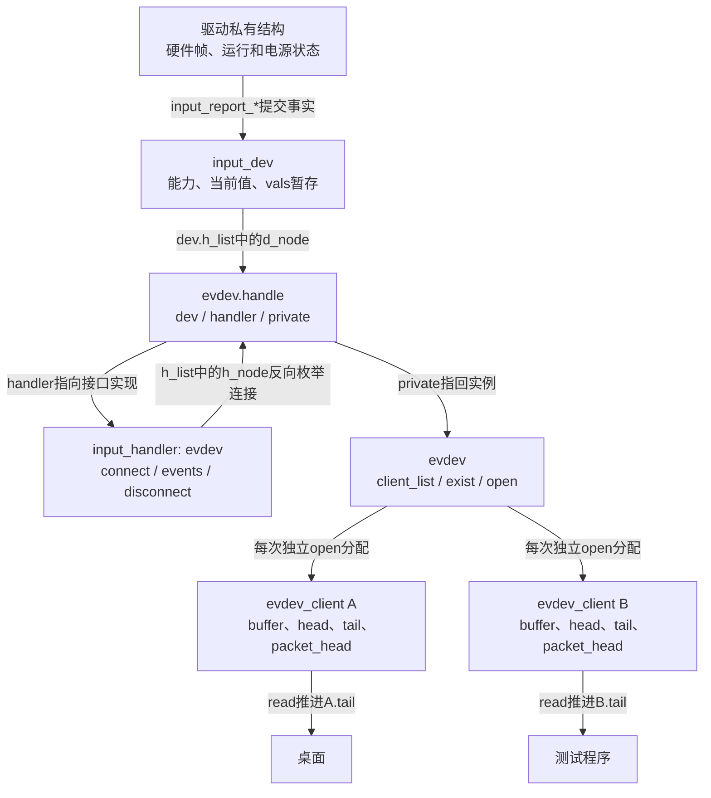
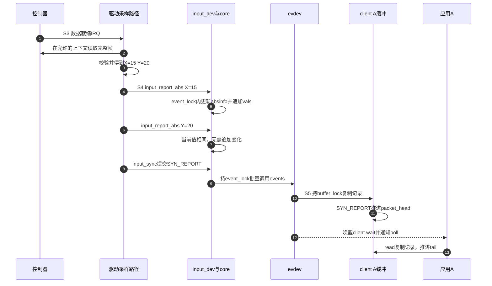
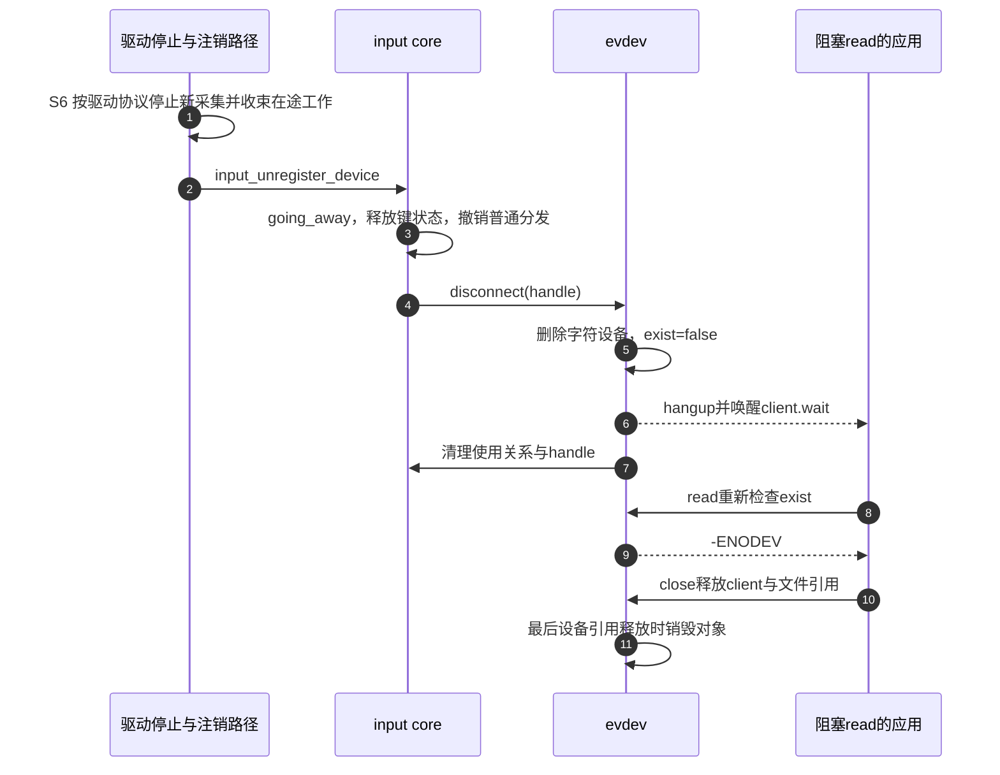

# 第2章\_体系结构与事件传递

上一章用变化记录和SYN_REPORT建立了输入协议，但那段C程序只有一个接收者。真实系统中，桌面、测试程序和其他内核处理接口可能同时观察一个设备：谁保存当前位置，谁保存尚未读走的记录，关闭一个程序又为什么不应让其他程序断流？本章沿一次触摸位置变化回答这些问题，再检查独占、过滤和拔插怎样改变这条路径。

这里采用Linux 6.12.20的具体实现，源码身份见 [总阅读索引](../../../research/source_reading/input/navigation/P01_Linux_6.12_Input源码阅读索引.md#1.1_固定版本与阅读任务)。先把普通路径限定为：设备已注册、evdev已启用且连接成功，两个应用分别open同一event设备，没有grab、过滤掩码、溢出或禁止状态。后面逐一撤去这些条件。

## 2.1\_一份设备事实为什么需要多份读取进度

设触摸位置从(10,20)移到(15,20)。驱动只需要采样并报告一次，内核也只需维护一份被接受的设备当前值；但桌面可能已经读到这次移动，测试程序还没调度到。若把“当前值”和“未读事件”塞进同一个对象，便无法同时表达这两件事。若两个应用共用一个消费游标，桌面读走记录后，测试程序便会错过它。

所以要分开两种状态：**设备当前是什么**，以及 **每个观察者看到了哪里**。Linux把前者主要放在input_dev中，把面向用户态的后者放在每次独立open产生的evdev_client中。中间还需要一条可建立和撤销的连接，否则框架不知道该把哪个设备交给哪种接口。

input_handler表示一种处理接口，evdev就是把输入事件交给用户态的handler；它不是某一个应用，也不是触摸硬件驱动。input_handle表示一个设备与一个handler之间的连接。evdev为每个已连接设备建立一个evdev对象，其中嵌入这个handle，再管理该设备的客户端列表。

图中箭头有两种含义：上半部分是指针或链表关系，下半部分是独立队列的读写关系。它们都不要求创建一个专用转发线程；事件回调通常沿报告调用栈同步执行。`dup()`或fork继承的是同一打开文件描述，而不是重新open；这些描述符共享原client及其消费位置，不能套用“每个fd必有独立队列”。

知道对象为何分开以后，再用字段定位它们。表中的位置是对象内的字段，不是固定物理地址：对象由内核分配，生命周期不同，地址随运行变化。

| 保存的事实 | 实际位置 | 写入者与时机 | 读取者与作用 |
| --- | --- | --- | --- |
| 支持的事件与当前键/轴值 | input_dev的evbit、keybit、absbit、key、absinfo等 | 驱动初始化能力；core接受事件时更新状态 | 事件检查、ioctl快照、handler |
| 多点接触状态 | input_dev->mt及各slot | MT辅助接口和报告路径 | 后续MT事件、快照与释放，第四章展开 |
| 尚待分发的一批变化 | input_dev->vals、num_vals、max_vals | core接受事件后追加、flush后清计数 | input_pass_values交给handle |
| 设备与接口的连接 | input_handle的dev、handler、d_node、h_node、open | 匹配连接、打开关闭和断开 | 从设备分发；从handler反向拆连接 |
| 一个event设备的客户端集合 | evdev->client_list、grab、exist、open | evdev连接、文件打开关闭、独占和断开 | 选择客户端、判断可用性 |
| 某次open的未读记录 | evdev_client->buffer及三个游标 | evdev入队，read出队 | 本client的read/poll及失步处理 |
| 采样是否允许、硬件是否供电 | 驱动私有对象 | open/close、IRQ工作、PM、remove | 驱动采样和停止路径 |

这些状态相互关联，却不是一个全局“就绪/运行/停止”枚举。例如设备当前值已经更新，某个client仍未消费；客户端仍存在，设备却已经拔出。把它们视为几组正交状态，才能解释这些组合。

## 2.2\_先建立连接再决定是否启动采样

设备驱动知道硬件是什么，evdev知道如何提供字符设备，但两者不能靠硬编码设备名单互相寻找。Input采用匹配：设备注册时遍历已注册的handler；handler晚加载时，又遍历已有设备，因此两种注册顺序都能建立连接。

匹配的id table可以提出总线、厂商、产品、版本和能力位图条件；可选的match回调还能进一步判断。匹配成立后，handler的connect负责创建连接及自己的私有对象。evdev的匹配表覆盖输入设备，connect申请编号、初始化evdev、登记handle并添加字符设备。**注册input_dev成功不保证eventX已经可用**：还要有CONFIG_INPUT_EVDEV对应的handler，连接分配及字符设备注册也可能失败；/dev中的节点呈现还依赖系统设备管理环境。

连接存在以后，普通事件分发还要看handle是否打开。对evdev而言，第一次独立open会创建client，并经evdev_open_device调用input_open_device；在没有其他使用关系、没有inhibit的普通情况下，设备users从0变1，core才调用驱动open启动采样。第二个应用open只增加同一evdev的open计数，不再次为它调用input_open_device。第三章再展开关闭配对与失败回滚。

为把采样、分发、消费和退出放到同一时间线上，后续沿用以下S0～S6。它们是阅读阶段，不是内核里的一个状态变量；S5消费可以落后于下一轮S3，S6也可以由拔插提前触发。

| 阶段 | 触发及状态推进 | 交接与完成条件 |
| --- | --- | --- |
| S0 准备 | probe分配私有对象和input_dev，填能力、回调和采样资源 | 尚未发布；公开前必须能安全承受open |
| S1 连接 | input_register_device与handler匹配，创建handle和evdev | 连接成功使用户接口可被打开 |
| S2 激活 | 首个evdev使用关系进入core，必要时调用驱动open | 驱动启动采样；失败必须撤销已增加的计数 |
| S3 采集 | IRQ、轮询或工作路径取得并校验硬件帧 | 只把可解释的样本转换为事件 |
| S4 接受与分发 | core更新当前状态并暂存变化，通常在SYN_REPORT时flush | 接收批次的handler完成同步回调 |
| S5 客户端交付 | evdev复制到各client，提交可读帧并通知 | 各应用独立read；慢应用可能溢出 |
| S6 停止与撤销 | 最后使用者关闭、inhibit、PM或remove各按契约处理 | 采样停止、在途路径结束，引用随后释放 |

S6不是一个万能“关电”动作。普通最后关闭可能保留设备和节点，PM可能保留打开关系，拔插则要撤销连接。不能从某一个布尔值直接推断所有对象都已消失。

## 2.3\_一次报告怎样变成应用可读的一帧

沿用位置从(10,20)变到(15,20)的例子。驱动可以报告X=15，再报告仍为20的Y，最后input_sync。对普通绝对轴，core比较已保存值；无有效变化的Y通常被过滤，X更新到设备当前值并进入vals。这时读当前状态的接口可能已观察到X，但普通evdev读者还没有收到一个完成帧。

input_sync实际提交EV_SYN/SYN_REPORT。core把同步值加入批次后调用input_pass_values，沿打开的handle同步分发。evdev的events回调再遍历client，把input_value转换为带时间戳的input_event，复制到各自环形缓冲。它没有等待每个应用执行完read才返回。

步骤5更新的是设备当前状态；步骤10、11才建立客户端的可读记录边界；步骤12只是通知，调度和步骤13可以晚得多。图只画client A，B经历同样复制但具有自己的游标。控制器IRQ也不是必需路径：轮询设备的S3由轮询回调触发，后面的事件协议不变。

`input_event()`对每次事件持有event_lock并保存/恢复本地IRQ状态，handler事件回调处在这条不可睡眠路径中。evdev还用每client的buffer_lock保护环形缓冲；用户read只在短临界区取出一条内核记录，复制到用户地址不在该spinlock内。这些锁保证各自对象的并发访问，并不会自动把驱动的X、Y、sync三次调用锁成完整硬件帧。若同一设备有两个报告源交错，仍需要驱动按帧串行化，第五章会给出反例。

### 2.3.1\_缓冲容量为什么也会触发同步

批处理是减少逐项回调的一种实现方式，不能让数组无限增长。Linux 6.12.20在vals接近max_vals上限时，追加一个合成的SYN_REPORT并提前分发；之后再继续收集。这里不只是“函数多调用一次”：用户可见事件流也可能增加同步边界，把驱动原想作为一帧的变化分开。因此不能把vals理解成不论多大都能原子提交的事务缓冲。

input_set_events_per_packet提供预计每包事件数，帮助core配置容量；它既不负责限速，也不修复驱动漏掉的同步标记。预估不足会影响批次，预估过大会增加每设备及客户端缓冲成本。正常帧结束时，即使只有一个孤立SYN_REPORT，core也不会把它当作有内容的帧交付。对只实现单事件event回调的handler，core提供逐项调用的分派函数；evdev使用批量events回调。对应实现见 [暂存和分发](../../../research/source_reading/input/source_explanations/P01_事件接受与批量分发.md#1.3_暂存容量与两条flush路径)。

## 2.4\_三个游标怎样保护完整帧与独立消费

环形缓冲中的head指向下一次写入处，tail指向下一条读取记录。只用这两个游标还不够：正在写入的X属于尚未结束的一帧，如果read立即取走，就会把“已排队”错当成“已有完整报告”。因此evdev_client另用packet_head表示最后一个已提交帧之后的位置；read以tail是否到达packet_head判断是否还有可取记录。

先做一个不跨环、不溢出、没有过滤的纸上实验。缓冲容量取8，初始三个游标都为0；X、Y都确实发生变化。表中数字只是教学索引，不是内核默认容量。

| 动作完成后 | head | packet_head | tail | 此时允许读什么 |
| --- | --- | --- | --- | --- |
| 初始 | 0 | 0 | 0 | 没有记录 |
| 写X到0 | 1 | 0 | 0 | 尚无完整帧 |
| 写Y到1 | 2 | 0 | 0 | 仍须等同步标记 |
| 写SYN_REPORT到2 | 3 | 3 | 0 | 可以从0读到2 |
| read空间只够一条 | 3 | 3 | 1 | 本次只返回X；Y和同步仍可读 |
| 再读余下两条 | 3 | 3 | 3 | 此帧读完，等待下一帧 |

为什么第四行允许完整帧进入读取窗口，第五行却只读到一条？packet_head保证的是 **没有完成帧时不暴露其半成品**，read的返回长度仍受用户缓冲大小限制。一次read也可能包含多个已完成帧。上一章按SYN_REPORT组帧的接收逻辑因此仍然必要。

再让A执行最后两行、B一次也不读。B的tail仍为0，A的tail已经到3；设备当前值却只有一份。慢B持续不读时，自己的队列可能追尾并插入SYN_DROPPED，要求它放弃不完整历史并重建可查询状态，不会把A的游标倒退。详细失步恢复放在第五章。

读取路径在队列为空且使用O_NONBLOCK时返回-EAGAIN；普通阻塞读把等待关系挂到client.wait，在可读帧、设备消失或client被撤销时重新检查条件。poll登记同一个等待队列并报告可读性。这就是“无需应用忙等”所替代的通信成本：内核保存队列和等待关系，生产者在帧完成时主动唤醒，而不是完全没有通知。

## 2.5\_独占过滤与禁止分别改变哪一段

到这里，默认模型是所有打开连接都能接收、evdev所有client都有机会得到记录。调试和安全管理会提出不同要求：只让一个应用收到事件、删除某些事件、暂时停止设备功能。它们作用位置不同，不能统一称作“禁用设备”。

先看EVIOCGRAB。evdev先让input_dev->grab指向自己的handle，core于是只把后续批次交给这个handle；再让evdev->grab指向申请的client，evdev内部也只向它分发。两级选择缺一不可：只独占core中的handle，仍不能区分同一个evdev下面的两个应用。独占不销毁其他client，也不把设备所有权交给应用；先前已排入其他队列的记录不会因这个选择自动全部消失。

再看filter。带filter回调的handler在设备连接链表中排在普通handler前面；回调返回true会把对应记录从后续批次中移除，后面的连接只能看到剩余项。它处于event_lock保护的高频路径，必须短小且不能睡眠。evdev客户端自己的事件mask则在向该client复制时筛选，不等价于core层面截住其他handler。设备当前值在更早的接受阶段更新，因此“某client没有看到事件”不能直接推出“core状态没变”。

最后看inhibit。打开的文件可以继续存在，但设备被暂时禁止使用。在此版本，core在有users时先走close/停止poller，释放已按键及MT接触状态并同步，再建立inhibited状态；之后普通输入事件被忽略。解除时若仍有users，尝试重新open/启动poller，成功后恢复；open失败不能伪称已恢复。它要求驱动的close真能停止生产并处理在途路径，不是仅在分发末端丢一条记录。

| 控制方式 | 改变的位置 | 保留什么 | 使用成本与边界 |
| --- | --- | --- | --- |
| core grab及evdev grab | 选择一个handle，再选择一个client | 设备、其他连接及client可以仍存在 | 独占期间其他观察者收不到后续正常事件，不代替电源管理 |
| handler filter | 删除传给后续handle的记录 | 已接受的设备状态不因此回滚 | 判断在锁内；错误过滤可破坏后续语义 |
| evdev client mask | 当前client入队前选择type/code | 其他client独立分发 | 减少本client流量，不能当全局屏蔽 |
| inhibit | 设备使用与接受路径 | fd和打开需求可保留 | 停止/恢复采样，并处理释放状态和重开失败 |

若只想让测试程序不消费某类事件，应先考虑本client的过滤需求；若要独占校准，再考虑grab并接受其他应用断流；若设备本身暂时不可用，才进入完整停止/恢复协议。三者都不能凭名字推断采样硬件已经断电。

## 2.6\_拔插如何让等待者退出而不提前释放对象

假设应用阻塞在read，设备突然被移除。只释放input_dev会让尚存的文件引用悬空；只删除event节点又只挡住新打开，无法通知已有reader。退出必须同时处理新操作、在途访问、等待通知和最后引用。

core注销准备通过going_away阻止新的input_open_device，释放已按键状态并关闭普通handle分发，再逐一调用handler的disconnect。evdev删除字符设备入口，设置exist=false，向client发送挂起通知并唤醒等待者，随后清理自己的core使用关系和handle。既有文件持有的引用可以让evdev对象继续存在，但此时它已不能提供有效设备操作。

步骤1表达驱动必须兑现的安全条件，具体可由驱动close、devres释放顺序或remove中的停止动作组合实现，不能机械要求所有驱动重复disable IRQ。步骤6唤醒不保证应用立即运行；步骤8在断开后重新检查时返回-ENODEV。已在断开前开始取数的并发read可能已经取得部分记录，不能据此承诺“所有缓存先读完，再返回EOF”。poll可同时带有挂起/错误和已有可读标志，应用仍须检查实际read结果。

对象内存仍在不等于硬件仍可访问。驱动不能只关电并释放私有数据，再希望框架替它取消所有IRQ、timer和work；框架也不能等待每个用户先close才允许硬件拔出。引用保留保护的是对象生命，生产路径停止保护的是不再访问撤销资源，两项保证需要分别建立。

用本章模型回答三个问题：A读走一帧，B为什么仍能读？因为独立open有不同client和tail。core的X已变为15，A为何可能仍睡眠？尚未形成可读同步帧，或尚未被调度，不能只看当前值推断历史交付。关闭A是否必然关闭采样？不必然，还要看evdev及其他handler的使用关系。

现在从设备事实到等待者的通信已经闭合。下一章 [设备注册能力与生命周期](P03_设备注册能力与生命周期.md) 继续解决S0～S2和S6的配对：公开设备以前必须准备什么，首次打开失败怎样回滚，最后关闭又究竟释放哪一层状态。版本化对象、分发和客户端实现从 [事件模块导读](../../../research/source_reading/input/navigation/P02_事件状态怎样到达各客户端.md#2.1_沿同一次移动寻找状态落点) 进入。
