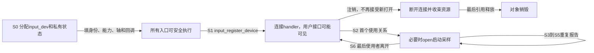
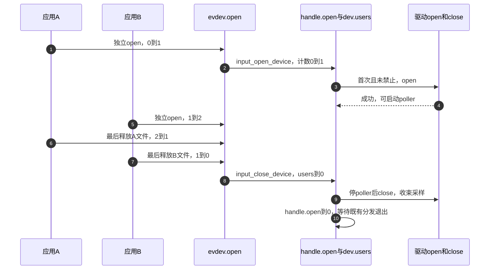
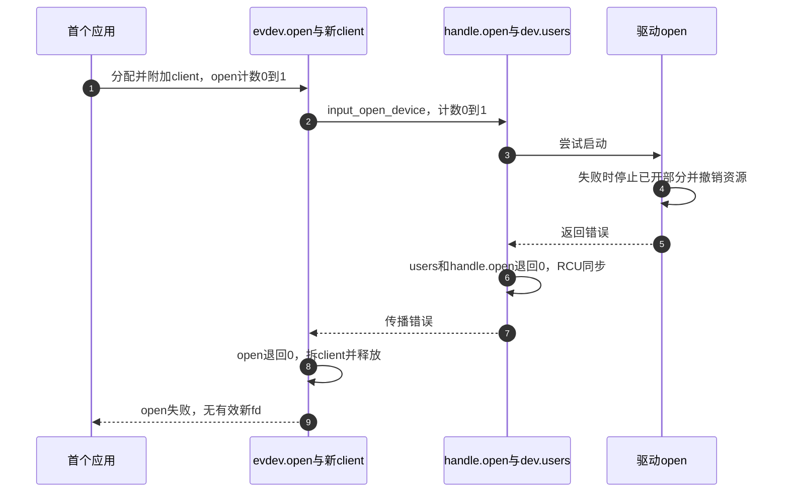
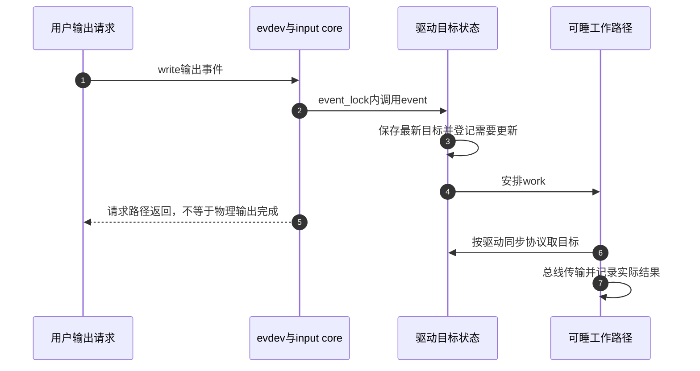

# 第3章\_设备注册能力与生命周期

上一章已经能追踪一次变化如何进入独立客户端队列，但它从“设备已经存在且有人打开”出发。现在把时间倒回驱动开始运行：如果先产生event节点，再补回调或私有数据，应用恰好在这段空隙打开会发生什么？反过来，关闭一个应用时又怎样避免停止另一个应用仍在使用的采样？

本章沿S0准备、S1发布、S2首次激活到S6停止，建立同一对象的完整生命期。先解释身份与能力为什么必须提前确定，再用一个只模拟绝对轴的完整模块观察首次打开和最后关闭。源码边界为 [NXP Linux 6.12.20固定提交](../../../research/source_reading/input/navigation/P01_Linux_6.12_Input源码阅读索引.md#1.1_固定版本与阅读任务)，示例不访问真实硬件。

## 3.1\_发布意味着其他路径可以开始使用对象

驱动刚分配input_dev时，没有用户知道它，适合填身份、能力、轴和回调。调用input_register_device以后，core会发布设备并连接handler；evdev连接成功后，新的打开就可能发生。不能把“本函数还没返回”当成“其他CPU还看不到设备”的锁。

因此S0必须先准备所有open会依赖的状态：input_set_drvdata保存的私有对象、能力和轴描述、open/close/event回调，以及它们要使用的总线和采样资源。如果IRQ可能在申请成功后立即到来，IRQ路径同样要有完整输入对象及私有状态，或可靠地保持禁止采样直到准备完成。注册既不是第一次分配内存，也不是启动硬件的唯一时刻，它是对外公开使用关系的边界。



图中最后关闭返回的是“已注册但无人使用”，不是销毁。设备可以再次打开；真正注销则关闭新使用关系，并安排已有引用退出。还有inhibit和PM等状态会保留fd却暂时停止硬件，不能把图中的阶段压成一个running布尔变量替代全部生命周期。

## 3.2\_先说明自己能提供什么再允许连接

应用通过稳定事件语义解释数据，所以能力声明不是展示设备名字的装饰。一个驱动若报告KEY_ENTER却没声明EV_KEY/KEY_ENTER，事件可能在core入口被过滤；只写“这是键盘”也不能让框架自动推导全部键码。

input_set_capability按type选择keybit、relbit、absbit、swbit等code位图，并设置evbit中的类型位；propbit补充直接触摸、间接指针等属性，通常使用__set_bit设置对应属性位。code来自UAPI已定义语义；自创编号无法让通用用户态自然理解。若数据更像连续波形或音视频，应重新判断所属子系统。

身份字段回答“来自哪里、叫什么”，能力字段回答“能报告或接受什么”，两者不能互相替代。先把身份表填得真实，比给空缺字段编一个漂亮数字更有用。

| 字段 | 当前职责 | 应避免的误用 |
| --- | --- | --- |
| name | 面向人的功能或型号名 | 将动态eventX序号写进稳定设备名 |
| phys | 拓扑位置，例如总线端口路径 | 当成全球唯一序列号 |
| uniq | 硬件提供的稳定唯一标识 | 无序列号时每次生成随机身份 |
| id.bustype | 实际连接类型，如BUS_I2C、BUS_USB；模拟设备可用BUS_VIRTUAL | 按“键盘/鼠标类别”编总线号 |
| id.vendor/product/version | 可确认的设备身份 | 随意常量诱使用户规则错误匹配 |
| dev.parent | 所属设备与设备模型关系 | 覆盖devm分配已设置的所有者 |

绝对轴还需要范围和噪声等描述。input_set_abs_params设置EV_ABS、轴能力，并分配/填写absinfo；它返回void，分配失败由注册时检查EV_ABS却缺absinfo来拒绝，因此注册返回值必须检查。若随后直接访问absinfo或调用会解引用它的辅助接口，仍须先确认分配成功。input_abs_set_res补充分辨率，不从像素宽度自动得出。

| 轴字段 | 作用 | 不能推断的保证 |
| --- | --- | --- |
| value | core最近接受的值 | 不等于此刻硬件寄存器的实时读数 |
| minimum/maximum | 逻辑范围，供映射、归一化等使用 | core不会因此自动钳位所有报告值 |
| fuzz | core按分段区间调整新值，再决定是否为变化 | 不是简单的固定死区判断 |
| flat | 中心区等解释所用元数据 | core不会自动把中心区域全部归零 |
| resolution | 普通位置/尺寸轴通常用单位每毫米；旋转轴用单位每弧度，特定属性另有定义 | 不能统一当作屏幕像素数或固定物理单位 |

例如硬件只允许0～4095，坏包却给出65535，范围声明不会自动把坏包变成4095。驱动要先按协议拒绝损坏帧或执行有依据的转换，再上报一致的逻辑范围。fuzz的版本实现见 [轴状态与分段调整](../../../research/source_reading/input/source_explanations/P01_事件接受与批量分发.md#1.2_绝对轴怎样选择旧值并抑制小幅变化)。

注册还会自动启用EV_SYN，清掉KEY_RESERVED，并清理未启用事件类型的附属位图。这能消除部分矛盾配置，不能替驱动选择正确能力。身份字符串以及drvdata指向的数据也必须活到相关使用路径结束；用probe栈上的临时字符数组作name，注册成功并不会替它延长生命期。

## 3.3\_首次打开与最后关闭为什么需要两级计数

两个应用分别打开同一event设备时，evdev需要两个client；硬件通常只应启动一次。evdev.open于是汇总本实例的打开数，只在0→1时调用input_open_device，在1→0时调用input_close_device。core的input_dev.users再汇总handler提交的使用关系，而不是直接统计用户fd。

设只有一个evdev handle使用设备，未inhibit，驱动open成功。下面的计数同时写出，避免把不同层次都称为“用户数”。

| 动作后 | evdev.open | 该handle.open | input_dev.users | 设备回调 |
| --- | --- | --- | --- | --- |
| 无使用者 | 0 | 0 | 0 | 未启动 |
| A独立open | 1 | 1 | 1 | open一次 |
| B独立open | 2 | 1 | 1 | 不再open |
| A最后释放自己的打开文件 | 1 | 1 | 1 | 不close |
| B最后释放自己的打开文件 | 0 | 0 | 0 | close一次 |

这里“关闭”指打开文件描述的最后引用被释放；dup出来的fd或fork继承者仍持有引用时，关闭一个数字fd不一定触发evdev release。若另一个handler也打开同一input_dev，users还包括那份关系，不能继续使用表中的固定数值。



步骤5只改变evdev层，步骤8才回到core。步骤9的顺序是本版本普通最后关闭路径；inhibit路径存在不同顺序，后文单独说明。core用dev.mutex串行open/close，回调可以处理可睡启动/停止，但不能在回调里再次拿同一个dev.mutex造成自锁。

启动还可能失败。core先增加handle.open和users，再调用驱动open；若返回错误，会把两者减回，等待既有RCU分发退出，再把错误交回evdev。evdev再减回自己的open计数，拆掉这次client并释放分配。core没有替驱动自动执行一次close来修复失败的open，所以驱动必须自己回滚已启动的一半硬件。



失败图的步骤4是驱动责任，步骤6和8是框架计数/对象责任。仅把错误值传回来，不能证明硬件已经恢复到下次可重试的状态。

## 3.4\_用完整虚拟设备观察这条生命线

下面创建一个只有ABS_X轴的模拟设备，每次轮询在100和0之间切换。它不需要GPIO或触摸芯片，目的只是把分配、能力、发布、首次打开、轮询和最后关闭连起来。Input polling helper接管延迟工作及其停止配对，驱动不另建永久定时器。

材料放在 [lifecycle_demo](../../../labs/kernel/input/materials/lifecycle_demo/input_lifecycle_demo.c)，配套 [Makefile](../../../labs/kernel/input/materials/lifecycle_demo/Makefile)。以下是完整模块源码，不是只摘probe函数：

```c
// SPDX-License-Identifier: GPL-2.0-only
#include <linux/init.h>
#include <linux/input.h>
#include <linux/module.h>

struct demo_state {
	struct input_dev *input;
	bool high;
};

static struct demo_state demo;

static void demo_poll(struct input_dev *input)
{
	struct demo_state *state = input_get_drvdata(input);

	/* 只模拟一个轴，不访问任何物理控制器。 */
	state->high = !state->high;
	input_report_abs(input, ABS_X, state->high ? 100 : 0);
	input_sync(input);
}

static int demo_open(struct input_dev *input)
{
	struct demo_state *state = input_get_drvdata(input);

	/* core在open成功之后才启动poller。 */
	state->high = false;
	pr_info("input_lifecycle_demo: open\n");
	return 0;
}

static void demo_close(struct input_dev *input)
{
	/* 普通最后关闭中，core已同步停止poller，再调用这里。 */
	pr_info("input_lifecycle_demo: close\n");
}

static int __init demo_init(void)
{
	struct input_dev *input;
	int error;

	input = input_allocate_device();
	if (!input)
		return -ENOMEM;

	demo.input = input;
	input_set_drvdata(input, &demo);
	input->name = "input-lifecycle-demo";
	input->id.bustype = BUS_VIRTUAL;
	input->open = demo_open;
	input->close = demo_close;
	input_set_abs_params(input, ABS_X, 0, 100, 0, 0);

	/* 设置轮询可能分配失败，尚未注册时走free路径。 */
	error = input_setup_polling(input, demo_poll);
	if (error)
		goto err_free;
	input_set_poll_interval(input, 1000);
	input_set_min_poll_interval(input, 1000);
	input_set_max_poll_interval(input, 1000);

	/* 发布后可能立即被打开，因此上面必须先准备完毕。 */
	error = input_register_device(input);
	if (error)
		goto err_free;
	return 0;

err_free:
	input_free_device(input);
	demo.input = NULL;
	return error;
}

static void __exit demo_exit(void)
{
	/* 注销收束handler使用关系及poller；之后不再解引用input。 */
	input_unregister_device(demo.input);
	demo.input = NULL;
}

module_init(demo_init);
module_exit(demo_exit);
MODULE_LICENSE("GPL");
MODULE_DESCRIPTION("Input lifecycle teaching device with a virtual axis");
```

Makefile的完整内容是：

```makefile
# 在目标Linux内核构建环境中作为外部模块编译。
obj-m += input_lifecycle_demo.o
```

S0在demo_init中完成：input分配后，把静态demo地址放到drvdata，填name、虚拟总线、open/close和轴参数，再配置poller。demo_poll只改demo.high并提交ABS_X及同步；它不碰真实设备。注册必须最后执行，因为core可能在返回前已建立可打开的evdev接口。

首次有效使用时，demo_open先把相位重置为false，core随后启动poller，第一次poll立即把它翻成true并报告100；后续约每1000ms报告0、100。若设备当前值本来已经是100，重新打开的首次同值报告可能被core过滤，所以不能要求“每次open必收到相同条数的首帧”。这正好复习前两章的当前状态与变化记录区别。

在普通最后关闭中，core先同步停止poller，再调用demo_close。样例close只打印状态，不操作硬件，因此在inhibit的不同调用顺序下也没有“先关硬件后轮询还读总线”的问题。注销由input_unregister_device断开handler并收束其使用关系，之后模块不再解引用input。注册前失败则走input_free_device，同一个对象不再重复unregister或free。

### 3.4.1\_编译与观察位置

以下操作在Linux测试环境中执行，需要匹配运行内核的构建目录、C工具链和evtest，并启用Input与evdev。本次仓库编辑环境没有完成目标内核模块构建或加载；下面给出可复现步骤和预期，而不是已实测日志。模块加载还应满足该系统自己的签名与权限配置。

```bash
# 在Linux测试机的仓库根目录执行，进入刚才的材料目录。
cd labs/kernel/input/materials/lifecycle_demo
make -C /lib/modules/$(uname -r)/build M="$PWD" modules
```

-C选择运行内核的构建环境，M把当前目录作为外部模块；obj-m要求构建input_lifecycle_demo.ko。若当前用的是交叉编译内核，应改用对应源码/输出目录、ARCH和CROSS_COMPILE，并在匹配内核的目标机运行，不能把主机模块直接搬给另一架构。

```bash
# 仍在材料目录，把模拟输入设备注册到测试内核。
sudo insmod ./input_lifecycle_demo.ko
cat /proc/bus/input/devices
```

在输出中找Name为input-lifecycle-demo的设备，再从其Handlers行取实际event编号，不把示例中的eventX原样当成文件名。注册成功却没有event节点时，按第二章检查evdev和设备节点管理环境，而不是继续猜编号。

```bash
# 两个终端分别运行；将eventX换为上一步实际节点。
sudo evtest /dev/input/eventX
```

在只有这两个观察者使用设备的条件下，两边都应看到ABS_X在100和0之间变化并由SYN_REPORT分帧。另一个终端可用dmesg观察open/close日志：第二次独立open不应再触发设备open；先退出一个evtest，另一个应继续读；最后退出才触发close。系统若还有自动打开设备的服务，这个前提不成立，应先识别实际使用者，不能据一条日志判定计数错误。

```bash
# 结束观察后，在Linux测试机卸载模拟模块。
sudo rmmod input_lifecycle_demo
```

正常清理后名称和节点应退出可用集合。如果保留一个阻塞reader再卸载，可观察挂起/错误退出；不承诺evtest在所有版本都打印同一句话，关键是旧文件不再提供有效设备事件。目标验证记录应分别保存构建、首次打开、双客户端、最后关闭和注销结果。

### 3.4.2\_改一处再预测结果

先将轮询间隔及最小/最大值一起改成200ms，预测事件频率变化而open次数不变；重建并重新加载后再观察。再临时让demo_open直接返回-EIO，预测首次open失败，poller不应启动，也不应期待框架补调demo_close。恢复后重新构建，避免把注入失败的版本当作正常样例。

这两个修改分别改变采样频率和启动结果，计数配对不应被它们破坏。频率更高会增加分发与唤醒成本，不能从模拟轴没有总线开销推断真实控制器也能按同样周期安全采样。

样例中的接口可沿 [生命周期模块导读](../../../research/source_reading/input/navigation/P03_设备怎样公开启停和退出.md#3.1_分开观察可见性使用关系与生产者) 进入固定实现。分配与注册见 [对象发布](../../../research/source_reading/input/source_explanations/P03_分配发布与两步资源撤销.md#3.3_注册把已准备对象交给设备模型和handler)，open/close计数见 [使用关系](../../../research/source_reading/input/source_explanations/P04_使用计数失败回滚与断开.md#4.1_首次evdev打开怎样进入core并回滚)，轴能力及poller分别见 [能力设置](../../../research/source_reading/input/source_explanations/P05_能力轮询重复与输出的边界.md#5.1_声明能力与轴参数到底改了哪些字段) 与 [轮询启停](../../../research/source_reading/input/source_explanations/P05_能力轮询重复与输出的边界.md#5.2_poller把周期工作接到打开与关闭)。

## 3.5\_托管资源为何仍需要理解释放顺序

示例用显式分配，是为了让注册前失败和注册后注销的区别可见。真实设备驱动常用devm_input_allocate_device(owner)：它仍创建同样的input_dev，但把分配释放登记到所有者的devres栈，自动设定dev.parent，调用者不应覆盖这个parent。

使用普通input_register_device注册托管对象时，core再登记一份注销动作。所有者解绑或probe失败展开devres时，先遇到后登记的注销动作，使设备退出使用；更早的分配释放动作最后放掉分配引用。因此 **已经注销** 与 **内存已经释放** 是两个时刻。中间尚有合法资源清理路径可能报告到仍存活的input对象，但事件不再向正常接收者分发。

| 对象与阶段 | 正确结束动作 | 不能叠加的动作 |
| --- | --- | --- |
| 显式分配，注册前或注册失败 | input_free_device | 不把未注册对象当成功对象unregister |
| 显式分配，注册成功 | input_unregister_device | 不紧接着再free同一分配引用 |
| devm分配且普通注册成功 | 通常让所有者devres撤销 | 不再手工安排重复注销/释放 |
| devm对象需要提前退出 | 用该版本支持的显式接口并核对它移除了哪条devres记录 | 不自行kfree或保留会重复执行的清理记录 |

devres只是按登记顺序逆序执行，不能判断你的work是否仍握着某个指针。例如在input分配后登记IRQ、在IRQ准备好后注册input，逆序会先注销input，再撤销IRQ，最后释放input分配引用。这种两步托管让中间对象可保持存活，但IRQ或工作仍必须在最后释放私有状态前停止；若工作还访问已断电总线，input对象活着也救不了它。

因此“使用devm就不需要remove思考”是错误结论。每条清理动作都要知道它停止生产、撤销入口还是释放内存；生产者与资源的依赖决定登记及显式停止顺序。需要跨设备转移所有权或精确提前销毁时，显式生命周期可能更合适，但必须把每个失败分支写完整。

## 3.6\_轮询重复与输出为何也属于生命周期

Input不只接收硬件IRQ。轮询会再次安排自己，软件重复由定时器再次报告，输出work会在原调用返回后写设备；它们都有“谁还能产生下一次动作”的问题，不能只在注册时设好回调就不再管停止。

### 3.6.1\_轮询由使用关系启动但间隔不是实时保证

input_setup_polling分配poller并登记poll回调；input_set_poll_interval、min/max设置当前及允许范围。此版本注册时若当前间隔为0会设为500ms，max未设时取当前间隔。开始使用且间隔非零时先同步执行一次poll，再安排system_freezable_wq上的delayed_work；其后每次poll结束再安排下一次，所以周期包括处理时间和调度延迟，并非精确硬件采样时钟。

普通最后关闭先cancel_delayed_work_sync，再调用设备close。inhibit的实际顺序却是先设备close，再停止poller。因此真实硬件驱动不能未经核对便在所有close入口立即切断poll所用资源：应以自己的状态和同步协议保证在途读取收束，不在poll回调里反拿core已持有的dev.mutex。示例只产生软件值，close没有关电动作，刻意避开了这个硬件依赖。

poller工作队列可冻结，也不等于设备所有runtime/system PM责任都已实现。是否承担唤醒、恢复时如何重新取得状态，仍应接到第五章的电源协议。

### 3.6.2\_自动重复要选择一个负责者

键盘一次物理按住可以对应一个按下状态和多次value=2重复。声明EV_REP说明支持重复控制；此版本注册时，仅当REP_DELAY和REP_PERIOD都为0，core才设置250ms初延迟、33ms周期的软件重复参数。实际重复还需要EV_KEY、EV_REP、有效按键状态及定时器条件，不是所有注册设备都会周期性产生键事件。

硬件或驱动已经负责重复时，不应无意再启用一份core软件重复。只设置一个参数也不会触发“两个都为0”的默认分支，不能靠猜测默认值配置。重复定时器在注销时同步删除，释放事件会停止后续重复；它表达按住期间的重复请求，不是新的物理按下边沿。

### 3.6.3\_输出回调先保存目标再交给可睡路径

键盘LED、声音和力反馈使Input具有双向交互。evdev写入输出事件后经input_inject_event进入core，按类型交给设备event回调或力反馈层。这条回调仍受event_lock和本地关中断约束，不能直接执行可睡I²C/SPI传输。



步骤3把跨上下文通信落到驱动私有状态，步骤4只通知有工作；如果新请求在旧work执行时到来，必须保证最新目标仍会被应用，不能把queue_work的返回值误作硬件完成。注销前还要禁止新输出并取消或完成work，再释放总线和私有对象。力反馈效果的上传/播放还具有自己的对象协议，不能用本图代替完整FF实现。

## 3.7\_用失败路径检查设计是否闭合

回看这章的虚拟设备，能够解释三组不同动作：分配/发布/注销管理对象可见性，open/close管理使用需求，poller或硬件驱动管理实际采样。真实设备再增加PM和唤醒条件后，应保持这些状态分别有来源，不能把evdev.open直接当电源开关。

判断三个修改：把input_set_drvdata挪到注册后是否安全？不安全，open或poll可能已使用它。把第二个应用open也当作第二次设备启动是否正确？不正确，先经过evdev汇总。首次open启动到一半失败，等待框架close回滚是否足够？不够，驱动自己必须撤销半完成动作。

现在已能把一个单轴设备安全地公开并按需运行。下一章 [事件帧与多点触控](P04_事件帧与多点触控.md) 增加多个同时存在的接触：一条轴值不再足以说明“哪个手指”，需要进一步分开槽位、接触身份和整帧的释放规则。
