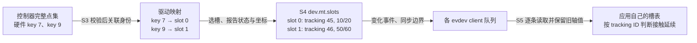
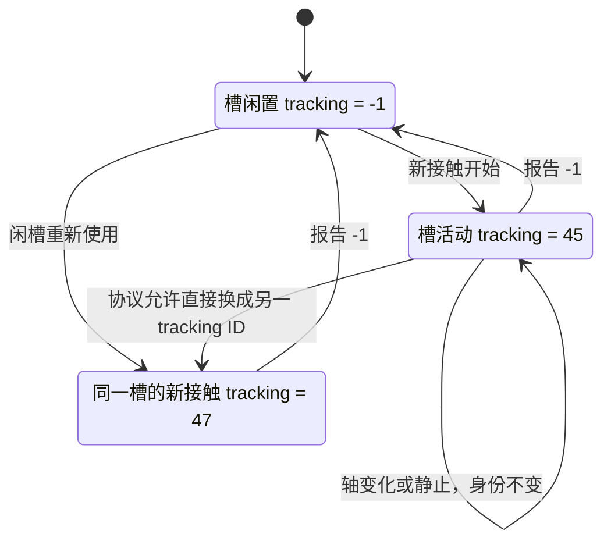
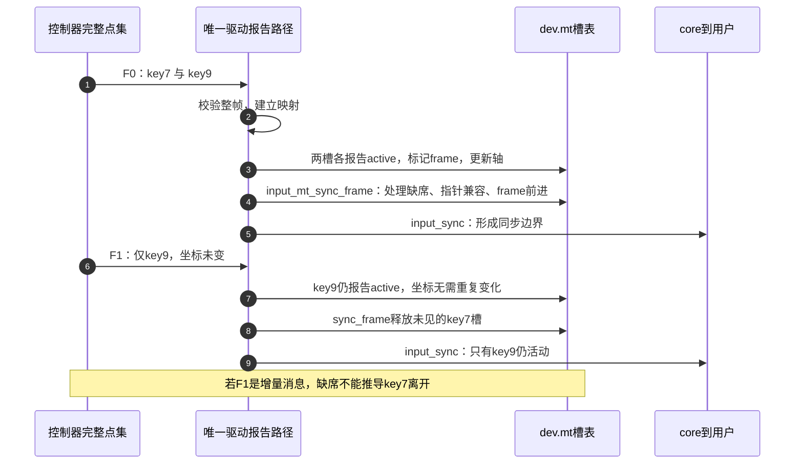
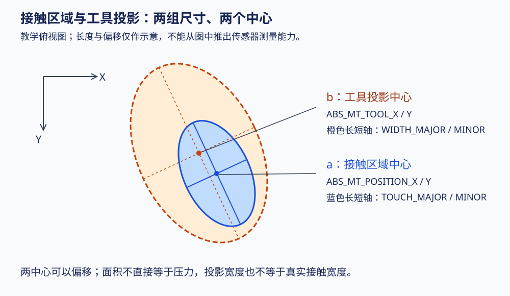

# 第4章\_事件帧与多点触控

上一章已经能公开一个绝对轴设备，在首次使用时启动采样，最后使用结束后停止。假设把该设备换成触摸屏，只报告一组 `ABS_X/ABS_Y`，一根手指移动时工作得很好；第二根手指落下以后，新的坐标覆盖旧坐标，读者无法知道它表示旧手指移动，还是另一根手指。增加一次同步也无济于事：帧只划分采样边界，不凭空增加保存多个接触的空间。

本章从两根手指的连续运动推导多点状态与身份，再把这个模型接到 Linux 的 MT 辅助接口。仍采用第二章的全周期：S3 驱动取样与解析，S4 core 接受并分发，S5 用户解释事件；这里只展开其中接触跨帧延续的问题。取样失败、读者丢帧以及休眠中断这个周期时怎么办，留到下一章。

## 4.1\_一帧需要描述哪些点以及哪些点延续了下来

假设控制器在时刻 T0 报告两个接触：甲在 `(10,20)`，乙在 `(50,60)`；T1 乙移动到 `(55,60)`，甲不动。若驱动只发两组 X/Y，即使在最后加上 `SYN_REPORT`，用户仍需决定哪组坐标属于谁。更糟的是，控制器可能按扫描顺序或强度排列点，下一帧列表顺序交换了，不能把“数组第一个”当成手指身份。

可以每帧发送完整点集，让用户根据距离猜测连续性。这能描述每个时刻的形状，却让每个应用各自猜一次；两指交叉或丢样本时还可能猜出不同结果。另一种办法是在驱动侧维护有限个 **槽位（slot）**：每个槽保存一个接触的轴状态，事件先选槽，再更新该槽的字段。用户也维护同样数量的槽，未变化的值继续保留。

槽位仍不等于身份。甲离开以后，槽 0 可以装进丙；如果坐标恰好相近，用户不能把它当成甲继续移动。因此每次接触还要有 **tracking ID**，非负值标识当前接触，`-1` 表示此槽没有接触。相同槽换成新的 tracking ID，意味着接触生命周期更换；ID 不是人的永久编号，也不要求等于控制器的硬件 ID。



这里有三种不同编号：控制器 key 来自硬件协议，slot 是有限的存储位置，tracking ID 是 Input 接触身份。驱动负责第一种到后两种的转换，core 不会从几个坐标自动识别控制器的编号规则。图中的 7、9、45、46 是教学值。

## 4.2\_沿五帧观察选择器状态与接触生命周期

下面使用 **Protocol B**，即 Linux 的有状态多点事件协议。`ABS_MT_SLOT` 改变后续 MT 轴事件作用的槽；这个选择一直有效，直到下一次选择。`SYN_REPORT` 结束一帧，但不把槽表和选择器清零。驱动可通过 `input_mt_slot()` 选槽，通过 `input_report_abs()` 报轴，最后 `input_sync()` 发出同步。

| 帧 | 教学事件序列，省略 EV_ABS 前缀 | 帧末能解释的状态 |
| --- | --- | --- |
| F0 | SLOT=0，TRACKING_ID=45，POSITION_X=10，POSITION_Y=20；SLOT=1，TRACKING_ID=46，X=50，Y=60；SYN_REPORT | 甲、乙都在，分居槽 0、1 |
| F1 | POSITION_X=55；SYN_REPORT | 选择器仍为槽 1，乙变为 `(55,60)`，甲保留原状 |
| F2 | SLOT=0，TRACKING_ID=-1；SYN_REPORT | 甲结束，只有乙 |
| F3 | TRACKING_ID=47，POSITION_X=20，POSITION_Y=30；SYN_REPORT | 槽 0 装入丙，乙仍在槽 1 |
| F4 | TRACKING_ID=-1；SLOT=1，TRACKING_ID=-1；SYN_REPORT | 所有接触结束 |

表中 SLOT、TRACKING_ID、POSITION_X/Y 分别是 `ABS_MT_SLOT`、`ABS_MT_TRACKING_ID`、`ABS_MT_POSITION_X/Y` 的简写。它展示协议所表达的信息，实际 core 会省略重复轴值，并可能在需要时补出选槽事件；不能以驱动调用次数预测 evdev 中完全相同的事件条数。



Protocol B 允许把一个非负 tracking ID 直接改成另一个非负 ID，表示替换，并非必须在两者中间插入 `-1`。但常用的 `input_mt_report_slot_state(..., true)` 在槽已活动时会沿用原 ID；如果驱动明确知道是另一个接触，不能只重新报告 `true` 和坐标。采用该辅助接口时，可以由驱动选定槽后先报告 `false`，再报告新接触 `true`，使辅助接口生成新身份。此处假设驱动已拥有正确映射，后文还会区分按 key 自动找槽的限制。

帧也不是数据库事务。第二章已说明：每次报告的锁保护该次状态更新，core 暂存容量达到阈值还会插入同步边界。它既不锁住驱动整个硬件采样，也不会撤销已经接受的半帧。因此先把控制器帧读入驱动缓存、检查长度和点集，再由一个串行的报告路径更新所有槽。不能报了一半才发现 CRC 错误，指望少发一次 `input_sync()` 就回滚。

### 4.2.1\_运行一个会记住槽状态的读者

下面是完整 C11 程序，使用本章自己的语义事件结构，不读取 Linux `struct input_event` 的二进制布局。起点已知：两槽闲置、轴缓存为零、选择器为 0。实际应用中途打开设备或遇到 `SYN_DROPPED` 时，必须先恢复状态，不能套用这个初始条件。

```c
/* 教学事件解释器：不读取 evdev 二进制，也不模拟内核锁或丢帧恢复。 */
#include <stdbool.h>
#include <stdio.h>
#include <string.h>

enum demo_code { demo_slot, demo_tracking, demo_x, demo_y, demo_sync };
struct demo_event { enum demo_code code; int value; };
struct demo_contact { int tracking; int x; int y; };

static const struct demo_event stream[] = {
    {demo_slot, 0}, {demo_tracking, 45}, {demo_x, 10}, {demo_y, 20},
    {demo_slot, 1}, {demo_tracking, 46}, {demo_x, 50}, {demo_y, 60},
    {demo_sync, 0},
    {demo_x, 55}, {demo_sync, 0}, /* 选择器仍指向槽 1，Y 沿用 60。 */
    {demo_slot, 0}, {demo_tracking, -1}, {demo_sync, 0},
    {demo_tracking, 47}, {demo_x, 20}, {demo_y, 30}, {demo_sync, 0},
    {demo_tracking, -1}, {demo_slot, 1}, {demo_tracking, -1}, {demo_sync, 0}
};

int main(int argc, char **argv)
{
    struct demo_contact slots[2] = {{-1, 0, 0}, {-1, 0, 0}};
    unsigned int selected = 0, frame = 0;
    bool omit_release = false;

    if (argc == 2 && strcmp(argv[1], "omit-release") == 0)
        omit_release = true;
    else if (argc != 1) {
        fprintf(stderr, "usage: %s [omit-release]\n", argv[0]);
        return 2;
    }

    for (size_t i = 0; i < sizeof(stream) / sizeof(stream[0]); ++i) {
        const struct demo_event event = stream[i];
        /* 删除第三帧的释放记录，观察幽灵接触；不修改其余输入。 */
        if (omit_release && frame == 2 && event.code == demo_tracking)
            continue;
        switch (event.code) {
        case demo_slot:
            if (event.value < 0 || event.value >= 2) {
                fprintf(stderr, "invalid slot\n");
                return 1;
            }
            selected = (unsigned int)event.value;
            break;
        case demo_tracking:
            if (event.value < -1) {
                fprintf(stderr, "invalid tracking id\n");
                return 1;
            }
            /* 接触身份变化不清空轴缓存；未报告的轴继续沿用槽内值。 */
            slots[selected].tracking = event.value;
            break;
        case demo_x:
            slots[selected].x = event.value;
            break;
        case demo_y:
            slots[selected].y = event.value;
            break;
        case demo_sync:
            printf("frame %u:", ++frame);
            for (unsigned int slot = 0; slot < 2; ++slot) {
                if (slots[slot].tracking >= 0)
                    printf(" slot%u=id%d@(%d,%d)", slot,
                           slots[slot].tracking, slots[slot].x, slots[slot].y);
            }
            putchar('\n');
            break;
        }
    }
    return 0;
}
```

将代码保存为 `mt_slot_reader.c`，或使用 [配套完整文件](../../../labs/kernel/input/materials/mt_slot_reader.c)：

```sh
cc -std=c11 -Wall -Wextra -Werror mt_slot_reader.c -o mt_slot_reader
./mt_slot_reader
./mt_slot_reader omit-release
```

正常输出应为：

```text
frame 1: slot0=id45@(10,20) slot1=id46@(50,60)
frame 2: slot0=id45@(10,20) slot1=id46@(55,60)
frame 3: slot1=id46@(55,60)
frame 4: slot0=id47@(20,30) slot1=id46@(55,60)
frame 5:
```

第二次运行只删掉第三帧的释放记录；第三行仍会显示 id45，于是出现“手指已离开，应用仍认为按着”的幽灵接触。第四帧新 ID 又会替换它，说明后来恢复正常不代表中间过程正确。程序也特意没有在新 ID 到来时清空轴缓存：轴缓存属于槽，未发送的轴沿用前值；实际 core 可能因为新旧数值相等而省略某个轴的事件。

这项练习只验证接收端的持久状态解释。它不模拟内核能力过滤、evdev 队列溢出、字节读取边界或真实控制器扫描频率。

## 4.3\_完整点集和变化通知需要不同的释放规则

现在驱动知道如何保留活动槽，还有一个新问题：硬件不再报告某个点时，它是离开了，还是没有变化？如果控制器每次返回 **所有当前接触的完整点集**，缺席可以表示离开；如果返回 **仅变化的增量**，缺席只表示本次没有消息。两者不能共用“没看到就释放”的推理。

Linux 的 `INPUT_MT_DROP_UNUSED` 实现第一种规则。`input_mt_report_slot_state()` 会将当前槽的 `frame` 标成当前 `mt->frame`；调用 `input_mt_sync_frame()` 时，未在本周期标记过的活动槽被释放，然后内部帧编号前进。驱动应对完整点集中的每一个活动接触调用状态报告，即使它的坐标没有变化；重复轴值可由 core 过滤，**内部 seen 标记不能省略**。



图中第 1～5 步完成首次两点报告；第 6～9 步中，key9 虽然不移动，也要在第 7 步标记出现，才能在第 8 步只释放缺席的 key7。

| 接口或标志 | 谁读写哪些状态 | 对调用者的要求 |
| --- | --- | --- |
| `input_mt_init_slots(dev, n, flags)` | 分配 `dev->mt` 和 n 个槽，初始化 tracking=-1，声明槽与身份轴 | 注册前完成；检查返回值；先设置要复制的 MT 轴参数 |
| `input_mt_slot(dev, slot)` | 经事件入口改变当前槽选择 | slot 在 `[0,n)`，不能把未知硬件 ID 直接塞进去 |
| `input_mt_report_slot_state(dev, tool, active)` | 标记槽的内部 frame；报告 tracking ID 与已声明的 tool 轴 | 整帧报告串行；返回 false 也可能表示 mt 尚未初始化 |
| `INPUT_MT_DROP_UNUSED` | `sync_frame` 依据各槽 frame 释放未见活动槽 | 每帧枚举全部仍活动接触；不适用于未重建快照的增量输入 |
| `input_mt_sync_frame(dev)` | 按标志释放槽，做单指兼容，推进内部 frame | 不会替代 `input_sync()` 发 SYN_REPORT |
| `input_sync(dev)` | 提交 Input 的同步事件 | 放在本次 MT 状态更新完成以后；不是硬件读取成功证明 |

硬件只有增量时，可以由驱动维护完整快照，再按快照报告并使用 DROP_UNUSED；代价是额外状态、失步检测及重建协议。也可以不用 DROP_UNUSED，按硬件明确的开始、更新、结束逐项维护槽。若一个“结束”通知丢失，后一方案不会自动知道该释放谁，这正是下一章需要处理的恢复问题。

MT 状态也不是每槽一个独立锁保护的事务。诸如 `slot->frame` 的辅助标记与多次轴事件并不整体处于一次 `event_lock` 临界区；驱动的 IRQ 线程、工作队列和恢复路径必须共同遵守同一报告串行化规则。

## 4.4\_硬件身份怎样安全映射到有限槽位

先确定容量：槽数对应设备能同时 **报告位置和身份** 的接触数量，不是屏幕像素数、硬件 ID 最大值，也不一定等于控制器内部能检测到的总接触数。某些硬件检测数大于可上报位置数，可以另外报告 `BTN_TOOL_*TAP` 接触数，但不能为没有位置的接触伪造槽坐标；使用自己的计数时还要避免兼容辅助函数用活动槽数覆盖它。

| 硬件实际保证 | 可选映射 | 必须检验的边界 |
| --- | --- | --- |
| 接触持续期间 ID 稳定，ID 范围天然为 `[0,n)`，并提供可靠结束/替换语义 | 直接以 ID 选槽 | 仅“数字连续”不够；编号重用不能把新接触沿用成旧身份 |
| ID 稳定但稀疏，如 7、90 | 驱动维护 key→slot；或在符合条件时用 `input_mt_get_slot_by_key()` | 不可把 key 当数组下标；处理满槽换人、重复 key 与无可用槽 |
| 没有稳定 ID，只有完整位置点集 | `INPUT_MT_TRACK` 初始化后用 `input_mt_assign_slots()` 进行位置关联 | 距离是推测，快速交叉与失采会破坏身份；检查返回码和每个槽号 |

按 key 辅助函数的细节会影响真正的驱动。该版本先找“活动且 key 相同”的槽，再找“闲置且本内部帧尚未用过”的槽；找不到返回 `-1`。它只设置新槽的 key，调用者还要选槽并报告 active，才建立接触。

考虑两槽已满，旧 key 为 7、9，新完整帧为 9、11。逐个对 9、11 调用找槽，11 到来时旧 key7 仍占着槽，失败。即使先用 `report_slot_state(false)` 释放 key7，该调用也会把槽标成“本帧用过”，同一帧再用按 key 函数仍不会分配它。不能忽略负值、覆盖现有槽，或乱加 `sync_frame` 只为绕过条件。

对这种满容量换人的协议，驱动可以自行维护完整映射：先校验全部新 key；保留新旧交集的槽；为已经离开的旧 key 记录结束并移除映射；把腾出的槽分给新 key，按明确选择的槽报告旧结束和新开始；最后结束本帧。映射方案一旦自管，就不再把辅助函数的内部 key 当作另一份自动同步的权威状态。若硬件只能提供不完整增量且没有可靠结束语义，首先缺的是恢复协议，换一个分配算法解决不了。

没有硬件身份时，`input_mt_assign_slots()` 根据上一轮活动槽的位置和当前点的位置计算关联，`dmax` 参与允许匹配的距离代价。`INPUT_MT_TRACK` 为此分配与槽数平方相关的工作区，因此有内存和匹配成本。接口返回 0 只表示计算路径完成：当旧活动槽不能匹配、又没有闲槽时，输出中仍可能有 `-1`；调用者应检查每个结果并采用自己的完整帧重建策略。坐标和距离还要符合接口类型及实现整数运算范围，不能把任意宽坐标直接窄化后使用。

这些具体限制来自固定版本 [Input源码索引](../../../research/source_reading/input/navigation/P01_Linux_6.12_Input源码阅读索引.md)。可沿 [多点状态模块导读](../../../research/source_reading/input/navigation/P04_接触身份怎样跨帧保留.md#4.1_先找三种身份和两份槽状态) 追到字段，再看 [找槽与位置匹配实现](../../../research/source_reading/input/source_explanations/P07_槽位映射与位置匹配.md#7.1_按key找槽为何会在本帧释放后仍失败)；正文给出了使用判断，源码用于核对条件。

## 4.5\_接触几何字段需要测量依据

身份建立后，才能讨论每个接触有什么属性。先想象手指斜压在面板上：真正接触表面的区域与整个工具投影不是同一个区域，它们的中心也可以不同。坐标、面积、压力和距离表达不同观测，不能为了让事件看起来丰富就互相替代。



| 轴 | 本文需要的完整含义 | 声明与解释边界 |
| --- | --- | --- |
| `ABS_MT_POSITION_X/Y` | 接触区域中心 a 的面板坐标 | 与设备量程、方向、固件变换一致；所有槽采用同一坐标系 |
| `ABS_MT_TOOL_X/Y` | 工具区域中心 b 的坐标 | 能独立测得才报告；不要求 b 与 a 重合 |
| `ABS_MT_TOUCH_MAJOR/MINOR` | 接触椭圆的长轴、短轴长度 | 长短轴是长度，不是半径或压力；圆形时可省短轴并按协议解释 |
| `ABS_MT_WIDTH_MAJOR/MINOR` | 工具区域椭圆的长轴、短轴长度 | 工具投影与真实接触面积分开，不拿一个量冒充另一个 |
| `ABS_MT_ORIENTATION` | 椭圆主轴相对表面 Y 轴的有符号方向 | 0 沿 Y，顺时针为正、逆时针为负；正负最大值对应相应方向转过四分之一圈；不支持时省略 |
| `ABS_MT_PRESSURE` | 接触压力或按设备语义给出的信号强度度量 | 通常为设备自定单位；resolution 非零时按协议表示每克的单位数；面积本身不是校准后的力 |
| `ABS_MT_DISTANCE` | 工具到表面的距离 | 0 表示接触，正值表示悬停距离；不要把未接触直接等同于不存在工具 |
| `ABS_MT_TOOL_TYPE` | finger、pen、palm 等类型 | 需要可信分类；类型改变不必然意味着接触结束 |
| `ABS_MT_BLOB_ID` | 把多点组成的区域分组，描述不规则接触 | 是 Protocol A 的分组轴；不是 Protocol B 的 tracking ID 替代品 |

方向还存在仅能区分横竖的有限能力设备，或能够报告整周方向的扩展情形；应遵守设备与协议给出的值域，而非把所有传感器都伪装成精确角度。圆形接触也没有可识别的主轴方向。坐标上下限、fuzz、resolution 是软件解释元数据，不能替代驱动对坏帧的检查；fuzz 的分段处理已在第二章对应实现讲清，不能用它掩盖身份映射错误。

## 4.6\_为什么旧协议和单指兼容仍要分开认识

前面的 Protocol B 是 **驱动向 Input 消费者报告事件的协议**，不是触摸芯片的 I²C/SPI 原始帧格式。硬件没有稳定 ID，不等于“硬件只支持 Protocol A”；驱动可以在软件中做关联后报告 B。固定的 Linux 6.12.20 协议文档已明确将 A 视为过时，并说明内核驱动已转换为 B。新驱动不应仅因芯片格式简单而选 A，下面保留 A 是为了读懂历史事件和旧资料。

| 同一个两接触场景 | Protocol A | Protocol B |
| --- | --- | --- |
| 每帧表达 | 重述全部接触；每个接触包由 `SYN_MT_REPORT` 分隔 | 用 `ABS_MT_SLOT` 选槽，只更新发生变化的字段 |
| 整帧结束 | `SYN_REPORT` | `SYN_REPORT` |
| 连续性由谁维护 | 用户关联前后点集；位置缺失很难恢复原身份 | 驱动提供 tracking ID，双方保留槽状态 |
| 最后一指离开 | 需要正确的空帧表达；没有 BTN_TOUCH/ABS_PRESSURE 时仍需 SYN_MT_REPORT，避免空同步被过滤 | 相关槽 tracking=-1，再同步 |
| 换来的成本 | 重发信息多，用户反复关联 | 驱动维护身份、槽容量与释放；失步后用户必须重建状态 |

另一个兼容问题发生在已经使用 B 的设备：旧消费者只认识 `ABS_X/ABS_Y/BTN_TOUCH`。`input_mt_report_pointer_emulation()` 从现有槽中选最老活动接触形成单指坐标，报告触摸状态，并可按活动槽数报告手指数。它丢掉了其他接触的空间信息，不能据此完成双指缩放、滚动或掌拒；手势解释仍属于后续消费者。

在此版本中，`input_mt_sync_frame()` 会调用指针模拟，实际哪些事件能被接受取决于声明的能力。`INPUT_MT_DIRECT` 和 `INPUT_MT_POINTER` 初始化会从已配置的 MT 坐标/压力复制对应单指轴并添加 BTN_TOUCH；POINTER 还声明手指数相关能力和指针属性。DIRECT 表示触摸位置直接对应显示表面，POINTER 表示间接控制指针，不是“支持鼠标”和“支持触屏”两个随意叠加的优化开关。初始化顺序和 flags 应根据设备真实用途选择，不能只调用了函数就断言所有兼容轴都会出现。

### 4.6.1\_用反例检查本章的槽模型

先自己判断，再对照答案：

1. 完整帧中一根手指完全静止，是否可以连 `report_slot_state(true)` 都不调用？
2. 两槽已满，稀疏 key 换了一根手指，为什么按 key 找槽会失败？
3. 用户在 F1 收到一个 X 更新，没有 Y 和 SLOT，是否是坏帧？
4. 丙使用甲原来的槽，是否一定要清空槽缓存、或者让 tracking ID 永不复用？

**参考答案**：启用 DROP_UNUSED 时静止接触也必须标记本帧出现；按 key 分配既需要闲槽，也要求槽本帧未使用，满槽换人应按完整映射策略处理；F1 选择器和 Y 延续此前值，因此是合法增量；槽缓存持续存在，新的接触必须有可辨识的新生命周期，但 tracking ID 是有限编号，不能要求永不重复，也不能把编号当人的永久身份。

实现验收应覆盖按下、静止、移动、交叉、逐指抬起、空帧和满容量换人。再加入一帧丢失，当前模型便暴露新边界：驱动可能失去硬件身份连续性，用户也可能失去槽更新历史。这两种失步发生在不同状态副本上，下一章分别处理，不能只靠再发一次 SYN_REPORT 解决。

> 本章协议依据为固定 NXP 提交 `dfaf2136deb2af2e60b994421281ba42f1c087e0` 的 [multi-touch-protocol.rst 原件](../../../research/source_reading/linux/Documentation/input/multi-touch-protocol.rst)；辅助接口以同提交 `drivers/input/input-mt.c` 和 `include/linux/input/mt.h` 为准。原件与唯一实现入口已在源码索引中列出；图和代码是仓库教学材料，不代表某款控制器的芯片布局或实测轨迹。
